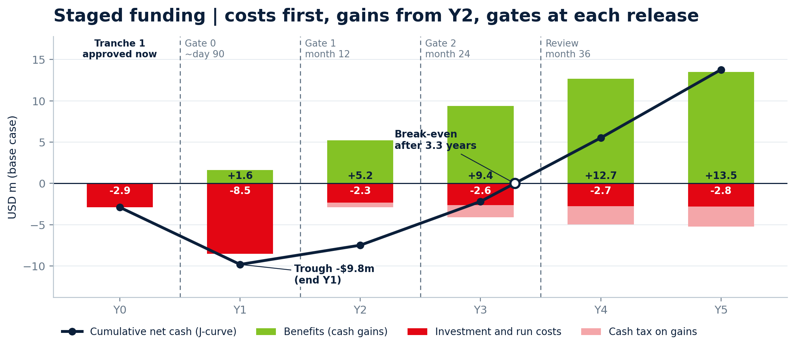

# Accelerating AI value across TotalEnergies

**To:** Chief Executive Officer and Board of Directors | **From:** Digital transformation team | **Date:** 11 November 2026 | **Decision requested:** 16 November 2026

<!-- kpi -->

| Decision today | Five-year envelope | Expected NPV at 10% | Expected IRR | Downside NPV |
| :---: | :---: | :---: | :---: | :---: |
| $2.90m | $21.94m | +$5.62m | 27.8% | −$1.30m |
| Tranche 1 (Y0) | ceiling, released by gates | 30/50/20 scenarios | vs 10% hurdle | 30% probability |

## 1. Decision

**Invest $21.94m over five years (Y0–Y5) in ten AI initiatives run by dedicated branch–Digital Factory teams, to create an expected NPV of $5.62m at 10% (IRR 27.8%), with a downside NPV of −$1.30m, only $2.90m committed before the first gate, and every later release conditional on Finance-verified gates.**

TotalEnergies already runs more than 10,000 AI models and about 100 Digital Factory solutions; we are at the implementing stage, approaching scale. What slows value is how project work is organised: each project is split across four reporting lines (branch project lead, branch data engineer, TDF data scientist, end user), so iterations are slow and each lead steers few projects. Each year of delay costs $0.65m of NPV. **We ask for approval of Tranche 1 ($2.90m) at this meeting.**

## 2. Portfolio

| Initiative | Horizon | Cost Y0–Y5, $m | Value lever | Sourcing | Owner |
| --- | --- | ---: | --- | --- | --- |
| P01 Refinery predictive maintenance | H1 | 3.15 | Sold throughput, fewer emergency repairs | Blend | Refining sponsor |
| P03 Deepwater drilling advisory | H2 | 3.65 | Contractually avoidable rig payments | Buy and blend | Drilling sponsor |
| P12 e-SAF technology licensing | H3 | 2.85 | Third-party licence fees (conditional) | Partner | OneTech + commercial lead |
| P13 French retail demand and markdowns | H1 | 1.70 | Less waste, markdown margin, fewer stock-outs | Buy and blend | Retail sponsor |
| P02, P04, P05, P08, P09 | H1/H2 | 9.65 | Production, generation, licences, retention, fuel | Blend or existing tools | Branch sponsors |
| E01 Shared value and model controls | H1 | 0.94 | Register, baselines, controls | Reuse | Finance + Digital Line |

One-time investment splits **70.5% H1, 19.4% H2, 10.2% H3**, a deliberate 70/20/10 mix: reliability and cost gains on long-lived assets pay back fastest and fund the J-curve; H3 is a bounded option. No proprietary model is built.

## 3. Investment envelope

| $m | Y0 | Y1 | Y2 | Y3 | Y0–Y3 |
| --- | ---: | ---: | ---: | ---: | ---: |
| Compute and equipment | 0.87 | 1.71 | 0.46 | 0.48 | 3.52 |
| Talent and change | 0.72 | 2.14 | 0.58 | 0.63 | 4.07 |
| Integration | 0.58 | 2.14 | 0.35 | 0.32 | 3.38 |
| Model operations | 0.14 | 0.68 | 0.39 | 0.58 | 1.80 |
| Data engineering | 0.43 | 1.45 | 0.37 | 0.42 | 2.68 |
| Governance and legal | 0.14 | 0.43 | 0.16 | 0.21 | 0.95 |
| **Total** | **2.90** | **8.55** | **2.31** | **2.64** | **16.40** |
| of which capital expenditure | 2.90 | 2.80 | 0.00 | 0.00 | 5.69 |

Y1 is the build year (integration and talent 25% each); by Y3 model operations reach 22%. From Y4 the run cost is **$2.74–2.79m a year**, for **$21.94m** over Y0–Y5. Branches co-fund **40% of Y2 and 60% of Y3–Y5 run costs**.

## 4. Scenarios and expected value

| Scenario | Probability | NPV at 10%, $m | IRR | Cumulative cash Y5, $m | Response |
| --- | ---: | ---: | ---: | ---: | --- |
| Downside: slower adoption, 80–90% of benefits, 105–110% of costs, P12 stopped | 30% | −1.30 | 5.7% | +2.27 | Pause failing cases at Gate 1 |
| Base: planned adoption and benefits | 50% | +7.11 | 32.6% | +13.78 | Scale on verified results |
| Upside: 115% of benefits, faster ramp | 20% | +12.28 | 48.2% | +20.83 | Release capacity after cash is proven |
| **Expected** |  | **+5.62** | **27.8%** | +11.74 |  |

<!-- pagebreak -->

## 5. Return, break-even and cost of inaction

Our hurdle is **10%** (7% WACC + 3-point AI premium): the expected IRR of **27.8%** clears it by 18 points. Not investing is not neutral: avoiding part of the expected deterioration in refining margin, rig rates and customer churn is worth **$1.32m**, so the decision value is **$6.94m**. Half the budget (four featured cases, $11.35m) keeps a 34.8% base IRR but drops five cases.

## 6. Risks and stop rules

| Risk | Stop rule (metric, threshold, date, action) | Owner |
| --- | --- | --- |
| Value | No Finance-verified incremental benefit, or negative prospective NPV at the project hurdle, at month 12 → pause, redesign or stop | CFO + branch sponsor |
| Delivery | Contract does not allow capture of rig payments at Gate 0 (P03), or labels do not beat forecast-only at month 12 (P13) → stop that scope | Digital Factory lead + project lead |
| Trust and compliance | Any critical safety, cyber or privacy incident, or missing employee consultation → immediate pause until the control owner approves restart | General Counsel, DPO, HSE |
| People and adoption | Under 40% of eligible users active at month 6 → remediate or stop within 30 days; under 60% of decisions recorded in the tool at month 12 → no expansion | Branch sponsor + CHRO |
| H3 option | No IP clearance and two qualified developers by Y2, or no paid-evaluation interest by Y3 → stop; $0.10m closure | OneTech + commercial lead |

## 7. Delivery model and change

We keep **hub-and-spoke**: the Digital Line and Digital Factory own platforms and standards; branches own use cases and results. Inside each project, a **dedicated trio** (TDF data scientist, branch data engineer, business expert) reports day to day to the branch project lead and keeps line reporting for standards and careers. Objectives and gates are unchanged.

| Failure mode | Early warning | Owner |
| --- | --- | --- |
| Specialist shortage or attrition | Unfilled secondments, single points of failure | CHRO + Digital Factory lead |
| Managers cannot release experts | Protected time not met, low attendance | Branch sponsors |
| Governance lag | Consultation or clearance missing before release | General Counsel, DPO |
| Board impatience in the J-curve | Budget questioned before month 12 | CEO + CFO |

Weekly sessions with users, a monthly one-page dashboard to sponsors, quarterly gate reviews; training in three tiers (all affected staff, trio members and managers, executives).

## 8. The ask

1. **Approve the $21.94m five-year envelope** as a planning ceiling, not a commitment to deploy every project.
2. **Release Tranche 1 today: $2.90m (Y0)**, case by case after existing-solution, rights and safety checks.
3. **Gate 0 (about day 90)** releases Y1 ($8.55m) per case once its trio is staffed and Finance has signed its baseline.
4. **Gate 1 (month 12)** releases Y2 ($2.31m) against verified benefit, adoption thresholds, spend within 10% of plan and 40% co-funding.
5. **Gate 2 (month 24)** releases Y3–Y5 run funding only if annual benefits cover run costs and branches co-fund 60%.

**Decision date: 16 November 2026.**
