# Accelerating AI value across TotalEnergies

**Strategic proposal to the Chief Executive Officer and the Board | 11 November 2026**

**Prepared by the digital transformation team:** Alexandre Waerniers, Vincent Lamy, Yoni Mahieddine, Nahel Bachriri

*Fictional academic document for the AI Transformation Strategies course, Albert School. Not a TotalEnergies document.*

## Strategic context and recommendation

TotalEnergies already has substantial digital and AI capabilities. The OneTech Digital Line coordinates digital transformation with the branches, while the TotalEnergies Digital Factory (TDF) develops solutions with the businesses. Under Michel Lutz's Data & AI leadership, this shared expertise provides the benefits of a Centre of Excellence: specialised talent, common technical standards, reusable solutions and a basis for group-wide governance. Branches contribute their own operational expertise, and each AI project already has a branch owner. We build on this; we do not propose a new organisation.

What slows value is how project work is organised. Each project is split across four people who report to different managers: the branch project lead who leads it, a branch data engineer who does not report to that lead, a TDF data scientist who sets data-science rules but carries no financial objective, and the end user who expresses the need but has no decision power. Responsibilities are dispersed, progress reviews are spaced out and each lead can steer only a few projects at once. This is our insider's observation in one branch; the first pilots will measure how widespread it is.

We recommend a **strong hub-and-spoke model with a dedicated trio on each project**: a TDF data scientist, a branch data engineer and a business expert, working together for a large share of their time and reporting both to the branch project lead and to their own line managers. Objectives and continuation gates stay as demanding as today; the team simply works faster, in shorter cycles. Decision-makers can then run more projects in parallel, and AI know-how spreads into the branches through the people who build the solutions.

The investment portfolio puts this model to work: ten initiatives, four of them with detailed business, financial and adoption plans, funded in stages so that both cash outcomes and the delivery model are proven before expansion.

## Executive decision

**We ask the Board to approve a $21.94 million, five-year (Y0–Y5) envelope for ten AI initiatives delivered by dedicated branch–Digital Factory teams, expected to create $5.62 million of net present value at 10% ($7.11 million in the base case), with an immediate commitment limited to a $2.90 million first tranche and every later release conditional on Finance-verified gates.**

The envelope includes **$9.82 million of one-time investment** and subsequent operating costs. Amounts are planning assumptions, not approved budgets or committed supplier prices.

- **Base case:** $13.78 million of cumulative net cash by Y5, an IRR of **32.6%** and an NPV of **$7.11 million at 10%**.
- **Downside:** $2.27 million cumulative net cash by Y5, an IRR of **5.7%** and an NPV of **−$1.30 million**; cumulative cash falls to **−$11.5 million** at end Y1 before recovering.
- **Expected value** (30% downside, 50% base, 20% upside): NPV **+$5.62 million**, IRR **27.8%**, break-even after **3.4 years**. Including the avoided cost of inaction, the decision to invest is worth **$6.94 million** compared with not investing.

Cash flows are after tax and exclude terminal value. The H3 case (P12) relies on licence receipts that are not yet contracted.

We request approval of the envelope and of **Tranche 1 ($2.90 million, Y0)**, released project by project once existing solutions, rights, safety and baselines are confirmed. Later tranches follow Gate 0 (about day 90), Gate 1 (month 12) and Gate 2 (month 24). The envelope is not a commitment to deploy every project: a failed gate stops further avoidable spending. Branches co-fund from Y2 (40%) and Y3 (60%). Finance and each branch confirm staffing, costs and contractual rights before commitments are made.

**Proposed decision date: 16 November 2026.**

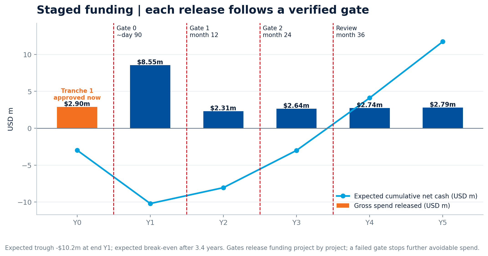

## 1. Starting point and readiness

TotalEnergies has already invested extensively in AI and digital tools. The 2025 Universal Registration Document describes nearly 100 Digital Factory solutions developed since 2020 and more than 10,000 live AI models. Industrial data programmes with AspenTech and Cognite provide foundations on which the proposed projects build. [2025 Universal Registration Document, pp. 39, 42–43](../../sources/primary/totalenergies_universal-registration-document-2025_2026_en.pdf).

Michel Lutz is TotalEnergies' Chief Data Officer and Head of Data & AI within the Digital Factory. His organisation is a natural partner in the proposed delivery model: common expertise, technical standards and reuse remain central assets, while project teams work more closely with the branches and their sites. [TotalEnergies, EnergyTalks, July 2026](https://www2.totalenergies.com/news/news/energytalks-ai-energy-hype-vs-real-impact).

### Readiness assessment

Our outside-in assessment scores five dimensions from 1 (exploring) to 5 (realising value at scale). It relies on public sources and our insider's observation; it is not an internal audit.

| Dimension | Score (range) | Starting position | Priority for this programme |
| --- | --- | --- | --- |
| Business strategy | 3 (3–4) | Four named AI priorities for 2026 and Board review of AI (CLM-024, CLM-025); no published AI budget or value target. | Link every project to an operating or commercial outcome that Finance can verify. |
| Technology and data | 3 (2.5–3.5) | More than 10,000 live models; AspenTech and Cognite industrial data rollouts until about 2027–2028 (CLM-017–019). | Use the data slice each project needs; verify rights, interfaces and site readiness before each pilot. |
| AI delivery experience | 3.5 (3–4) | About 100 Digital Factory solutions since 2020, 60% with AI (CLM-016, CLM-017); no published return per solution. | Turn solutions into measured cash outcomes faster and repeatably. |
| Organisation and culture | 2.5 (2–3) | Digital Line created in September 2025 (CLM-015); project work split across four reporting lines (CLM-074, local observation). | Dedicated project trios with dual reporting; protected expert time and backfill. |
| AI governance | 2.5 (2–3) | Principle of no fully autonomous decisions (CLM-026); no public model inventory or EU AI Act classification. | Shared model and value register (E01); controls cleared before each release. |

The group is at the **implementing stage, approaching scaling**. Strategy, data and expertise are strong; the dimension that holds value back is the **organisation of delivery**. Data access, value measurement and governance remain serious alternative constraints: during the first 90 days we compare actual lead times, data blockers and staffing with this diagnosis and adjust the intervention if the evidence points elsewhere.

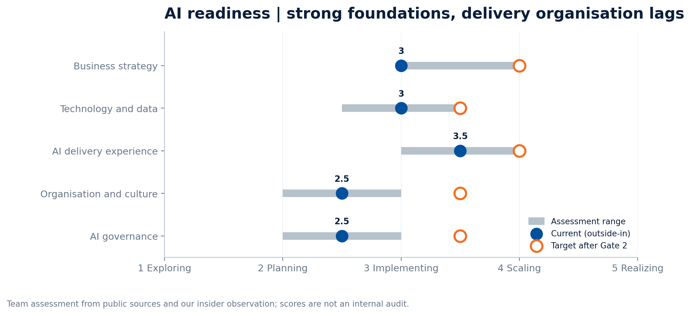

**Why now.** The data platforms are being rolled out and thousands of models already run. The return on these investments now depends on how quickly solutions reach daily operating decisions. Organising delivery around dedicated teams lets us capture that value without new platforms, and builds the delivery capacity the group will need as AI use grows.

## 2. Delivery model: dedicated project teams within a strong hub

### Where delivery slows today

Branches already own their AI projects. A branch project lead, usually the branch digital-transformation head, sponsors and leads each one. The difficulty is that the work is split across four people who share neither a reporting line nor an objective:

- **the branch project lead**, who carries the objective but directs none of the specialists;
- **the branch data engineer**, who reports to the branch IT/data organisation rather than to the project lead;
- **the TDF data scientist**, who sets data-science standards but carries no financial objective, and therefore works with the branch much like an external consultancy;
- **the end user**, who expresses the need and gives feedback but has no decision power over the solution.

Each contributes part-time and answers to a different manager. Progress reviews are spaced weeks apart, user feedback reaches the solution late, and each project lead can steer only a few projects at a time. This is our insider's observation in one branch (CLM-074). It is consistent with the group's own identification of the pace of organisational and skills adaptation as a material risk (URD p. 138, CLM-014). The first pilots measure how widespread it is.

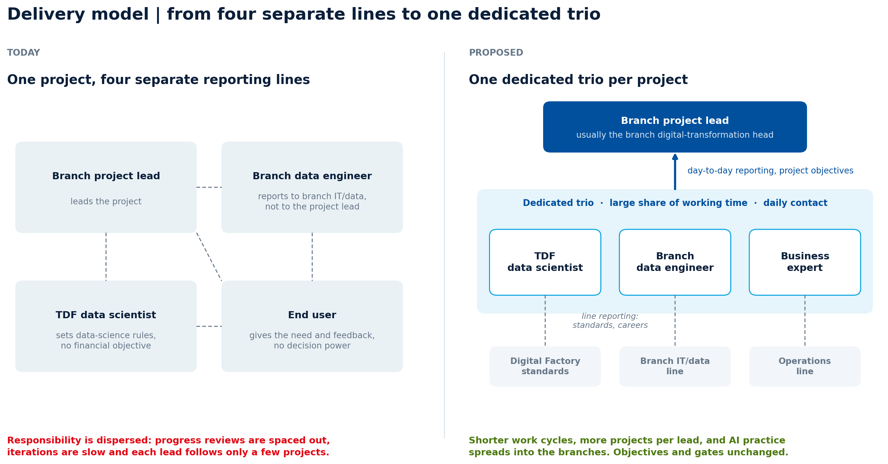

### The operating-model choice

A **centralised CoE** concentrates scarce AI talent, supports consistent standards and makes shared assets easy to reuse. A single delivery pool, however, can queue and become distant from site workflows as demand grows. A **federated model** gives branches autonomy but duplicates tools and skills and weakens group-wide control of models, risks and investments.

We keep the **hub-and-spoke** model that the group already has and strengthen it where it breaks: at the seam between hub specialists and branch teams. The Digital Line and Digital Factory remain the hub for architecture, security, AI expertise, shared tools and reuse. Branches remain accountable for use-case selection, operations and results. The change happens inside each project.

### Dedicated project trios

For each approved project we form a dedicated trio:

- a **TDF data scientist or AI engineer**, seconded to the project and working on site when that helps design and adoption;
- a **branch data engineer**, who secures data access, prepares the data and integrates the solution into local systems;
- a **business expert** from the operation that will use the solution, who represents users inside the team and helps embed the new workflow.

Each member spends a large share of working time on the project, at least half according to its needs and the availability of backfill, and the three work together daily. Each reports **day to day to the branch project lead** on project objectives and priorities, and keeps **line reporting** to their own manager for professional standards, methods and career. The Digital Factory continues to set data-science and security standards; the branch IT/data line continues to own systems.

**What changes.** Questions about the solution are settled inside the team in days rather than at the next steering meeting. The team works in short cycles, shows results to users frequently and adjusts quickly. The end user's view enters the team through the business expert, with real influence on design.

**What does not change.** Every project keeps the objectives, budget and continuation gates set by its sponsor and Finance. HSE, cyber, legal and employee-relations controls keep their veto. Operators retain operational decision authority.

**Why it raises capacity.** Coordination moves from the project lead's agenda into the team. Each lead and sponsor can steer more projects in parallel, so the group deploys more projects without adding management layers. Working side by side also spreads AI practice into the branches: data engineers and business experts learn how solutions are built and validated, and return to their teams as relays.

Each sponsor reserves the required capacity and identifies its cost, including travel, backfill and training, within the project envelope or reprices the case before approval. Finance joins at baseline and gate reviews.

**How we test the model.** In the four featured cases we compare with the existing delivery process: interval between progress reviews, lead time from approval to first live use, expert time actually available, number of projects per lead, user adoption and Finance-verified outcomes. If the main obstacle proves to be data access, a contract or another constraint, we adjust the intervention rather than simply adding teams.

### Decision rights and controls

| Decision | Accountable lead | Required participation |
| --- | --- | --- |
| Project objectives, scope and baseline | Branch project lead and branch sponsor | Finance, operations and Digital Factory |
| Day-to-day design and priorities | Project trio, reporting to the project lead | Users and site teams |
| Data-science standards, security and reuse | Digital Factory technical lead and branch IT/data lead | Site security and relevant platform owners |
| Operational release | Site or business operations lead | Users, HSE, cyber, legal and employee representatives as applicable |
| Value verification and further funding | Branch sponsor and Finance | Project lead and portfolio steering group |
| Stop, redesign or scale | Portfolio steering group | Sponsor, Finance and relevant control owners |

Human operators retain operational decision authority. Unsafe or non-compliant solutions do not proceed, regardless of the projected return.

## 3. Portfolio and investment priorities

The portfolio combines operational improvements (**H1**), redesigned cross-functional workflows (**H2**) and a conditional external-business option (**H3**). P12 qualifies as H3 only if it establishes a genuinely new external licensing proposition; improving an internal research workflow alone would not.

| Initiative | Horizon | One-time investment, $m | Gross Y0–Y5 cost, $m | Main value mechanism |
| --- | --- | ---: | ---: | --- |
| P01 — Refinery predictive maintenance | H1 | 1.40 | 3.15 | More sold throughput and fewer emergency repairs |
| P02 — Upstream production surveillance | H1 | 0.90 | 2.23 | Avoided production deferment on distinct eligible assets |
| P03 — Deepwater drilling advisory | H2 | 1.40 | 3.65 | Contractually avoidable rig payments |
| P04 — Renewable fleet performance | H1 | 1.40 | 2.70 | Recover eligible generation through earlier fault resolution |
| P05 — Copilot workflow and licence management | H1 | 0.30 | 0.73 | Cancellation of eligible redundant licences |
| P08 — Customer retention | H1 | 1.50 | 2.95 | Retain profitable energy customers through targeted support |
| P09 — LNG voyage optimisation | H2 | 0.50 | 1.04 | Lower controllable fuel invoices |
| P12 — e-SAF technology licensing | H3 | 1.00 | 2.85 | Conditional third-party technology fees |
| P13 — Retail demand and markdowns | H1 | 1.12 | 1.70 | Lower waste, incremental markdown margin and stock-out recovery |
| E01 — Shared value and model controls | H1 | 0.30 | 0.94 | Shared control capability; no separate benefit booked |
| **Total** |  | **9.82** | **21.94** |  |

P13 is modelled in euros and translated at $1.1165/€; totals may differ by rounding.

**Horizon mix.** One-time investment splits **70.5% H1, 19.4% H2 and 10.2% H3** (E01 within H1); on total five-year spending the split is **65.6% H1, 21.4% H2 and 13.0% H3**. The weight on H1 is deliberate: TotalEnergies operates long-lived industrial assets where reliability, uptime and cost improvements pay back fastest and fund the J-curve. H2 changes cross-functional workflows where contracts allow cash capture. H3 is a bounded option: if P12 fails its gates, its spending stops and H3 falls to its sunk cost.

**Scale.** At $22 million the programme is deliberately small relative to the group. Its purpose is to prove that dedicated teams deliver measurable cash faster. If Gate 2 confirms it, the same model extends to further sites and branches through separate investment cases.

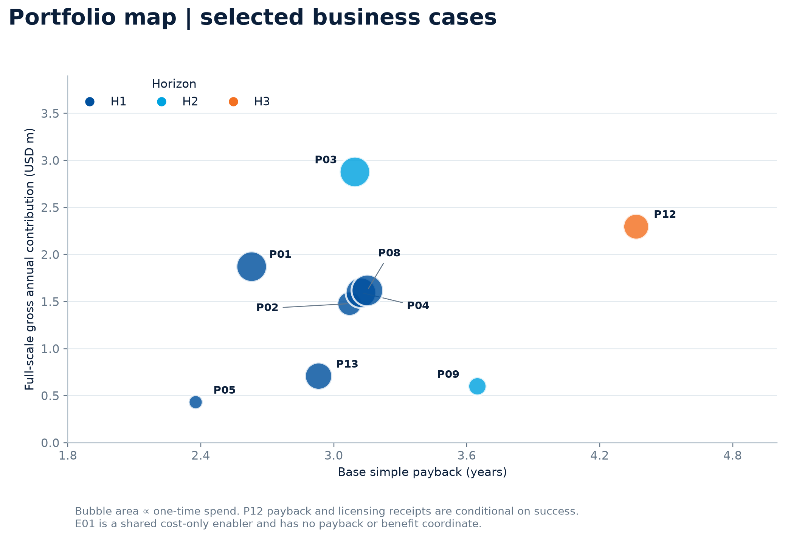

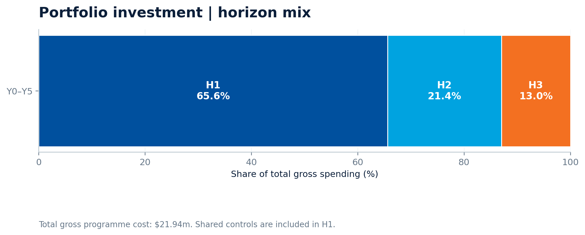

P02, P05 and P09 are complementary estimates rather than fully developed investment cases. P02 assumes two production hubs with 135 barrels per day of eligible recovered production each and $15 per barrel of incremental contribution; it is kept separate from P03 drilling events. P05 assumes 10,000 paid licences, 12% cancellable, at $30 per month; procurement confirms cancellation rights and whether users need alternatives. P09 assumes 30 eligible voyages, $1 million of controllable fuel per voyage and a 2% improvement; charter terms and savings over existing routing are checked. Each requires a business-owner baseline before commitment.

P04 targets an illustrative 3,000 MW of eligible renewable assets: `3,000 MW × 8,760 hours × 30% capacity factor × 0.45% incremental generation recovered × $45/MWh net value` gives **$1.597m/year** at full rollout, incremental to existing monitoring and within the company's economic entitlement. P08 targets 1.2 million eligible power or gas accounts: `1.2m × 10% annual churn × 9% relative reduction × $150 annual contribution` gives **$1.62m/year** at full rollout, net of customer incentives; a control group establishes incremental retention.

P04 and P08 cost **$2.70m** and **$2.95m** over Y0–Y5. At their project hurdles, base NPVs are **+$1.05m** and **+$0.99m**, with simple paybacks of **3.12** and **3.15 years**; downside paybacks are **4.34** and **4.52 years**. The [complementary project cards](../../work/projects/reserve_cards.md) detail the assumptions and gates.

### Portfolio ownership, sourcing and dependencies

The roles below are proposed accountable functions, subject to appointment. Dependencies are checked before each case is released; shared controls are funded once through E01.

| Initiative | Business owner / sourcing | Dependency before release |
| --- | --- | --- |
| P01 | Refining sponsor / blend | Eligible site data and reliability workflow |
| P02 | Upstream sponsor / blend | Production access and distinct events |
| P03 | Drilling sponsor / buy and blend | Contract terms and avoidable rig payments |
| P04 | Renewables sponsor / blend | O3C and OEM baseline, entitlement and saleability |
| P05 | Corporate IT and procurement / existing tools | Licence and cancellation rights |
| P08 | Customer business sponsor / blend | CRM access, privacy and controlled test |
| P09 | LNG operations sponsor / buy and blend | Routing baseline, charter rights and fuel invoices |
| P12 | OneTech and commercial lead / partner | Lab access, IP rights and external demand |
| P13 | Retail sponsor / buy and blend | POS access, stock and pricing rights |
| E01 | Finance and Digital Line / reuse | Existing governance tools and named owners |

**Sourcing of the featured cases.** We score six factors from 1 (buy from the market) to 5 (build in-house). An average between 2 and 4 points to a blend of market tools, partners and our own data and expertise.

| Factor | P01 | P03 | P12 | P13 |
| --- | ---: | ---: | ---: | ---: |
| Strategic differentiation | 3 | 3 | 5 | 2 |
| Proprietary data | 4 | 4 | 4 | 3 |
| Time-to-market (5 = can wait) | 2 | 2 | 4 | 2 |
| In-house skills | 3 | 2 | 3 | 3 |
| Regulatory and safety control | 3 | 3 | 4 | 2 |
| Cost at scale (5 = cheaper in-house) | 2 | 2 | 2 | 2 |
| **Average and decision** | **2.8 — blend** | **2.7 — buy and blend** | **3.7 — partner** | **2.3 — buy and blend** |

No case justifies building a proprietary model. P12 is the closest to build because its value lies in proprietary IP; laboratory partners reduce its cost and risk.

### Spending and funding sequence

Capital expenditure is separated from operating and launch expense; both are in the gross envelope. Amounts in $m; tax is excluded from the cost envelope and included in net cash flows.

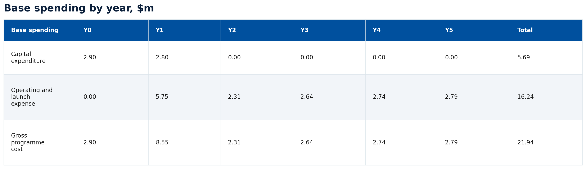

The one-time $9.82m includes $5.69m of assumed capital expenditure and $4.12m of launch expense; recurring operating costs total $12.12m.

**Why five years.** TotalEnergies operates long-cycle industrial assets with a moderate pace of disruption; maintenance, drilling and retail benefits ramp over two to three years and are only visible over five. On a three-year view (Y0–Y3), spending is **$16.40m**. From Y4 the programme runs at **$2.74m–2.79m a year**, almost entirely recurring software, cloud, support and model operations.

**Branch co-funding.** Y0–Y1 are funded centrally to set up the teams and prove the first results. Branches then co-fund **40% of Y2 costs** and **60% of Y3–Y5 run costs** of their projects, confirmed at Gate 1 and Gate 2. Projects a branch will not co-fund do not continue.

### Programme tranches and gates

| Gate | Timing | Evidence required | Owner | If not met |
| --- | --- | --- | --- | --- |
| Tranche 1 | Approval, 16 November 2026 | Up to $2.90m (Y0) released case by case after existing-solution, rights and safety checks | CEO and CFO | Case not released |
| Gate 0 | About day 90, before Y1 commitments ($8.55m) | Every launched case has a staffed trio with reserved time, a Finance-signed baseline and value formula, data rights and a cost build; required employee consultation complete | Branch sponsors and Finance | Case not released; its envelope is held |
| Gate 1 | Month 12, before Y2 releases ($2.31m) | User-facing pilots: at least 60% of eligible decisions recorded through the tool; at least three cases with Finance-verified incremental benefit against baseline; no unresolved critical safety, cyber or privacy issue; spend within 10% of plan; branches confirm 40% co-funding | CFO and portfolio sponsor | Pause failing cases; redesign within the envelope or stop |
| Gate 2 | Month 24, before Y3 run funding | Verified annual benefits at least equal to annual run costs at portfolio level; positive prospective NPV for each continuing case; branches confirm 60% co-funding | CEO, CFO and branch heads | Stop or resize cases; no extension of the delivery model |

Portfolio steering reviews the cash forecast quarterly. A stop does not recover sunk or non-cancellable costs. The project-level gates in Section 4 apply within this structure.

### Cost allocation by category

We classify each year's gross spending into six cost categories. Y1–Y3 form the three-year operating view; Y0 is the decision period and is shown separately. Cost owners replace these planning shares with staff, procurement and contract evidence before release. Compute and equipment include physical assets such as retail labels; talent includes training and backfill.

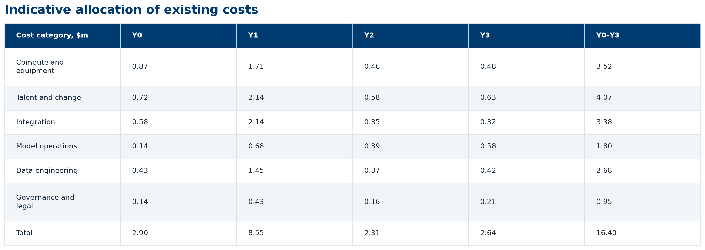

Integration and talent dominate Y1 (25% each); by Y3 model operations rise to 22% and governance to 8%, as the portfolio moves from build to run. The [calculation](../../work/finance/category_allocation.py) retains the unrounded amounts.

### Portfolio economics

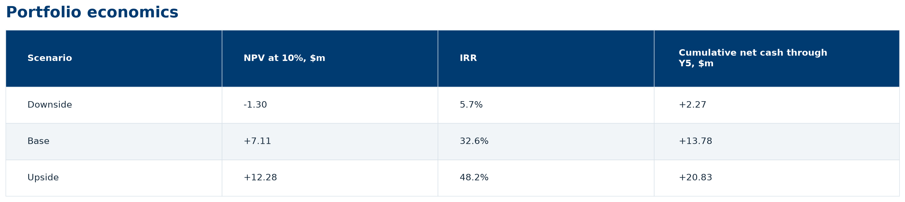

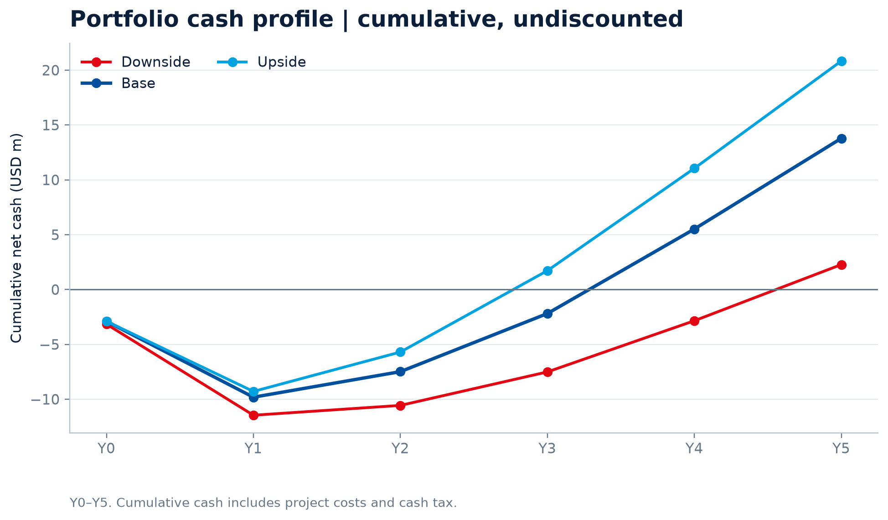

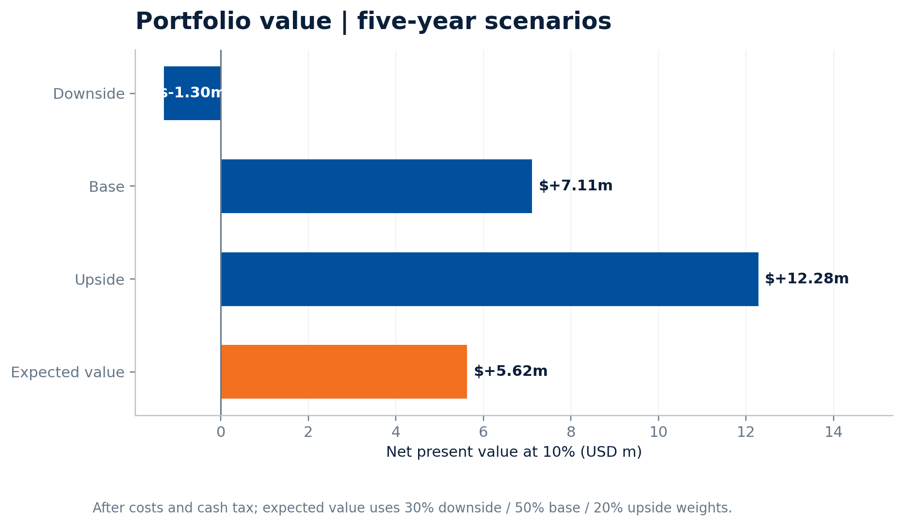

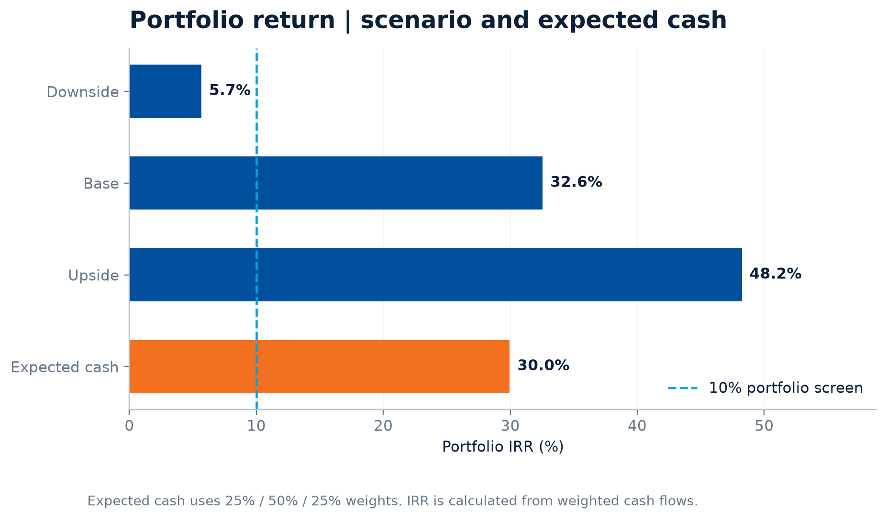

With scenario weights of **30% downside, 50% base and 20% upside**, the expected NPV at 10% is **+$5.62m** and the IRR of expected cash flows is **27.8%**, nearly three times the 10% screen.

**J-curve.** Cumulative cash reaches its low point at the end of Y1: **−$9.8m** in the base case, **−$10.2m** in expectation and **−$11.5m** in the downside. It turns positive during Y4: after **3.3 years** in the base case, **3.4 years** in expectation and about **4.6 years** in the downside. This is the capital genuinely at risk. Tranche 1 commits only $2.90m; the Y1 tranche, which drives the trough, is released case by case at Gate 0, after baselines are signed.

**Downside.** The downside remains cash-positive by Y5 (+$2.27m) but does not clear the 10% screen (NPV −$1.30m, IRR 5.7%). It includes a stopped, loss-making P12. In the base case we scale only on verified adoption and prospective economics; in the upside we release capacity only after operational and cash benefits are demonstrated.

**Discount rate.** The company reported a 7% post-tax WACC for its 2025 impairment tests; we add a 3-percentage-point AI execution-risk premium to reach a 10% portfolio screen. Project cases use their own hurdles (9% to 12%). The model assumes 25% cash tax, straight-line depreciation of capital assets and no immediate credit for annual losses.

### If the budget is cut

The four featured cases are the priorities: P01, P03, P12 and P13. Their combined full-scope gross cost is **$11.35 million**, or **51.7%** of the $21.94 million full portfolio. Their base and downside IRRs are **34.8% and 6.4%** respectively. This is our approximately half-budget option. The four-case calculation excludes E01: essential shared controls must be provided from existing capabilities or funded separately. The 34.8% and 6.4% IRRs apply to the four cases as modelled; these costs and returns do not include an additional E01 allocation.

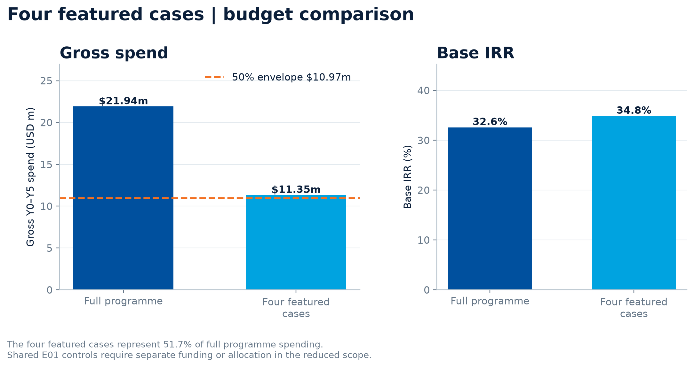

### Cost of inaction and decision value

Our project cases are valued against today's operating performance. Not investing would not keep that performance unchanged. From Y2 we expect three exposures to grow:

- the refining margin lost with each unrecovered barrel, assumed to rise by $1 per barrel (P01 sites);
- avoidable rig spread costs, assumed to rise by $0.05m per day (P03 campaigns);
- customer churn among 1.2 million eligible accounts, assumed to rise by one percentage point (P08).

The proposed projects absorb part of each increase: at full adoption they protect an additional **$0.29m, $0.36m and $0.16m a year**. Weighted by our scenarios, after tax and discounted at 10%, this avoided loss is worth **$1.32m**. Investing therefore creates **$6.94m of decision value** compared with not investing: $5.62m from the projects themselves and $1.32m from avoided deterioration. Project returns in this report exclude this amount; we track the three exposures as leading indicators.

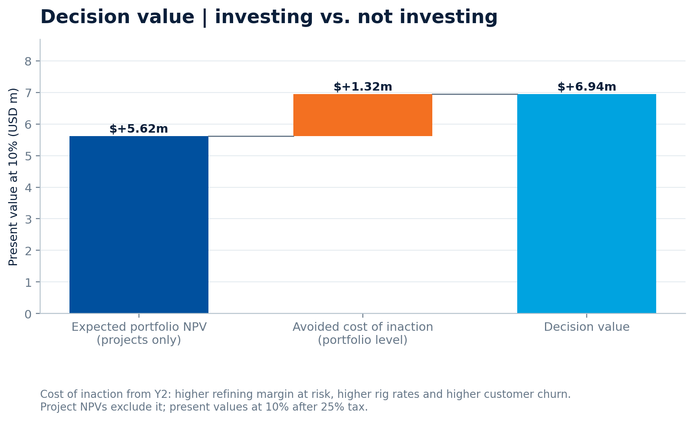

Delaying the same programme by one year would reduce the base NPV from $7.11m to $6.47m, a **$0.65m** cost of waiting at 10%. Peers are moving: Equinor reports predictive-maintenance value since 2020 and BP has published digital well-planning gains. These examples show what is achievable; they do not establish a measured TotalEnergies gap or lost market share.

### Cost composition of the four featured cases

Planning allocations within the modelled envelopes, not additional costs or supplier quotations. Hardware/software, integration and training are one-time; run costs cover Y1–Y5. Internal staff and site backfill are included in the allocated lines, subject to capacity confirmation.

| Case and currency | Capitalised hardware, software and integration | One-time launch, integration and training | Recurring operating costs, Y1–Y5 | Total gross cost |
| --- | --- | --- | --- | ---: |
| P01 ($m) | Equipment and software 0.55; integration 0.45 | Implementation 0.20; training and backfill 0.20 | Software and cloud 0.65; data and technical support 0.70; site support and backfill 0.40 | 3.15 |
| P03 ($m) | Software 0.35; integration 0.45 | Commissioning 0.30; contractor onboarding 0.15; training and backfill 0.15 | Software and cloud 0.80; contractor support 0.80; data engineering 0.45; business support 0.20 | 3.65 |
| P12 ($m) | Lab/data equipment 0.30; software and integration 0.30 | Experimental design 0.10; IP and commercial work 0.15; lab setup 0.15 | Laboratory work 0.75; technical support and compute 0.55; IP and commercial work 0.35; business support 0.20 | 2.85 |
| P13 (€m) | Labels and hardware 0.65; connectivity/software 0.15 | Installation and integration 0.10; training and backfill 0.10 | Software and cloud 0.20; maintenance 0.16; store support and training 0.16 | 1.52 |

P13's €1.52m converts to approximately $1.70m. P12 remains a limited research envelope; it does not fund a demonstration plant. Procurement, seconded staff, backfill and support commitments are validated before release, and a case is repriced if the required work exceeds the allowance.

## 4. Four featured investment cases

Each case sets out the decision, the existing capability, the value mechanism, the costs, the cash flows by scenario and the gates. Figures are scenario assumptions validated operationally, contractually and financially at each gate. Project returns are standalone: they exclude the portfolio-level cost of inaction.

### P01 — Refining predictive maintenance (H1)

#### 1. Decision, problem and existing capability

**Proposal:** Pilot predictive maintenance on critical rotating equipment at two eligible refining sites, then extend within those sites only when operations and Finance confirm value. Asset and site selection are **assumptions** pending validation. TotalEnergies is already deploying AspenTech's industrial data platform (CLM-018) and has existing maintenance processes; both belong in the counterfactual. We fund an incremental workflow and interventions only where they are not already delivered.

**Problem [Hypothesis]:** Certain unplanned equipment stops lead to lost margin and avoidable emergency repairs. The number of preventable outages, eligible machines and economic contribution of the sites are unknown. A data platform or an anomaly alert alone does not create value: a verified alert must lead to a safe maintenance action that changes the baseline outcome.

#### 2. Alternatives, horizon and sourcing

| Option | Decision |
| --- | --- |
| Existing scheduled and condition-based maintenance | Counterfactual. Compare the proposed system against existing monitoring and documented maintenance activity. |
| Improved manual thresholds and reliability review | Benchmark on the same machines; use this simpler approach if it achieves comparable results at lower cost. |
| Vendor APM plus site-owned integration and maintenance workflow | Working proposal: buy/partner for tools, integrate with existing data and build the site workflow. Contracts and current licences are checked. |

**H1 [Judgment]:** Optimises existing refining operations using an established class of maintenance tools. No new enterprise-wide data lake is assumed.

#### 3. Perimeter and benefit drivers

All parameters below are **assumptions**, not published TotalEnergies site performance. The two sites' actual throughput, ownership share, production constraints and incremental contribution margin are verified before release.

| Annual driver at full rollout | Assumption | Calculation / limit |
| --- | --- | --- |
| Eligible combined refining throughput | 250,000 barrels/day | Two eligible sites combined; a scope assumption, not a factbook site figure. |
| Effective days | 365/year | Applied to the stated daily throughput; confirm whether baseline throughput already includes downtime. |
| Incremental throughput recovery | 0.45% | Improvement over existing maintenance, not all site outages. |
| Additional output sold | 70% | Capacity and market constraint; verify the actual bottleneck and product demand. |
| Incremental contribution margin | $6/barrel | Working assumption, not TotalEnergies' realised margin; the published ERM is a market marker (CLM-063). |
| Avoided emergency repair cost | $0.150m/year | Count only invoices not already captured in throughput or existing budgets. |

Full-scale gross benefit = `250,000 × 365 × 0.0045 × 0.70 × $6 + $150,000` = **$1.8746m/year [Calculation on assumptions]**. The scope is two assumed sites, not all group throughput. Equinor's reported $120m since 2020 (SRC-017 / CLM-036) is a cumulative contextual benchmark and does not prove this annual amount.

#### 4. Costs, schedule and assumptions

Amounts **$m**, nominal. Y0 is the late-2026 decision point and Y1–Y5 the following annual periods. Total one-time investment: **$1.4m**, comprising $1.0m capitalised hardware/software ($0.5m in Y0 and $0.5m in Y1) and $0.4m implementation/training expensed in Y1. Recurring operating and support costs are $0.20m, $0.35m, $0.40m, $0.40m, $0.40m in Y1–Y5.

Pilot benefit ramp is 20%, 60%, 85%, 100%, 100%. Tax assumes a 25% rate, five-year straight-line depreciation on the $1.0m of capital assets from Y1, and no immediate tax credit on annual losses. No terminal value or expansion beyond the assumed perimeter is included.

#### 5. Cash flows and scenarios

Downside assumes 80% of full-scale benefits, 110% of investment and operating costs, and a slower 15% / 50% / 80% / 100% / 100% benefit ramp. Upside assumes 115% of full-scale benefits and accelerates the base ramp by 15%, capped at 100%, at base costs. The project hurdle is 9.5%.

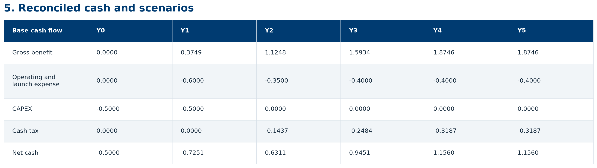

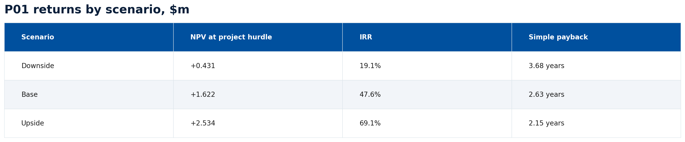

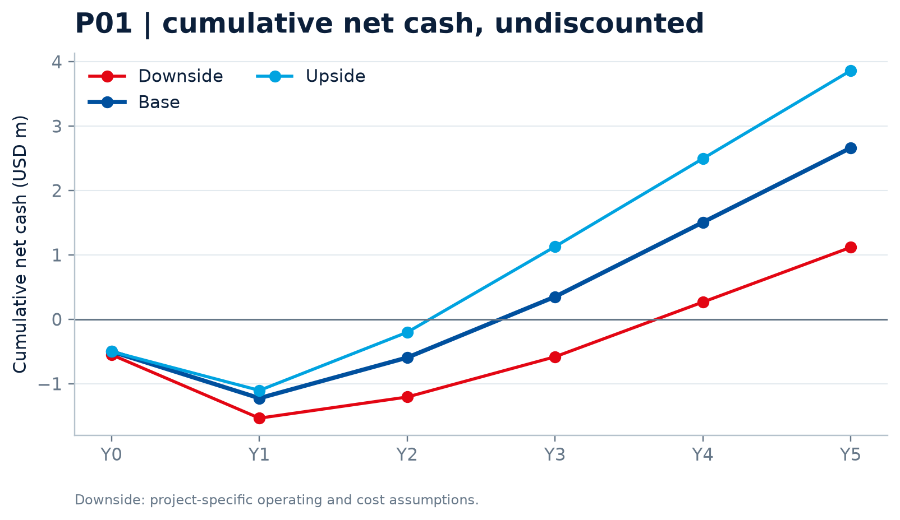

#### 6. Gates, adoption and risk

1. **Before pilot:** site reliability owner, Finance and IT establish existing solutions, eligible equipment and production baseline, data rights and the $1.4m spend split. Agree the alert metric, false-alarm tolerance and comparable maintenance baseline before live testing.
2. **Pilot review:** reliability engineers validate actionable alerts, safe intervention and actual production/repair economics; Finance checks whether incremental throughput was sold. Pause on safety issues; retrain or stop on missed pre-agreed performance thresholds.
3. **Expansion:** the sponsor releases further spend only if the **future** incremental case clears the hurdle and the site adoption and security conditions are satisfied. A stop leaves sunk and non-cancellable costs in the programme.

**Margin of safety [Calculation]:** with base costs, tax and ramp unchanged, the five-year NPV at 9.5% reaches zero at about **$1.080m/year at full scale**, 57.6% of the modelled $1.8746m. At each gate the decision uses only remaining cash commitments and attainable benefits.

The reliability team retains intervention authority; operators and maintenance staff take part in design and receive funded training. Cybersecurity, safety, data completeness and licensing scope are gating conditions.

#### 7. Operational workflow and evidence plan

Select critical rotating equipment with the site reliability team and document the existing inspection programme, historical events and process constraints. Establish whether sensor and maintenance records can be joined at equipment level; where they cannot, repair only the interfaces needed for the pilot. The project trio reviews alert logic with the site experts. Alerts enter the existing maintenance workflow; a reliability engineer assesses severity, maintenance windows and false alarms. No model directs an automatic shutdown or bypasses safety procedures.

Before testing, Finance and operations agree comparable equipment and a period adjusted for maintenance schedules and production conditions. The evaluation follows the complete chain: eligible alert → verified failure mode → action taken → avoidable stop or repair → additional saleable throughput or paid invoice avoided. Alerts without intervention and missed events are logged. Additional output is valued at actual incremental contribution, net of planned maintenance, demand or other bottlenecks; repair invoices are compared separately so that no event is counted twice. The sponsor stops expansion if safe action, data quality or prospective economics are inadequate; a good prediction score alone is not a return.

#### 8. Sources and validation

- TotalEnergies 2025 URD: refining throughput CLM-052 and existing data initiatives CLM-018; no claim that the assumed two sites have 250 kb/d.
- Market ERM is contextual only, CLM-063; the $6/b incremental contribution is not a TotalEnergies actual.
- Equinor SRC-017 / CLM-036: $120m cumulative predictive-maintenance value since 2020, including partners; not an annual peer amount.
- Discount rate: `work/finance/discount_rate_policy.md`.

### P03 — Deepwater drilling advisory (H2, provisional)

#### 1. Proposal and starting point

**Proposal:** Test a human-supervised planning and drilling advisory workflow across **two eligible operated deepwater rigs or campaigns**. Identify the operated assets and obtain agreement from the operator, drilling contractor and relevant partners before committing to a pilot. Existing Cognite deployments and drilling practices remain in the counterfactual (CLM-019); only incremental capability and cash count.

**Fact:** Mero is operated by Petrobras; TotalEnergies' reported interest was 19.3% in the 2025 announcement (SRC-037, CLM-077). This case therefore does not assume unilateral deployment at Mero, nor apply the 19.3% figure to a different contract.

**Problem [Hypothesis]:** Better use of well and drilling data may reduce non-productive time. A faster operation does not automatically save cash: the contract must permit an earlier rig release, reduce variable charges or create another documented financial benefit. BP's published well-planning example is context, not proof of a TotalEnergies gap or saving (CLM-068).

#### 2. Alternatives, horizon and delivery

| Option | Assessment |
| --- | --- |
| Existing drilling workflow | Counterfactual, including existing engineering and contracted tools. |
| Improved manual or rules-based planning | Benchmark using the same wells, staff and contractor terms. |
| Commercial drilling tools alone | Consider existing contract features and compare total costs, data rights and actual incremental gains. |
| Blended advisory workflow | Working proposal: integrate existing data and proven software with company drilling expertise, with no autonomous steering. |

**H2 [Judgment, provisional]:** A cross-functional redesign of the well-planning and operational workflow. HSE and drilling experts retain operational authority.

#### 3. Scope and incremental benefit formula

**Annual assumptions at full scale:** two eligible operated rigs/campaigns; six avoidable rig-days per rig per year; $0.400m/day fully avoidable gross spread cost; 80% assumed economic share × 75% payment avoidability = 60% combined realisation. These are **not verified company figures**. If the actual economic share is 40%, otherwise unchanged benefit halves to $1.440m/year, below the approximately $1.660m break-even level.

`2 rigs × 6 days/rig/year × $0.400m/day × 60% = $2.880m/year` gross incremental cash **[Calculation on assumptions]**. Invoices, rate composition, rig release rights, partner allocation and existing savings plans are verified. Time saved without a reduced payment is reported as capacity or schedule value, not as this cash benefit.

#### 4. Costs, data and timing

Amounts **$m**, nominal. The one-time investment is **$1.4m**: $0.8m assumed capitalised integration/software ($0.4m Y0 + $0.4m Y1) and $0.6m of one-time integration, commissioning and training expense in Y1. Recurring software, data engineering, contractor support and run cost are $0.30m, $0.45m, $0.50m, $0.50m, $0.50m in Y1–Y5.

Benefit ramp: 0%, 30%, 70%, 100%, 100% in Y1–Y5: a pilot followed by conditional release, not autonomous operation. The model assumes 25% cash tax, straight-line depreciation of $0.8m over five years from Y1 and no immediate credit for annual losses; jurisdiction, ownership and tax terms are confirmed before release.

**Hard dependencies:** rights to selected drilling data, contractor integration, operator consent, a safely bounded advisory workflow and Finance access to invoices. The well engineering lead and contractor representatives own validation.

#### 5. Cash flows and scenarios

Downside assumes 80% of full-scale benefits, 110% of investment and operating costs, and a slower 0% / 25% / 60% / 90% / 100% benefit ramp. Upside assumes 115% of full-scale benefits and accelerates the base ramp by 15%, capped at 100%, at base costs. The project hurdle is 11%.

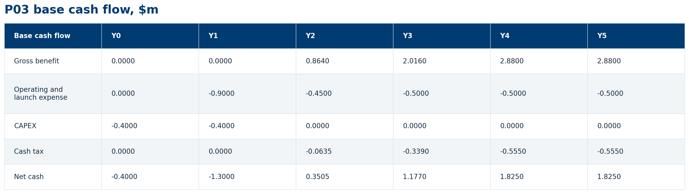

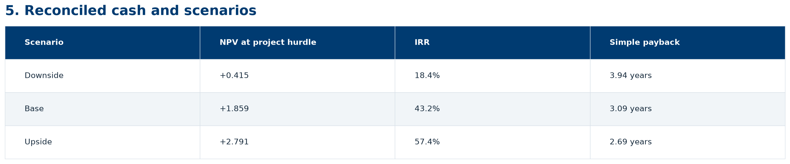

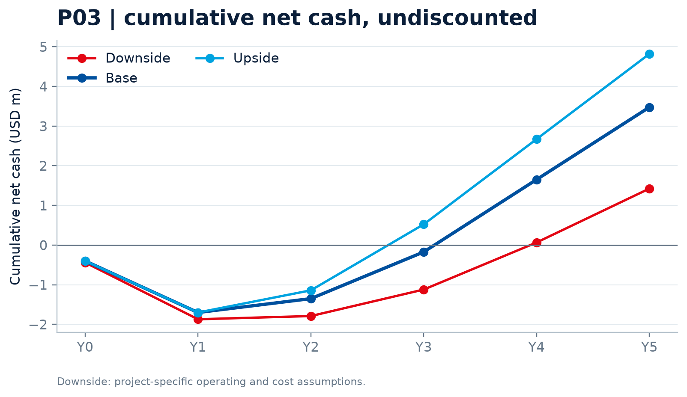

#### 6. Operational workflow and evidence plan

The drilling lead selects eligible campaigns and obtains operator, partner and contractor agreement before any data transfer. The project trio combines approved historical well data, engineering records and contractor inputs to surface advisory recommendations for planning and execution. The drilling engineer and contractor assess each recommendation within existing HSE and well-control procedures; operational authority and the right to reject a recommendation remain unchanged.

Before the pilot, we establish comparable well phases and the existing planning and non-productive-time baseline, with geological and operational differences recorded. For each recommendation, the evidence trail runs from planned activity to actual rig days and then to the contract clause and invoice. Finance counts a benefit only when a shorter period actually reduces a payment or creates another documented cash effect, adjusted once for the group's economic interest. If the contract prevents capture, the tool duplicates an existing capability, or the remaining cash flows fail the 11% hurdle, the sponsor pauses expansion and decides to redesign or stop.

#### 7. Sources and validation

- SRC-037 / CLM-077: Mero operator and 2025 participation; not evidence of an operated two-rig scope.
- SRC-008 / CLM-019: Cognite partnership and announced deployment scope; not proof that selected rigs or the advisory tool are ready.
- SRC-025 / CLM-068: BP's well-planning example; no TotalEnergies saving can be inferred.
- Project hurdle: `work/finance/discount_rate_policy.md`. The decisive question is whether rig-day savings reduce payments under the actual contract.

### P12 — AI-assisted e-SAF technology licensing option (H3)

#### 1. Decision and business-model hypothesis

**Decision:** fund a staged experiment towards a third-party technology business, reusing the catalyst research concept and its existing cost envelope. We do not approve a production plant; commercial receipts depend on technical and market gates.

**Business model:** combine AI-assisted catalyst/process discovery with a licensable process package for independent e-fuel developers. The buyer is a third-party plant developer; consideration would be development fees, technology royalties and technical support, rather than only margin on fuel produced in company-owned plants. Pricing, addressable buyers, IP ownership and technical differentiation are not yet established. The base scenario includes receipts conditional on those assumptions and on the gates below.

#### 2. Existing capability and why AI

TotalEnergies already has CO2 Techno Hub, BioHub and SAF research partnerships; we do not create those capabilities again. Infinium describes a third-party technology licensing arrangement in Southeast Asia; that establishes a possible commercial structure, not demand for a competing TotalEnergies package. Before spending, we map existing TotalEnergies licensing, partner IP and funded e-fuel research. If the project merely improves an internal fuel-production process or duplicates an existing offer, its H3 thesis fails and it is stopped or reclassified.

**Why AI:** rank candidate formulations and experiments using uncertainty-aware models, then validate with physical tests, compared with conventional design of experiments on the same laboratory budget. Prediction accuracy alone is not an investment milestone. We blend existing research infrastructure, specialist laboratory partners and commercial/IP expertise; no new foundation model or plant construction is funded.

**H3 rationale:** the transformation is a technology-licensing revenue model serving external developers. The laboratory work is the means; the new revenue model is the reason for H3.

Sources: [TotalEnergies innovation and existing research](https://totalenergies.com/company/strength/innovation-rd); [Infinium projects, Southeast Asia licensing](https://infinium.energy/projects), accessed 10 November 2026; [H3 evidence note](../../sources/synthesis/2026-11-10_h3_licensing_option.md).

#### 3. Costs and gates

**Costs [Assumptions]:** $0.30m CAPEX in Y0, $0.30m CAPEX and $0.40m launch expense in Y1; recurring Y1–Y5 costs of $0.20m / $0.30m / $0.40m / $0.45m / $0.50m. Total gross ceiling **$2.85m**: a feasibility and laboratory envelope, not funding for certification, a demonstration plant, industrial warranties or full commercialisation. Existing laboratory access is a hard condition; the $0.40m launch allowance covers commercial/IP work and experiment design, or the case is repriced.

**Gates:** before Y0, OneTech and Legal establish non-duplication, data and licensing rights. Before Y2, at least two qualified third-party developers agree to discuss a defined application and benchmark. Before Y3, three independent experimental runs show a repeatable result against a pre-registered improvement target, a preliminary freedom-to-operate assessment is complete and at least one developer documents willingness to enter a paid evaluation. If any condition fails, avoidable spending stops; spent cash and a $0.10m closure allowance remain. No industrial scale-up follows automatically from a laboratory pass.

#### 4. Cash flows and scenarios

The base scenario assumes gross licence-related receipts of **$0.60m in Y3, $1.50m in Y4 and $2.30m in Y5**, contingent on the technical, IP and commercial gates; they are not signed contracts. Upside applies 115% to the full-scale receipt and accelerates the ramp by 15%, capped at 100%. In the downside the experiment stops after Y2, receives no commercial income, incurs 110% of pre-stop costs and a $0.10m closure cost in Y3. The project hurdle is 12%.

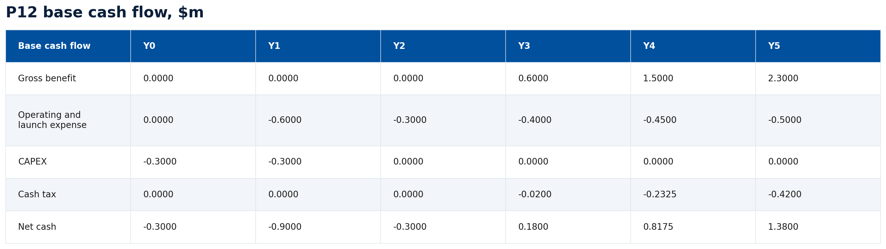

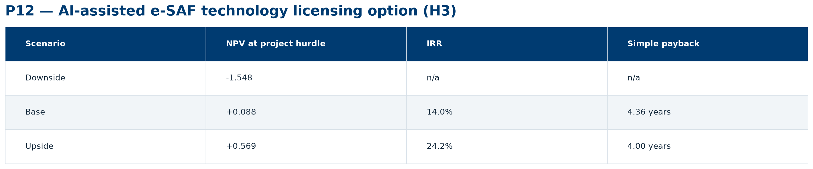

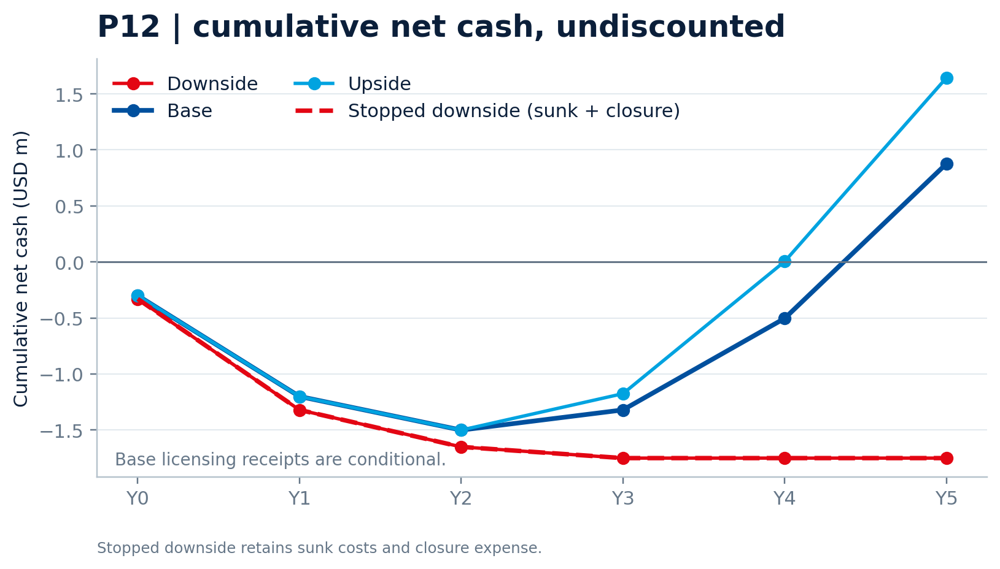

#### 5. Operational workflow and evidence plan

OneTech and Legal first map existing research, partner rights and any current external licensing offer; the commercial lead defines the target developer and the problem the process package would solve. Within existing laboratory capacity, researchers compare AI-assisted experiment selection with conventional design of experiments under a pre-registered protocol and the same experimental resources. Scientific leads set the technical improvement threshold before testing. A research result alone does not prove that a third party will pay for the technology.

The commercial lead tests a defined application and benchmark with at least two qualified developers before Y2, and seeks documented willingness from at least one to enter a paid evaluation before Y3. Pricing, scope of support, partner rights and the cost of moving beyond laboratory work are established before any commercial commitment.

### P13 — French retail demand and controlled markdowns (H1)

#### 1. Decision and existing situation

**Proposal [Assumption]:** Pilot demand forecasting and replenishment assistance with electronic shelf labels and controlled dynamic markdowns in 100 large company-operated French service stations. A successful pilot may justify a separately approved expansion.

**Calibration [Local observation]:** Our insider, drawing on French retail network experience, suggests an indicative **€1m investment for 100 large French company-operated stations, including electronic labels** (CLM-078, CLM-079). This informs our assumptions; it is not evidence of an actual project, company budget or realised result.

Before investment, we map existing retail capabilities and funded initiatives so that only incremental costs and benefits count. TotalEnergies' worldwide retail footprint is not used as the pilot denominator (SRC-002 p.13). The baseline retains existing replenishment, pricing, staff and systems.

#### 2. Problem, alternatives and horizon

**Problem [Hypothesis]:** Store-level volatility creates avoidable perishable losses, out-of-stocks and urgent deliveries; static ordering and pricing may not capture local traffic and seasonality. Actual losses and baseline performance across the 100 stores are unknown.

| Alternative | Approach | Decision rationale |
| --- | --- | --- |
| Existing process | Current ordering, promotions and local adjustments continue | Counterfactual. Measure its actual outcomes; do not assume it is ineffective. |
| Forecast only | Improve orders and stock visibility; no new labels | Lower hardware spend may make this preferable. Compare pilot cost and benefits before selection. |
| Forecast + labels | Forecast demand and apply approved markdown recommendations using electronic labels | Working base case. Each label/markdown gain must be incremental to forecasting. |
| Manual rules | Improve min/max thresholds and expiry rules without ML | Benchmark on the same stores; AI is justified only if it adds measurable net value. |

**H1 [Judgment]:** Improves an existing retail workflow for existing customers using established methods. Forecasts and prices remain subject to human control and pricing rules.

#### 3. Scope, dependencies and implementation

- **Scope:** 100 selected French company-operated stores. Stock ownership, price authority, POS coverage and category mix are verified before funding.
- **Hard dependencies:** permission to use station/SKU sales and stock history; an eligible POS and label interface; a process for updating shelf prices; data-protection and commercial review. Existing pricing systems and pre-funded label costs are part of the baseline.
- **Soft dependencies:** weather and traffic feeds. The pilot starts without them if they are unavailable; it does not wait for a group-wide data platform.
- **Delivery [Assumption]:** a retail project trio (branch data engineer, TDF data scientist, store-operations expert) works with station managers and Finance; label hardware is bought, integrated with existing systems, and the forecasting layer is built or configured.
- **Timeline [Assumption]:** Y0 decision and set-up; Y1 pilot rollout and baseline validation; Y2 expansion to the eligible 100 stores after a successful gate; Y3–Y5 operation and measurement.

#### 4. Investment and operating costs

Amounts are **€m**, nominal; business-case assumptions, not a company quotation.

| Cost item | Y0 | Y1 | Total one-time | Treatment assumed |
| --- | ---: | ---: | ---: | --- |
| Electronic labels, connectivity and eligible software | 0.400 | 0.400 | 0.800 | Capital expenditure, depreciated over five years from Y1. |
| Integration, installation and initial training | 0 | 0.200 | 0.200 | One-time operating expense in Y1. |
| **Total one-time investment** | **0.400** | **0.600** | **1.000** | Includes labels. |

Recurring cloud, data, support and store enablement costs are €0.060m in Y1, €0.100m in Y2 and €0.120m/year in Y3–Y5, separate from the €1m. No expansion beyond the 100 stores is included.

#### 5. Benefit drivers and financial case

All inputs are assumptions for 100 eligible stores. The central annual benefit is **€0.635m**: €0.245m waste reduction + €0.250m incremental markdown recovery + €0.140m stock-out recovery. Urgent-delivery savings are excluded until invoices establish avoidable cash.

- Waste: 100 × €350,000 perishable sales × 70% inventory cost × 4% baseline waste × 25% reduction = €245,000/year.
- Markdowns: 100 × 1,000 at-risk items × €2.50 net incremental recovery = €250,000/year, on items outside the waste pool, net of cannibalisation, discounts and extra handling.
- Stock-outs: 100 × €50,000 missed sales × 8% recovery × 35% contribution = €140,000/year, measured as incremental category contribution.

Downside assumes 90% of full-scale benefits, 105% of investment and operating costs, and a slower 40% / 70% / 90% / 100% / 100% benefit ramp. Upside assumes 115% of full-scale benefits and accelerates the base ramp by 15%, capped at 100%, at base costs. Values are in EUR millions; the portfolio converts at $1.1165/€. The project hurdle is 9%.

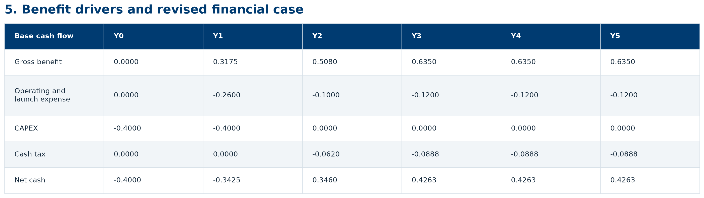

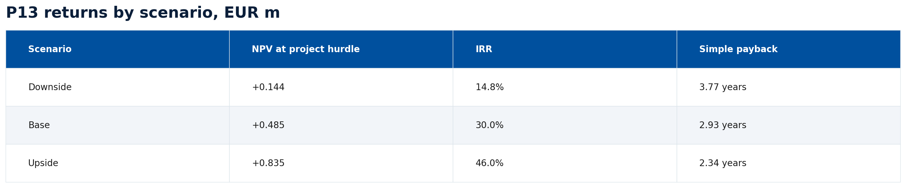

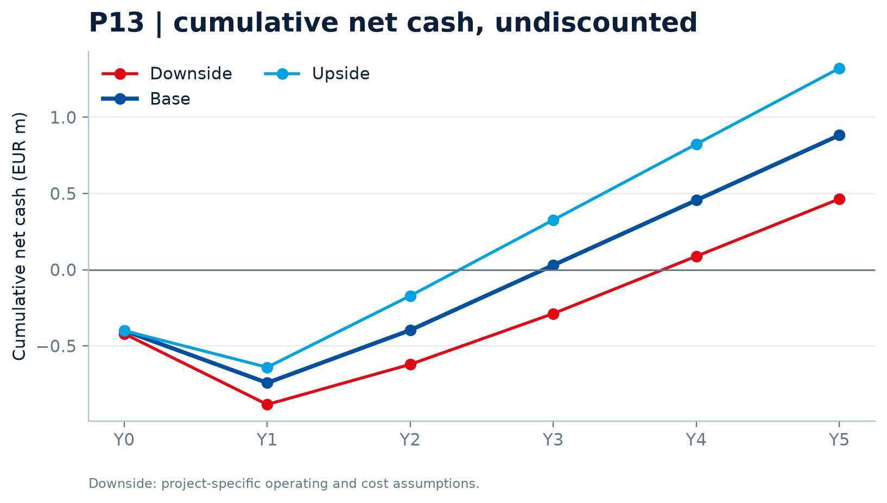

**Attribution sensitivity:** without the €0.250m markdown stream, annual benefit falls to €0.385m, below the approximately €0.446m break-even level at 9%. The case therefore requires evidence of incremental markdown value or a lower-cost forecasting-only design.

**Release rule:** the retail sponsor and Finance pre-register the matched-store protocol, baseline waste cohorts, margin and paid delivery invoices before Y0 release. Before Y2 hardware expansion, the prospective NPV at 9% must be positive using measured incremental margin and remaining avoidable costs. Hardware rollout stops if labels do not outperform forecasting-only after their incremental costs. Store managers retain pricing authority.

#### 6. Operational workflow and evidence plan

We start with a representative, instrumented subset of eligible stores. Retail operations confirms stock ownership, price authority, POS and label interfaces, then agrees a matched-store protocol with Finance before hardware is purchased at scale. Store managers receive recommended orders and markdowns through their existing workflow and retain approval authority. The team trains staff on exceptions, price controls and a manual fallback, and records the additional workload and backfill cost.

We compare current practice, rules-based ordering, forecasting without labels and forecasting with labels where the pilot design permits. Separate SKU/day cohorts for waste reduction and markdown recovery are defined before testing; stock-out recovery is measured net of substitution. Finance checks the measured effects and remaining costs before further hardware release. If the label increment does not justify its cost, we keep forecasting alone; if the prospective case fails the 9% hurdle, expansion pauses or stops.

**Sources and limits:** local calibration CLM-074/078/079 establishes neither a group baseline nor a realised saving.

### Project-level release gates

At month 12 the sponsor and Finance apply these tests before releasing expansion. Prospective NPV uses only remaining cash flows and the project's hurdle. For user-facing pilots (P01, P03, P04, P08, P13), the gate also requires at least **60% of eligible decisions recorded through the tool**. Where a pilot starts later, the same evidence is required before its first expansion. A critical safety, security or legal failure triggers an immediate pause.

| Initiative / owner | Month-12 evidence and threshold | If threshold is missed |
| --- | --- | --- |
| P01 — Refining sponsor | Safe pilot, documented baseline and prospective NPV above zero at 9.5%. | Pause site expansion; redesign or stop. |
| P02 — Upstream sponsor | Eligible sold output and event baseline confirmed; prospective NPV above zero at 10%. | Pause rollout; redesign or stop. |
| P03 — Drilling sponsor | Contractual ability to avoid rig payments confirmed; prospective NPV above zero at 11%. | Pause expansion; redesign or stop. |
| P04 — Renewables sponsor | Saleable generation and entitlement measured against baseline; prospective NPV above zero at 10%. | Pause asset expansion; redesign or stop. |
| P05 — Corporate IT / procurement | Cancellation rights and eligible redundant licence cohort verified; prospective NPV above zero at 9%. | Pause removals; redesign or stop. |
| P08 — Customer business sponsor | Controlled test demonstrates positive incremental net retention; prospective NPV above zero at 9.5%. | Pause expansion; redesign or stop. |
| P09 — LNG operations sponsor | Fuel-payment rights and invoice baseline verified; prospective NPV above zero at 10%. | Pause rollout; redesign or stop. |
| P12 — OneTech / commercial lead | IP and lab access cleared and two qualified developer discussions initiated before Y2. | Stop avoidable commercial expansion or redesign the option. |
| P13 — Retail sponsor | Matched-store trial and baseline established; prospective NPV above zero at 9% and incremental label economics positive. | Pause hardware expansion; prefer forecast-only or stop. |
| E01 — Finance / Digital Line | Named owners, model inventory and baseline register cover all launched pilots. | Pause release of any pilot lacking required controls. |

At month 24, branch sponsors and Finance approve further funding only if the remaining case has positive prospective NPV at its project hurdle and its operational and control conditions remain satisfied; P12 instead requires technical, IP and paid-evaluation evidence before commercial continuation. At month 36 the steering group reviews each case on the same principle. If a condition is not met, the owner pauses new commitments and decides whether to redesign or stop; existing contractual obligations and closure costs remain.

## 5. Implementation and adoption

**First 90 days.** Nominate branch sponsors and project leads; staff each project trio and reserve its time; check existing solutions, contracts, eligible assets and data access for each case. Finance agrees a measured baseline and the incremental value formula with the business. Select pilot sites and complete worker consultation, safety and data-protection requirements. Record the current interval between progress reviews and the time from approval to first live use, as the reference for the new delivery model.

**Pilot and learning.** Trios work with frontline staff at the site or in their daily workflow, in short cycles with frequent user reviews. Each pilot compares the AI-enabled process with current practice and, where relevant, a simpler rules-based alternative. Managers and users are trained on the decision they must take, not only on the tool. An exception and escalation process is maintained. Actual use, decision quality, operating performance and economic outcomes are measured separately.

**Scale or stop.** The business sponsor and Finance review evidence at the agreed gate. Additional sites are released only if data, user adoption, safety and prospective economics support expansion. If results disappoint, the scope is redesigned or further avoidable expenditure stops. Reusable components and lessons return to the hub so that later teams do not repeat the same integration work.

**Executive review.** A monthly one-page dashboard shows, for each initiative, committed and forecast spend, delivery lead time, active users, baseline and observed operating metrics, Finance-verified benefit, risks and the next funding decision. No workforce savings are counted merely because time is saved; any redeployment or external-cost reduction must be observable and agreed with the business.

### Accountabilities and milestones

| Time | Accountable owner | Decision and evidence |
| --- | --- | --- |
| First 90 days | Branch sponsors, project leads, Digital Factory lead and Finance | Staff the four featured trios and reserve their capacity; document existing tools, baselines, data rights, backfill cost and pilot budgets. Release each Y0 commitment only after safety, security and business-ownership checks (Gate 0). |
| By month 6 | Project leads | At least 40% of eligible users active in the preceding month in user-facing pilots; otherwise agree remediation or stop within 30 days. |
| By month 12 | Site/business leads, with Finance | Review adoption (at least 60% of eligible decisions recorded), measured incremental outcomes and spending against the agreed baseline (Gate 1). For P12, OneTech and Legal confirm rights and non-duplication; the commercial lead secures two qualified developer discussions before Y2. Pause an unsafe or non-compliant pilot immediately. |
| By month 24 | Branch sponsors and Finance | P01, P03 and P13 proceed only if their remaining cash flows clear their project hurdles and site or contract conditions are met (Gate 2). P12 proceeds only against its technical, IP and paid-evaluation gates; otherwise avoidable spending stops and closure costs remain. |
| By month 36 | Portfolio steering group | Review cumulative spend, realised cash, adoption and the next deployment decision for each case; scale, redesign or stop based on evidence and remaining economics. |

Each project lead records eligible, trained and active users, with a target and review date agreed before launch. Site managers schedule training and staff cover, gather operator feedback and maintain a manual fallback; the branch sponsor owns adoption and Finance confirms realised cash rather than tool usage alone.

### Change risks, early warning and ownership

**Specialist capacity and retention.** *Owners: CHRO and Digital Factory lead.* Monitor vacancies, unfilled secondments and single points of failure monthly. Record a named deputy and handover plan for each trio member before pilots begin; cross-train and reschedule deployments if capacity is unavailable. Line managers keep staffing authority and agree each secondment.

**Manager and frontline adoption.** *Owners: branch sponsors and site managers.* Track protected expert time, attendance at pilot reviews, active use and operator feedback. When a team cannot release its expert, the branch sponsor arranges backfill within the allowance or returns for a revised scope and budget. No deployment displaces safety procedures or human operational authority.

**Dual-reporting friction.** *Owners: project leads and line managers.* Agree each trio member's objectives jointly before launch: project objectives with the project lead, professional standards with the line manager. Conflicts on priorities escalate to the branch sponsor within a week.

**Governance and employee trust.** *Owners: General Counsel, DPO, HSE and employee-relations leads.* Before pilot release, assess data rights, security, privacy, operational safety and required employee-representative consultation. Missing clearance or an unsafe incident pauses the affected deployment immediately; the relevant control owner determines remediation and approves restart.

**Premature cancellation or escalation.** *Owners: CFO and portfolio sponsor.* Review the investment trough alongside spend, adoption and leading operating indicators quarterly. Follow the agreed gates instead of cancelling solely because early cash flow is negative; stop or redesign when prospective economics, safety or contractual conditions fail.

### Stakeholders and communication

**Sponsors:** CEO, CFO and branch leaders set the mandate and resolve capacity or funding conflicts. The portfolio sponsor sends a monthly one-page dashboard showing spend, milestones, risk and next decision; material incidents escalate immediately.

**Translators:** branch project leads and managers translate each initiative into schedules, roles and performance measures. They review trio capacity and adoption every two weeks, resolve friction and protect expert time.

**Adopters:** site operators, maintenance specialists, drilling teams, retail staff and other pilot users shape the workflow through the business expert and test recommendations. The trio runs short weekly two-way sessions during a pilot, logs concerns and publishes decisions to the team. Users retain their operational decision rights and a manual fallback.

**Guardians:** HSE, cyber, Legal, DPO, procurement and employee representatives are engaged during scoping, and required consultation is complete before deployment. They receive the intended workflow, data, safeguards, effect on work and escalation route; the outcome and owner are recorded.

### Skills, measurement and stop rules

**Three training tiers.** (1) For affected staff: practical AI literacy, acceptable data use, uncertainty and escalation. (2) For trio members, practitioners and managers: workflow design, validation, human oversight and interpretation of performance. (3) For executives: scenario assumptions, portfolio risk, adoption and gate decisions. The CHRO and branch sponsors set audiences, completion measures and backfill before launch, within the project envelopes.

**Adoption staircase.** Months 0–6: usage (eligible, trained and active users). Months 6–12: behaviour (decisions recorded through the tool, cycle time, user feedback). From month 12: value (Finance-verified incremental cash against the baseline). For projects without a user workflow, technical and commercial milestones replace user metrics.

**Release discipline.** User-facing pilots with fewer than **40% of eligible users active** in the month before the month-6 review pause expansion and agree remediation or stop within 30 days. At month 12, continuation requires at least **60% of eligible decisions recorded** through the tool, alongside the project gate. Safety, legal and contractual failures trigger an immediate pause. At months 12, 24 and 36 the steering group decides to scale, redesign or stop each initiative; no milestone guarantees further funding.

## 6. Conditions for the final investment decision

Before final approval we confirm: (1) resource availability and complete costs, including trio secondments, branch backfill and shared controls; (2) eligible assets, contracts and incremental value relative to existing tools; (3) P12's technical differentiation, rights, demand and realistic commercialisation costs; and (4) branch agreement to the co-funding schedule and to the dual-reporting arrangement. The programme proceeds where measured economics and adoption justify it; the option to stop individual cases is part of the design.

## References and calculation basis

Company baseline: [2025 Universal Registration Document](../../sources/primary/totalenergies_universal-registration-document-2025_2026_en.pdf); [TotalEnergies on AI and Michel Lutz](https://www2.totalenergies.com/news/news/energytalks-ai-energy-hype-vs-real-impact); [TotalEnergies on O3C renewable operations](https://totalenergies.com/news/news/roads-carbon-neutral-season-4-episode-1-o3c-renewables-control-tower). Claim identifiers (CLM-, SRC-) refer to the [source register](../../sources/register.md). Readiness evidence: [readiness assessment](../../work/options/readiness_bottleneck.md). Figures are derived from the [working financial model](../../work/finance/portfolio_model_working.xlsx), with annual cash components checked by the [reconciliation script](../../work/finance/reconcile_selected.py). Project cards are maintained in `work/projects/`.
