# TotalEnergies: a gated AI transformation portfolio

**Full analytical report — review draft, 10 November 2026**  
**Team:** Alexandre Waerniers, Vincent Lamy, Yoni Mahieddine, Nahel Bachriri  
**Decision status:** Proposal for challenge, not a TotalEnergies investment decision or a claim about an existing internal programme. The proposed projects, operating arrangements and financial outcomes below are team assumptions unless marked as verified facts.  
**Financial source of truth:** [`portfolio_model_14_revised.xlsx`](../../work/finance/portfolio_model_14_revised.xlsx). The separate 15-year illustration lives in the [portfolio notebook](../../work/projects/portfolio_charts.ipynb) and is not part of the five-year approval case.

## 1. Decision, strategic logic and what is still open

**Proposed resolution [Judgment and Assumption]:** approve a gated, 14-initiative AI transformation programme across the five operating segments and shared governance. Authorise a **$27.6371m gross planning ceiling** for the model's five operating years Y1–Y5 plus the Y0 decision-point expenditure, including CAPEX, launch and recurring OPEX; release the **$3.6966m Y0 tranche** only after eligibility and baseline checks, then release later annual tranches against documented value, safety and learning gates. The course's memo framework explicitly permits a **three- to five-year envelope** (p. 190); five years fits this heavy-industry portfolio and the team's fixed financial model. The amount is a planning estimate from the frozen workbook, not a TotalEnergies quote or an unconditional instruction to spend. Any failed project retains sunk and unavoidable costs but does not receive its avoidable next tranche. This asks the board to fund and launch a programme subject to controls, as the course's decision-first sequence requires (pp. 142, 145–150, 189–206).

**Decision economics [Calculation on assumptions]:** at the separately assumed 10% portfolio screen, the weighted five-year NPV is **+$3.303m** before the inaction overlay and **+$4.874m** after it; corresponding weighted-cash IRRs are **19.2%** and **23.1%**. The additional $1.571m is an assumed avoided loss, not measured value, and depends on unverified market exposure, talent retention, causality and non-overlap. The unadjusted downside remains negative, and the harsher stress is not a loss cap. See §§7–8.

**Strategic mechanism [Judgment]:** use TotalEnergies' existing Digital Line, Digital Factory, segment expertise and data-platform investments to test incremental operational workflows. A strong hub sets common controls and reusable tools; segment teams own use cases, frontline adoption and signed cash benefit. This formalises a proposed delivery mechanism; it does not assert that TotalEnergies lacks one today.

The four cases proposed for detailed scrutiny are P01 refining predictive maintenance, P03 deepwater drilling advisory, P11 a customer-side flexibility option and P13 a 100-station French retail forecasting/markdown pilot. They span existing operations, adjacent decision processes and a possible new customer offer. The other ten entries, including the shared E01 enabler, remain shorter estimates. **All 14 remain in the model, portfolio charts and proposed programme ceiling.** P07 safety computer vision and P10 steam-cracker yield have negative five-year standalone NPVs at their project hurdles; the programme does not conceal that fact. Their inclusion is a strategic **test mandate**, with continuation conditional on safety evidence (P07) or an improved prospective commercial case (P10), not a claim that their present cash case clears the hurdle. The workbook's full-spend path remains an illustrative ceiling rather than a gate-adjusted forecast.

**Approval conditions [Unknowns to validate before cash release]:** eligible sites/rigs/stations and rights; vendor prices, actual tax and cancellable contracts; overlap among benefits and existing programmes; current group decision rights; and named operational and Finance signatories. The report makes the proposed roles, financial bridge and gate thresholds explicit as **team planning assumptions** so the CEO can approve a bounded path while demanding evidence before each draw. The [course PDF](../../course/lectures/AI%20Strategy%20-%20Albert%20School%20-%20Master%202026.pdf), pp. 188–206, requires a decision, downside, return on capital, controls, accountability and a two-page Comex memo derived from a detailed plan. This full report is the team's analytical support; the memo and slides are the actual executive-facing deliverables.

## 2. Company baseline and evidence discipline

**Verified facts.** TotalEnergies had five operating segments—Exploration & Production, Integrated LNG, Integrated Power, Refining & Chemicals, and Marketing & Services—plus Corporate at year-end 2025. It reported $201.196bn of external sales in FY2025 and 101,513 employees at 31 December 2025 ([2025 Universal Registration Document](../../sources/primary/totalenergies_universal-registration-document-2025_2026_en.pdf), pp. 6, 49, 474; [strategy synthesis](../../sources/synthesis/2026-11-08_totalenergies_strategy_activities.md), CLM-001). The stated growth pillars are oil and gas, particularly LNG, and Integrated Power. Those facts explain why operating reliability, drilling economics, power flexibility and customer operations deserve examination; they do not prove these four proposals are the best investments.

The company already has a Digital Line within OneTech, a Digital Factory, existing segment AI capability, a planned AspenTech industrial-data rollout and a Cognite rollout across operated upstream assets. Its URD says nearly 100 Digital Factory solutions have been developed since 2020 and more than 10,000 AI models are live; it does not disclose equivalent coverage, adoption or cash value per solution ([URD](../../sources/primary/totalenergies_universal-registration-document-2025_2026_en.pdf), pp. 39, 42–43; [AI synthesis](../../sources/synthesis/2026-11-08_totalenergies_ai_data_organization.md); [register](../../sources/register.md), CLM-015–019 and CLM-029). The roughly 500-expert Digital Factory figure is **disputed across dated sources** (CON-001); it is not a staffing baseline for our budget. Existing investments and capabilities are included in each counterfactual, so no case purchases an already-funded group platform again.

The 2025 URD reports a **7.0% post-tax WACC estimate for specified impairment tests** ([URD](../../sources/primary/totalenergies_universal-registration-document-2025_2026_en.pdf), pp. 462, 472; CLM-075). This is a published impairment input, **not** a published company investment hurdle or branch WACC. The branch and project rates in this report are explicit team assumptions. ROACE is a distinct return-on-capital measure and is never substituted for a hurdle.

**Competing evidence.** Equinor reported cumulative predictive-maintenance value since 2020, including partners, but its methodology and comparable scope are not established (CLM-036). Shell vendor material describes large deployments without an audited AI-only return (CLM-041). BP's well-planning example gives a speed claim, not an attributable TotalEnergies saving (CLM-068). These examples show feasible use-case classes, not a measured performance gap. The [competitor synthesis](../../sources/synthesis/2026-11-08_competitors_benchmarks.md) records the limits. Vincent's Argedis experience is a **local observation** about French retail delivery and a calibration input for a **hypothetical** P13 proposal (CLM-074, 078–079); it is neither evidence of group-wide practice nor a statement that this specific project exists or has been funded.

## 3. Readiness, bottleneck and testable thesis

Using the course's five pillars and five stages ([course PDF](../../course/lectures/AI%20Strategy%20-%20Albert%20School%20-%20Master%202026.pdf), session 1; [assessment](../../work/options/readiness_bottleneck.md)), the outside-in working scores are: business strategy **3/5**, technology/data **3/5**, AI experience **3.5/5**, organisation/culture **2.5/5**, and governance **2.5/5**. The last two are uncertain because public disclosure does not establish internal adoption, value tracking or model-inventory practice. The provisional group stage is **3, Implementing, potentially approaching 4, Scaling**. These are team judgments, not a TotalEnergies internal maturity audit.

The candidate bottleneck is delivery throughput and frontline adoption: subject-matter users may lack protected time to co-build and validate solutions. This is supported by one local Argedis observation and the URD's acknowledgement of organisation/skills adaptation risk; neither proves a binding group-wide constraint. Industrial data availability, value measurement, model governance and talent are serious alternatives. A first cross-segment diagnostic should compare delivery lead time, data blockers, decision ownership, adoption and Finance-signed value on selected workflows. If data access or governance proves the binding constraint, the operating intervention must change. The [readiness analysis](../../work/options/readiness_bottleneck.md) keeps evidence for and against each candidate and specifies the tests.

**Why now [Judgment].** Already-funded data and model capabilities create an opportunity to capture value through use-case-specific workflow changes. Faster deployment would matter only if it creates verifiable incremental cash or a defensible learning option. An unquantified assertion that competitors will overtake the company is not used as a financial benefit or as the cost of inaction.

## 4. Operating model and change mechanism

The provisional choice is a **strong hub-and-spoke**, using existing structures rather than a new stand-alone AI organisation. The Digital Line/Digital Factory hub would own common standards, reusable data/model infrastructure, vendor arrangements and a model-and-value register. Segment spokes would select use cases, provide an accountable business owner and own operational change. Finance would establish the baseline, check attribution and sign realised value. HSE, cyber, legal and employee representatives would review relevant uses before deployment. Human experts retain high-impact operating decisions, consistent with TotalEnergies' stated AI principle (CLM-026).

The [operating-model comparison](../../work/options/operating_model.md) assesses a central CoE, hub-and-spoke and federation against size, regulation, talent and maturity. A purely central CoE risks queues and weak business ownership; immediate federation risks duplicated tools and inconsistent controls while common platforms are still rolling out. Federation can be reconsidered for a segment once its data slice, model register, Finance-signed benefits and safety controls pass agreed tests. Actual group decision rights and Digital Factory funding are unknown (CLM-030); the proposal must be reconciled with them before describing an organisational change.

**Delivery trio [Assumption to test].** For each approved pilot, pair a hub data scientist, a segment data engineer and a business champion with **20–40% protected time**. The latter fraction is a planning assumption, not a current TotalEnergies allocation or an unfunded contribution. A project budget must include or explicitly identify the engineer, manager, frontline training and backfill time. Segment leaders own adoption and the P&L lever; the hub cannot certify its own benefits. Compare this trio with the existing delivery process in the first pilots before scaling it.

| Decision | Proposed accountable role | Control |
| --- | --- | --- |
| Pilot selection and business baseline | Segment sponsor and Finance | Compare the existing process, simple non-AI alternative and incremental AI proposal. |
| Technical and data design | Digital Line / Digital Factory with segment IT | Use the smallest necessary data slice and existing contracts first. |
| Operational release | Segment operations lead | Human authority, safe workflow, user training and documented adoption. |
| Financial release | Segment sponsor and Finance | Recalculate remaining cash flows at the project hurdle; retain sunk and unavoidable cost. |
| Safety, privacy and regulatory stop | HSE, cyber, legal and applicable workforce representatives | Block a non-compliant or unsafe deployment irrespective of modelled NPV. |

The course's change section asks who changes work, how resistance is handled, what skills are funded and which leading indicators the Comex sees before EBIT appears (course pp. 198–203). For every pilot, record baseline usage, manager participation, exception handling, employee consultation where applicable, operational quality and Finance-verified cash separately. A model used often is not itself a cash saving. The [governance draft](../../work/governance/gates_and_adoption.md) gives the release structure; named individuals, calendar dates and quantitative thresholds still require agreement.

## 5. Portfolio design, horizons and dependencies

H1 improves existing workflows, H2 changes adjacent decision or operating processes, and H3 tests a possible new model with learning gates. The course's **70/20/10 capital and inverse 10/20/70 return illustration is approximate, not a target to manufacture** (course pp. 80–83 and 194). The working one-time candidate allocation is H1 **$6.5665m (58.3%)**, H2 **$1.900m (16.9%)**, H3 **$2.500m (22.2%)**, plus E01 **$0.300m (2.7%)**, total **$11.2665m**. For the three-horizon graphic E01 is visually grouped with H1 (combined **60.9%**); the financial accounts retain it separately. This higher H3 seed allocation reflects the candidate mix and the wish to fund learning, not evidence that H3 will earn the course's illustrative 70% of returns. The H1/H2 cases must earn measurable cash while H3 remains gated.

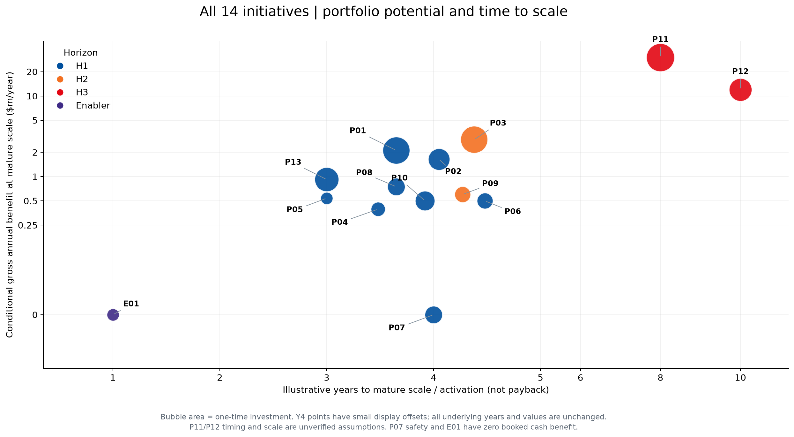

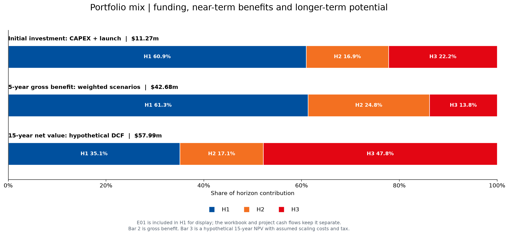

The [bubble chart methods](../../work/projects/portfolio_visuals.md) are essential: x = **illustrative time to mature scale/activation, not payback**; y = conditional gross annual benefit at mature scale; bubble area = one-time investment. Y4 labels have small display offsets to avoid overlap, and the time axis is nonlinear. H3 points P11/P12 use unverified long-term assumptions. No H3 payback is claimed. The workbook's five-year return and the notebook's separate 15-year hypothetical DCF have different purposes and should never be presented as one approved forecast.

| Candidate | Horizon | Initial investment, USD m | Project hurdle | Working selection logic |
| --- | --- | ---: | ---: | --- |
| P01 Refining predictive maintenance | H1 | 1.400 | 9.5% | Focus; only incremental interventions over existing maintenance and AspenTech. |
| P02 Upstream production surveillance | H1 | 0.900 | 10.0% | Estimate; operated scope and production ownership to validate. |
| P03 Deepwater drilling advisory | H2 | 1.400 | 11.0% | Focus; cash-releasing contract and operator rights are hard gates. |
| P04 Renewable availability | H1 | 0.400 | 10.0% | Estimate; existing OEM monitoring and PPA/merchant exposure to check. |
| P05 Copilot workflow redesign | H1 | 0.300 | 9.0% | Estimate; count cancellable licence expense, not redeployed time. |
| P06 Procurement analytics | H1 | 0.500 | 9.5% | Estimate; avoid overlap with existing savings and drilling contracts. |
| P07 Safety computer vision | H1 | 0.600 | 10.0% | Strategic safety test within the ceiling; no booked incident-savings cash and no claim of positive standalone NPV. |
| P08 Power/gas customer retention | H1 | 0.600 | 9.5% | Estimate; customer scope, churn and contribution to validate. |
| P09 LNG voyage optimisation | H2 | 0.500 | 10.0% | Estimate; only controllable voyages and attributable fuel cash. |
| P10 Steam-cracker yield | H1 | 0.750 | 10.0% | Industrial process-learning test within the ceiling; scale only if measured yield, distinct from P01, creates a positive prospective case. |
| P11 Customer-side flexibility | H3 | 1.500 | 11.0% | Focus option; distinguish a new customer offer from existing Quadra aggregation. |
| P12 e-SAF catalyst discovery | H3 | 1.000 | 12.0% | Learning option; no five-year commercial return assumed. |
| P13 French retail forecasting/markdown | H1 | ~1.117 USD-equivalent of €1.000m | 9.0% | Focus, hypothetical 100-store pilot; evidence before scale. |
| E01 Value/model register | Shared | 0.300 | 9.0% reference | Governance cost; no standalone cash benefit or extra fifth focus case. |

The table reports assumptions from the [active workbook](../../work/finance/portfolio_model_14_revised.xlsx), [discount policy](../../work/finance/discount_rate_policy.md), [four case cards](../../work/projects/) and [short candidate estimates](../../work/projects/reserve_cards.md). One-time spend excludes recurring OPEX and tax. Project horizons are provisional where the operating workflow or business-model novelty is not yet proven. The [working sequencing canvas](../../work/projects/portfolio_sequencing_canvas.md) proposes a minimum data slice, hard and soft dependencies, sourcing, accountable role and model-year first milestone for **each** candidate. These are planning assumptions; actual people, dates, supplier contracts and operational rights remain to be agreed. P01/P10, P03/P06, P02/P03 and P06/P09 require explicit overlap checks. Existing Cognite, AspenTech, Quadra and Digital Factory assets are counterfactual capabilities, not freshly proposed projects.

## 6. Four detailed business cases and five-year cash flows

The four cases below provide the decision logic, operational baseline, non-AI alternatives, sourcing, assumptions, cost build, annual cash and release criteria needed to defend each project. All project amounts are calculations on explicit assumptions, not verified TotalEnergies actuals. Y0 is the illustrative initial decision period; Y1–Y5 are subsequent annual periods. Their cash flows are incremental, nominal, post-tax and unlevered, and do not include the separate portfolio cost-of-inaction overlay. Cash taxes, capitalisation, contractual rights and project scopes remain to be validated. The working [financial workbook](../../work/finance/portfolio_model_14_revised.xlsx) owns the active scenarios; P13 is in EUR and the other cases are in USD. Each case uses its own assumed hurdle.

### 6.1 P01 — Refining predictive maintenance (H1)

**Decision at a glance:** deploy a supervised predictive-maintenance pilot on two assumed refining sites, extending existing capabilities. The model assumes **$1.4m** one-time investment, **$2.116m/year** gross benefit at full scale and a **9.5%** hurdle. Its five-year base NPV is **+$2.116m**, with **57.8% IRR** and **2.40-year simple payback**. Quantities and gains are assumptions; continued investment depends on site-level evidence and prospective economics.

**Status:** Rebuilt working case, 10 November 2026. Economic drivers and unit costs are explicit **assumptions**, not reported TotalEnergies results. Validate the site perimeter, counterfactual, actual costs and tax before approval. Calculation: `work/finance/industrial_case_models.py`.

#### 1. Decision, problem and existing capability

**Proposal:** Pilot predictive maintenance on critical rotating equipment at two eligible refining sites, then extend within those sites only when operations and finance confirm value. Asset and site selection are **assumptions** pending validation. TotalEnergies is already deploying AspenTech's industrial data platform (CLM-018) and has existing maintenance processes; both belong in the counterfactual. This proposal funds an incremental workflow and interventions only where they are not already delivered.

**Problem [Hypothesis]:** Certain unplanned equipment stops lead to lost margin and avoidable emergency repairs. The number of preventable outages, eligible machines and economic contribution of the sites are unknown. A data platform or an anomaly alert alone does not create value: a verified alert must lead to a safe maintenance action that changes the baseline outcome.

#### 2. Alternatives, horizon and sourcing

| Option | Decision |
| --- | --- |
| Existing scheduled and condition-based maintenance | Counterfactual. Compare the proposed system against existing monitoring and documented maintenance activity. |
| Improved manual thresholds and reliability review | Benchmark on the same machines; use this simpler approach if it achieves comparable results at lower cost. |
| Vendor APM plus site-owned integration and maintenance workflow | Working proposal: buy/partner for tools, integrate with existing data and build the site workflow. Contracts and current licenses must be checked. |

**H1 [Judgment]:** Optimises existing refining operations using an established class of maintenance tools. Technology maturity does not prove the local gain. No new enterprise-wide data lake is assumed.

#### 3. Perimeter and benefit drivers

All parameters below are **assumptions**, not published TotalEnergies site performance. The two sites' actual throughput, ownership share, production constraints and incremental contribution margin must be verified.

| Annual driver at full rollout | Assumption | Calculation / limit |
| --- | ---: | --- |
| Eligible combined refining throughput | 250,000 barrels/day | Two eligible sites combined; a scope assumption, not a factbook site figure. |
| Effective days | 365/year | Applied to the stated daily throughput; confirm whether baseline throughput already includes downtime. |
| Incremental throughput recovery | 0.5% | Improvement over existing maintenance, not all site outages. Avoid applying it to downtime already excluded from the throughput base. |
| Additional output sold | 70% | Capacity and market constraint; verify the actual bottleneck and product demand. |
| Incremental contribution margin | $6/barrel | Working assumption, not TotalEnergies' realised margin; the published ERM is a market marker (CLM-063). |
| Avoided emergency repair cost | $0.200m/year | Additional assumed cash savings; count only invoices not already captured in throughput or existing budgets. |

Full-scale gross benefit = `250,000 × 365 × 0.005 × 0.70 × $6 + $200,000` = **$2.11625m/year [Calculation on assumptions]**. The scope is two assumed sites, not all group throughput. Equinor's reported $120m since 2020 (SRC-017 / CLM-036) is a cumulative contextual benchmark and does not prove this annual amount.

#### 4. Costs, schedule and assumptions

Amounts **$m**, nominal. Y0 is a late-2026 decision point and Y1–Y5 the following annual periods. These allocations and dates are project assumptions, not vendor quotations. Total one-time investment: **$1.4m**, comprising $1.0m capitalised hardware/software ($0.5m in Y0 and $0.5m in Y1) and $0.4m implementation/training expensed in Y1. Verify sensor reuse, software capitalization, site costs and existing contracts. Recurring operating and support costs are $0.20m, $0.35m, $0.40m, $0.40m, $0.40m in Y1–Y5.

Pilot benefit ramp is 20%, 60%, 85%, 100%, 100%. Tax illustration assumes a 25% rate, five-year straight-line depreciation on the assumed $1.0m of capital assets from Y1, and no immediate tax credit on annual losses. Actual taxes, depreciation, internal staff and backfill are unverified. No terminal value, external benefit or expansion beyond the assumed perimeter is included.

#### 5. Annual cash flow and J-curve

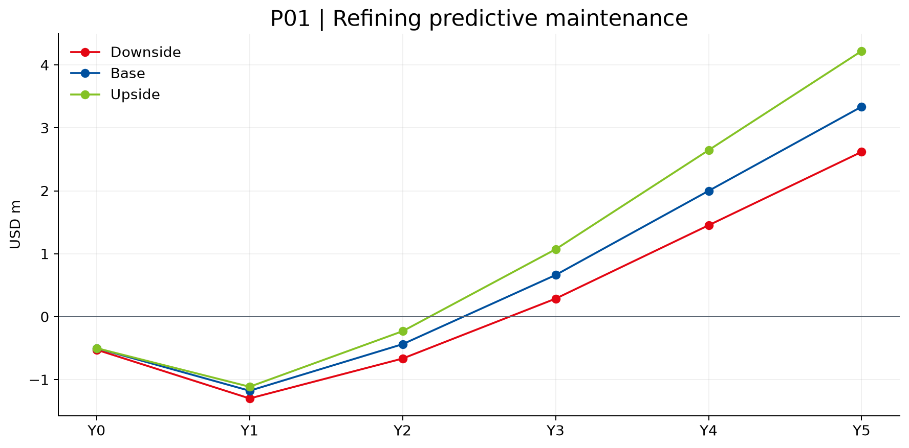

**Base [Calculation on assumptions]**, $m. Gross benefits are pre-tax incremental contribution and repair savings; net cash includes the assumed operating expense, investment and cash tax.

| $m | Y0 | Y1 | Y2 | Y3 | Y4 | Y5 |
| --- | ---: | ---: | ---: | ---: | ---: | ---: |
| Incremental gross benefit | 0 | 0.4233 | 1.2698 | 1.7988 | 2.1163 | 2.1163 |
| Recurring OPEX | 0 | -0.2000 | -0.3500 | -0.4000 | -0.4000 | -0.4000 |
| One-time implementation expense | 0 | -0.4000 | 0 | 0 | 0 | 0 |
| CAPEX | -0.5000 | -0.5000 | 0 | 0 | 0 | 0 |
| Cash tax | 0 | 0 | -0.1799 | -0.2997 | -0.3791 | -0.3791 |
| **Net cash** | **-0.5000** | **-0.6768** | **0.7398** | **1.0991** | **1.3372** | **1.3372** |
| **Cumulative cash** | **-0.5000** | **-1.1768** | **-0.4369** | **0.6622** | **1.9994** | **3.3365** |

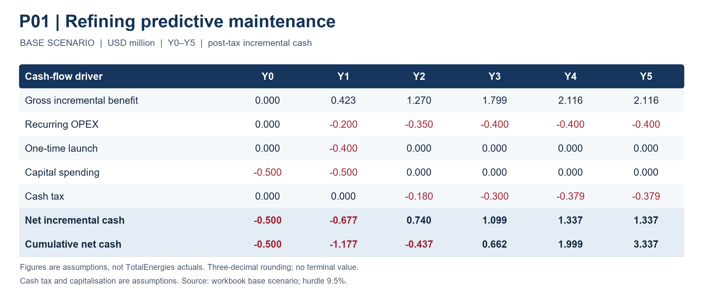

*Presentation figure: same base-case table, rounded to three decimals; values are model assumptions.*
At the P01 **9.5% project hurdle** (`work/finance/discount_rate_policy.md`): NPV **+$2.116m**, IRR **57.8%**, simple payback **2.40 years**, discounted payback **2.60 years**. The annual interpolation is not a measured monthly result. No figure is a validated TotalEnergies forecast.

#### 6. Scenarios and investment decision

The downside assumes 90% of the base benefit and 105% of initial and recurring costs. P13 also uses slower 35% / 60% / 80% / 100% / 100% adoption; other cases retain their base ramp. Upside assumes 115% benefits and base costs; P13 uses 65% / 90% / 100% / 100% / 100% adoption. These are illustrative assumptions, not observed probabilities. A separate severe stress uses 65% benefits and 120% costs. Actual stop costs, delays, contract terms and attribution must be validated before approval.

| Scenario | NPV at project hurdle | IRR | Simple payback (years) |
| --- | ---: | ---: | ---: |
| Downside | $+1.573m | 45.0% | 2.70 |
| Base | $+2.116m | 57.8% | 2.40 |
| Upside | $+2.764m | 70.7% | 2.18 |

#### 7. Gates, adoption and risk

1. **Before pilot:** site reliability owner, finance and IT establish existing solutions, eligible equipment and production baseline, data rights and the $1.4m spend split. Agree the alert metric, false-alarm tolerance and comparable maintenance baseline before live testing.
2. **Pilot review:** reliability engineers validate actionable alerts, safe intervention and actual production/repair economics; finance checks whether incremental throughput was sold. Pause on safety issues; retrain or stop on missed pre-agreed performance thresholds.
3. **Expansion:** sponsor releases further spend only if the **future** incremental case clears the hurdle and the site adoption and security conditions are satisfied. A stop leaves sunk and non-cancellable costs in the programme.

**Illustrative financial threshold [Calculation]:** with the base costs, tax and ramp unchanged and all benefits scaled together, total five-year NPV at 9.5% reaches zero at approximately **$1.080m/year at full scale** (51.0% of the modelled $2.116m). This is a full-project sensitivity, not a prospective continuation rule: at the gate, exclude sunk costs and recalculate the remaining cash commitments and attainable benefits. Agree operational reliability and safety thresholds with the site before launch.

The reliability team retains intervention authority; operators and maintenance staff participate in design and receive funded training. Cybersecurity, safety, data completeness and actual licensing scope are gating conditions, not afterthoughts.

#### 8. Sources and validation required

- TotalEnergies 2025 URD: refining throughput CLM-052 and existing data initiatives CLM-018; no claim that the assumed two sites have 250 kb/d.
- Market ERM is contextual only, CLM-063; the $6/b incremental contribution assumption is not a source-backed TotalEnergies actual.
- Equinor SRC-017 / CLM-036: $120m cumulative predictive-maintenance value since 2020, including partners; not an annual peer amount or a transferable per-machine return.
- Discount rate: `work/finance/discount_rate_policy.md`. Recompute independently in the replacement spreadsheet and validate site baseline, budgets, tax, rates and scenarios before presentation.

### 6.2 P03 — Deepwater drilling advisory (H2, provisional)

**Decision at a glance:** test human-supervised drilling advisory on two eligible operated rigs or campaigns. The model assumes **$1.4m** one-time investment, **$2.880m/year** gross benefit at full scale and an **11%** hurdle. Its five-year base NPV is **+$1.859m**, with **43.2% IRR** and **3.09-year simple payback**. Day savings must reduce actual cash payments; site selection, contracts and operator rights are decision gates.

**Status:** Rebuilt working case, 10 November 2026. The two-rig scope, economic inputs, payment mechanism, costs, tax and ramp are assumptions, not TotalEnergies' observed results. Contracts, eligible assets and incremental benefit require validation. Calculation: `work/finance/industrial_case_models.py`.

#### 1. Proposal and starting point

**Proposal:** Test a human-supervised planning and drilling advisory workflow across **two eligible operated deepwater rigs or campaigns**. Identify actual operated assets and obtain agreement from the operator, drilling contractor and relevant partners before committing to a pilot. Existing Cognite deployments and drilling practices remain in the counterfactual (CLM-019); count only incremental capability and cash.

**Fact:** Mero is operated by Petrobras; TotalEnergies' reported interest was 19.3% in the 2025 announcement (SRC-037, CLM-077). The previous claim that Mero is operated by TotalEnergies was incorrect. This case therefore does not assume the ability to deploy unilaterally at Mero, nor apply the 19.3% figure mechanically to a different contract.

**Problem [Hypothesis]:** Better use of well and drilling data may reduce non-productive time. A faster operation does not automatically save cash: the contract must permit an earlier rig release, reduce variable charges or create another documented financial benefit. BP's published well-planning example is context, not proof of a TotalEnergies gap or saving (CLM-068).

#### 2. Alternatives, horizon and delivery

| Option | Assessment |
| --- | --- |
| Existing drilling workflow | Counterfactual, including existing engineering and contracted tools. |
| Improved manual or rules-based planning | Benchmark using the same wells, staff and contractor terms. |
| Commercial drilling tools alone | Consider existing contract features and compare total costs, data rights and actual incremental gains. |
| Blended advisory workflow | Working proposal: integrate existing data and proven software with company drilling expertise, with no autonomous steering. |

**H2 [Judgment, provisional]:** A cross-functional redesign of the well-planning and operational workflow is proposed. Horizon placement must reflect the selected workflow and adoption cycle, not a desire to rebalance the portfolio. HSE and drilling experts retain operational authority.

#### 3. Scope and incremental benefit formula

**Annual assumptions at full scale:** two eligible operated rigs/campaigns; six avoidable rig-days per rig per year; $0.400m/day fully avoidable gross spread cost; 60% cash realization after fixed-contract restrictions, partner terms and other leakage. These are **not verified company figures**. The 60% factor is a single combined assumption; do not also apply an unverified ownership discount to the same amount.

`2 rigs × 6 days/rig/year × $0.400m/day × 60% = $2.880m/year` gross incremental cash **[Calculation on assumptions]**. Verify invoices, full rate composition, actual rig release rights, partner allocation and whether the company already planned the saving. Any time saving without reduced cash payment is reported as capacity or schedule value, not this cash benefit. Avoid overlap with procurement P06 and the existing savings plan.

#### 4. Costs, data and timing

Amounts **$m**, nominal; calendar and procurement terms are assumptions. The one-time investment is **$1.4m**: $0.8m assumed capitalised integration/software ($0.4m Y0 + $0.4m Y1) and $0.6m of one-time integration, commissioning and training expense in Y1. Confirm the accounting treatment and reuse of existing platforms. Recurring software, data engineering, contractor support and run cost are assumed at $0.30m, $0.45m, $0.50m, $0.50m, $0.50m in Y1–Y5.

Assumed benefit ramp: 0%, 30%, 70%, 100%, 100% in Y1–Y5. This assumes a pilot, followed by conditional release, not autonomous operation. The model assumes a 25% cash-tax rate, straight-line depreciation of $0.8m over five years from Y1 and no immediate credit for annual losses; actual jurisdiction, ownership and tax terms must be confirmed. No terminal value or country premium is assumed separately.

**Hard dependencies:** rights to selected drilling data, contractor integration, operator consent, safely bounded advisory workflow and finance access to invoices. Cognite on operated assets is an existing foundation, not a promise that a specific rig is connected on a chosen date. Well engineering lead and contractor representatives own validation.

#### 5. Annual cash flow and J-curve

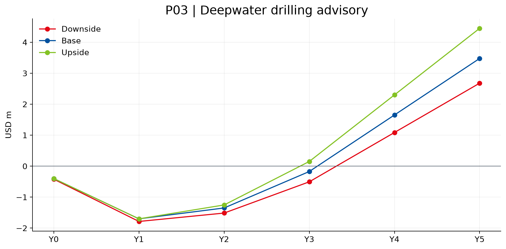

**Base [Calculation on assumptions]**, $m; Y0 late 2026 and Y1–Y5 subsequent annual periods.

| $m | Y0 | Y1 | Y2 | Y3 | Y4 | Y5 |
| --- | ---: | ---: | ---: | ---: | ---: | ---: |
| Incremental gross benefit | 0 | 0 | 0.8640 | 2.0160 | 2.8800 | 2.8800 |
| Recurring OPEX | 0 | -0.3000 | -0.4500 | -0.5000 | -0.5000 | -0.5000 |
| One-time implementation | 0 | -0.6000 | 0 | 0 | 0 | 0 |
| CAPEX | -0.4000 | -0.4000 | 0 | 0 | 0 | 0 |
| Cash tax | 0 | 0 | -0.0635 | -0.3390 | -0.5550 | -0.5550 |
| **Net cash** | **-0.4000** | **-1.3000** | **0.3505** | **1.1770** | **1.8250** | **1.8250** |
| **Cumulative net cash** | **-0.4000** | **-1.7000** | **-1.3495** | **-0.1725** | **1.6525** | **3.4775** |

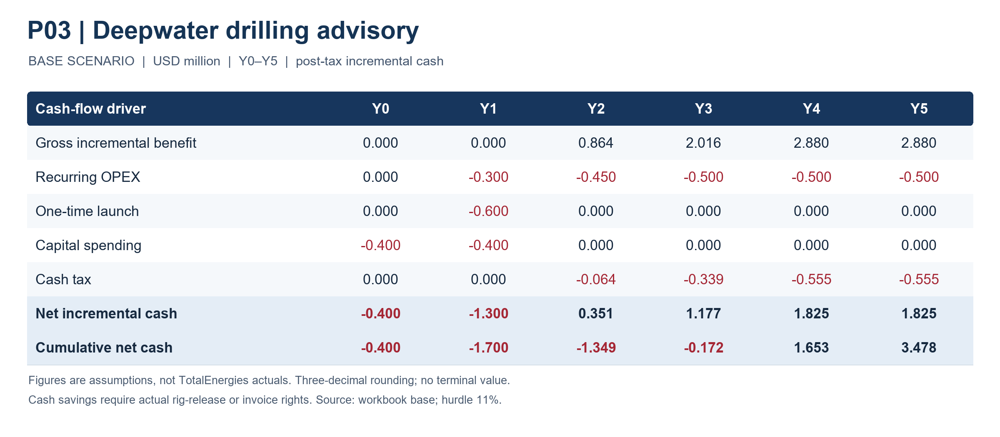

*Presentation figure: same base-case table, rounded to three decimals; values are model assumptions.*
At the fixed P03 **11% hurdle**: NPV **+$1.859m**, IRR **43.2%**, simple payback **3.09 years**, discounted payback **3.35 years**, with annual interpolation and no terminal value. These are not actual results or a commitment to a specific rig programme.

#### 6. Scenarios and controls

The downside assumes 90% of the base benefit and 105% of initial and recurring costs. P13 also uses slower 35% / 60% / 80% / 100% / 100% adoption; other cases retain their base ramp. Upside assumes 115% benefits and base costs; P13 uses 65% / 90% / 100% / 100% / 100% adoption. These are illustrative assumptions, not observed probabilities. A separate severe stress uses 65% benefits and 120% costs. Actual stop costs, delays, contract terms and attribution must be validated before approval.

| Scenario | NPV at project hurdle | IRR | Simple payback (years) |
| --- | ---: | ---: | ---: |
| Downside | $+1.302m | 33.8% | 3.32 |
| Base | $+1.859m | 43.2% | 3.09 |
| Upside | $+2.510m | 52.2% | 2.89 |

**Illustrative financial threshold [Calculation]:** at base costs and timing, approximately **$1.660m/year at full scale** (57.6% of $2.880m) is needed for a zero five-year NPV at 11%. Before proceeding, the drilling lead and finance must verify that day reductions release cash under the actual contract; a schedule improvement alone does not qualify. At the continuation gate, test the remaining cash flows excluding sunk costs, and stop if the prospective NPV is negative or operator/safety permissions fail. The sensitivity is not a guaranteed operational threshold.

**Sequenced decisions:** In Y0, the upstream sponsor confirms two eligible campaigns, data rights and operator/contractor access before approving the assumed $0.4m capital outlay. In Y1, the drilling lead tests advisory recommendations under human control and finance verifies the rig-release or variable-cost mechanism before the assumed $0.4m capital and $0.6m implementation expenditure. At the Y2 review, compare measured cash capture with the agreed baseline and release further activity only if the **remaining** incremental business case clears 11%. If the pilot fails, stop avoidable spending and retain sunk and non-cancellable commitments. These gates do not change the annual cash schedule above; cancellation costs require contract validation.

#### 7. Sources, limitations and challenge

- SRC-037 / CLM-077: Mero operator and 2025 participation; not evidence of operated two-rig scope.
- SRC-008 / CLM-019: Cognite partnership, announced deployment scope; not proof that the selected rigs or advisory tool are ready.
- SRC-025 / CLM-068: BP's well-planning example; no TotalEnergies savings or cash entitlement can be inferred.
- Project hurdle: `work/finance/discount_rate_policy.md`. Recompute in the replacement workbook and verify scope, actual contracts, tax, prices, timeline and scenarios. The main CEO question is whether rig-day savings reduce payments under the actual contract.

### 6.3 P11 — Customer-side flexibility option (H3, provisional)

**Decision at a glance:** test a customer-flexibility service using existing market capabilities and a staged learning investment. The conditional commercial case assumes **$1.5m** one-time investment, **$3.75m/year** retained contribution at 250 MW and an **11%** hurdle. If its assumptions hold, five-year NPV is **+$0.328m** and IRR **16.1%**. This H3 case uses learning gates; no payback or unmodelled post-Y5 value is claimed.

**Status:** Rebuilt conditional case, 10 November 2026. The opportunity is an option to test, not an established new market, a guaranteed revenue stream or a funded rollout. The capacity, margin, costs and customer behavior below are scenario assumptions, not TotalEnergies figures. Active scenarios: `work/finance/portfolio_model_14_revised.xlsx`.

#### 1. Proposal and existing capability

**Proposal [Hypothesis]:** Test a customer-side flexibility service that enrolls eligible commercial loads, batteries or EV charging and offers dispatchable flexibility through existing market capabilities. This is a staged learning investment. First determine which countries, assets, customer segments and services are genuinely incremental to TotalEnergies' current portfolio.

**Existing capability [Fact]:** Quadra Energy's 2023 acquisition announcement describes a 9 GW virtual power plant aggregating renewable production (SRC-036, CLM-076); Integrated Power also has trading and forecasting capability (CLM-027). These facts do not establish whether the specific customer-side service proposed here already exists. A product and contract inventory is a precondition: do not propose a duplicate service or recreate an existing trading platform.

#### 2. Alternatives, classification and design

| Option | Assessment |
| --- | --- |
| Use current Quadra and existing flexibility offers | Counterfactual; determine what they already cover in the chosen country and asset class. |
| Partner with an existing aggregator | Compare customer economics, acquisition costs, market access and sharing of margins. |
| Extend existing platforms with customer-side assets | Working option: partner/buy asset connectivity, use existing trading and build only the missing integration and customer workflow. |

**H3 [Provisional judgment]:** Customer-owned assets could create a different service and revenue-sharing relationship. If the selected offer is only an extension of an existing TotalEnergies business model, H2 may be more appropriate. Classification is not proven by project duration or a label.

The programme tests enrollment, asset availability, cyber controls and dispatch performance; human oversight and network-security rules apply. Before customer activation, obtain explicit consent, control rights, data access, market eligibility and approved contractual terms. The existing portfolio is the baseline.

#### 3. Conditional commercial illustration

**Assumptions, not facts:** Eligible enrolled/dispatchable capacity is 0, 25, 75, 150 and 250 MW in Y1–Y5; all MW are assumed to meet contractual availability conditions. Annual retained contribution is **$15,000 per MW** after customer payments but **before project operating costs and tax**. This cannot automatically be treated as a market price or extrapolated across products, geographies or assets. It requires contracts, settlement data, customer economics and proof that revenues do not overlap with existing activities.

At 250 MW, `250 MW × $15,000/MW/year = $3.75m/year` **[Calculation on assumptions]**. The small pilot's trial economics must be measured separately; the assumption that 250 MW can be acquired and kept available within five years is especially uncertain.

#### 4. Cost, tax and staged timeline

Amounts are **$m nominal**. A hypothetical initial project investment of **$1.5m** includes $0.8m eligible software/integration capital ($0.4m Y0 and $0.4m Y1) and $0.7m initial implementation/contracting expense in Y1. Spending classification is an accounting assumption, not an approved budget or vendor quote. Recurring acquisition, platform, cyber and market operations cost is assumed at $0.35m, $0.55m, $0.75m, $0.90m and $1.00m in Y1–Y5. Procurement, credit/collateral needs, customer recruitment, service levels and non-cancellable commitments require validation.

Tax illustration uses 25% of positive operating surplus after straight-line depreciation of the $0.8m over five years from Y1; no immediate credit for losses. Jurisdictional taxes, working capital and contract accounting are unknown. Costs in a funded pilot are counted in the programme regardless of whether future commercial receipts materialise.

**Indicative sequence:** Y0–Y1 map existing offers and customers, contract a limited pilot and prepare controls; Y2 learn from a 25 MW trial; Y3–Y5 consider additional releases only if customer, dispatch and financial thresholds are met. Each MW and date is an assumption to test, not an approved rollout.

#### 5. Conditional annual cash-flow illustration

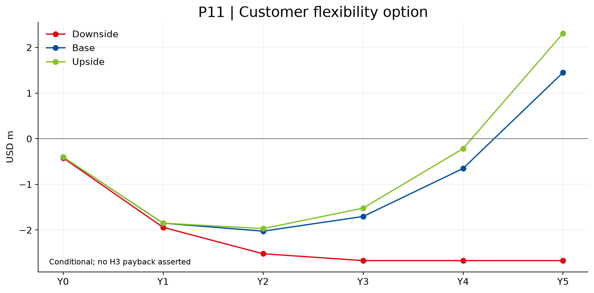

**Conditional portfolio base, not committed revenue.** $m; Y0 late 2026 and Y1–Y5 subsequent annual model periods. The flows below assume every gate succeeds and the hypothetical capacity and margin materialise.

| $m | Y0 | Y1 | Y2 | Y3 | Y4 | Y5 |
| --- | ---: | ---: | ---: | ---: | ---: | ---: |
| Retained contribution before project OPEX | 0 | 0 | 0.3750 | 1.1250 | 2.2500 | 3.7500 |
| Recurring OPEX | 0 | -0.3500 | -0.5500 | -0.7500 | -0.9000 | -1.0000 |
| One-time implementation | 0 | -0.7000 | 0 | 0 | 0 | 0 |
| CAPEX | -0.4000 | -0.4000 | 0 | 0 | 0 | 0 |
| Cash tax | 0 | 0 | 0 | -0.05375 | -0.2975 | -0.6475 |
| **Net cash** | **-0.4000** | **-1.4500** | **-0.1750** | **0.32125** | **1.0525** | **2.1025** |
| **Cumulative cash** | **-0.4000** | **-1.8500** | **-2.0250** | **-1.70375** | **-0.65125** | **1.45125** |

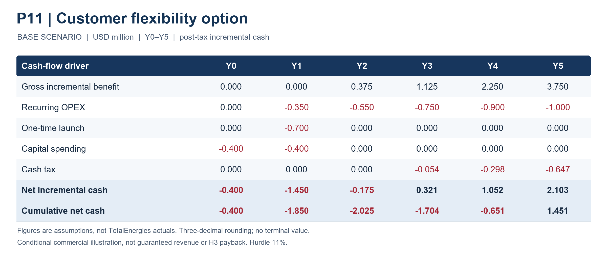

*Presentation figure: same base-case table, rounded to three decimals; values are model assumptions.*
Under these conditional assumptions, NPV at the **11% P11 illustrative hurdle** is **+$0.328m** and IRR **16.1%**. They describe one successful commercial scenario, not verified option value or the value of the initial learning tranche. No H3 payback is claimed. The programme base must retain approved pilot spending even if commercial receipts are excluded.

#### 6. Scenarios and learning gates

The base is conditional on the commercial capacity and retained margin described above. The downside stops after Y2, retains all Y0–Y2 spending, assumes 5% higher costs and includes an additional **$0.15m exit cost in Y3**; all later avoidable operating costs and commercial income stop. The exit allowance and cancellation terms require validation. Upside assumes benefits 15% higher than the conditional base, with base costs. No outcome is guaranteed.

| Scenario | NPV at project hurdle | IRR | Simple payback (years) |
| --- | ---: | ---: | ---: |
| Downside | $-2.370m | n/a | n/a |
| Base | $+0.328m | 16.1% | n/a |
| Upside | $+0.883m | 24.0% | n/a |

For H3, IRR is shown only for the conditional illustration and no payback is claimed. The separate severe stress assumes no P11 commercial receipts and continued spending, providing a materially harsher case than the staged downside. The base portfolio includes P11 conditional income; it is not a company forecast.

| Gate | Owner | Continue only after |
| --- | --- | --- |
| Existing capability | Power owner and Quadra | Document product, geography and contract incrementality; stop duplication. |
| Controlled trial | Venture owner, customers, operator and security | Demonstrate consent, eligibility, dispatch, customer acquisition cost, settlements and cybersecurity. |
| Commercial release | Sponsor and finance | Validate prospective margin and next-stage cash flows against the 11% hurdle and approve incremental exposure. |
| Stop | Sponsor and finance | Recognise sunk costs and contracted exit fees; cancel only costs that are avoidable. |

Capacity, commercial margin, hurdle clearance and exit costs are assumptions requiring evidence; do not advance automatically.

**Illustrative financial threshold [Calculation]:** keeping the base costs, timing and proportional capacity ramp unchanged, the full five-year illustration reaches zero NPV at 11% at roughly **$3.418m retained annual contribution at full scale**, equivalent to about **228 MW** at $15,000/MW/year. This is not evidence that either MW or margin is achievable. At each actual gate, recalculate the remaining prospective economics excluding sunk costs; validate non-cancellable commitments and compare against the partner alternative.

**Separate longer-term illustration [Assumption]:** the portfolio notebook explores a possible expansion to 2,000 MW from Y8 at the same assumed $15,000/MW annual contribution, with a 60% assumed probability of post-Y5 continuation. It assumes $4m expansion CAPEX in Y7 and $5m/year total OPEX at mature scale. These unverified inputs support a separate hypothetical 15-year illustration, not the five-year base case or a committed rollout; they require market, customer, cost and contractual evidence before use as an investment claim.

#### 7. Sources and limits

- SRC-036 / CLM-076: 2023 Quadra VPP announcement; scope was renewable generation aggregation, not proof that the proposed customer offer does or does not exist.
- CLM-027: existing Integrated Power forecasting and trading capabilities.
- `work/finance/discount_rate_policy.md`: P11 11% assumed project hurdle; conditional H3 metrics are not guaranteed.
- `work/finance/industrial_case_models.py`: illustrative calculations. Primary market rates, customer economics, implementation quotes, actual taxes and existing contract coverage remain to be verified. No H3 payback is asserted.

### 6.4 P13 — French retail demand and controlled markdowns (H1)

**Decision at a glance:** propose forecasting and controlled markdowns for a hypothetical 100-station French retail pilot, including electronic shelf labels. The model assumes **€1m** one-time investment, **€0.825m/year** gross benefit at full scale and a **9%** hurdle. Its five-year base NPV is **+€0.972m**, with **49.5% IRR** and **2.33-year simple payback**. Inputs are illustrative and require store-level validation before rollout.

**Status:** Rebuilt working case, 10 November 2026. Project and scenario figures are assumptions unless explicitly identified as facts or local observations; they require financial and operational validation before submission. The active scenario calculations are in `work/finance/portfolio_model_14_revised.xlsx`. The decision does not yet authorise deployment.

#### 1. Decision and existing situation

**Proposal [Assumption]:** Pilot demand forecasting and replenishment assistance with electronic shelf labels and controlled dynamic markdowns in 100 large company-operated French service stations. A successful pilot may justify a separately approved expansion. The pilot does not assume the 800- or 1,500-station footprint of the discarded draft.

**Calibration [Assumption]:** For this proposed case, Vincent suggests an indicative **€1m investment for 100 large French COCO stations, including electronic labels**, and a **2–3 year payback objective** (CLM-078, CLM-079). These are inputs informed by local experience, not evidence of an actual project, company budget or realised result. Scope, contracts and operational baseline require validation.

The programme is presented as a **proposed pilot**. Before investment, map existing retail capabilities and funded initiatives, so the business case counts only incremental costs and benefits. TotalEnergies' worldwide retail footprint is not used as the pilot denominator (SRC-002 p.13). The comparative baseline retains existing replenishment, pricing, staff and systems.

#### 2. Problem, alternatives and horizon

**Problem [Hypothesis]:** Store-level volatility creates avoidable perishable losses, out-of-stocks and urgent deliveries; static ordering and pricing may not capture local traffic and seasonality. Actual losses and baseline performance across the 100 stores are unknown.

| Alternative | Approach | Decision rationale |
| --- | --- | --- |
| Existing process | Current ordering, promotions and local adjustments continue | Counterfactual. Measure its actual outcomes; do not assume it is ineffective. |
| Forecast only | Improve orders and stock visibility; no new labels | Lower hardware spend may make this preferable. Compare pilot cost and benefits before selection. |
| Forecast + labels | Forecast demand and apply approved markdown recommendations using electronic labels | Working base case: combines the proposed pilot's components. Each label/markdown gain must be incremental to forecasting. |
| Manual rules | Improve min/max thresholds and expiry rules without ML | Benchmark on the same stores and outcomes; AI is justified only if it adds measurable net value over this option. |

**H1 rationale [Judgment]:** Improve an existing retail workflow for existing customers using established methods. Forecasts and prices remain subject to human control and pricing rules; the first validated benefit is targeted within the pilot, not assumed before it operates.

#### 3. Scope, dependencies and implementation

- **Scope:** 100 selected French company-operated stores. Verify stock ownership, price authority, POS coverage and category mix before funding.
- **Hard dependencies:** permission to use station/SKU sales and stock history; an eligible POS and label interface; a process for updating shelf prices; data-protection and commercial review. Existing pricing systems and pre-funded label costs are part of the baseline, not repurchased.
- **Soft dependencies:** weather and traffic feeds. Begin with a representative pilot if they are unavailable; do not wait for a group-wide data platform.
- **Delivery [Assumption]:** a branch retail owner, data engineer and data scientist work with station managers and finance; buy/partner for label hardware, integrate with existing systems, and build or configure the forecasting layer. Contract terms and data rights determine the final sourcing choice.
- **Timeline [Assumption]:** Y0 late 2026 decision and setup; Y1 pilot rollout and baseline validation; Y2 expand to the eligible 100 stores after a successful gate; Y3–Y5 operate and measure. These are hypothetical model periods.

#### 4. Investment and operating costs

Amounts are **€m**, nominal. The €1m one-time investment, allocation, timing, CAPEX treatment and recurring costs are business-case assumptions, not a company quotation. The split must be tested against the proposed scope and supplier contracts.

| Cost item | Y0 | Y1 | Total one-time | Treatment assumed |
| --- | ---: | ---: | ---: | --- |
| Electronic labels, connectivity and eligible software | 0.400 | 0.400 | 0.800 | Capital expenditure, depreciated evenly over five years from Y1 for illustration. |
| Integration, installation and initial training | 0 | 0.200 | 0.200 | One-time operating expense in Y1. |
| **Total one-time investment** | **0.400** | **0.600** | **1.000** | Includes labels; do not add them a second time. |

Incremental recurring cloud, data, support and store enablement are assumed at €0.060m in Y1, €0.100m in Y2 and €0.120m/year in Y3–Y5, separate from the €1m. Verify supplier fees, replacement hardware, internal capacity and backfill. No expansion cost or benefit beyond the 100 sites is included.

#### 5. Benefit drivers and evidence

All following amounts are **assumptions**, not reported Argedis results. They are per year at full adoption and refer to the same 100-site perimeter. Finance must verify the baseline and the incremental effect using comparable stores and seasonality before crediting cash.

| Non-overlapping lever | Formula | Annual gross benefit |
| --- | --- | ---: |
| Perishable waste reduction | 100 stores × €350,000 perishable sales/store × 70% inventory cost/sales × 4% baseline waste × 25% reduction | €245,000 |
| Dynamic markdowns | 100 stores × 1,000 **distinct, non-overlapping** at-risk items/store × €2 incremental net recovery | €200,000 |
| Fewer stock-outs | 100 stores × €50,000 baseline missed sales/store × 8% recovered × 35% incremental contribution margin | €140,000 |
| Urgent deliveries avoided | 100 stores × 80 baseline urgent deliveries/store/year × 50% reduction × €60 variable cost/delivery | €240,000 |
| **Total** | Sum of distinct cash drivers | **€825,000/year** |

The 1,000 markdown items must be excluded from the waste-reduction pool; if not, subtract the overlap. The assumption of 80 urgent deliveries per store and a 50% reduction is material and must be tested against invoices and store data. Missed sales, avoidable deliveries, the €2 recovery and the 35% margin must be evidenced by station data and supplier contracts. Savings from released inventory working capital are excluded until a separate balance-sheet bridge proves they are incremental and not recurring earnings.

The model assumes realised benefit ramps to 50% of full scale in Y1, 80% in Y2 and 100% in Y3–Y5. A 25% cash-tax rate and five-year straight-line depreciation of the assumed €0.8m capitalised portion are scenario assumptions; losses generate no immediate tax credit. The applicable tax base, treatment of software and timing must be checked before an investment decision.

#### 6. Five-year cash flow and J-curve

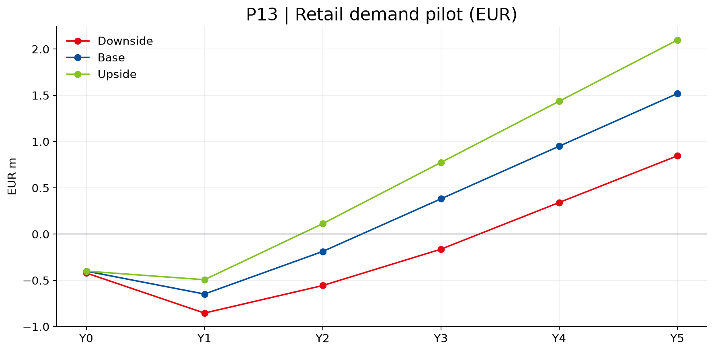

**Base [Calculation on assumptions]**, €m. Y0 is the end-2026 decision point; Y1–Y5 are annual model periods. Depreciation is not a cash outflow; it reduces taxable operating surplus. No terminal value is assumed.

| €m | Y0 | Y1 | Y2 | Y3 | Y4 | Y5 |
| --- | ---: | ---: | ---: | ---: | ---: | ---: |
| Gross incremental benefit | 0 | 0.4125 | 0.6600 | 0.8250 | 0.8250 | 0.8250 |
| Recurring operating cost | 0 | -0.0600 | -0.1000 | -0.1200 | -0.1200 | -0.1200 |
| One-time implementation expense | 0 | -0.2000 | 0 | 0 | 0 | 0 |
| Capital expenditure | -0.4000 | -0.4000 | 0 | 0 | 0 | 0 |
| Cash tax | 0 | 0 | -0.1000 | -0.13625 | -0.13625 | -0.13625 |
| **Net incremental cash** | **-0.4000** | **-0.2475** | **0.4600** | **0.56875** | **0.56875** | **0.56875** |
| **Cumulative net cash** | **-0.4000** | **-0.6475** | **-0.1875** | **0.38125** | **0.9500** | **1.51875** |

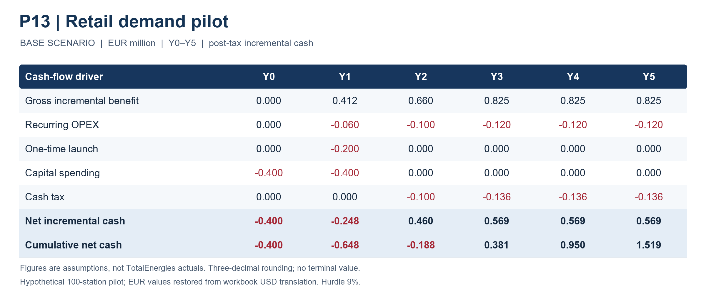

*Presentation figure: same base-case table, rounded to three decimals; values are model assumptions.*
At the fixed P13 hurdle of **9%** (`work/finance/discount_rate_policy.md`), the model produces NPV **+€0.972m**, IRR **49.5%**, simple payback **2.33 years**, and discounted payback **2.55 years**. Paybacks interpolate annual cash uniformly and are not observed month-by-month. The result is consistent with the assumed 2–3 year target, but does not validate the inputs.

#### 7. Scenarios, hurdle and sensitivities

The downside assumes 90% of the base benefit and 105% of initial and recurring costs. P13 also uses slower 35% / 60% / 80% / 100% / 100% adoption; other cases retain their base ramp. Upside assumes 115% benefits and base costs; P13 uses 65% / 90% / 100% / 100% / 100% adoption. These are illustrative assumptions, not observed probabilities. A separate severe stress uses 65% benefits and 120% costs. Actual stop costs, delays, contract terms and attribution must be validated before approval.

| Scenario | NPV at project hurdle | IRR | Simple payback (years) |
| --- | ---: | ---: | ---: |
| Downside | €+0.422m | 24.8% | 3.32 |
| Base | €+0.972m | 49.5% | 2.33 |
| Upside | €+1.434m | 72.1% | 1.81 |

#### 8. Gates, adoption and decision rights

| Gate | Owner | Evidence / action |
| --- | --- | --- |
| Baseline and permission, before spend | M&S sponsor, station representatives, finance, IT | Agree 100 eligible stores, existing capabilities and spend, baseline, treatment/control design, data rights, accounting scope and exact €1m components. |
| Pilot validation, Y1 | Retail product owner, station managers, finance | Track forecast accuracy, inventory losses, markdown event ledger, lost sales, urgent-delivery invoices, adoption and customer impact against comparable stores. Pre-agree sample, threshold and observation window; no assumed 100-store expansion if evidence fails. |
| Scale release, Y2 | M&S sponsor and finance | Release the next stage only if a prospective after-tax business case clears 9% and operational/safety conditions are met. Assess a forecast-only alternative. |
| Stop | Sponsor with finance | Stop or redesign if agreed outcomes fail; retain already incurred costs, contract commitments and exit costs. Do not assume all unspent budget is recoverable. |

Station staff must retain pricing oversight, receive training during working hours and have a feedback route; ensure no unsafe expiry practices and involve employee representatives when applicable. Baselines, thresholds and detailed worker time remain to be established.

**Illustrative financial threshold [Calculation]:** with base costs, timing and tax unchanged, the five-year NPV at 9% reaches zero at about **€0.446m/year of realised gross benefit at full scale**, or 54.0% of the assumed €0.825m. This is not a measured store target. Before further funding, finance should use observed store-level incremental cash and the *remaining* avoidable costs to test whether the prospective continuation case clears 9%.

#### 9. Sources, limits and next validation

- **CLM-078 / CLM-079:** Vincent's calibration guidance for the hypothetical case: ~€1m including labels for 100 stations and a 2–3-year target. Neither is a company filing or a verified actual result.
- **SRC-002 p.13 / CLM-066:** group service-station footprint, context only; it does not establish the 100-store pilot's sales or loss levels.
- **Rate:** `work/finance/discount_rate_policy.md`, P13 9% assumed project hurdle on a 7% group impairment WACC reference.
- **Calculation:** `work/finance/portfolio_model_14_revised.xlsx` and the independent cash-flow checks. Base annual amounts and the break-even sensitivity are illustrative; scenario definitions in the older Python retail model are superseded by the spreadsheet.
- **Open:** validate cost allocation, supplier contracts, data availability, station mix, contribution margins, tax, labour and baseline. The 100-store scope, €1m investment, 2–3 year objective, benefit drivers and future cash are assumptions for the hypothetical case.

### 6.5 Focus case scenario bridge

| Case | Native unit | Downside NPV | Base NPV | Upside NPV | Base IRR | Decision caution |
| --- | --- | ---: | ---: | ---: | ---: | --- |
| P01 | USD m | +1.573 | +2.116 | +2.764 | 57.8% | Validate actual cash margin and distinct downtime/repair benefits. |
| P03 | USD m | +1.302 | +1.859 | +2.510 | 43.2% | Contractually avoidable rig-day payments are decisive. |
| P11 | USD m | −2.370 | +0.328 | +0.883 | 16.1% conditional | Stop/learning option; no payback or assured scale. |
| P13 | EUR m | +0.422 | +0.972 | +1.434 | 49.5% | Pilot economics and 100-store scope are hypothetical. |

These are calculations **on assumptions**, not forecasts or observed results. The downside uses 90% of base benefits and 105% costs except for P13's slower adoption and H3 stop; upside uses 115% benefits and, for P13, faster adoption. Scenario weights are subjective and not empirical frequencies. The focus cases each have a scenario J-curve in their card; the [combined four-case figure](assets/notebook_focus_jcurves.png) is a visual cross-check, not a new financial model.

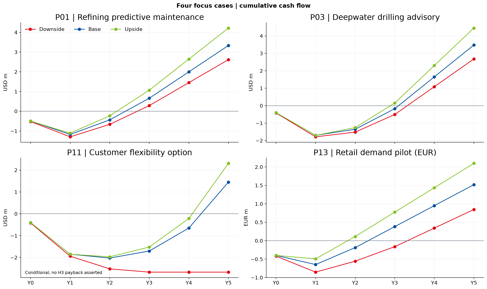

## 7. Financial policy, envelope, scenarios and return test

### 7.1 Hurdles

The team's [discount-rate policy](../../work/finance/discount_rate_policy.md) starts from the **published 7% impairment WACC proxy** and adds assumed branch premiums: E&P +3 pp → **10%**; Integrated LNG, Integrated Power and Refining & Chemicals +2.5 pp → **9.5%**; Marketing & Services and Corporate +2 pp → **9%**. Project adjustments follow: P03 +1 pp → 11%, P11 +1.5 pp above Power reference → 11%, and P12 +3 pp above Corporate → 12%, among others. These are **team hurdles**, not TotalEnergies' disclosed approval policy. They were set by scope and relative risk, not tuned to achieve a desired NPV. Rates must be matched with nominal post-tax cash in the same currency and ownership perimeter. The policy calls for 6/7/8% WACC-proxy sensitivities while keeping premiums fixed.

### 7.2 Five-year funding envelope and cost categories

The **$11.2665m one-time candidate budget** is Y0–Y1 CAPEX plus Y1 implementation/launch, **not** total programme spend. The course's fictional cases use three years, while its memo framework permits **three to five years** (p. 190). Here the decision and financial appraisal cover **Y0 plus five operating years Y1–Y5** because industrial adoption, asset integration and the H2/H3 gates extend beyond three years. The five-year gross ceiling is **$27.6371m** before cash tax and before netting benefits. All numbers below are calculated from the active workbook's [Inputs](../../work/finance/portfolio_model_14_revised.xlsx), including its fixed FX assumption and all 14 inclusion flags. P07/P10 remain in this ceiling even though their standalone cash cases do not clear their hurdles.

| Gross cost component, USD m | Y0 | Y1 | Y2 | Y3 | Y4 | Y5 | Y0–Y5 |
| --- | ---: | ---: | ---: | ---: | ---: | ---: | ---: |
| CAPEX | 3.6966 | 3.5966 | 0 | 0 | 0 | 0 | 7.2932 |
| One-time launch | 0 | 3.9733 | 0 | 0 | 0 | 0 | 3.9733 |
| Recurring OPEX | 0 | 1.9570 | 2.9317 | 3.6440 | 3.8440 | 3.9940 | 16.3706 |
| **Gross modelled spend** | **3.6966** | **9.5269** | **2.9317** | **3.6440** | **3.8440** | **3.9940** | **27.6371** |

**Time convention [Assumption]:** Y0 is the initial decision and pilot preparation period after the late-2026 presentation; Y1–Y5 are five subsequent annual operating periods, not a five-calendar-year claim about 2026–2030. The team should assign actual fiscal dates before submission. The Y0 $3.6966m is the maximum first release in the frozen full-spend scenario, subject to G0 eligibility; the remaining annual ceilings are conditional, not automatic drawdowns. A gate failure changes the actual cash path, so the current full-spend scenario is not a forecast of savings from stopped projects. Gross spend excludes cash tax, working capital, financing and any post-Y5 expansion capital. The rounded table may differ from the unrounded sum by $0.0001m.

The course also asks where money goes across **compute, talent, integration, model operations, data acquisition and governance** (pp. 114–120, 195). The current workbook books CAPEX, launch and OPEX, but does not contain vendor or staff line items that would support a factual six-category split. For the memo, a **planning allocation [Assumption]** can classify each CAPEX dollar as 20% compute, 60% integration and 20% data; each launch dollar as 20% talent, 50% integration, 20% data and 10% governance; and each recurring OPEX dollar as 10% compute, 20% talent, 55% model operations, 5% data and 10% governance. This does **not** change project cash or create additional spend. These proportions must be checked against quotations, internal time and contract invoices before they are stated as an approved budget.

| Illustrative category allocation, USD m | Y0–Y5 total | Share of $27.6371m | Basis and main uncertainty |
| --- | ---: | ---: | --- |
| Compute / platform | 3.0957 | 11.2% | Hardware, cloud and software allocations; electronic labels need actual quotes. |
| Talent and training | 4.0688 | 14.7% | Implementation and run support; protected user time and backfill may be understated. |
| Integration and workflow redesign | 6.3626 | 23.0% | Site, contractor and POS integration concentrated in Y0–Y1. |
| Model operations | 9.0038 | 32.6% | Majority of recurring run cost; validate vendor support and monitoring. |
| Data acquisition and preparation | 3.0718 | 11.1% | Industrial and retail data access and preparation. |
| Governance, safety and control | 2.0344 | 7.4% | E01 and project controls require contract-level attribution. |
| **Total — classification of existing model costs** | **27.6371** | **100.0%** | Rounded rows may differ by $0.0001m. |

The same assumptions also give the following **indicative annual classification**, calculated from the rounded cost-component table above. These rows classify existing costs rather than adding funding; rounding may create small differences from the workbook totals.

| Category, USD m | Y0 | Y1 | Y2 | Y3 | Y4 | Y5 |
| --- | ---: | ---: | ---: | ---: | ---: | ---: |
| Compute / platform | 0.7393 | 0.9150 | 0.2932 | 0.3644 | 0.3844 | 0.3994 |
| Talent and training | 0.0000 | 1.1861 | 0.5863 | 0.7288 | 0.7688 | 0.7988 |
| Integration / workflow | 2.2180 | 4.1446 | 0.0000 | 0.0000 | 0.0000 | 0.0000 |
| Model operations | 0.0000 | 1.0764 | 1.6124 | 2.0042 | 2.1142 | 2.1967 |
| Data preparation | 0.7393 | 1.6118 | 0.1466 | 0.1822 | 0.1922 | 0.1997 |
| Governance / controls | 0.0000 | 0.5930 | 0.2932 | 0.3644 | 0.3844 | 0.3994 |
The category shares are a reporting overlay, **not an independently costed six-category budget**. Finance and operational owners must assign every project line once, check shared staff and contract cancellation rights, and replace these allocators with bills of materials before committing later tranches.

### 7.3 Five-year portfolio cash, downside and return

The workbook's five-year annual cash includes all 14 current inclusion flags and E01 once. It does **not** resolve whether all candidates should be funded. All project cash is translated to USD for aggregation. The table below uses USD m, year-end periods, and the workbook's current assumptions.

| Scenario | Y0 | Y1 | Y2 | Y3 | Y4 | Y5 | Sum of project NPVs at their rates |
| --- | ---: | ---: | ---: | ---: | ---: | ---: | ---: |
| Downside | −3.881 | −8.879 | +0.835 | +3.521 | +5.555 | +5.555 | **−1.307** |
| Base | −3.697 | −8.140 | +1.822 | +4.530 | +7.055 | +8.055 | **+3.671** |
| Upside | −3.697 | −7.828 | +2.516 | +5.600 | +8.528 | +9.697 | **+7.346** |

Assumed 25/50/25 scenario weights give **+$3.345m** as the weighted **sum of project-rate NPVs**. The separate severe stress is **−$11.624m** at project rates, with 65% benefits, 120% costs and continued H3 spending without P11 receipts. It is not a fourth weighted scenario. The ordinary downside is a milder **gated** case, not a worst-case loss cap. The [portfolio J-curve](assets/notebook_portfolio_jcurve.png) shows cumulative **undiscounted** net cash and a base break-even within Y4, conditional on all modelled projects and benefits. It depicts the original workbook cash flows and does not include the separate cost-of-inaction scenario in §8. The [economics note](../../work/finance/portfolio_economics.md) explains the scenario definitions and remaining double-counting/ownership checks.

**Portfolio hurdle test [Calculation on assumptions].** For the course's aggregate comparison, set a separately disclosed **10% common portfolio screening hurdle = the published 7% impairment-WACC proxy + a team-assumed 3 percentage-point mixed-programme premium**. This is a screening convention, neither TotalEnergies' disclosed approval rate nor an average of the 9–12% project hurdles. Project approval still uses each project's own hurdle and prospective cash flows. Solving `0 = Σ(CF_t / (1 + IRR)^t)` using the **unrounded cached consolidated workbook cash flows** gives approximate aggregate IRRs of **6.0% downside, 20.2% base and 29.6% upside**. At the common 10% rate, the same unrounded cached flows have approximate NPVs of **−$1.374m, +$3.633m and +$7.319m** respectively. The 25/50/25 probability-weighted *cash-flow path* has approximate IRR **19.2%** and NPV **+$3.303m at 10%**, so the central and weighted paths clear the chosen common screen while the downside fails. These figures were independently recomputed from cached workbook values. A separate LibreOffice recalculation reproduced 2,906 comparable numeric formula values, including all 18 portfolio cumulative-cash values; Excel-specific recalculation remains outstanding ([review](../../work/research/workbook_recalculation_review.md)). They do not replace the workbook's sum of project-rate NPVs. A weighted average of scenario IRRs would be mathematically wrong. The course asks for IRR, NPV and hurdle together (pp. 96, 129, 190–195). The subjective scenario weights and project risk premiums may charge uncertainty twice; Finance should review that interpretation.

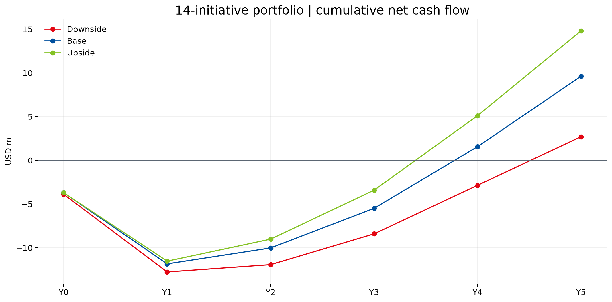

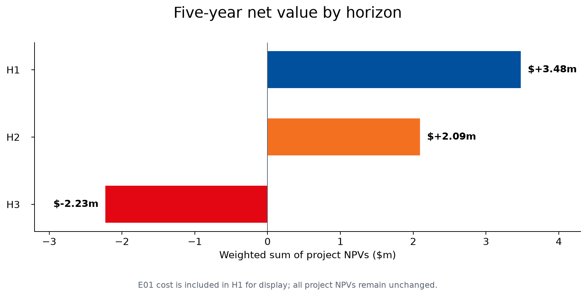

### 7.4 Funding and downside challenges

**WACC-proxy comparison [Calculation].** Discounting the 25% / 50% / 25% weighted portfolio cash path at the published **7% impairment-WACC proxy**, rather than the team's 10% screening hurdle, gives **+$4.755m before** and **+$6.508m after** the assumed inaction overlay. The 7% is a reference for the course comparison, not a verified investment hurdle or a substitute for project-specific risk assessment. Cash remains nominal, post-tax and translated to USD at the model's assumed FX. The inaction-adjusted number remains conditional on the separate exposure, avoidance and non-overlap assumptions in §8.

**Probability challenge [Calculation, not a new forecast].** If scenario weights were changed from 25% / 50% / 25% to **50% downside / 40% base / 10% upside**, weighted NPV at 10% would be **+$1.498m before** and **+$3.069m after** the same illustrative overlay. This exercise isolates weighting; it does not establish those probabilities, worsen the scenario cash flows or prove a loss cap. The overlay's fixed 50% effectiveness even after H3 stops makes the adjusted downside optimistic if the people or commercial measures are also stopped. At zero avoidable erosion, the downside is **−$1.374m** at 10%. The separate severe stress is **−$11.624m at project-specific rates before overlay**, with continued H3 spending and no P11 receipts. It is not assigned a probability and does not establish the worst possible loss. The professor explicitly warns against a downside that clears the hurdle merely because adverse assumptions are too mild (course p. 135).

**J-curve and timing [Calculation].** On the unadjusted weighted annual cash path, cumulative cash reaches an assumed trough of **−$11.990m at the end of Y1**, then turns positive in **Y4** (approximately **Y3.81** under straight-line interpolation within the year). This is cumulative undiscounted cash, not NPV or proof of an actual monthly payback; the notebook chart uses the unadjusted workbook and excludes the inaction overlay. Funding must cover the trough even if planned benefits are delayed.

**If the envelope were halved [Illustrative alternative].** Half of the $27.6371m gross ceiling is **$13.8186m**. An alternative retaining P01, P03, P05, P12, P13 and E01 spends **$13.0171m** on the existing base gross cost assumptions and leaves **$0.8015m** unallocated. It defers P11 and seven other projects, including the P07 safety test; existing safety controls continue, but any additional mandatory safety spending must be included in the ceiling. P12 retains one H3 learning option. Summing the retained projects' existing cash flows, without an inaction overlay, gives **+$2.902m weighted NPV at 10% and 27.5% weighted-cash IRR**, versus **+$3.303m and 19.2%** for the full portfolio on the same unadjusted basis. This is not a recommendation to cut: omitted projects have strategic and safety value, the mild downside is not a worst case, and shared costs, dependencies and incremental scopes require review. The full portfolio's avoided-inaction overlay cannot automatically be assigned to a smaller portfolio. [Alternative assumptions and scenario flows](../../work/finance/half_envelope_alternative.md).

**Business-unit co-funding [Illustrative proposal, USD m].** For the classroom case only, assign each project cost to its sponsoring segment, with cross-functional P05/P06/P07/P12 and E01 assigned to Corporate. This is a 100% sponsor-funding planning convention, not TotalEnergies' actual funding policy, a signed commitment, or an additional expense. Internal transfer prices, corporate contributions and shared resources remain to be negotiated.

| Proposed sponsor | Y0 | Y1 | Y2 | Y3 | Y4 | Y5 | Total |
| --- | ---: | ---: | ---: | ---: | ---: | ---: | ---: |
| Refining & Chemicals | 0.7500 | 1.7000 | 0.5000 | 0.6000 | 0.6000 | 0.6000 | 4.7500 |
| Exploration & Production | 0.7500 | 2.0300 | 0.7000 | 0.8000 | 0.8000 | 0.8000 | 5.8800 |
| Integrated Power | 0.7500 | 2.2500 | 0.7700 | 1.0500 | 1.2000 | 1.3000 | 7.3200 |
| Integrated LNG | 0.1500 | 0.4300 | 0.1000 | 0.1200 | 0.1200 | 0.1200 | 1.0400 |
| Marketing & Services | 0.4466 | 0.7369 | 0.1117 | 0.1340 | 0.1340 | 0.1340 | 1.6971 |
| Corporate / cross-functional | 0.8500 | 2.3800 | 0.7500 | 0.9400 | 0.9900 | 1.0400 | 6.9500 |
| **Total** | **3.6966** | **9.5269** | **2.9317** | **3.6440** | **3.8440** | **3.9940** | **27.6371** |

Rounded totals may differ by $0.0001m. Gross costs exclude cash tax. Confirm business owners, actual co-funding agreements, internal capacity and cancellable commitments before releasing funds.
### 7.5 Long-horizon H3 illustration

The notebook's third mix bar computes a **separate 15-year discounted net value**. It extends the five-year weighted project NPVs with assumed Y6–Y15 continuation cash at each project hurdle. Under explicit but unverified P11/P12 scale, cost and success assumptions, the combined illustrative result is **+$57.987m**, with H3 **+$27.727m**, H2 **+$9.903m**, H1 **+$21.721m** and E01 **−$1.364m**. The chart visually groups E01 with H1, giving H3 47.8% of displayed net value. This is **not** an official forecast, approved option value, or reason to force the course's approximate 70% H3 return illustration. Expansion capital, taxes, OPEX, probabilities and later asset replacement need evidence. No post-Y15 terminal value is included. Do not add this illustrative NPV to the five-year NPV or the cost of inaction.

## 8. Portfolio cost of inaction and decision return

The course compares investment with a deteriorating continuation case (pp. 131–133). The following is a **team-created illustrative scenario**, not a measured TotalEnergies loss. It retains existing group AI, commercial and retention initiatives. The incremental risk pools and the programme's ability to reduce them are unverified, and no financial effect is guaranteed.

1. **Competitive erosion:** assume a $150m/year eligible revenue pool outside P08, P11 and all other booked benefits, with 20% post-tax contribution margin. Assume competitive erosion of 1% / 2% / 3% / 4% of that revenue in Y2–Y5, respectively.
2. **Talent:** assume a cohort of 100 specialists and 1 / 2 / 3 / 4 additional departures in Y2–Y5 beyond existing retention trends, each costing $0.1m after tax in external replacement, onboarding and temporary cover.
3. **Long-term competitive capability:** assume a separate $10m annual post-tax contribution pool for future tenders and offers, outside the first pool and all booked projects. Assume 1% / 2% / 3% of that contribution is lost in Y3–Y5 as capabilities and win rates lag. This is not a second loss on the same contracts or a valuation of P11/P12.

**Evidence and calibration.** TotalEnergies itself identifies skills management, retention and innovation as group risks ([2025 URD](../../sources/primary/totalenergies_universal-registration-document-2025_2026_en.pdf), p. 318; CLM-080), while its existing Digital Line and Digital Factory are already active (p. 42). Neither statement quantifies this proposed programme's effect. The assumed $150m competitive revenue pool is approximately **0.075%** of the group's FY2025 $201,196m external sales (CLM-031), a scale comparison that does not establish the exposed customers or vulnerability. The exposure was increased when exploring a positive downside; it is not a validated estimate.

Assume the funded programme prevents **50%** of each loss through relevant customer improvements, learning, protected time and reusable capabilities. Each pool, baseline, effect, economic ownership and causal mechanism is a planning assumption needing validation. Programme costs must already cover these activities; otherwise add the incremental expense. If a loss is already included in project benefits, remove the overlapping amount. The [overlap review](../../work/research/overlap_and_inaction_review.md) defines proposed exclusions and evidence tests; it has not identified eligible distinct customer pools or established the 50% effect.

| USD m, year-end | Y0 | Y1 | Y2 | Y3 | Y4 | Y5 | PV at 10% |
| --- | ---: | ---: | ---: | ---: | ---: | ---: | ---: |
| No-programme erosion | 0 | 0 | −0.40 | −0.90 | −1.40 | −1.90 | −3.143 |
| Residual erosion with programme | 0 | 0 | −0.20 | −0.45 | −0.70 | −0.95 | −1.571 |
| **Avoided erosion in investment cash** | **0** | **0** | **+0.20** | **+0.45** | **+0.70** | **+0.95** | **+1.571** |

**Scale check against the course [Calculation, not evidence].** In the fictional MaisonRetail example, the professor's **€8.0m** erosion PV at 12% is **23.5%** of the example's €34m five-year gross costs (€30m in Y1–Y3 plus €2m in each of Y4 and Y5; course pp. 120, 126, 131–133). Here **$3.143m** of assumed erosion PV at 10% is **11.4%** of the $27.6371m Y0–Y5 gross programme cost; the **$1.571m** assumed avoided portion is **5.7%**. At 12%, our same loss path has a PV of **$2.927m**, or **10.6%** of our gross ceiling. These are within-case ratios, not currency conversions or comparable forecasts: scope, periods, tax, cash timing and business models differ. A lower ratio does not establish a credible customer exposure or a 50% causal effect. The [detailed comparison](../../work/finance/cost_of_inaction.md) preserves these limitations.

Only the part avoided by the programme is added to its modeled incremental cash flows. At the common **10%** screening hurdle, using the unrounded cached workbook cash flows summarised in §7.3, the resulting decision bridge is:

| Scenario, USD m | NPV before overlay | Avoided erosion PV | Decision NPV | Decision IRR |
| --- | ---: | ---: | ---: | ---: |
| Downside | −1.374 | +1.571 | **+0.197** | 10.6% |
| Base | +3.633 | +1.571 | **+5.204** | 24.1% |
| Upside | +7.319 | +1.571 | **+8.891** | 33.1% |
| Weighted annual cash, 25% / 50% / 25% | +3.303 | +1.571 | **+4.874** | 23.1% |

Weights are subjective. IRR is calculated from each adjusted cash path, not from an average of IRRs. The identical overlay in every scenario is a simplifying assumption and presumes the relevant measures continue even after downside H3 stops; it may overstate downside value. At **zero demonstrated avoidance**, the overlay is zero and weighted NPV returns to **+$3.303m**; at 25% / 75% avoidance its PV is approximately **+$0.786m / +$2.357m**. The downside becomes positive under these assumptions but is not a loss cap. Break-even is approximately **43.7%** avoidance; this is a calculation on unverified exposures, not evidence of a robust margin. The market exposure was increased from $100m to $150m at the user’s request; under the earlier exposure and 50% avoidance, downside NPV is −$0.146m. These common-rate calculations are distinct from the workbook's sum of project-rate NPVs; validate the underlying assumptions and, when available, confirm the workbook in Excel before approval. See [assumptions, detailed calculations and overlap controls](../../work/finance/cost_of_inaction.md). No post-Y5 value or withdrawn $276.02m estimate is included.

## 9. Gates, risk controls and programme execution

The course asks for **metric + threshold + date + owner + action**, not “review regularly” (course p. 198). The following is a **proposed approval contract [Assumption]**, expressed in model years because actual fiscal dates and named employees are not available publicly. The Comex can approve the ceilings and delegate cash release to the named role holders only after they sign the measured baseline and trial protocol. These provisional thresholds are neither observed TotalEnergies targets nor a claim that a pilot has passed.

| Gate and deadline | Metric and proposed threshold | Accountable role and action on failure |
| --- | --- | --- |
| **G0, before any Y0 purchase order** | **100%** of selected assets/stores/customers have identified economic owner, current solution, comparison baseline, data/contract rights and fully costed pilot; initial total commitments do not exceed **$3.6966m**. | Segment sponsor and Finance authorise only eligible project slices. HSE, cyber or legal can block unsafe or unlawful use. Unready candidates receive no purchase order. |
| **G1, end of Y1, before Y2 tranche** | Pilot protocol and matched or historical counterfactual completed; **zero unresolved critical safety/privacy incidents**; at least **90% of identified pilot users trained** and at least **60% of eligible decisions recorded in the approved workflow** in the last four pilot weeks; actual committed cost within the approved project ceiling. Adoption thresholds are proposed assumptions, not measured results, and must be adjusted before launch if the operational workflow makes them inappropriate. For P07, safety owner documents incident/near-miss baseline and a pre-registered target before live use. | Operations lead signs safety and adoption; Finance signs attributable cash. Pause new spend on a missing baseline, unresolved critical incident, cost overrun or non-adoption; redesign or stop the affected project. |
| **G2, end of Y2, before Y3 scale** | Reforecast remaining after-tax cash with observed unit economics. **Prospective NPV > 0 at each project's hurdle** for cash-led H1/H2 scale. As full-project diagnostic reference, P01 needs about **$1.080m/year** full-scale gross benefit, P03 **$1.660m/year**, and P13 **€0.446m/year** under their unchanged cost/tax/ramp assumptions; the actual gate uses remaining avoidable costs and therefore recalculates, rather than blindly applying these thresholds. | Segment sponsor and Finance release only the next eligible tranche. P10 cannot scale on its current negative case: require a positive 10% prospective NPV and distinct yield effect from P01, or retain it solely as a separately justified process-learning test. |
| **H3 option gate, end of Y2 and before each later expansion** | P11 must demonstrate the **25 MW Y2 ramp implied by its 250 MW conditional five-year case** with customer consent, dispatch and settlement evidence; its 250 MW Y5 path and $15,000/MW/year retained contribution remain hypotheses. P12 needs a pre-registered lab success criterion, reproducibility check and costed next experiment; no sales or payback target is invented. | Integrated Power venture sponsor / OneTech R&D sponsor and Finance stop or resize learning if the evidence or next-stage loss ceiling fails. Neither P11 nor P12 receives automatic scale capital from the 15-year illustration. |

**Release schedule [Calculation on assumptions]:** Y0 up to **$3.6966m** after G0; Y1 up to **$9.5269m** after the selected project protocols; Y2 up to **$2.9317m** after G1; Y3 up to **$3.6440m** after G2; Y4 up to **$3.8440m** and Y5 up to **$3.9940m** after annual prospective value and risk reviews. These are full-spend model ceilings, not a claim of contractually cancellable amounts. A stopped project leaves spent and non-cancellable cash in the forecast; the workbook's fixed base path does not dynamically recalculate gate failures. Finance must forecast that branch before any actual release.

For P01, intervention safety and **sold** incremental production matter more than alert accuracy. For P03, contractor payment rights matter more than saved minutes. For P13, matched-store waste, margin, markdown and urgent-delivery records must distinguish the four benefit pools. For P11, customer participation, dispatch, settlement and net contribution decide whether an option becomes a commercial project. At every stop, sunk and non-cancellable commitments remain in the cash forecast. A pilot may fail without cancelling unrelated projects. HSE and cyber can stop an unsafe deployment even if its NPV is positive. Training, frontline feedback, manager capacity and employee consultation where applicable must be included in the confirmed budget and tracked; the current category allocation does not prove that their full cost is funded.

**Comex cadence [Proposal]:** monthly one-page dashboard and quarterly portfolio review. Report baseline, adoption, quality, safety, realised cash signed by Finance, forecast-to-complete, gate status and next decision. At 12/24/36 months, show what was learned and what cash or option evidence justified each release; the course's milestone pattern (p. 202) is a template, not evidence that a deployment will have reached a particular scale by those dates.

## 10. CEO challenge and recommendation for the next decision

| Likely challenge | Evidence-based answer today | Decision consequence |
| --- | --- | --- |
| “Does TotalEnergies already do this?” | It already has substantial AI, data and trading capabilities. Each case defines a proposed **incremental** workflow and must map the current system first. | Reject or redesign a duplicate before spending. |
| “Why these four?” | They span two H1 cash mechanisms, an H2 operational contract mechanism and an H3 learning option. The selection remains provisional until overlap, scope and alternatives are checked. | Do not convert a teaching mix into automatic approvals. |
| “What if the base case fails?” | Modelled five-year downside NPV is −$1.307m; separate severe stress is −$11.624m. Neither is a guaranteed loss cap. | Size the first tranche to cancellable exposure, then pre-agree stop dates and contractual exit costs. |
| “Who owns the return?” | The segment business sponsor signs operational value and Finance verifies incremental cash. Actual names are outstanding. | Name them before the first release. |
| “Why this envelope rather than half?” | An illustrative six-initiative subset costs $13.0171m before tax and gives +$2.902m weighted NPV at 10% before any inaction overlay; P11 and the P07 safety test are deferred. | Compare on like-for-like assumptions; validate dependencies, omitted safety and option value, and any alternative-specific inaction effect. |
| “When does it break even and who co-funds?” | The unadjusted weighted cash trough is −$11.990m at Y1 and cumulative break-even is within Y4; a proposed sponsor allocation is shown in §7.4; actual co-funders are unknown. | Secure liquidity for the trough and assign annual BU/Corporate contributions before release. |
| “Why five years rather than the course's three-year example?” | Industrial deployment and the fixed model have five operating years plus Y0. Gross modelled costs total $27.6371m; the six-category view is an explicit provisional classification. | Approve a five-year ceiling with annual releases and keep H3 post-Y5 potential separately labelled. |
| “Does the portfolio clear a hurdle?” | Before the inaction overlay, base IRR is about 20.2% and weighted-cash IRR 19.2%; with the assumed overlay, they are 24.1% and 23.1%, respectively, against the 10% common screen. The unadjusted downside fails; its adjusted 10.6% depends on the unverified erosion assumptions. Project-rate NPVs remain the project tests. | State both return tests and their different purposes; do not claim P07/P10 stand alone as positive-NPV projects. |
| “What is the cost of doing nothing?” | The illustrative no-programme erosion is −$3.143m PV at 10%; the programme is assumed to avoid $1.571m of it. These are unverified assumptions. | Validate the distinct exposures and causal effect; include only avoided costs, once, and test zero avoidance. |

**Recommendation for this draft:** approve the **$27.6371m five-year gross ceiling** and the **up-to-$3.6966m Y0 initial release**, subject to G0 eligibility and contract checks; reserve the later annual ceilings for documented gates rather than automatic spending. P07 and P10 stay in the strategic programme and its modelled ceiling, but their continuation has separate safety or prospective-economic tests. Before submitting the memo, reconcile the provisional six-category allocation, identify role holders, and replace generic gate thresholds with signed site- or customer-level protocols. Derive the two-page Comex memo from this report, and derive the slide narrative from both. The 15-year notebook continuation remains an illustration, not an approval forecast.

## Appendix A. Course requirement cross-check

This report is the detailed analytical support requested alongside the two-page Comex memo (course p. 206). The oral assessment additionally requires a **15-minute presentation and 5-minute Q&A**; this document alone does not satisfy those separate deliverables. The course PDF gives conflicting team sizes on different slides; administrative confirmation is outside the financial case.

| Course topic | Where covered in this report | Remaining limit |
| --- | --- | --- |
| Readiness, stage, bottleneck and alternatives | §§2–3 | External assessment; internal adoption and root cause remain uncertain. |
| Operating model, decision rights and evolution | §4 | Roles are proposed; actual group authority needs confirmation. |
| Three Horizons, capital mix, build/buy/blend and dependencies | §5 and linked sequencing canvas | All 14 entries have proposed dependencies and first milestones; horizons, sourcing and owners remain assumptions. |
| Investment envelope by category and year | §7.2 | Six-category split is an allocation of existing costs, not itemised procurement evidence; BU co-funding is not known. |
| Three scenarios, weights, annual cash, NPV, IRR and hurdle | §7.3 | Weights and risk premiums are judgments; Excel recalculation and finance review remain outstanding. |
| Cost of inaction and incremental investment decision | §8 | Erosion, avoidance and non-overlap are explicit unverified assumptions. The downside benefit may be overstated. |
| Liquidity J-curve, smaller envelope and co-funding | §7.4 | Trough and a six-initiative half-envelope illustration are modelled; BU funding allocations are proposed, not committed. |
| Governance, adoption, accountable owners and stop criteria | §9 | Roles, dates and thresholds are proposed; no actual internal approvals or contractual loss cap are claimed. |
| Critical board questions and evidence | §10 and Appendix C | Worst case is not bounded, and investment decisions remain conditional on evidence. |

## Appendix B. Source and calculation map

| Evidence class | Primary location | Scope and limit |
| --- | --- | --- |
| Course requirements | [Professor's course PDF](../../course/lectures/AI%20Strategy%20-%20Albert%20School%20-%20Master%202026.pdf), especially pp. 6, 80–83, 96, 124–150, 188–206; [guidelines](../../course/guidelines.md) | Framework and teaching illustrations, not TotalEnergies actuals. |
| Group facts | [2025 URD](../../sources/primary/totalenergies_universal-registration-document-2025_2026_en.pdf); [primary source register](../../sources/register.md) | Date, page, period, scope and status in each CLM/SRC row. |
| Strategy and existing AI | [Strategy synthesis](../../sources/synthesis/2026-11-08_totalenergies_strategy_activities.md); [AI synthesis](../../sources/synthesis/2026-11-08_totalenergies_ai_data_organization.md) | Public outside-in evidence; non-disclosure is not absence of practice. |
| Peer context | [Competitor synthesis](../../sources/synthesis/2026-11-08_competitors_benchmarks.md) | Announcements and vendor claims do not measure an AI performance gap. |
| Rates | [Discount-rate policy](../../work/finance/discount_rate_policy.md) | 7% impairment WACC proxy is published; branch and project hurdles are assumed. |
| Financial calculations | [Active workbook](../../work/finance/portfolio_model_14_revised.xlsx); [model notes](../../work/finance/portfolio_model_14_notes.md); [tests](../../work/finance/tests/) | Recalculate Excel after input changes; project assumptions and inclusion flags are editable. |
| Figures | [Portfolio notebook](../../work/projects/portfolio_charts.ipynb); [visual methods](../../work/projects/portfolio_visuals.md) | Fifteen-year continuation is hypothetical and separate from the workbook. |
| Case detail | [P01](../../work/projects/case_p01_refining_pdm.md), [P03](../../work/projects/case_p03_deepwater_drilling.md), [P11](../../work/projects/case_p11_virtual_power_plant.md), [P13](../../work/projects/case_p13_retail_station_demand.md); [short cards](../../work/projects/reserve_cards.md) | Unit drivers, Y0–Y5 cash tables, alternatives, gates and source limits. |

## Appendix C. Verification and unresolved decisions

1. **Evidence:** confirm actual eligible assets and stores, rights, baseline, vendor costs, data access and tax with business owners. Validate novelty of P11 against existing products, contractor savings for P03, and non-overlapping P13 benefit pools. Keep CLM-074/078/079 explicitly local or assumed.
2. **Selection:** keep all 14 in the proposed ceiling. P07 and P10 cannot be presented as positive five-year standalone cash investments under current model inputs; document the safety and industrial learning rationale and make continuation conditional. Resolve overlap with existing programmes and among candidate benefits before cash release.
3. **Finance:** confirm Y0/calendar conventions, the provisional six-category **five-year** classification, staged commitments and operating costs. The 10% common portfolio screen is a disclosed team assumption, not an average of project rates. Confirm the independently reconciled workbook in Excel when available and verify aggregate IRRs before the memo; validate WACC-proxy sensitivities, FX, taxes and contractual exit costs. Validate the assumed inaction exposure, causal effects, associated costs and overlap before relying on the adjusted portfolio decision case.
4. **Delivery:** name the sponsor, Finance signatory, operational owner and safety/data approver for each funded case; pre-agree numeric gate thresholds, dates and the cost of stopping. Map workforce and management adoption to funded time and training.
5. **Publication:** after these checks, challenge the report against the professor's six board tests (course p. 205), derive the two-page memo, then create slides with one decision claim per slide and calculations in an appendix. Update the [roadmap](../../work/roadmap.md) and matching GitHub issues when acceptance criteria truly pass; this review draft alone closes none of them.
