# Accelerating AI value across TotalEnergies

**Strategic proposal to the Chief Executive Officer | Working decision draft | 11 November 2026**

## Strategic context and recommendation

TotalEnergies already has substantial digital and AI capabilities. The OneTech Digital Line coordinates digital transformation with the branches, while the TotalEnergies Digital Factory develops solutions with the businesses. Under Michel Lutz's Data & AI leadership, this shared expertise provides the benefits associated with a **Centre of Excellence (CoE)**: specialised talent, common technical standards, reusable solutions and a basis for group-wide governance. Branches also contribute their own operational expertise and digital capabilities. This existing combination is a strength on which to build; it should not be replaced by a new organisation.

The opportunity is to make delivery and adoption more repeatable across different operating contexts. Our working hypothesis is that hand-offs between central AI specialists, branch data teams and frontline experts can slow projects when access, decision rights or dedicated capacity are difficult to coordinate. Site integration and the time needed to turn an AI recommendation into an operational decision may also constrain value. The extent of these bottlenecks is not established across the group: the first pilots should test lead times, staffing and adoption against the current process.

We recommend a **strong hub-and-spoke model** that builds on the existing central and branch capabilities. The hub retains shared AI expertise, architecture, security, standards and reuse; the spokes bring business ownership, data access and accountability for results. For each selected pilot, a branch business **champion** with protected time works with a Digital Factory AI specialist, embedded on site when useful, and a branch data engineer where needed. Existing line management and decision rights remain in place. This arrangement requires protected capacity and coordination, but can shorten feedback loops and strengthen ownership without fragmenting controls.

The proposed investment portfolio puts this operating model into practice: four cases receive detailed business, financial and adoption plans, supported by complementary initiatives and shared controls. We recommend releasing funding in stages and measuring both cash outcomes and the delivery model's effectiveness before expanding it.

## Executive decision

Build on the Digital Line, the TotalEnergies Digital Factory and existing branch capabilities to accelerate the delivery and adoption of AI in selected operating decisions. We propose ten initiatives, including a shared control capability, with four detailed investment cases. The programme's indicative gross cost is **$21.94 million over Y0–Y5**, including **$9.82 million of one-time investment** and subsequent operating costs. Amounts are planning assumptions, not approved budgets or committed supplier prices.

On the model's assumptions, the full portfolio generates **$13.78 million of cumulative net cash by Y5** in the base scenario, an **IRR of 32.6%** and an **NPV of $7.11 million at 10%**. The downside generates **$2.27 million cumulative net cash**, with an IRR of **5.7%** and negative NPV at the 10% screen. Cash flows are after the model's illustrative tax and exclude terminal value. These are scenario results, not guaranteed returns; particularly, the H3 case relies on uncontracted licence receipts.

We recommend staged investment, beginning with business baselines, delivery teams and eligibility checks. Release implementation and expansion funding only after the relevant business sponsor, Digital Factory, branch data team and Finance agree on ownership, costs and measurable value. We request sponsorship of the $21.94m programme envelope and a **Y0 authorization ceiling of $2.90m**, released project by project after the checks below. Later spending requires a separate gate decision; the envelope is not a commitment to deploy every project. Finance and each branch must confirm staffing, costs and contractual rights before commitments are made.

The proposed decision date is **16 November 2026**. Approval would establish the envelope and the Y0 ceiling; individual commitments remain conditional on the controls and project gates set out below.

## 1. Start from the capabilities already in place

TotalEnergies has already invested extensively in AI and digital tools. The OneTech Digital Line coordinates digital transformation with the branches and the Digital Factory develops and deploys solutions for business needs. The 2025 Universal Registration Document describes nearly 100 Digital Factory solutions developed since 2020 and more than 10,000 live AI models. Industrial data programmes with AspenTech and Cognite provide foundations on which the proposed projects should build. [2025 Universal Registration Document, pp. 39, 42–43](../../sources/primary/totalenergies_universal-registration-document-2025_2026_en.pdf).

Michel Lutz is TotalEnergies' Chief Data Officer and Head of Data & AI within the Digital Factory. His organisation is a natural partner in the proposed delivery model: common expertise, technical standards and reuse remain central assets, while project teams work more closely with the branches and their operating sites. [TotalEnergies, EnergyTalks, July 2026](https://www2.totalenergies.com/news/news/energytalks-ai-energy-hype-vs-real-impact).

The opportunity is to turn this existing capability into measurable operational and commercial outcomes faster. Our working diagnosis is that coordination across digital experts, branch data owners and frontline teams can constrain delivery when responsibilities and dedicated time are fragmented. This is a hypothesis to test against actual lead times, data access, staffing and adoption; public evidence does not establish a group-wide bottleneck. Existing Digital Factory successes and branch teams are the starting point, not activities to replace.

### Maturity and strategic objective

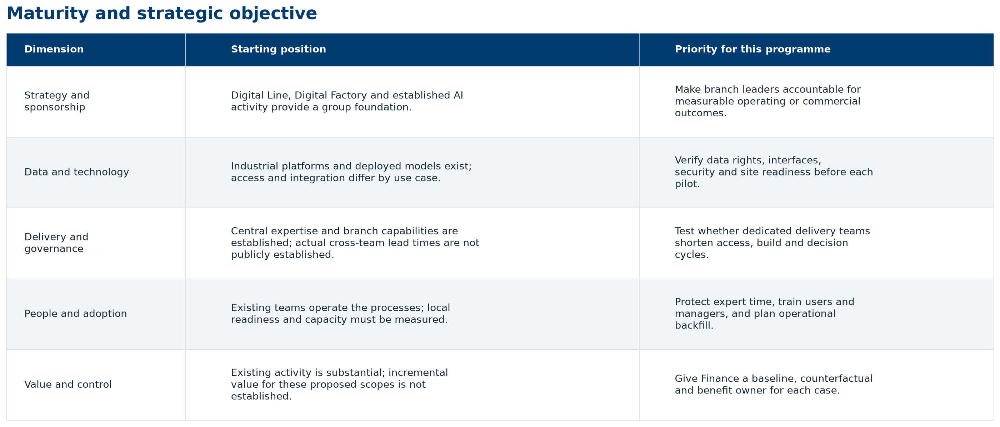

The objective is to turn selected use cases into verified cash outcomes while building a repeatable delivery capability. During the first 90 days, compare actual lead times and capacity constraints with the coordination hypothesis; revise the operating model if evidence points elsewhere.

## 2. Delivery model: a stronger hub with empowered project teams

### The operating-model choice and its trade-offs

A **centralised CoE** concentrates scarce AI talent, supports consistent standards and makes shared assets easier to reuse. Its trade-off is that a single delivery pool can face queues or become distant from site-specific workflows when demand grows. Centralisation remains valuable for common platforms, specialist expertise and risk controls; the existence or size of any queue at TotalEnergies must be measured.

A **federated model** gives branches more autonomy and can fit highly specialised local needs. Its trade-offs include potentially duplicated tools and skills, inconsistent controls and fewer opportunities to reuse solutions. Branch autonomy is valuable where capabilities already exist, but a fully federated approach would make it harder to maintain a coherent group-wide view of models, risks and investments.

The proposed **hub-and-spoke** model combines a strong shared hub with branch-led use cases and accountable business sponsors. Its own risks are coordination overhead, unclear ownership between hub and spokes, and competition for scarce specialists. We address these through named decision owners, protected project capacity, common standards and explicit escalation and funding gates. The choice is an evolution of capabilities already in place, not a claim that the current organisation fits a single archetype or that a group-wide reorganisation is required.

### Embedded delivery teams

Retain the Digital Line and Digital Factory as the hub for architecture, security, AI expertise, shared tools and reuse. Branch leaders remain accountable for use-case selection, operations, business results and existing reporting lines. For each approved pilot, establish a small delivery team with:

- A business champion nominated by the branch: an expert with protected time, ideally half-time or more according to the pilot's needs and the availability of backfill, who represents users and helps embed the new workflow.
- A Digital Factory data scientist or AI engineer, seconded to the project and working on site when that materially helps design and adoption.
- A branch data engineer where needed to secure access, prepare the relevant data and integrate the solution into local systems.

The branch project lead continues to coordinate delivery; technical standards and line management remain with their existing owners. Finance joins at baseline and review gates rather than serving as a permanent fourth delivery member. FDE describes the working arrangement of the Digital Factory specialist, not a requirement to create a new organisation or hire for every project. Each sponsor must reserve the required capacity and identify its cost, including travel, backfill and training, within the project envelope or reprice the case before approval. The current estimates do not independently demonstrate that all such capacity is funded.

Start with the four featured cases. Compare their lead time, access delays, time spent by operational experts, user adoption and Finance-verified outcomes with the existing delivery process. If the main obstacle proves to be data access, a contract or another constraint, adjust the intervention rather than simply adding more teams.

### Decision rights and controls

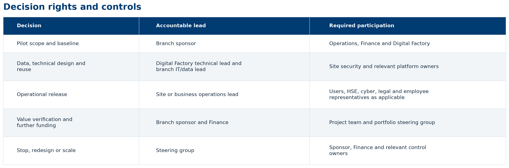

Human operators retain operational decision authority. Unsafe or non-compliant solutions do not proceed, regardless of the projected return.

## 3. Portfolio and investment priorities

The portfolio combines operational improvements (**H1**), redesigned cross-functional workflows (**H2**) and a conditional external-business option (**H3**). P12 qualifies as H3 only if it establishes a genuinely new external licensing proposition; improving an existing internal research workflow alone would not establish that change.

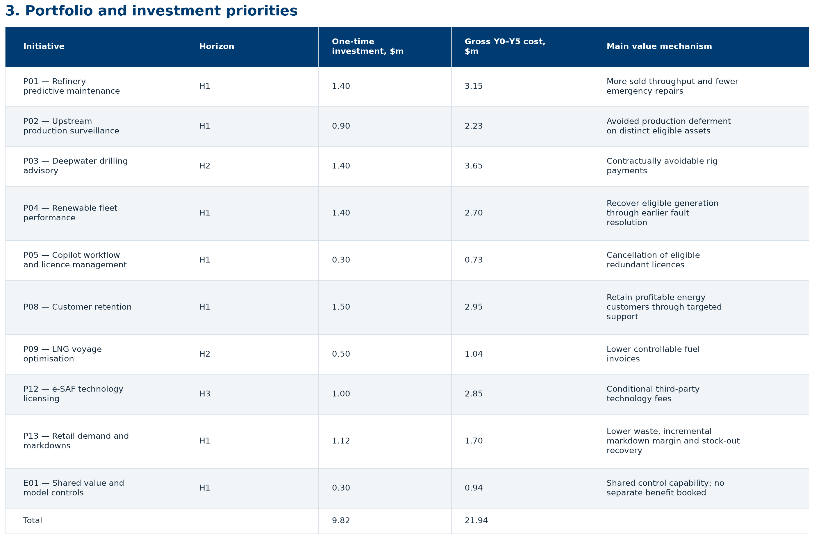

E01 is shown within H1 for allocation purposes and funded once. The one-time horizon mix is **70.5% H1, 19.4% H2 and 10.2% H3**, subject to rounding. Full programme spending includes recurring costs. P13 is modelled in euros and translated at the assumed rate of $1.1165/€; totals may differ by rounding.

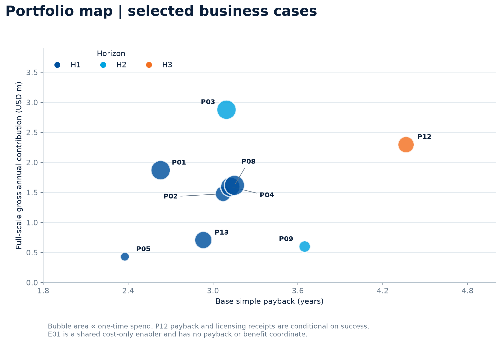

P02, P04, P05, P08 and P09 are complementary estimates rather than fully developed investment cases. P02 assumes two production hubs with 135 barrels per day of eligible recovered production each and $15 per barrel of incremental contribution; it must be separated from P03 drilling events. P05 assumes 10,000 paid licences, 12% cancellable, at $30 per month; procurement must confirm cancellation rights and whether the users need alternatives. P09 assumes 30 eligible voyages, $1 million of controllable fuel per voyage and a 2% improvement; charter terms and incremental savings over existing routing must be checked. These values are assumptions and all three require a business-owner baseline before commitment.

P04 targets an illustrative 3,000 MW of eligible renewable assets: `3,000 MW × 8,760 hours × 30% capacity factor × 0.45% incremental generation recovered × $45/MWh net value` gives **$1.597m/year** at full rollout. The gain must be incremental to existing monitoring, within the company's economic entitlement and net of relevant operating costs. P08 targets 1.2 million eligible power or gas accounts: `1.2m × 10% annual churn × 9% relative reduction × $150 annual contribution` gives **$1.62m/year** at full rollout. Contribution is assumed net of customer incentives and avoidable service costs; a control group must establish incremental retention. Neither project assumes group-wide coverage or claims these inputs as reported results.

The assumed one-time and recurring costs total **$2.70m** for P04 and **$2.95m** for P08 over Y0–Y5. At their project hurdles, base NPVs are **+$1.05m** and **+$0.99m**, with simple paybacks of **3.12** and **3.15 years**; downside paybacks are **4.34** and **4.52 years**, respectively. The [complementary project cards](../../work/projects/reserve_cards.md) detail the assumptions and gates.

### Portfolio ownership and dependencies

The roles below are proposed accountable functions, subject to appointment. The listed dependencies are checked before each case is released; shared controls are funded once through E01 in the full portfolio.

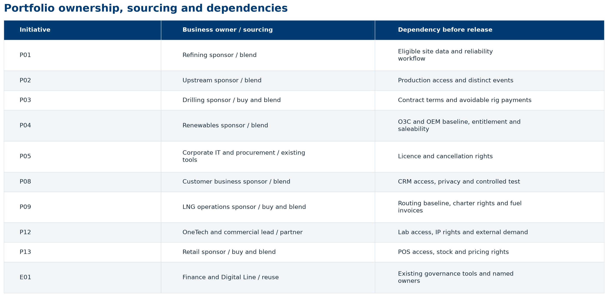

### Spending and funding sequence

The model separates capital expenditure from operating and launch expense; both are included in the gross envelope below. Amounts are $m and may not add exactly because of rounding. Tax is excluded from the cost envelope and included in the net cash flows.

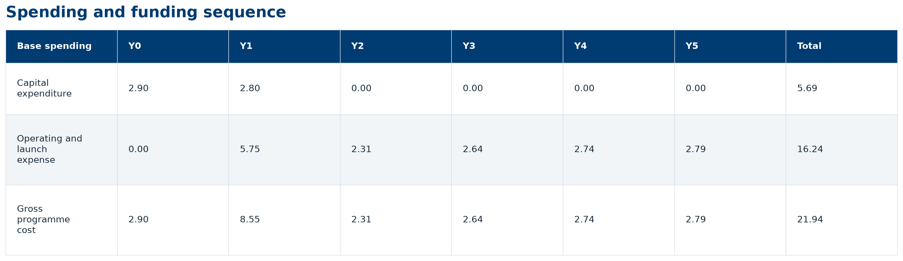

The one-time $9.82m includes $5.69m assumed capital expenditure and $4.12m launch expense. Remaining recurring operating costs total $12.12m. The four featured cases are itemised below; complementary-case categories still require supplier and staffing validation. They must not add an uncosted duplicate allowance or treat the present estimate as a supplier quote.

Authorize at most the modelled $2.90m Y0 capital tranche, subject to case-level release, existing-commitment checks and confirmation that the first tranche is the lowest practical commitment. The remaining $19.04m is a planning envelope, not an automatic authorization. Portfolio steering reviews the cash forecast quarterly; sponsors return for Y1 commitments after baseline and feasibility gates. A stop does not recover sunk or non-cancellable costs.

### Indicative cost allocation

The following top-down planning allocation classifies the existing model costs into six categories. Y1–Y3 form the three-year operating view; Y0 is the upfront decision period and is shown separately. This classification does not add spending or change CAPEX/OPEX. It is an indicative allocation, not a project-level costing or supplier quote: cost owners must replace its assumed shares with staff, procurement and contract evidence before release. Compute and equipment includes physical assets such as retail labels; talent includes training and backfill. Amounts may differ by rounding.

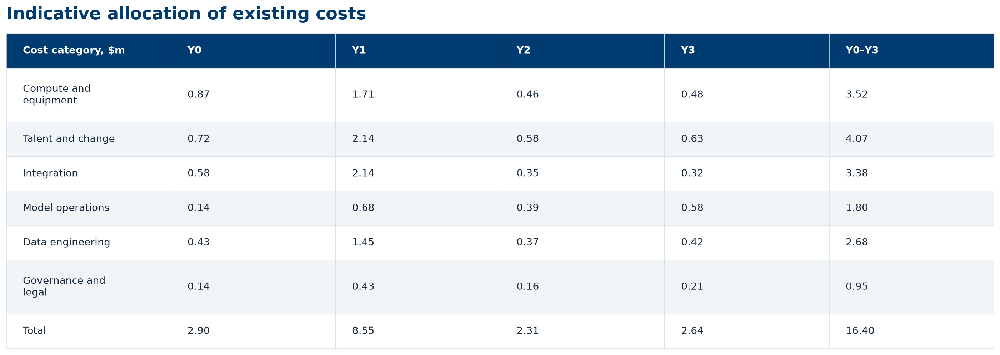

The assumed category shares, in the order shown, are 30/25/20/5/15/5% for Y0, 20/25/25/8/17/5% for Y1, 20/25/15/17/16/7% for Y2 and 18/24/12/22/16/8% for Y3. Each year’s gross spending is multiplied by those shares; the resulting classifications sum to the existing annual model totals. They are portfolio-level allocations and must not be read as a project-by-project breakdown. The [reproducible calculation](../../work/finance/category_allocation.py) retains the unrounded amounts.

### Portfolio economics

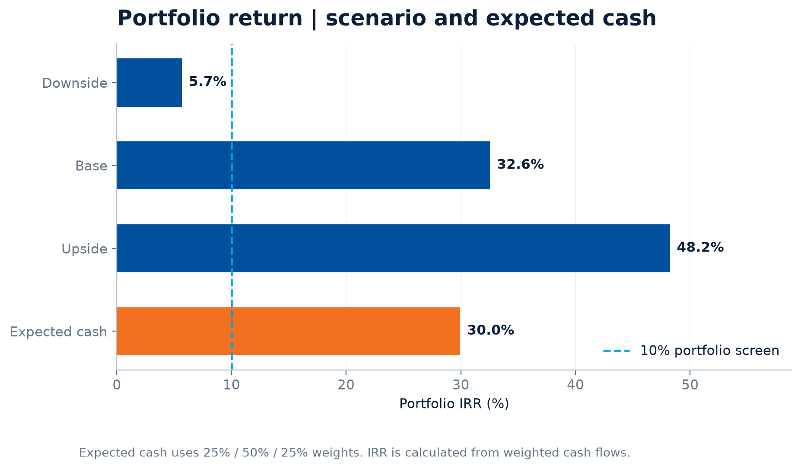

With judgemental scenario weights of **25% downside, 50% base and 25% upside**, expected NPV at the common 10% screen is **+$6.30m**; the IRR of the probability-weighted annual cash flows is **30.0%**. This IRR is calculated from expected cash flows, not by averaging scenario IRRs. The downside remains cash-positive by Y5 but does not clear the common 10% screen; it includes a stopped, loss-making P12. In the base case scale only on verified adoption and prospective economics; in the upside release capacity only after operational and cash benefits are demonstrated.

The company reported a 7% post-tax WACC estimate for specified 2025 impairment tests; the portfolio uses that only as a proxy and adds an assumed 3 percentage point execution-risk premium to reach the 10% screening rate. This is not a published TotalEnergies investment hurdle. Project cases use the rates stated in their tables. The model assumes 25% cash tax, straight-line depreciation of assumed capital assets and no immediate credit for annual losses. All scenarios include the costs and benefits of the ten selected initiatives once; P12's commercial base case is conditional on successful development and sales. Individual project downside assumptions differ and are specified in their cases.

### If the budget is cut

The four featured cases are the priorities: P01, P03, P12 and P13. Their combined full-scope gross cost is **$11.35 million**, or **51.7%** of the $21.94 million full portfolio. Their base and downside IRRs are **34.8% and 6.4%** respectively. This is our approximately half-budget option. The four-case calculation excludes E01: essential shared controls must be provided from existing capabilities or funded separately. The 34.8% and 6.4% IRRs apply to the four cases as modelled; these costs and returns do not include an additional E01 allocation.

### Cost of inaction and decision value

The portfolio's expected NPV of **$6.30m** stands on its own against static operating baselines. A separate sensitivity considers three adverse developments from Y2: a $1/barrel increase in the refining contribution associated with unrecovered production (P01), a $0.05m/day increase in eligible avoidable rig cost (P03), and a one-percentage-point increase in churn among P08's 1.2 million eligible accounts. The projects avoid only the part of those additional exposures represented by their respective incremental impact. At full adoption the additional gross benefit assumptions are $0.287m, $0.360m and $0.162m per year, respectively.

After applying scenario-weighted benefit ramps, an illustrative 25% tax rate and 10% discount rate, these items add **$1.36m** of avoided loss, giving an illustrative **$7.66m decision value**. They are assumptions, not observed trends or a forecast, and the overlay is not included in the $6.30m portfolio NPV. These amounts assume no additional project spending and depend on eligibility, contracts and execution. Remove any component already reflected in the baseline or project gains to avoid double counting.

A different question is whether to delay the same base programme by a year. Moving all six annual cash flows back by one year reduces NPV from $7.11m to $6.47m, a $0.65m timing cost at 10%. That alternative is not added to the bridge. Equinor's predictive-maintenance and BP's digital well-planning examples show relevant activity by peers; they do not prove a TotalEnergies performance gap or establish lost market share.

### Cost composition of the four featured cases

The following are planning allocations within the existing modelled envelopes, not additional costs or supplier quotations. Hardware/software, integration and training are one-time; run costs cover Y1–Y5. Capitalisation is a modelling assumption, subject to accounting review. Internal staff and site backfill are included in the allocated lines, subject to capacity confirmation.

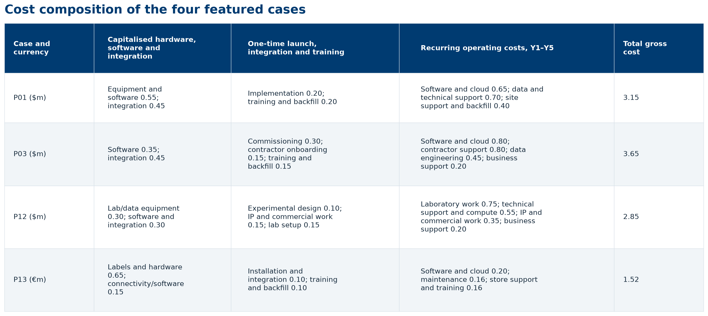

P13's €1.52m converts to approximately $1.70m at the model's $1.1165/€ assumption. For P12, this remains a limited research envelope; it does not fund a demonstration plant or establish that commercialization can be delivered at the assumed cost. Validate procurement, seconded staff, backfill and support commitments before release, and reprice if the required work exceeds the allowance.

## 4. Four featured investment cases

The following cases retain their existing operational logic and are aligned with the working model. Figures are scenario assumptions and require operational, contractual and financial validation at the gates.

### P01 — Refining predictive maintenance (H1)

#### 1. Decision, problem and existing capability

**Proposal:** Pilot predictive maintenance on critical rotating equipment at two eligible refining sites, then extend within those sites only when operations and finance confirm value. Asset and site selection are **assumptions** pending validation. TotalEnergies is already deploying AspenTech's industrial data platform (CLM-018) and has existing maintenance processes; both belong in the counterfactual. This proposal funds an incremental workflow and interventions only where they are not already delivered.

**Problem [Hypothesis]:** Certain unplanned equipment stops lead to lost margin and avoidable emergency repairs. The number of preventable outages, eligible machines and economic contribution of the sites are unknown. A data platform or an anomaly alert alone does not create value: a verified alert must lead to a safe maintenance action that changes the baseline outcome.

#### 2. Alternatives, horizon and sourcing

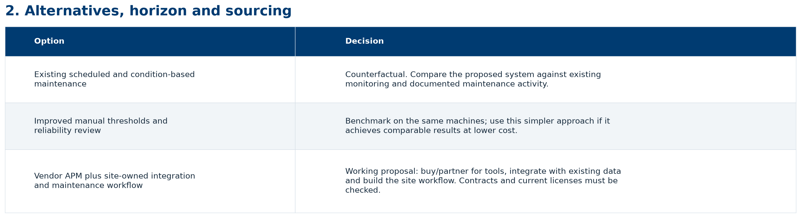

**H1 [Judgment]:** Optimises existing refining operations using an established class of maintenance tools. Technology maturity does not prove the local gain. No new enterprise-wide data lake is assumed.

#### 3. Perimeter and benefit drivers

All parameters below are **assumptions**, not published TotalEnergies site performance. The two sites' actual throughput, ownership share, production constraints and incremental contribution margin must be verified.

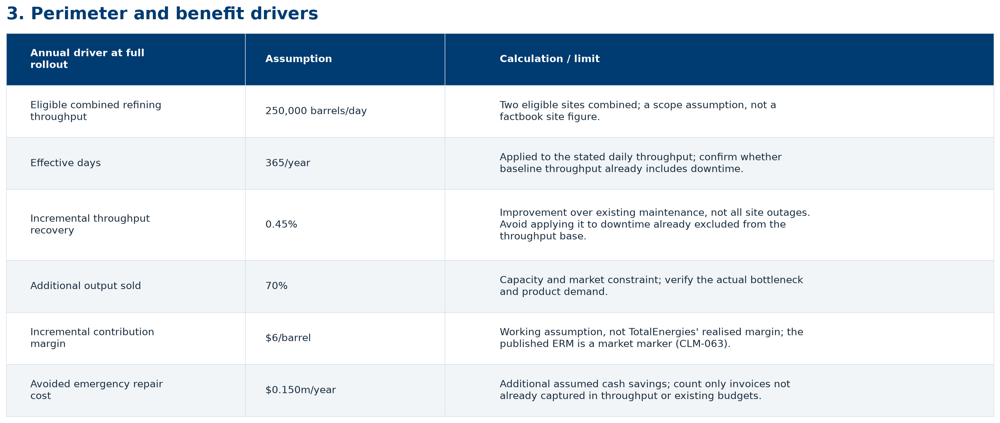

Full-scale gross benefit = `250,000 × 365 × 0.0045 × 0.70 × $6 + $150,000` = **$1.8746m/year [Calculation on assumptions]**. The scope is two assumed sites, not all group throughput. Equinor's reported $120m since 2020 (SRC-017 / CLM-036) is a cumulative contextual benchmark and does not prove this annual amount.

#### 4. Costs, schedule and assumptions

Amounts **$m**, nominal. Y0 is a late-2026 decision point and Y1–Y5 the following annual periods. These allocations and dates are project assumptions, not vendor quotations. Total one-time investment: **$1.4m**, comprising $1.0m capitalised hardware/software ($0.5m in Y0 and $0.5m in Y1) and $0.4m implementation/training expensed in Y1. Verify sensor reuse, software capitalization, site costs and existing contracts. Recurring operating and support costs are $0.20m, $0.35m, $0.40m, $0.40m, $0.40m in Y1–Y5.

Pilot benefit ramp is 20%, 60%, 85%, 100%, 100%. Tax illustration assumes a 25% rate, five-year straight-line depreciation on the assumed $1.0m of capital assets from Y1, and no immediate tax credit on annual losses. Actual taxes, depreciation, internal staff and backfill are unverified. No terminal value, external benefit or expansion beyond the assumed perimeter is included.

#### 5. Reconciled cash and scenarios

Amounts USD m.

Downside assumes 80% of full-scale benefits, 110% of investment and operating costs, and a slower 15% / 50% / 80% / 100% / 100% benefit ramp. Upside assumes 115% of full-scale benefits and accelerates the base ramp by 15%, capped at 100%, at base costs. The 9.5% hurdle is a project screening assumption.

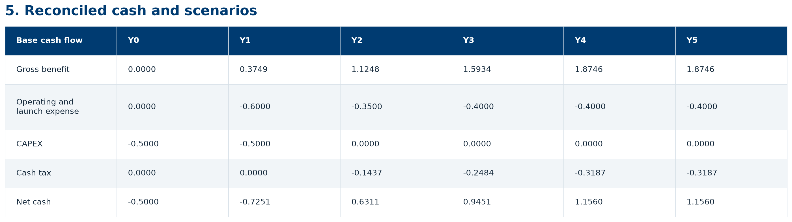

#### Gates, adoption and risk

1. **Before pilot:** site reliability owner, finance and IT establish existing solutions, eligible equipment and production baseline, data rights and the $1.4m spend split. Agree the alert metric, false-alarm tolerance and comparable maintenance baseline before live testing.
2. **Pilot review:** reliability engineers validate actionable alerts, safe intervention and actual production/repair economics; finance checks whether incremental throughput was sold. Pause on safety issues; retrain or stop on missed pre-agreed performance thresholds.
3. **Expansion:** sponsor releases further spend only if the **future** incremental case clears the hurdle and the site adoption and security conditions are satisfied. A stop leaves sunk and non-cancellable costs in the programme.

**Illustrative financial threshold [Calculation]:** with the base costs, tax and ramp unchanged and all benefits scaled together, total five-year NPV at 9.5% reaches zero at approximately **$1.080m/year at full scale** (57.6% of the modelled $1.8746m). This is a full-project sensitivity, not a prospective continuation rule: at the gate, exclude sunk costs and recalculate the remaining cash commitments and attainable benefits. Agree operational reliability and safety thresholds with the site before launch.

The reliability team retains intervention authority; operators and maintenance staff participate in design and receive funded training. Cybersecurity, safety, data completeness and actual licensing scope are gating conditions, not afterthoughts.

#### Sources and validation required

- TotalEnergies 2025 URD: refining throughput CLM-052 and existing data initiatives CLM-018; no claim that the assumed two sites have 250 kb/d.
- Market ERM is contextual only, CLM-063; the $6/b incremental contribution assumption is not a source-backed TotalEnergies actual.
- Equinor SRC-017 / CLM-036: $120m cumulative predictive-maintenance value since 2020, including partners; not an annual peer amount or a transferable per-machine return.
- Discount rate: `work/finance/discount_rate_policy.md`. Recompute independently in the replacement spreadsheet and validate site baseline, budgets, tax, rates and scenarios before presentation.

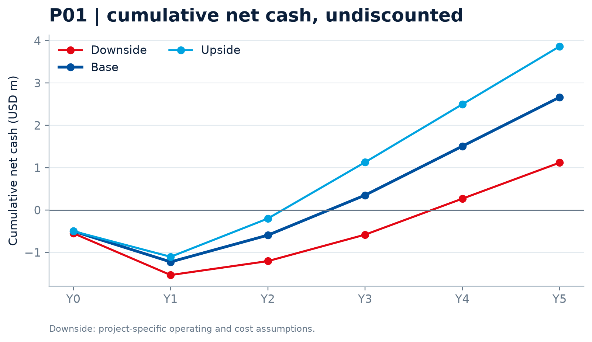

#### Operational workflow and evidence plan

Select critical rotating equipment with the site reliability team and document the existing inspection programme, historical events and process constraints. Establish whether the sensor and maintenance records can be joined at equipment level; where they cannot, repair only the interfaces needed for the pilot. The Digital Factory specialist and site expert review alert logic together. Alerts enter the existing maintenance workflow; a reliability engineer assesses severity, maintenance windows and false alarms. No model directs an automatic shutdown or bypasses safety procedures.

Before testing, Finance and operations agree comparable equipment and a period adjusted for maintenance schedules and production conditions. The evaluation follows the complete chain: eligible alert → verified failure mode → action taken → avoidable stop or repair → additional saleable throughput or paid invoice avoided. Log alerts that do not lead to intervention as well as missed events. Record additional output at the actual incremental contribution and deduct the effects of planned maintenance, demand or other bottlenecks; compare repair invoices separately to avoid counting the same event twice. The sponsor stops expansion if safe action, data quality or prospective economics are inadequate; a good prediction score alone is not a return.

### P03 — Deepwater drilling advisory (H2, provisional)

#### 1. Proposal and starting point

**Proposal:** Test a human-supervised planning and drilling advisory workflow across **two eligible operated deepwater rigs or campaigns**. Identify actual operated assets and obtain agreement from the operator, drilling contractor and relevant partners before committing to a pilot. Existing Cognite deployments and drilling practices remain in the counterfactual (CLM-019); count only incremental capability and cash.

**Fact:** Mero is operated by Petrobras; TotalEnergies' reported interest was 19.3% in the 2025 announcement (SRC-037, CLM-077). The previous claim that Mero is operated by TotalEnergies was incorrect. This case therefore does not assume the ability to deploy unilaterally at Mero, nor apply the 19.3% figure mechanically to a different contract.

**Problem [Hypothesis]:** Better use of well and drilling data may reduce non-productive time. A faster operation does not automatically save cash: the contract must permit an earlier rig release, reduce variable charges or create another documented financial benefit. BP's published well-planning example is context, not proof of a TotalEnergies gap or saving (CLM-068).

#### 2. Alternatives, horizon and delivery

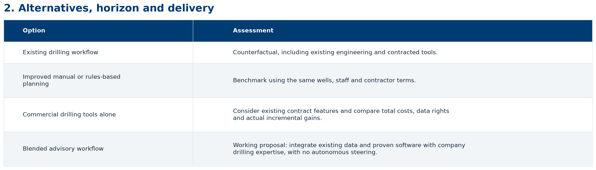

**H2 [Judgment, provisional]:** A cross-functional redesign of the well-planning and operational workflow is proposed. Horizon placement must reflect the selected workflow and adoption cycle, not a desire to rebalance the portfolio. HSE and drilling experts retain operational authority.

#### 3. Scope and incremental benefit formula

**Annual assumptions at full scale:** two eligible operated rigs/campaigns; six avoidable rig-days per rig per year; $0.400m/day fully avoidable gross spread cost; 80% assumed economic share × 75% payment avoidability = 60% combined realization. These are **not verified company figures**. Both factors are explicit hypotheses for the same eligible campaigns, not verified contract terms. Do not apply ownership a second time. If the actual economic share is 40%, otherwise unchanged benefit halves to $1.440m/year, below the approximately $1.660m break-even reference.

`2 rigs × 6 days/rig/year × $0.400m/day × 60% = $2.880m/year` gross incremental cash **[Calculation on assumptions]**. Verify invoices, full rate composition, actual rig release rights, partner allocation and whether the company already planned the saving. Any time saving without reduced cash payment is reported as capacity or schedule value, not this cash benefit. Avoid overlap with existing procurement savings and the existing savings plan.

#### 4. Costs, data and timing

Amounts **$m**, nominal; calendar and procurement terms are assumptions. The one-time investment is **$1.4m**: $0.8m assumed capitalised integration/software ($0.4m Y0 + $0.4m Y1) and $0.6m of one-time integration, commissioning and training expense in Y1. Confirm the accounting treatment and reuse of existing platforms. Recurring software, data engineering, contractor support and run cost are assumed at $0.30m, $0.45m, $0.50m, $0.50m, $0.50m in Y1–Y5.

Assumed benefit ramp: 0%, 30%, 70%, 100%, 100% in Y1–Y5. This assumes a pilot, followed by conditional release, not autonomous operation. The model assumes a 25% cash-tax rate, straight-line depreciation of $0.8m over five years from Y1 and no immediate credit for annual losses; actual jurisdiction, ownership and tax terms must be confirmed. No terminal value or country premium is assumed separately.

**Hard dependencies:** rights to selected drilling data, contractor integration, operator consent, safely bounded advisory workflow and finance access to invoices. Cognite on operated assets is an existing foundation, not a promise that a specific rig is connected on a chosen date. Well engineering lead and contractor representatives own validation.

#### 5. Reconciled cash and scenarios

Amounts USD m.

Downside assumes 80% of full-scale benefits, 110% of investment and operating costs, and a slower 0% / 25% / 60% / 90% / 100% benefit ramp. Upside assumes 115% of full-scale benefits and accelerates the base ramp by 15%, capped at 100%, at base costs. The 11% hurdle is a project screening assumption.

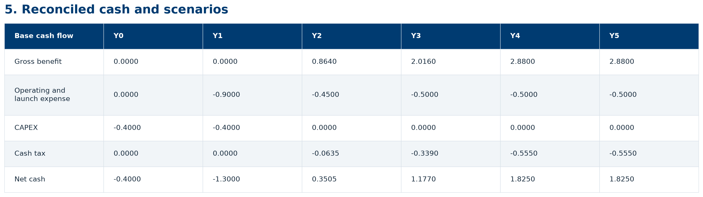

#### Sources, limitations and challenge

- SRC-037 / CLM-077: Mero operator and 2025 participation; not evidence of operated two-rig scope.
- SRC-008 / CLM-019: Cognite partnership, announced deployment scope; not proof that the selected rigs or advisory tool are ready.
- SRC-025 / CLM-068: BP's well-planning example; no TotalEnergies savings or cash entitlement can be inferred.
- Project hurdle: `work/finance/discount_rate_policy.md`. Recompute in the replacement workbook and verify scope, actual contracts, tax, prices, timeline and scenarios. The main CEO question is whether rig-day savings reduce payments under the actual contract.

#### Operational workflow and evidence plan

The drilling lead selects eligible campaigns and obtains operator, partner and contractor agreement before any data transfer. The project team combines approved historical well data, engineering records and contractor inputs to surface advisory recommendations for planning and execution. The drilling engineer and contractor assess each recommendation within existing HSE and well-control procedures; operational authority and the right to reject a recommendation remain unchanged.

Before the pilot, establish comparable well phases and the existing planning and non-productive-time baseline, with geological and operational differences recorded. For each recommendation, retain the evidence trail from planned activity to actual rig days and then to the relevant contract clause and invoice. Finance counts a benefit only when a shorter period actually reduces a payment or creates another documented cash effect, adjusted once for the group's contractual economic interest. Faster work without an invoice impact is reported separately. If the contract prevents capture, if the tool duplicates an existing capability, or if remaining prospective cash flows fail the 11% hurdle, the sponsor pauses expansion and selects a redesign or stop decision.

### P12 — AI-assisted e-SAF technology licensing option (H3)

**Decision:** fund a staged experiment in a third-party technology business, reusing the catalyst research concept and its existing cost envelope. Do not approve a production plant; later commercial receipts depend on technical and market gates.

**Business-model hypothesis:** combine AI-assisted catalyst/process discovery with a licensable process package for independent e-fuel developers. The proposed buyer is a third-party plant developer; potential consideration would be development fees, technology royalties and technical support, rather than only margin on fuel produced in company-owned plants. Pricing, addressable buyers, IP ownership and technical differentiation are unknown. The base scenario includes illustrative receipts, conditional on those assumptions and the successful gates below.

**Existing capability and disconfirmation:** TotalEnergies already has CO2 Techno Hub, BioHub and SAF research partnerships. This is not a proposal to create those capabilities again. Infinium describes a third-party technology licensing arrangement in Southeast Asia; that establishes a possible commercial structure, not demand for a competing TotalEnergies package or an achievable return. Before spending, map existing TotalEnergies licensing, partner IP and funded e-fuel research. If this merely improves an internal fuel-production process or duplicates an existing offer, its H3 thesis fails. Stop or reclassify it; do not preserve H3 by relabelling duration.

**Why AI:** rank candidate formulations and experiments using uncertainty-aware models, then validate with physical tests. Compare against conventional design of experiments using the same laboratory budget. Prediction accuracy alone is not an investment milestone. Blend existing research infrastructure, specialist laboratory partners and commercial/IP expertise. No new foundation model or plant construction is funded.

**Costs [Assumptions]:** preserve $0.30m CAPEX in Y0, $0.30m CAPEX and $0.40m launch expense in Y1; recurring Y1–Y5 costs are $0.20m/$0.30m/$0.40m/$0.45m/$0.50m. Total gross ceiling is $2.85m. This is a narrow feasibility and laboratory envelope, not funding for certification, a demonstration plant, industrial warranties or commercialization. Existing lab access is a hard condition. The $0.40m launch allowance must cover commercial/IP work and experiment design as well as integration; reprice or stop if it cannot.

**Gates [Proposed assumptions]:** before Y0, OneTech and Legal establish non-duplication, data and licensing rights. Before Y2, identify at least two qualified third-party developers willing to discuss a defined application and benchmark. Before Y3, require a repeatable result from three independent experimental runs, a pre-registered improvement target against the conventional method, a preliminary freedom-to-operate assessment and at least one documented willingness to enter a paid evaluation. The experiment protocol must set the technical improvement threshold before testing. If any commercial or technical condition fails, stop avoidable spending; retain spent cash and a $0.10m closure allowance. No automatic industrial scale-up follows a laboratory pass.

**H3 rationale:** the proposed transformation is a technology-licensing revenue model serving external developers. The lab work is the means, not the reason for H3 classification. H3 is conditional on this novelty being established at G0. The figures below are a conditional scenario, not an established project return. The revenue and delivery cost assumptions must be validated before commercial commitment; no long-term option valuation is asserted.

Sources: [TotalEnergies innovation and existing research](https://totalenergies.com/company/strength/innovation-rd); [Infinium projects, Southeast Asia licensing](https://infinium.energy/projects), accessed 10 November 2026. See the [H3 evidence note](../../sources/synthesis/2026-11-10_h3_licensing_option.md) for scope and limits.

The base scenario assumes gross licence-related receipts of $0.60m in Y3, $1.50m in Y4 and $2.30m in Y5, contingent on achieving the technical, IP and commercial gates. These are unverified illustrative assumptions, not signed contracts; the existing envelope relies on laboratory access and does not establish that commercialization and support are fully funded. Reprice or stop if additional commercial, certification or demonstration costs are required. Upside applies 115% to the full-scale receipt and accelerates the ramp by 15%, capped at 100%. In downside the experiment stops after Y2, receives no commercial income, assumes 110% of pre-stop costs and includes $0.10m closure cost in Y3. The 12% hurdle is an assumed screen. The base payback and IRR below are arithmetic outputs of the hypothetical receipts, not a demonstrated or assured H3 return.

Amounts USD m.

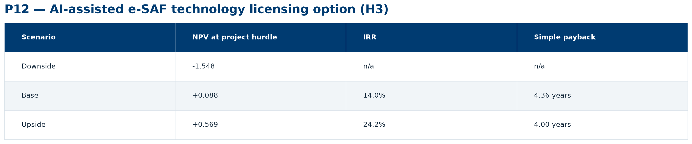

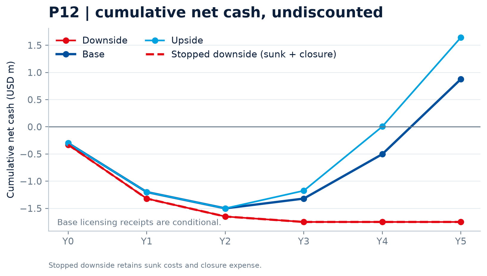

#### Operational workflow and evidence plan

OneTech and Legal first map existing research, partner rights and any current external licensing offer; the commercial lead defines the prospective developer and the problem the proposed process package would solve. Within existing laboratory capacity, researchers compare AI-assisted experiment selection with conventional design of experiments under a pre-registered protocol and the same experimental resources. Three independent runs must demonstrate repeatability; scientific leads set the technical improvement threshold before testing. A research result is not by itself proof that a third party will pay for the technology.

The commercial lead tests a defined application and benchmark with at least two qualified developers before Y2. Before Y3, OneTech and Legal review freedom to operate and technical results, and the commercial lead seeks documented willingness from at least one developer to enter a paid evaluation. Pricing, scope of support, partner rights and the cost of moving beyond laboratory work must be established before a commercial commitment. Stop or reclassify if the proposition only improves an internal process or duplicates an existing offer. The Y3–Y5 receipts are a conditional scenario rather than signed revenue; the downside assumes no receipts and includes closure costs.

### P13 — French retail demand and controlled markdowns (H1)

#### 1. Decision and existing situation

**Proposal [Assumption]:** Pilot demand forecasting and replenishment assistance with electronic shelf labels and controlled dynamic markdowns in 100 large company-operated French service stations. A successful pilot may justify a separately approved expansion. The pilot does not assume the 800- or 1,500-station footprint of the discarded draft.

**Calibration [Assumption]:** For this proposed case, Vincent suggests an indicative **€1m investment for 100 large French COCO stations, including electronic labels**,  (CLM-078, CLM-079). These are inputs informed by local experience, not evidence of an actual project, company budget or realised result. Scope, contracts and operational baseline require validation.

The programme is presented as a **proposed pilot**. Before investment, map existing retail capabilities and funded initiatives, so the business case counts only incremental costs and benefits. TotalEnergies' worldwide retail footprint is not used as the pilot denominator (SRC-002 p.13). The comparative baseline retains existing replenishment, pricing, staff and systems.

#### 2. Problem, alternatives and horizon

**Problem [Hypothesis]:** Store-level volatility creates avoidable perishable losses, out-of-stocks and urgent deliveries; static ordering and pricing may not capture local traffic and seasonality. Actual losses and baseline performance across the 100 stores are unknown.

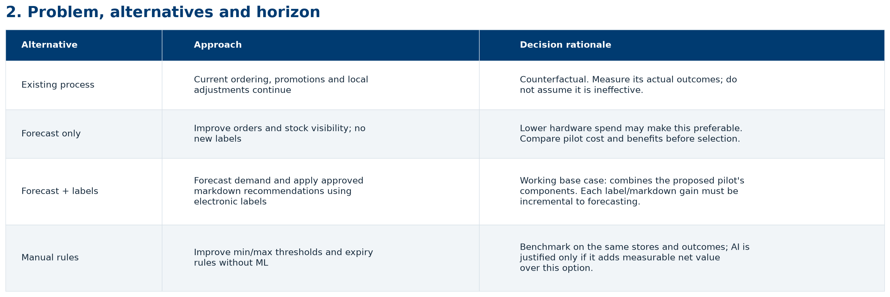

**H1 rationale [Judgment]:** Improve an existing retail workflow for existing customers using established methods. Forecasts and prices remain subject to human control and pricing rules; the first validated benefit is targeted within the pilot, not assumed before it operates.

#### 3. Scope, dependencies and implementation

- **Scope:** 100 selected French company-operated stores. Verify stock ownership, price authority, POS coverage and category mix before funding.
- **Hard dependencies:** permission to use station/SKU sales and stock history; an eligible POS and label interface; a process for updating shelf prices; data-protection and commercial review. Existing pricing systems and pre-funded label costs are part of the baseline, not repurchased.
- **Soft dependencies:** weather and traffic feeds. Begin with a representative pilot if they are unavailable; do not wait for a group-wide data platform.
- **Delivery [Assumption]:** a branch retail owner, data engineer and data scientist work with station managers and finance; buy/partner for label hardware, integrate with existing systems, and build or configure the forecasting layer. Contract terms and data rights determine the final sourcing choice.
- **Timeline [Assumption]:** Y0 late 2026 decision and setup; Y1 pilot rollout and baseline validation; Y2 expand to the eligible 100 stores after a successful gate; Y3–Y5 operate and measure. These are hypothetical model periods.

#### 4. Investment and operating costs

Amounts are **€m**, nominal. The €1m one-time investment, allocation, timing, CAPEX treatment and recurring costs are business-case assumptions, not a company quotation. The split must be tested against the proposed scope and supplier contracts.

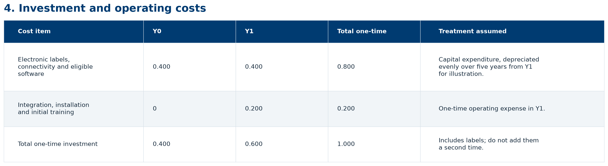

Incremental recurring cloud, data, support and store enablement are assumed at €0.060m in Y1, €0.100m in Y2 and €0.120m/year in Y3–Y5, separate from the €1m. Verify supplier fees, replacement hardware, internal capacity and backfill. No expansion cost or benefit beyond the 100 sites is included.

#### 5. Benefit drivers and revised financial case

All inputs are assumptions for 100 eligible stores. The central annual benefit is **€0.635m**: €0.245m waste reduction + €0.250m incremental markdown recovery + €0.140m stock-out recovery. Urgent-delivery savings are excluded until invoices establish avoidable cash.

- Waste: 100 × €350,000 perishable sales × 70% inventory cost × 4% baseline waste × 25% reduction = €245,000/year.
- Markdowns: 100 × 1,000 at-risk items × €2.50 net incremental recovery = €250,000/year. These items must be outside the waste pool. Define SKU/day cohorts and measure net margin after cannibalization, discounts and extra handling. If this cannot be demonstrated, remove the markdown stream.
- Stock-outs: 100 × €50,000 missed sales × 8% recovery × 35% contribution = €140,000/year. Measure incremental category contribution, not substitution between products.

These equations are transparent planning hypotheses, not observed baselines. A pilot must compare forecasting only, rules-based ordering and forecasting plus labels using matched stores and seasonality. The €1m remains the 100-store rollout ceiling; release only a small instrumented slice before buying all hardware.

Amounts EUR m below. Costs and the central adoption ramp are preserved.

Downside assumes 90% of full-scale benefits, 105% of investment and operating costs, and a slower 40% / 70% / 90% / 100% / 100% benefit ramp. Upside assumes 115% of full-scale benefits and accelerates the base ramp by 15%, capped at 100%, at base costs. Values in the table are in EUR millions; the portfolio converts at the model assumption of $1.1165/€. The 9% hurdle is a project screening assumption.

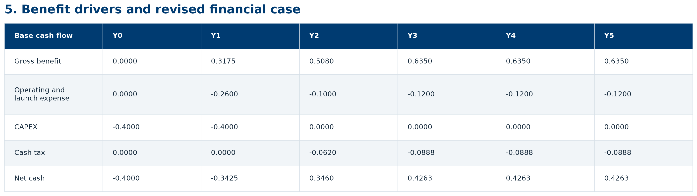

**Attribution sensitivity:** without the €0.250m markdown stream, annual benefit falls to €0.385m, below the existing approximately €0.446m full-project break-even threshold at 9%. The case therefore requires evidence of incremental markdown value or a lower-cost forecasting-only design. It is not robust merely because all drivers are labelled assumptions. The previous delivery-saving assumption is an unbooked upside lead, not an offset to this risk.

**Release rule:** retail sponsor and Finance pre-register the matched-store protocol, baseline waste cohorts, margin and paid delivery invoices before Y0 release. Before Y2 hardware expansion, require positive prospective NPV at 9% using measured incremental margin and remaining avoidable costs. Stop hardware rollout if labels do not outperform forecasting-only after their incremental costs. Store managers retain pricing authority. Count training, installation and staff backfill inside the cost envelope or reprice the case.

**Sources and limits:** local calibration CLM-074/078/079 establishes neither a group baseline nor a realized saving. The €1m/100-store envelope is an explicit planning assumption. The source register and retail case preserve these distinctions.

#### Operational workflow and evidence plan

Start with a representative, instrumented subset of eligible stores. Retail operations confirms stock ownership, price authority, POS and label interfaces, then agrees a matched-store protocol with Finance before hardware is purchased at scale. Store managers receive recommended orders and markdowns through their existing workflow and retain approval authority. The team trains staff on exceptions, price controls and a manual fallback, and records the additional workload and backfill cost.

Compare current practice, rules-based ordering, forecasting without labels and forecasting with labels where the pilot design permits. Define separate SKU/day cohorts for waste reduction and markdown recovery before testing; measure stock-out recovery net of substitution and use incremental contribution rather than sales. Adjust for seasonality and promotions, and count urgent-delivery savings only against avoidable paid invoices. Finance checks the measured effects and remaining costs before further hardware release. If the label increment does not justify its cost, retain the option to use forecasting alone; if the prospective case fails the 9% hurdle, pause or stop expansion.

### Project-level release gates

At month 12 the sponsor and Finance apply these proposed tests before releasing expansion. Prospective NPV uses only remaining cash flows and the project's hurdle; sunk spending is excluded. Where a pilot starts later, the same evidence is required before its first expansion, with the revised review date recorded by the sponsor. Critical safety, security or legal failure triggers an immediate pause. Owners must validate operational thresholds and appoint decision-makers before launch.

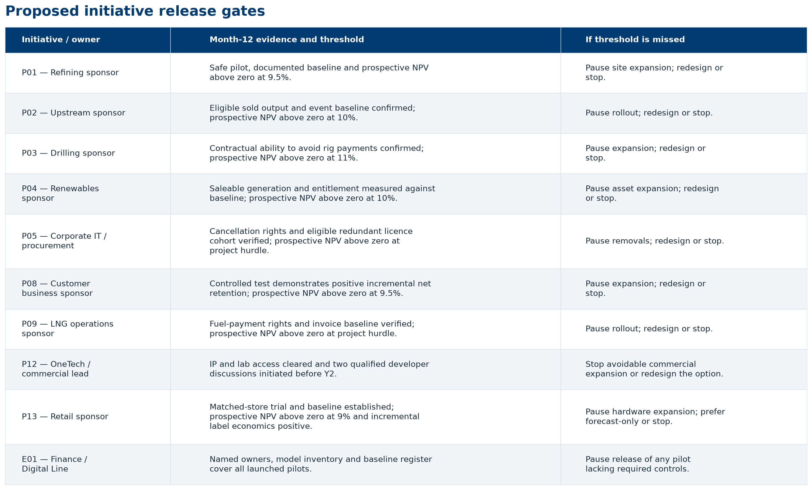

For P05 and P09, use the project-specific rates in the [hurdle policy](../../work/finance/discount_rate_policy.md). At the month-24 gate, branch sponsors and Finance approve further funding only if the remaining case has positive prospective NPV at its project hurdle and its operational and control conditions remain satisfied; P12 instead requires technical, IP and paid-evaluation evidence before commercial continuation. At month 36, the steering group reviews each case against the same continuation principle. If a condition is not met, the owner pauses new commitments and decides whether to redesign or stop; existing contractual obligations and closure costs remain.

## 5. Implementation and adoption

**First 90 days.** Nominate branch sponsors and Digital Factory leads; check existing solutions, contracts, eligible assets, data access and resources for each case. Finance agrees a measured baseline and the incremental value formula with the business. Select pilot sites and confirm worker consultation, safety and data-protection requirements. Record planned versus available dedicated time for each delivery trio.

**Pilot and learning.** Teams work with frontline staff at the site or in their daily workflow. Each pilot compares the AI-enabled process with current practice and, where relevant, a simpler rules-based alternative. Train managers and users on the decision they must take, not only on the tool. Maintain an exception and escalation process; collect user feedback and adjust the workflow. Measure actual use, decision quality, operational performance and economic outcomes separately.

**Scale or stop.** The business sponsor and Finance review evidence at the agreed gate. Release additional sites only if data, user adoption, safety and prospective economics support expansion. If results disappoint, redesign the scope or stop further avoidable expenditure while recording sunk and non-cancellable costs. Retain reusable components and lessons in the hub so that later teams do not repeat the same integration work.

**Executive review.** A regular steering review should show committed and forecast spend, delivery lead time, active users, baseline and observed operating metrics, Finance-verified benefit, risks and the next funding decision for each initiative. No workforce savings are counted merely because time is saved; any redeployment or external-cost reduction must be observable and agreed with the business.

### Accountabilities and milestones

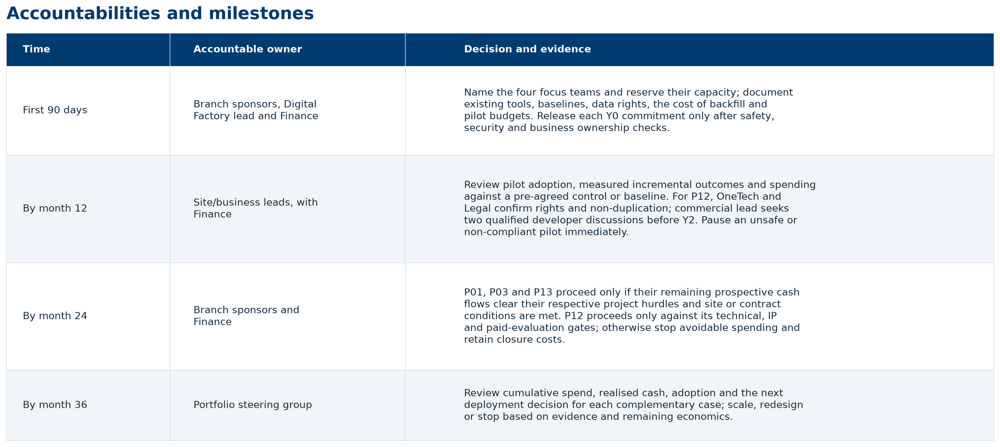

Each project lead records the number of eligible users, trained users and active users, with a target and review date agreed before launch. Site managers schedule training and staff cover, gather operator feedback and maintain a manual fallback; the branch sponsor owns adoption and Finance confirms realised cash rather than tool usage alone. Costs must be accommodated within each approved case or returned for repricing. Early reviews compare delivery lead time and adoption against the existing process so that the operating model can be adjusted on evidence.

### Change risks, early warning and ownership

**Specialist capacity and retention — CHRO and Digital Factory lead.** Monitor vacancies, unfilled secondments and single points of failure monthly. Record a named deputy and handover plan for each critical role before pilots begin; cross-train and reschedule deployments if capacity is unavailable. The existing line managers retain staffing authority.

**Manager and frontline adoption — branch sponsors and site managers.** Track protected expert time, attendance at pilot sessions, active use and operator feedback. When teams cannot spare time, the branch sponsor arranges backfill within the existing allowance or returns for a revised scope and budget. No deployment displaces safety procedures or human operational authority.

**Governance and employee trust — General Counsel, DPO, HSE and employee-relations leads.** Before pilot release, assess data rights, security, privacy, operational safety and locally required employee-representative consultation. Missing clearance or an unsafe incident pauses the affected deployment immediately; the relevant control owner determines remediation and approves restart.

**Premature cancellation or escalation — CFO and portfolio sponsor.** Review the investment trough alongside spend, adoption and leading operating indicators quarterly. Follow the agreed gates instead of cancelling solely because early cash flow is negative; stop or redesign when prospective economics, safety or contractual conditions fail. Sunk and non-cancellable costs remain visible.

### Stakeholders and communication

**Sponsors:** CEO, CFO and branch leaders set the mandate and resolve capacity or funding conflicts. The portfolio sponsor sends a quarterly one-page dashboard showing spend, milestones, risk and next decision; material incidents escalate immediately.

**Translators:** branch managers and project leads translate the initiative into schedules, roles and performance measures. They review team capacity and adoption monthly, resolve friction and allocate protected expert time.

**Adopters:** site operators, maintenance specialists, drilling teams, retail staff and other pilot users shape the workflow and test recommendations. The delivery trio runs short two-way weekly sessions during a pilot, logs concerns and publishes decisions to the team. Users retain the appropriate operational decision rights and a manual fallback.

**Guardians:** HSE, cyber, Legal, DPO, procurement and employee representatives examine the matters relevant to their remit. Engage them during scoping and complete required consultation before deployment, following the applicable local process. Share the intended workflow, data, safeguards, effect on work and escalation route; record the outcome and owner.

### Skills, measurement and stop rules

**Three training tiers.** (1) For affected staff: practical AI literacy, acceptable data use, uncertainty and escalation. (2) For practitioners and managers: workflow design, validation, human oversight and interpretation of performance. (3) For executives: scenario assumptions, portfolio risk, adoption and gate decisions. The CHRO and branch sponsors set the audiences, completion measures and backfill arrangements before launch; delivery uses the existing project envelope, subject to validation.

**Adoption dashboard.** Each project lead records eligible, trained and active users and proficiency; each business owner tracks workflow quality and the relevant operational outcome; Finance verifies incremental cash against the agreed baseline and counterfactual. Compare delivery lead time and expert availability with the previous working method. For projects without a user workflow, use the applicable technical and commercial milestones instead of an artificial user metric.

**Release discipline.** The project-specific month-12 gates and month-24 continuation checks in the report name the owner, metric, threshold and action. For user-facing pilots, an initial proposed warning threshold is fewer than 40% of eligible users active during the month before the month-6 review: pause expansion and agree remediation or stop within 30 days. Sponsors validate this threshold for the workflow before launch. Safety, legal and contractual failures can trigger an immediate pause. At months 12, 24 and 36, the steering group reviews cash, adoption and controls, deciding to scale, redesign or stop each initiative; no milestone guarantees further funding.

## 6. Conditions for the final investment decision

Confirm four dependencies before final approval: (1) resource availability and complete costs, including branch backfill and shared controls; (2) eligible assets, contracts and incremental value relative to existing tools; (3) P12's technical differentiation, rights, demand and realistic commercialisation costs; and (4) funding and allocation of shared controls in the approximately half-budget scope. Finance should then refresh the workbook and portfolio visuals together. The programme should proceed where measured economics and adoption justify it; the option to stop individual cases remains part of the design.

## References and calculation basis

Company baseline: [2025 Universal Registration Document](../../sources/primary/totalenergies_universal-registration-document-2025_2026_en.pdf); [TotalEnergies on AI and Michel Lutz](https://www2.totalenergies.com/news/news/energytalks-ai-energy-hype-vs-real-impact); [TotalEnergies on O3C renewable operations](https://totalenergies.com/news/news/roads-carbon-neutral-season-4-episode-1-o3c-renewables-control-tower). Project-specific references appear within the cases. Figures are derived from the [working financial model](../../work/finance/portfolio_model_working.xlsx), with annual cash components checked by the [reconciliation script](../../work/finance/reconcile_selected.py). The active four-case cards are maintained in `work/projects/`.
