# Accélérer la création de valeur par l'IA chez TotalEnergies

**Proposition stratégique au Directeur Général et au Conseil d'administration | 11 novembre 2026**

**Préparé par l'équipe de transformation digitale :** Alexandre Waerniers, Vincent Lamy, Yoni Mahieddine, Nahel Bachriri

*Document académique fictif pour le cours AI Transformation Strategies, Albert School. Ce n'est pas un document TotalEnergies.*

*Traduction française de lecture du rapport anglais. La version anglaise fait foi. Les figures et tableaux-images restent en anglais.*

## Contexte stratégique et recommandation

TotalEnergies dispose déjà de capacités numériques et d'IA substantielles. La Digital Line de OneTech coordonne la transformation digitale avec les branches, tandis que le TotalEnergies Digital Factory (TDF) développe des solutions avec les métiers. Sous le leadership Data & IA de Michel Lutz, cette expertise partagée apporte les bénéfices d'un Centre d'Excellence : talents spécialisés, standards techniques communs, solutions réutilisables et base d'une gouvernance à l'échelle du groupe. Les branches apportent leur expertise opérationnelle, et chaque projet d'IA a déjà un propriétaire en branche. Nous nous appuyons sur cela ; nous ne proposons pas de nouvelle organisation.

Ce qui ralentit la valeur, c'est la façon dont le travail projet est organisé. Chaque projet est réparti entre quatre personnes qui dépendent de managers différents : le chef de projet de la branche qui le porte, un data engineer de la branche qui ne rapporte pas à ce chef de projet, un data scientist du TDF qui fixe les règles de data science mais ne porte aucun objectif financier, et l'utilisateur final qui exprime le besoin mais n'a aucun pouvoir de décision. Les responsabilités sont dispersées, les revues d'avancement sont espacées et chaque responsable ne peut piloter que quelques projets à la fois. C'est l'observation de notre initié dans une branche ; les premiers pilotes mesureront son ampleur.

Nous recommandons un **modèle hub-and-spoke renforcé avec un trio dédié sur chaque projet** : un data scientist du TDF, un data engineer de la branche et un expert métier, travaillant ensemble pendant une part importante de leur temps et rendant compte à la fois au chef de projet de la branche et à leurs propres managers hiérarchiques. Les objectifs et les gates de poursuite restent aussi exigeants qu'aujourd'hui ; l'équipe travaille simplement plus vite, en cycles plus courts. Les décideurs peuvent alors mener davantage de projets en parallèle, et le savoir-faire IA se diffuse dans les branches à travers les personnes qui construisent les solutions.

Le portefeuille d'investissement met ce modèle en œuvre : dix initiatives, dont quatre avec des plans détaillés métier, financier et d'adoption, financées par étapes afin que les résultats en cash et le modèle de livraison soient prouvés avant extension.

## Décision demandée

**Nous demandons au Conseil d'approuver une enveloppe de 21,94 millions de dollars sur cinq ans (Y0–Y5) pour dix initiatives d'IA, livrées par des équipes dédiées branche–Digital Factory, devant créer 5,62 millions de dollars de valeur actuelle nette à 10 % (7,11 millions dans le cas de base), avec un engagement immédiat limité à une première tranche de 2,90 millions de dollars et chaque libération ultérieure conditionnée à des gates vérifiés par la Finance.**

L'enveloppe comprend **9,82 millions de dollars d'investissement ponctuel** et des coûts d'exploitation ultérieurs. Les montants sont des hypothèses de planification, pas des budgets approuvés ni des prix fournisseurs engagés.

- **Cas de base :** 13,78 millions de dollars de cash net cumulé à Y5, un IRR de **32,6 %** et une NPV de **7,11 millions de dollars à 10 %**.
- **Downside :** 2,27 millions de dollars de cash net cumulé à Y5, un IRR de **5,7 %** et une NPV de **−1,30 million de dollars** ; le cash cumulé tombe à **−11,5 millions de dollars** à la fin de Y1 avant de se redresser.
- **Valeur espérée** (30 % downside, 50 % base, 20 % upside) : NPV **+5,62 millions de dollars**, IRR **27,8 %**, point d'équilibre après **3,4 ans**. En incluant le coût de l'inaction évité, la décision d'investir vaut **6,94 millions de dollars** par rapport à ne pas investir.

Les cash-flows sont après impôt et excluent toute valeur terminale. Le cas H3 (P12) repose sur des redevances de licence non encore contractualisées.

Nous demandons l'approbation de l'enveloppe et de la **Tranche 1 (2,90 millions de dollars, Y0)**, libérée projet par projet une fois confirmés les solutions existantes, les droits, la sécurité et les baselines. Les tranches suivantes dépendent du Gate 0 (environ jour 90), du Gate 1 (mois 12) et du Gate 2 (mois 24). L'enveloppe n'est pas un engagement à déployer tous les projets : un gate non franchi arrête les dépenses évitables. Les branches cofinancent à partir de Y2 (40 %) et Y3 (60 %). La Finance et chaque branche confirment le staffing, les coûts et les droits contractuels avant tout engagement.

**Date de décision proposée : 16 novembre 2026.**

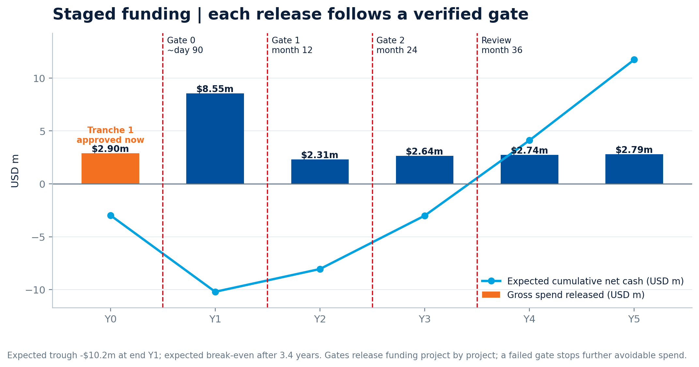

## 1. Point de départ et maturité

TotalEnergies a déjà investi massivement dans l'IA et les outils numériques. Le Document d'enregistrement universel 2025 décrit près de 100 solutions Digital Factory développées depuis 2020 et plus de 10 000 modèles d'IA en production. Les programmes de données industrielles avec AspenTech et Cognite fournissent des fondations sur lesquelles s'appuient les projets proposés. [Document d'enregistrement universel 2025, pp. 39, 42–43](../../sources/primary/totalenergies_universal-registration-document-2025_2026_en.pdf).

Michel Lutz est Chief Data Officer de TotalEnergies et responsable Data & IA au sein du Digital Factory. Son organisation est un partenaire naturel du modèle de livraison proposé : expertise commune, standards techniques et réutilisation restent des actifs centraux, tandis que les équipes projet travaillent plus étroitement avec les branches et leurs sites. [TotalEnergies, EnergyTalks, juillet 2026](https://www2.totalenergies.com/news/news/energytalks-ai-energy-hype-vs-real-impact).

### Évaluation de maturité

Notre évaluation « outside-in » note cinq dimensions de 1 (exploration) à 5 (création de valeur à grande échelle). Elle s'appuie sur des sources publiques et sur l'observation de notre initié ; ce n'est pas un audit interne.

| Dimension | Score (fourchette) | Position de départ | Priorité pour ce programme |
| --- | --- | --- | --- |
| Stratégie métier | 3 (3–4) | Quatre priorités IA nommées pour 2026 et revue de l'IA par le Conseil (CLM-024, CLM-025) ; ni budget IA ni cible de valeur publiés. | Relier chaque projet à un résultat opérationnel ou commercial que la Finance peut vérifier. |
| Technologie et données | 3 (2,5–3,5) | Plus de 10 000 modèles en production ; déploiements de données industrielles AspenTech et Cognite jusqu'à environ 2027–2028 (CLM-017–019). | Utiliser la tranche de données dont chaque projet a besoin ; vérifier droits, interfaces et maturité des sites avant chaque pilote. |
| Expérience de livraison IA | 3,5 (3–4) | Environ 100 solutions Digital Factory depuis 2020, dont 60 % avec de l'IA (CLM-016, CLM-017) ; aucun retour publié par solution. | Transformer plus vite et de façon répétable les solutions en résultats de cash mesurés. |
| Organisation et culture | 2,5 (2–3) | Digital Line créée en septembre 2025 (CLM-015) ; travail projet réparti sur quatre lignes hiérarchiques (CLM-074, observation locale). | Trios projet dédiés avec double rattachement ; temps d'expert protégé et remplacement. |
| Gouvernance de l'IA | 2,5 (2–3) | Principe d'absence de décisions entièrement autonomes (CLM-026) ; aucun inventaire public de modèles ni classification AI Act. | Registre partagé des modèles et de la valeur (E01) ; contrôles validés avant chaque libération. |

Le groupe est au **stade d'implémentation, proche du passage à l'échelle**. La stratégie, les données et l'expertise sont solides ; la dimension qui freine la valeur est l'**organisation de la livraison**. L'accès aux données, la mesure de la valeur et la gouvernance restent des contraintes alternatives sérieuses : pendant les 90 premiers jours, nous comparons les délais réels, les blocages de données et le staffing à ce diagnostic et ajustons l'intervention si les preuves pointent ailleurs.

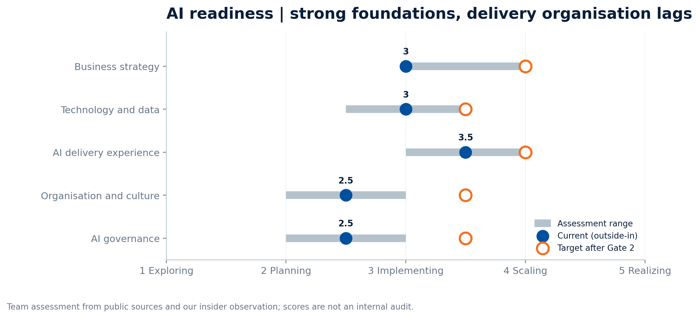

**Pourquoi maintenant.** Les plateformes de données sont en cours de déploiement et des milliers de modèles tournent déjà. Le rendement de ces investissements dépend désormais de la vitesse à laquelle les solutions atteignent les décisions opérationnelles quotidiennes. Organiser la livraison autour d'équipes dédiées permet de capter cette valeur sans nouvelles plateformes, et construit la capacité de livraison dont le groupe aura besoin à mesure que l'usage de l'IA croît.

## 2. Modèle de livraison : équipes projet dédiées au sein d'un hub fort

### Où la livraison ralentit aujourd'hui

Les branches possèdent déjà leurs projets d'IA. Un chef de projet de branche, généralement le responsable de la transformation digitale de la branche, parraine et dirige chacun d'eux. La difficulté est que le travail est réparti entre quatre personnes qui ne partagent ni ligne hiérarchique ni objectif :

- **le chef de projet de la branche**, qui porte l'objectif mais ne dirige aucun des spécialistes ;
- **le data engineer de la branche**, qui rapporte à l'organisation IT/data de la branche plutôt qu'au chef de projet ;
- **le data scientist du TDF**, qui fixe les standards de data science mais ne porte aucun objectif financier, et travaille donc avec la branche un peu comme un cabinet de conseil externe ;
- **l'utilisateur final**, qui exprime le besoin et donne du retour mais n'a aucun pouvoir de décision sur la solution.

Chacun contribue à temps partiel et dépend d'un manager différent. Les revues d'avancement sont espacées de plusieurs semaines, le retour des utilisateurs arrive tard dans la solution, et chaque chef de projet ne peut piloter que peu de projets à la fois. C'est l'observation de notre initié dans une branche (CLM-074). Elle est cohérente avec l'identification par le groupe lui-même du rythme d'adaptation organisationnelle et des compétences comme risque matériel (URD p. 138, CLM-014). Les premiers pilotes mesurent son ampleur.

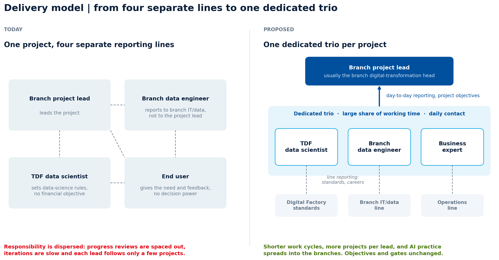

### Le choix du modèle opérationnel

Un **CoE centralisé** concentre les talents IA rares, soutient la cohérence des standards et facilite la réutilisation des actifs partagés. Un pool de livraison unique peut toutefois créer des files d'attente et s'éloigner des flux de travail des sites à mesure que la demande croît. Un **modèle fédéré** donne de l'autonomie aux branches mais duplique outils et compétences et affaiblit le contrôle groupe des modèles, des risques et des investissements.

Nous conservons le modèle **hub-and-spoke** que le groupe a déjà et le renforçons là où il casse : à la couture entre les spécialistes du hub et les équipes des branches. La Digital Line et le Digital Factory restent le hub pour l'architecture, la sécurité, l'expertise IA, les outils partagés et la réutilisation. Les branches restent responsables du choix des cas d'usage, de l'exploitation et des résultats. Le changement se produit à l'intérieur de chaque projet.

### Trios projet dédiés

Pour chaque projet approuvé, nous constituons un trio dédié :

- un **data scientist ou ingénieur IA du TDF**, détaché sur le projet et travaillant sur site lorsque cela aide à concevoir et à faire adopter ;
- un **data engineer de la branche**, qui sécurise l'accès aux données, les prépare et intègre la solution dans les systèmes locaux ;
- un **expert métier** de l'opération qui utilisera la solution, qui représente les utilisateurs dans l'équipe et aide à ancrer le nouveau flux de travail.

Chaque membre consacre une part importante de son temps au projet, au moins la moitié selon les besoins et la disponibilité d'un remplacement, et les trois travaillent ensemble au quotidien. Chacun rend compte **au jour le jour au chef de projet de la branche** sur les objectifs et priorités du projet, et conserve un **rattachement hiérarchique** à son propre manager pour les standards professionnels, les méthodes et la carrière. Le Digital Factory continue de fixer les standards de data science et de sécurité ; la ligne IT/data de la branche continue de posséder les systèmes.

**Ce qui change.** Les questions sur la solution se règlent au sein de l'équipe en quelques jours plutôt qu'à la prochaine réunion de pilotage. L'équipe travaille en cycles courts, montre fréquemment ses résultats aux utilisateurs et ajuste rapidement. Le point de vue de l'utilisateur final entre dans l'équipe par l'expert métier, avec une réelle influence sur la conception.

**Ce qui ne change pas.** Chaque projet conserve les objectifs, le budget et les gates de poursuite fixés par son sponsor et la Finance. HSE, cyber, juridique et relations sociales gardent leur droit de veto. Les opérateurs conservent l'autorité de décision opérationnelle.

**Pourquoi cela augmente la capacité.** La coordination quitte l'agenda du chef de projet pour entrer dans l'équipe. Chaque responsable et sponsor peut piloter davantage de projets en parallèle, de sorte que le groupe déploie plus de projets sans ajouter de couches de management. Travailler côte à côte diffuse aussi la pratique de l'IA dans les branches : data engineers et experts métier apprennent comment les solutions sont construites et validées, et retournent dans leurs équipes comme relais.

Chaque sponsor réserve la capacité nécessaire et en identifie le coût, y compris déplacements, remplacement et formation, dans l'enveloppe du projet, ou rechiffre le cas avant approbation. La Finance rejoint les revues de baseline et de gate.

**Comment nous testons le modèle.** Dans les quatre cas phares, nous comparons avec le processus de livraison existant : intervalle entre revues d'avancement, délai entre approbation et première mise en service, temps d'expert effectivement disponible, nombre de projets par responsable, adoption par les utilisateurs et résultats vérifiés par la Finance. Si l'obstacle principal s'avère être l'accès aux données, un contrat ou une autre contrainte, nous ajustons l'intervention plutôt que d'ajouter simplement des équipes.

### Droits de décision et contrôles

| Décision | Responsable | Participation requise |
| --- | --- | --- |
| Objectifs, périmètre et baseline du projet | Chef de projet de la branche et sponsor de la branche | Finance, opérations et Digital Factory |
| Conception au quotidien et priorités | Trio projet, rendant compte au chef de projet | Utilisateurs et équipes du site |
| Standards de data science, sécurité et réutilisation | Responsable technique du Digital Factory et responsable IT/data de la branche | Sécurité du site et propriétaires de plateformes concernés |
| Mise en exploitation | Responsable des opérations du site ou du métier | Utilisateurs, HSE, cyber, juridique et représentants du personnel selon le cas |
| Vérification de la valeur et financement ultérieur | Sponsor de la branche et Finance | Chef de projet et comité de pilotage du portefeuille |
| Arrêter, redessiner ou passer à l'échelle | Comité de pilotage du portefeuille | Sponsor, Finance et propriétaires de contrôles concernés |

Les opérateurs humains conservent l'autorité de décision opérationnelle. Les solutions dangereuses ou non conformes ne se poursuivent pas, quel que soit le rendement projeté.

## 3. Portefeuille et priorités d'investissement

Le portefeuille combine des améliorations opérationnelles (**H1**), des flux de travail transverses redessinés (**H2**) et une option conditionnelle de business externe (**H3**). P12 ne se qualifie comme H3 que s'il établit une proposition de licence externe réellement nouvelle ; améliorer seulement un flux de recherche interne ne suffirait pas.

| Initiative | Horizon | Investissement ponctuel, M$ | Coût brut Y0–Y5, M$ | Principal mécanisme de valeur |
| --- | --- | ---: | ---: | --- |
| P01 — Maintenance prédictive en raffinerie | H1 | 1,40 | 3,15 | Plus de débit vendu et moins de réparations d'urgence |
| P02 — Surveillance de la production amont | H1 | 0,90 | 2,23 | Report de production évité sur des actifs éligibles distincts |
| P03 — Conseil au forage en eaux profondes | H2 | 1,40 | 3,65 | Paiements de rig contractuellement évitables |
| P04 — Performance du parc renouvelable | H1 | 1,40 | 2,70 | Récupérer la production éligible grâce à une résolution plus rapide des pannes |
| P05 — Flux Copilot et gestion des licences | H1 | 0,30 | 0,73 | Résiliation des licences redondantes éligibles |
| P08 — Rétention client | H1 | 1,50 | 2,95 | Conserver les clients énergie rentables par un accompagnement ciblé |
| P09 — Optimisation des voyages GNL | H2 | 0,50 | 1,04 | Factures de carburant contrôlables plus faibles |
| P12 — Licence technologique e-SAF | H3 | 1,00 | 2,85 | Redevances conditionnelles de technologie à des tiers |
| P13 — Demande retail et démarques | H1 | 1,12 | 1,70 | Moins de gaspillage, marge incrémentale sur démarques et récupération des ruptures |
| E01 — Valeur partagée et contrôles des modèles | H1 | 0,30 | 0,94 | Capacité de contrôle partagée ; aucun bénéfice séparé comptabilisé |
| **Total** |  | **9,82** | **21,94** |  |

P13 est modélisé en euros et converti à 1,1165 $/€ ; les totaux peuvent différer par arrondi.

**Mix d'horizons.** L'investissement ponctuel se répartit en **70,5 % H1, 19,4 % H2 et 10,2 % H3** (E01 dans H1) ; sur la dépense totale à cinq ans, la répartition est de **65,6 % H1, 21,4 % H2 et 13,0 % H3**. Le poids de H1 est délibéré : TotalEnergies exploite des actifs industriels à longue durée de vie où fiabilité, disponibilité et amélioration des coûts rapportent le plus vite et financent la courbe en J. H2 modifie des flux de travail transverses là où les contrats permettent de capter du cash. H3 est une option bornée : si P12 échoue à ses gates, ses dépenses s'arrêtent et H3 se réduit à son coût engagé.

**Échelle.** À 22 millions de dollars, le programme est délibérément petit par rapport au groupe. Son but est de prouver que des équipes dédiées délivrent du cash mesurable plus vite. Si le Gate 2 le confirme, le même modèle s'étend à d'autres sites et branches par des dossiers d'investissement séparés.

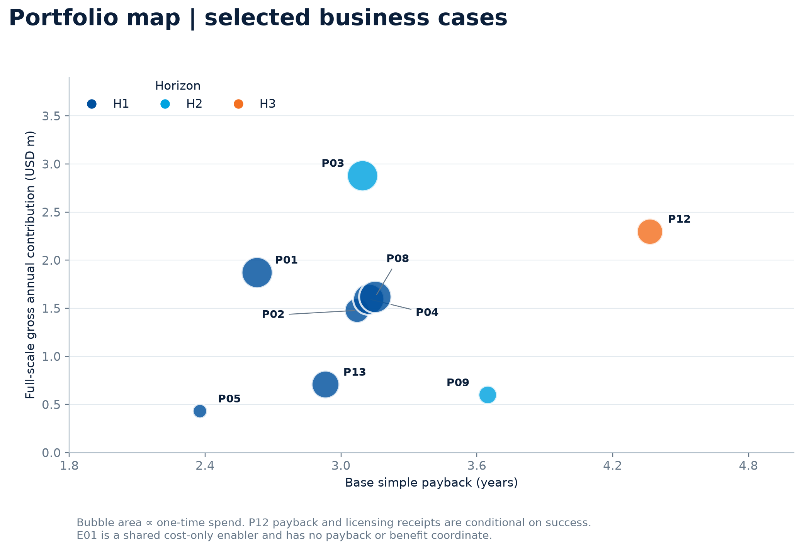

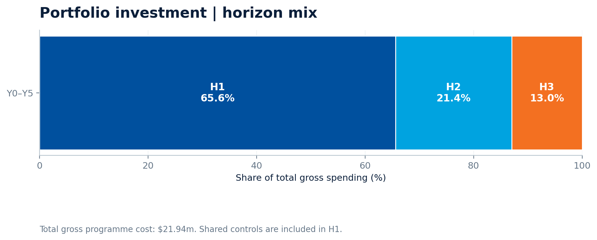

P02, P05 et P09 sont des estimations complémentaires plutôt que des dossiers d'investissement entièrement développés. P02 suppose deux hubs de production avec 135 barils par jour de production récupérée éligible chacun et 15 dollars par baril de contribution incrémentale ; il est séparé des événements de forage de P03. P05 suppose 10 000 licences payantes, 12 % résiliables, à 30 dollars par mois ; les achats confirment les droits de résiliation et si les utilisateurs ont besoin d'alternatives. P09 suppose 30 voyages éligibles, 1 million de dollars de carburant contrôlable par voyage et une amélioration de 2 % ; les conditions de charter et les économies par rapport au routage existant sont vérifiées. Chacun exige une baseline du propriétaire métier avant engagement.

P04 cible un parc d'actifs renouvelables éligibles illustratif de 3 000 MW : `3 000 MW × 8 760 heures × 30 % de facteur de charge × 0,45 % de production incrémentale récupérée × 45 $/MWh de valeur nette` donne **1,597 M$/an** à déploiement complet, incrémental par rapport à la surveillance existante et dans le droit économique de l'entreprise. P08 cible 1,2 million de comptes électricité ou gaz éligibles : `1,2 m × 10 % de churn annuel × 9 % de réduction relative × 150 $ de contribution annuelle` donne **1,62 M$/an** à déploiement complet, net des incitations clients ; un groupe témoin établit la rétention incrémentale.

P04 et P08 coûtent **2,70 M$** et **2,95 M$** sur Y0–Y5. À leurs hurdles de projet, les NPV de base sont de **+1,05 M$** et **+0,99 M$**, avec des paybacks simples de **3,12** et **3,15 ans** ; les paybacks en downside sont de **4,34** et **4,52 ans**. Les [fiches des projets complémentaires](../../work/projects/reserve_cards.md) détaillent hypothèses et gates.

### Responsabilités, sourcing et dépendances du portefeuille

Les rôles ci-dessous sont des fonctions responsables proposées, sous réserve de nomination. Les dépendances sont vérifiées avant la libération de chaque cas ; les contrôles partagés sont financés une seule fois par E01.

| Initiative | Propriétaire métier / sourcing | Dépendance avant libération |
| --- | --- | --- |
| P01 | Sponsor raffinage / blend | Données de sites éligibles et flux de fiabilité |
| P02 | Sponsor amont / blend | Accès à la production et événements distincts |
| P03 | Sponsor forage / buy and blend | Termes contractuels et paiements de rig évitables |
| P04 | Sponsor renouvelables / blend | Baseline O3C et OEM, droit économique et commercialisabilité |
| P05 | IT corporate et achats / outils existants | Droits de licence et de résiliation |
| P08 | Sponsor métier clients / blend | Accès CRM, confidentialité et test contrôlé |
| P09 | Sponsor opérations GNL / buy and blend | Baseline de routage, droits de charter et factures de carburant |
| P12 | OneTech et responsable commercial / partenaire | Accès au laboratoire, droits IP et demande externe |
| P13 | Sponsor retail / buy and blend | Accès caisse (POS), stock et droits de prix |
| E01 | Finance et Digital Line / réutilisation | Outils de gouvernance existants et propriétaires nommés |

**Sourcing des cas phares.** Nous notons six facteurs de 1 (acheter sur le marché) à 5 (construire en interne). Une moyenne entre 2 et 4 indique un blend d'outils du marché, de partenaires et de nos propres données et expertise.

| Facteur | P01 | P03 | P12 | P13 |
| --- | ---: | ---: | ---: | ---: |
| Différenciation stratégique | 3 | 3 | 5 | 2 |
| Données propriétaires | 4 | 4 | 4 | 3 |
| Délai de mise sur le marché (5 = on peut attendre) | 2 | 2 | 4 | 2 |
| Compétences internes | 3 | 2 | 3 | 3 |
| Contrôle réglementaire et sécurité | 3 | 3 | 4 | 2 |
| Coût à l'échelle (5 = moins cher en interne) | 2 | 2 | 2 | 2 |
| **Moyenne et décision** | **2,8 — blend** | **2,7 — buy and blend** | **3,7 — partenaire** | **2,3 — buy and blend** |

Aucun cas ne justifie de construire un modèle propriétaire. P12 est le plus proche du « build » car sa valeur réside dans une IP propriétaire ; les partenaires de laboratoire réduisent son coût et son risque.

### Séquence de dépenses et de financement

Les dépenses d'investissement (capex) sont séparées des charges d'exploitation et de lancement ; les deux figurent dans l'enveloppe brute. Montants en M$ ; l'impôt est exclu de l'enveloppe de coûts et inclus dans les cash-flows nets.

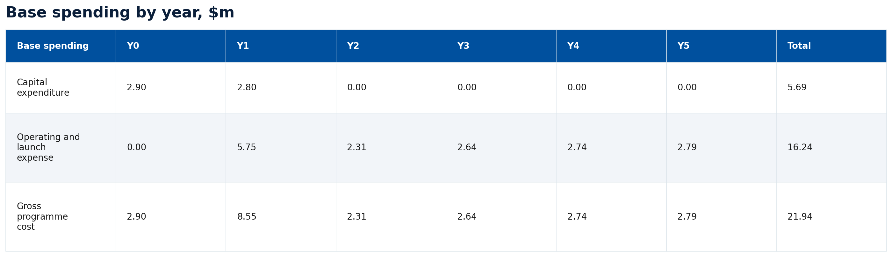

Les 9,82 M$ ponctuels comprennent 5,69 M$ de capex supposé et 4,12 M$ de charges de lancement ; les coûts d'exploitation récurrents totalisent 12,12 M$.

**Pourquoi cinq ans.** TotalEnergies exploite des actifs industriels à cycle long avec un rythme de disruption modéré ; les bénéfices de maintenance, de forage et de retail montent en puissance sur deux à trois ans et ne sont visibles que sur cinq. Sur trois ans (Y0–Y3), les dépenses sont de **16,40 M$**. À partir de Y4, le programme tourne à **2,74–2,79 M$ par an**, presque entièrement en logiciels, cloud, support et exploitation des modèles récurrents.

**Cofinancement des branches.** Y0–Y1 sont financés centralement pour constituer les équipes et prouver les premiers résultats. Les branches cofinancent ensuite **40 % des coûts de Y2** et **60 % des coûts récurrents de Y3–Y5** de leurs projets, confirmés au Gate 1 et au Gate 2. Les projets qu'une branche ne cofinance pas ne se poursuivent pas.

### Tranches et gates du programme

| Gate | Calendrier | Preuves requises | Responsable | Si non atteint |
| --- | --- | --- | --- | --- |
| Tranche 1 | Approbation, 16 novembre 2026 | Jusqu'à 2,90 M$ (Y0) libérés cas par cas après vérification des solutions existantes, des droits et de la sécurité | CEO et CFO | Cas non libéré |
| Gate 0 | Environ jour 90, avant les engagements Y1 (8,55 M$) | Chaque cas lancé a un trio staffé avec temps réservé, une baseline et une formule de valeur signées par la Finance, les droits de données et un chiffrage ; consultation des salariés requise terminée | Sponsors des branches et Finance | Cas non libéré ; son enveloppe est conservée |
| Gate 1 | Mois 12, avant les libérations Y2 (2,31 M$) | Pilotes tournés vers les utilisateurs : au moins 60 % des décisions éligibles enregistrées via l'outil ; au moins trois cas avec bénéfice incrémental vérifié par la Finance contre baseline ; aucun problème critique non résolu de sécurité, cyber ou confidentialité ; dépenses à moins de 10 % du plan ; les branches confirment le cofinancement à 40 % | CFO et sponsor du portefeuille | Mise en pause des cas défaillants ; redesign dans l'enveloppe ou arrêt |
| Gate 2 | Mois 24, avant le financement récurrent Y3 | Bénéfices annuels vérifiés au moins égaux aux coûts récurrents annuels au niveau du portefeuille ; NPV prospective positive pour chaque cas qui continue ; les branches confirment le cofinancement à 60 % | CEO, CFO et responsables de branches | Arrêt ou redimensionnement des cas ; pas d'extension du modèle de livraison |

Le pilotage du portefeuille revoit chaque trimestre la prévision de cash. Un arrêt ne récupère pas les coûts engagés ou non annulables. Les gates au niveau projet de la Section 4 s'appliquent dans cette structure.

### Allocation des coûts par catégorie

Nous classons la dépense brute de chaque année en six catégories de coûts. Y1–Y3 forment la vue d'exploitation à trois ans ; Y0 est la période de décision et est présentée séparément. Les propriétaires de coûts remplacent ces parts de planification par des preuves de staffing, d'achats et de contrats avant libération. Calcul et équipement incluent les actifs physiques comme les étiquettes retail ; les talents incluent la formation et le remplacement.

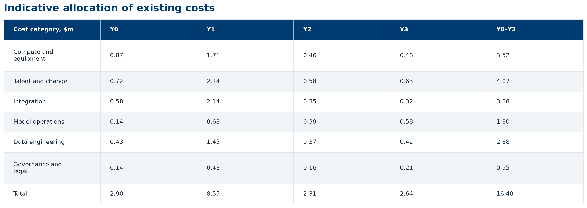

Intégration et talents dominent Y1 (25 % chacun) ; en Y3, l'exploitation des modèles monte à 22 % et la gouvernance à 8 %, à mesure que le portefeuille passe de la construction à l'exploitation. Le [calcul](../../work/finance/category_allocation.py) conserve les montants non arrondis.

### Économie du portefeuille

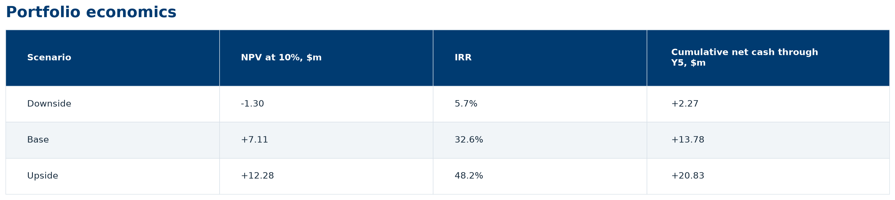

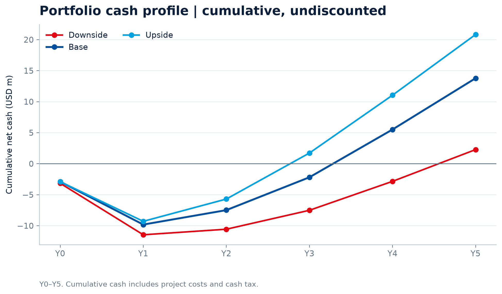

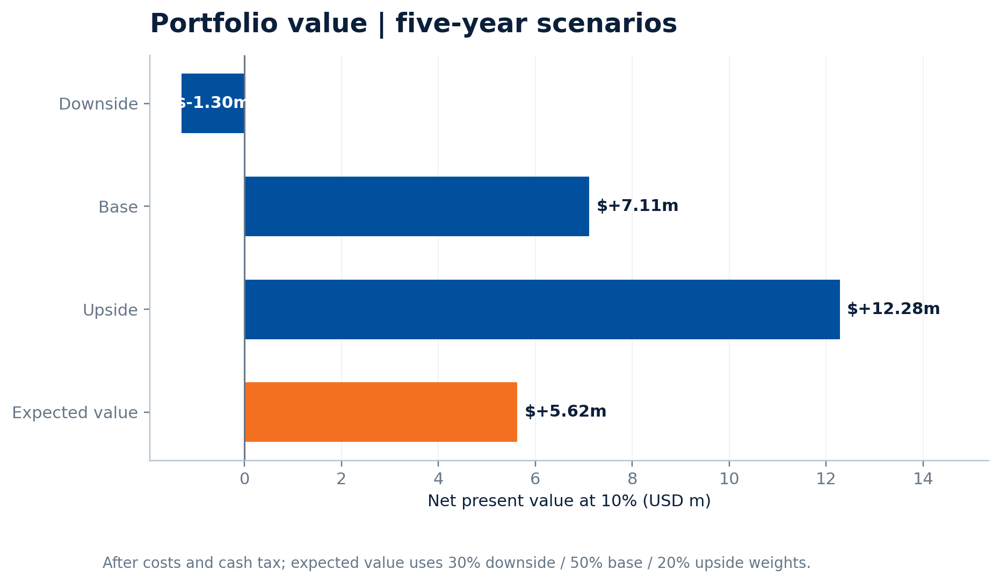

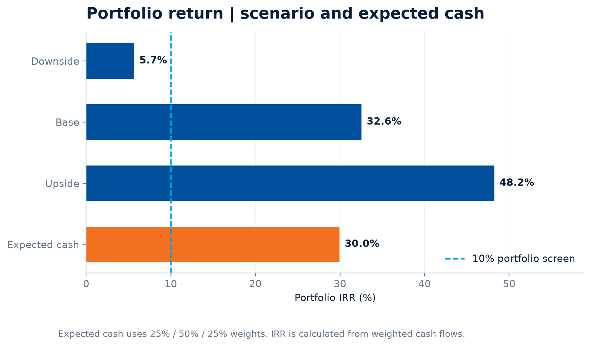

Avec des pondérations de scénarios de **30 % downside, 50 % base et 20 % upside**, la NPV espérée à 10 % est de **+5,62 M$** et l'IRR des cash-flows espérés est de **27,8 %**, soit près de trois fois le seuil de 10 %.

**Courbe en J.** Le cash cumulé atteint son point bas à la fin de Y1 : **−9,8 M$** dans le cas de base, **−10,2 M$** en espérance et **−11,5 M$** en downside. Il devient positif pendant Y4 : après **3,3 ans** dans le cas de base, **3,4 ans** en espérance et environ **4,6 ans** en downside. C'est le capital réellement à risque. La Tranche 1 n'engage que 2,90 M$ ; la tranche Y1, qui détermine le creux, est libérée cas par cas au Gate 0, après signature des baselines.

**Downside.** Le downside reste positif en cash à Y5 (+2,27 M$) mais ne franchit pas le seuil de 10 % (NPV −1,30 M$, IRR 5,7 %). Il inclut un P12 arrêté et déficitaire. Dans le cas de base, nous ne passons à l'échelle que sur adoption vérifiée et économie prospective ; dans l'upside, nous ne libérons de la capacité qu'après démonstration des bénéfices opérationnels et en cash.

**Taux d'actualisation.** L'entreprise a publié un WACC post-impôt de 7 % pour ses tests de dépréciation 2025 ; nous ajoutons une prime de 3 points de risque d'exécution de l'IA pour atteindre un seuil de portefeuille de 10 %. Les cas projet utilisent leurs propres hurdles (9 % à 12 %). Le modèle suppose un impôt de 25 % sur le cash, un amortissement linéaire des actifs de capital et aucun crédit immédiat pour les pertes annuelles.

### Si le budget est réduit

Les quatre cas phares sont les priorités : P01, P03, P12 et P13. Leur coût brut combiné à périmètre complet est de **11,35 millions de dollars**, soit **51,7 %** des 21,94 millions du portefeuille complet. Leurs IRR de base et de downside sont de **34,8 % et 6,4 %** respectivement. C'est notre option d'environ la moitié du budget. Le calcul à quatre cas exclut E01 : les contrôles partagés essentiels doivent être fournis par les capacités existantes ou financés séparément. Les IRR de 34,8 % et 6,4 % s'appliquent aux quatre cas tels que modélisés ; ces coûts et rendements n'incluent pas d'allocation E01 supplémentaire.

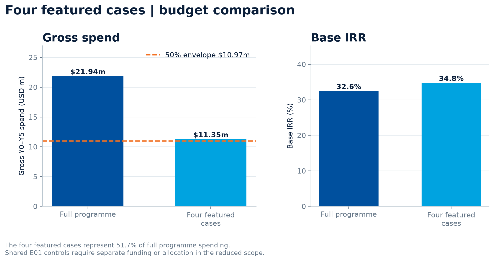

### Coût de l'inaction et valeur de la décision

Nos cas projet sont valorisés par rapport à la performance opérationnelle d'aujourd'hui. Ne pas investir ne maintiendrait pas cette performance inchangée. À partir de Y2, nous attendons que trois expositions s'aggravent :

- la marge de raffinage perdue sur chaque baril non récupéré, supposée augmenter de 1 $ par baril (sites P01) ;
- les coûts évitables de spread de rig, supposés augmenter de 0,05 M$ par jour (campagnes P03) ;
- le churn des 1,2 million de comptes clients éligibles, supposé augmenter d'un point de pourcentage (P08).

Les projets proposés absorbent une partie de chaque hausse : à pleine adoption, ils protègent **0,29 M$, 0,36 M$ et 0,16 M$ par an** supplémentaires. Pondérée par nos scénarios, après impôt et actualisée à 10 %, cette perte évitée vaut **1,32 M$**. Investir crée donc **6,94 M$ de valeur de décision** par rapport à ne pas investir : 5,62 M$ des projets eux-mêmes et 1,32 M$ de détérioration évitée. Les rendements projet de ce rapport excluent ce montant ; nous suivons les trois expositions comme indicateurs avancés.

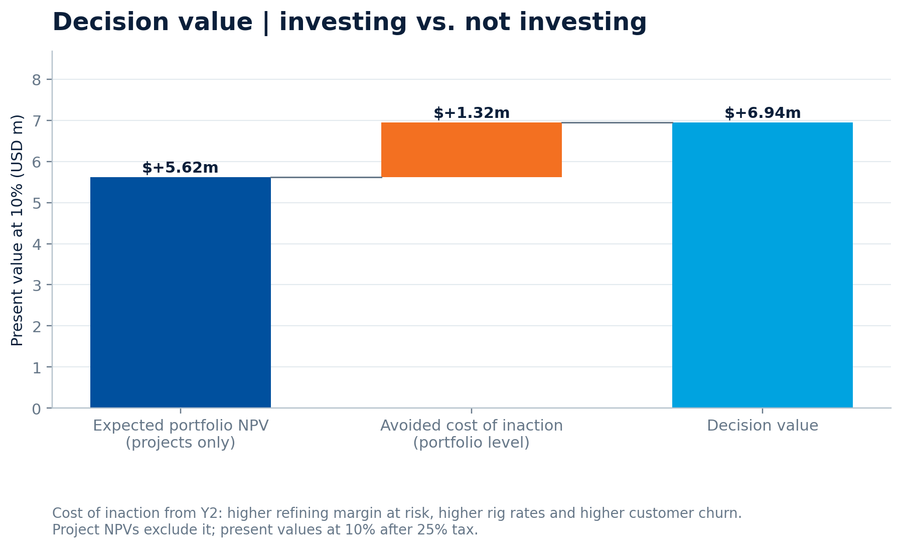

Retarder le même programme d'un an réduirait la NPV de base de 7,11 M$ à 6,47 M$, soit un **coût d'attente de 0,65 M$** à 10 %. Les pairs avancent : Equinor rapporte une valeur de maintenance prédictive depuis 2020 et BP a publié des gains de planification digitale de puits. Ces exemples montrent ce qui est atteignable ; ils n'établissent ni un écart mesuré pour TotalEnergies ni une perte de parts de marché.

### Composition des coûts des quatre cas phares

Allocations de planification au sein des enveloppes modélisées, pas des coûts supplémentaires ni des devis fournisseurs. Matériel/logiciel, intégration et formation sont ponctuels ; les coûts récurrents couvrent Y1–Y5. Le personnel interne et le remplacement sur site sont inclus dans les lignes allouées, sous réserve de confirmation de capacité.

| Cas et devise | Matériel, logiciel et intégration capitalisés | Lancement, intégration et formation ponctuels | Coûts d'exploitation récurrents, Y1–Y5 | Coût brut total |
| --- | --- | --- | --- | ---: |
| P01 (M$) | Équipement et logiciel 0,55 ; intégration 0,45 | Mise en œuvre 0,20 ; formation et remplacement 0,20 | Logiciel et cloud 0,65 ; données et support technique 0,70 ; support site et remplacement 0,40 | 3,15 |
| P03 (M$) | Logiciel 0,35 ; intégration 0,45 | Mise en service 0,30 ; intégration des contracteurs 0,15 ; formation et remplacement 0,15 | Logiciel et cloud 0,80 ; support contracteurs 0,80 ; data engineering 0,45 ; support métier 0,20 | 3,65 |
| P12 (M$) | Équipement labo/données 0,30 ; logiciel et intégration 0,30 | Plan d'expériences 0,10 ; travail IP et commercial 0,15 ; mise en place du labo 0,15 | Travaux de laboratoire 0,75 ; support technique et calcul 0,55 ; travail IP et commercial 0,35 ; support métier 0,20 | 2,85 |
| P13 (M€) | Étiquettes et matériel 0,65 ; connectivité/logiciel 0,15 | Installation et intégration 0,10 ; formation et remplacement 0,10 | Logiciel et cloud 0,20 ; maintenance 0,16 ; support et formation des stations 0,16 | 1,52 |

Les 1,52 M€ de P13 se convertissent en environ 1,70 M$. P12 reste une enveloppe de recherche limitée ; elle ne finance pas d'usine de démonstration. Achats, personnel détaché, remplacement et engagements de support sont validés avant libération, et un cas est rechiffré si le travail nécessaire dépasse l'allocation.

## 4. Quatre dossiers d'investissement phares

Chaque cas présente la décision, la capacité existante, le mécanisme de valeur, les coûts, les cash-flows par scénario et les gates. Les chiffres sont des hypothèses de scénario validées sur les plans opérationnel, contractuel et financier à chaque gate. Les rendements des projets sont autonomes : ils excluent le coût de l'inaction au niveau du portefeuille.

### P01 — Maintenance prédictive du raffinage (H1)

#### 1. Décision, problème et capacité existante

**Proposition :** piloter la maintenance prédictive sur des équipements tournants critiques de deux sites de raffinage éligibles, puis l'étendre à l'intérieur de ces sites seulement lorsque les opérations et la Finance confirment la valeur. Le choix des actifs et des sites est une **hypothèse** en attente de validation. TotalEnergies déploie déjà la plateforme de données industrielles d'AspenTech (CLM-018) et dispose de processus de maintenance existants ; les deux relèvent du contrefactuel. Nous finançons un flux de travail incrémental et des interventions seulement là où elles ne sont pas déjà réalisées.

**Problème [Hypothèse] :** certains arrêts non planifiés d'équipements entraînent une perte de marge et des réparations d'urgence évitables. Le nombre de pannes évitables, de machines éligibles et la contribution économique des sites sont inconnus. Une plateforme de données ou une alerte d'anomalie ne crée pas de valeur à elle seule : une alerte vérifiée doit conduire à une action de maintenance sûre qui change le résultat de la baseline.

#### 2. Alternatives, horizon et sourcing

| Option | Décision |
| --- | --- |
| Maintenance planifiée et conditionnelle existante | Contrefactuel. Comparer le système proposé à la surveillance existante et à l'activité de maintenance documentée. |
| Seuils manuels améliorés et revue de fiabilité | Benchmark sur les mêmes machines ; utiliser cette approche plus simple si elle donne des résultats comparables à moindre coût. |
| APM d'un éditeur plus intégration par le site et flux de maintenance | Proposition de travail : acheter/s'associer pour les outils, intégrer aux données existantes et construire le flux du site. Les contrats et licences actuelles sont vérifiés. |

**H1 [Jugement] :** optimise les opérations de raffinage existantes avec une classe établie d'outils de maintenance. Aucun nouveau data lake d'entreprise n'est supposé.

#### 3. Périmètre et leviers de bénéfice

Tous les paramètres ci-dessous sont des **hypothèses**, pas des performances de sites TotalEnergies publiées. Le débit réel des deux sites, la part de détention, les contraintes de production et la marge de contribution incrémentale sont vérifiés avant libération.

| Levier annuel à déploiement complet | Hypothèse | Calcul / limite |
| --- | --- | --- |
| Débit de raffinage éligible combiné | 250 000 barils/jour | Deux sites éligibles combinés ; hypothèse de périmètre, pas un chiffre de site du factbook. |
| Jours effectifs | 365/an | Appliqués au débit journalier indiqué ; confirmer si le débit de baseline inclut déjà les arrêts. |
| Récupération incrémentale de débit | 0,45 % | Amélioration par rapport à la maintenance existante, pas à tous les arrêts de site. |
| Production supplémentaire vendue | 70 % | Contrainte de capacité et de marché ; vérifier le goulot réel et la demande produit. |
| Marge de contribution incrémentale | 6 $/baril | Hypothèse de travail, pas la marge réalisée de TotalEnergies ; la marge ERM publiée est un repère de marché (CLM-063). |
| Coût de réparation d'urgence évité | 0,150 M$/an | Ne compter que les factures non déjà captées dans le débit ou les budgets existants. |

Bénéfice brut à pleine échelle = `250 000 × 365 × 0,0045 × 0,70 × 6 $ + 150 000 $` = **1,8746 M$/an [Calcul sur hypothèses]**. Le périmètre est de deux sites supposés, pas tout le débit du groupe. Les 120 M$ rapportés par Equinor depuis 2020 (SRC-017 / CLM-036) sont un repère contextuel cumulé et ne prouvent pas ce montant annuel.

#### 4. Coûts, calendrier et hypothèses

Montants en **M$**, nominaux. Y0 est le point de décision de fin 2026 et Y1–Y5 les périodes annuelles suivantes. Investissement ponctuel total : **1,4 M$**, comprenant 1,0 M$ de matériel/logiciel capitalisé (0,5 M$ en Y0 et 0,5 M$ en Y1) et 0,4 M$ de mise en œuvre/formation passés en charges en Y1. Les coûts d'exploitation et de support récurrents sont de 0,20, 0,35, 0,40, 0,40, 0,40 M$ en Y1–Y5.

La montée en puissance du bénéfice pilote est de 20 %, 60 %, 85 %, 100 %, 100 %. L'impôt suppose un taux de 25 %, un amortissement linéaire sur cinq ans des 1,0 M$ d'actifs de capital à partir de Y1 et aucun crédit d'impôt immédiat sur les pertes annuelles. Aucune valeur terminale ni extension au-delà du périmètre supposé n'est incluse.

#### 5. Cash-flows et scénarios

Le downside suppose 80 % des bénéfices à pleine échelle, 110 % de l'investissement et des coûts d'exploitation, et une montée en puissance plus lente de 15 % / 50 % / 80 % / 100 % / 100 %. L'upside suppose 115 % des bénéfices à pleine échelle et accélère la rampe de base de 15 %, plafonnée à 100 %, aux coûts de base. Le hurdle du projet est de 9,5 %.

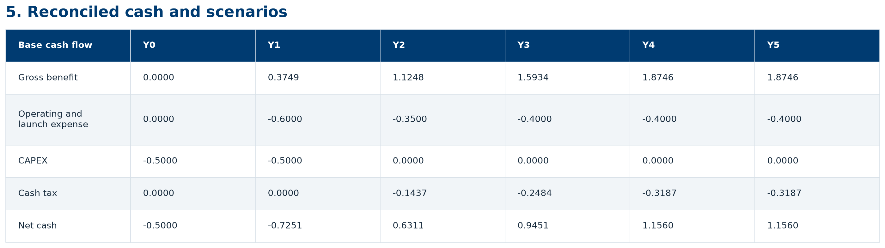

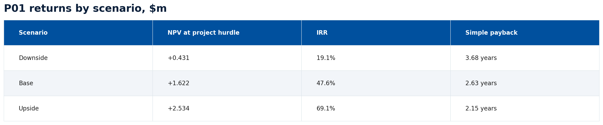

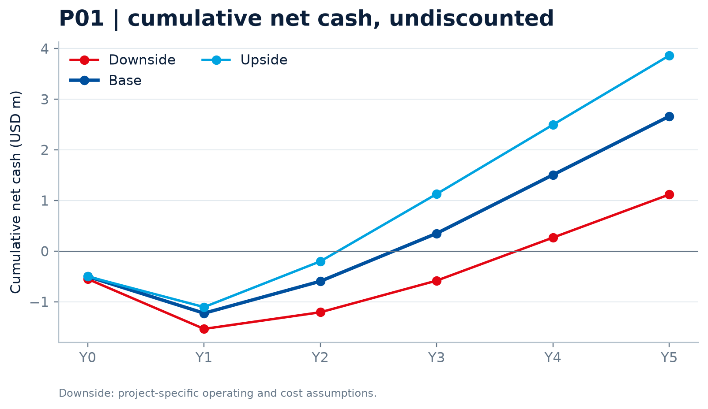

#### 6. Gates, adoption et risque

1. **Avant le pilote :** le responsable fiabilité du site, la Finance et l'IT établissent les solutions existantes, les équipements éligibles et la baseline de production, les droits de données et la répartition des 1,4 M$. Convenir de la métrique d'alerte, de la tolérance aux fausses alertes et d'une baseline de maintenance comparable avant les tests en réel.
2. **Revue du pilote :** les ingénieurs fiabilité valident les alertes exploitables, l'intervention sûre et l'économie réelle de production/réparation ; la Finance vérifie si le débit incrémental a été vendu. Pause en cas de problème de sécurité ; réentraînement ou arrêt si les seuils de performance préconvenus ne sont pas atteints.
3. **Extension :** le sponsor ne libère de dépenses supplémentaires que si le cas incrémental **futur** franchit le hurdle et si les conditions d'adoption et de sécurité du site sont satisfaites. Un arrêt laisse les coûts engagés et non annulables dans le programme.

**Marge de sécurité [Calcul] :** à coûts, impôt et rampe de base inchangés, la NPV à cinq ans à 9,5 % atteint zéro à environ **1,080 M$/an à pleine échelle**, soit 57,6 % des 1,8746 M$ modélisés. À chaque gate, la décision n'utilise que les engagements de cash restants et les bénéfices atteignables.

L'équipe fiabilité conserve l'autorité d'intervention ; opérateurs et personnel de maintenance participent à la conception et reçoivent une formation financée. Cybersécurité, sécurité, complétude des données et périmètre de licence sont des conditions de gate.

#### 7. Flux opérationnel et plan de preuves

Sélectionner les équipements tournants critiques avec l'équipe fiabilité du site et documenter le programme d'inspection existant, les événements historiques et les contraintes de procédé. Établir si les données de capteurs et de maintenance peuvent être jointes au niveau équipement ; là où ce n'est pas possible, réparer seulement les interfaces nécessaires au pilote. Le trio projet revoit la logique d'alerte avec les experts du site. Les alertes entrent dans le flux de maintenance existant ; un ingénieur fiabilité évalue la sévérité, les fenêtres de maintenance et les fausses alertes. Aucun modèle ne commande d'arrêt automatique ni ne contourne les procédures de sécurité.

Avant les tests, la Finance et les opérations conviennent d'équipements comparables et d'une période ajustée des calendriers de maintenance et des conditions de production. L'évaluation suit la chaîne complète : alerte éligible → mode de défaillance vérifié → action menée → arrêt ou réparation évitable → débit vendable supplémentaire ou facture payée évitée. Les alertes sans intervention et les événements manqués sont consignés. La production supplémentaire est valorisée à la contribution incrémentale réelle, nette de la maintenance planifiée, de la demande ou d'autres goulots ; les factures de réparation sont comparées séparément afin qu'aucun événement ne soit compté deux fois. Le sponsor arrête l'extension si l'action sûre, la qualité des données ou l'économie prospective sont insuffisantes ; un bon score de prédiction n'est pas un rendement.

#### 8. Sources et validation

- URD 2025 de TotalEnergies : débit de raffinage CLM-052 et initiatives de données existantes CLM-018 ; aucune affirmation que les deux sites supposés ont 250 kb/j.
- L'ERM de marché est contextuel uniquement, CLM-063 ; les 6 $/b de contribution incrémentale ne sont pas un réel TotalEnergies.
- Equinor SRC-017 / CLM-036 : 120 M$ de valeur cumulée de maintenance prédictive depuis 2020, partenaires inclus ; pas un montant annuel de pair.
- Taux d'actualisation : `work/finance/discount_rate_policy.md`.

### P03 — Conseil au forage en eaux profondes (H2, provisoire)

#### 1. Proposition et point de départ

**Proposition :** tester un flux de conseil à la planification et au forage supervisé par des humains sur **deux rigs ou campagnes en eaux profondes opérés éligibles**. Identifier les actifs opérés et obtenir l'accord de l'opérateur, du contracteur de forage et des partenaires concernés avant de s'engager dans un pilote. Les déploiements Cognite et pratiques de forage existants restent dans le contrefactuel (CLM-019) ; seuls la capacité incrémentale et le cash incrémental comptent.

**Fait :** Mero est opéré par Petrobras ; la participation rapportée de TotalEnergies était de 19,3 % dans l'annonce de 2025 (SRC-037, CLM-077). Ce cas ne suppose donc pas de déploiement unilatéral à Mero, ni n'applique le chiffre de 19,3 % à un autre contrat.

**Problème [Hypothèse] :** une meilleure utilisation des données de puits et de forage peut réduire le temps non productif. Une opération plus rapide n'économise pas automatiquement du cash : le contrat doit permettre une libération plus précoce du rig, réduire les charges variables ou créer un autre bénéfice financier documenté. L'exemple publié de planification de puits de BP est du contexte, pas la preuve d'un écart ou d'une économie pour TotalEnergies (CLM-068).

#### 2. Alternatives, horizon et livraison

| Option | Évaluation |
| --- | --- |
| Flux de forage existant | Contrefactuel, y compris l'ingénierie existante et les outils contractés. |
| Planification manuelle ou à règles améliorée | Benchmark sur les mêmes puits, le même personnel et les mêmes termes avec les contracteurs. |
| Outils de forage commerciaux seuls | Considérer les fonctionnalités des contrats existants et comparer coûts totaux, droits sur les données et gains incrémentaux réels. |
| Flux de conseil en blend | Proposition de travail : intégrer les données existantes et des logiciels éprouvés à l'expertise de forage de l'entreprise, sans pilotage autonome. |

**H2 [Jugement, provisoire] :** refonte transverse du flux de planification de puits et d'exploitation. HSE et experts forage conservent l'autorité opérationnelle.

#### 3. Périmètre et formule de bénéfice incrémental

**Hypothèses annuelles à pleine échelle :** deux rigs/campagnes opérés éligibles ; six jours de rig évitables par rig et par an ; 0,400 M$/jour de coût de spread brut entièrement évitable ; 80 % de part économique supposée × 75 % d'évitabilité du paiement = 60 % de réalisation combinée. Ce **ne sont pas des chiffres d'entreprise vérifiés**. Si la part économique réelle est de 40 %, le bénéfice, toutes choses égales, est divisé par deux à 1,440 M$/an, sous le niveau d'équilibre d'environ 1,660 M$.

`2 rigs × 6 jours/rig/an × 0,400 M$/jour × 60 % = 2,880 M$/an` de cash incrémental brut **[Calcul sur hypothèses]**. Factures, composition des taux, droits de libération des rigs, allocation aux partenaires et plans d'économies existants sont vérifiés. Le temps gagné sans paiement réduit est rapporté comme valeur de capacité ou de calendrier, pas comme ce bénéfice en cash.

#### 4. Coûts, données et calendrier

Montants en **M$**, nominaux. L'investissement ponctuel est de **1,4 M$** : 0,8 M$ d'intégration/logiciel supposés capitalisés (0,4 M$ en Y0 + 0,4 M$ en Y1) et 0,6 M$ d'intégration, mise en service et formation ponctuelles passées en charges en Y1. Les coûts récurrents de logiciel, data engineering, support contracteurs et exploitation sont de 0,30, 0,45, 0,50, 0,50, 0,50 M$ en Y1–Y5.

Rampe de bénéfice : 0 %, 30 %, 70 %, 100 %, 100 % en Y1–Y5 : un pilote suivi d'une libération conditionnelle, pas d'exploitation autonome. Le modèle suppose un impôt de 25 % sur le cash, un amortissement linéaire de 0,8 M$ sur cinq ans à partir de Y1 et aucun crédit immédiat sur les pertes annuelles ; juridiction, détention et termes fiscaux sont confirmés avant libération.

**Dépendances dures :** droits sur les données de forage choisies, intégration des contracteurs, consentement de l'opérateur, flux de conseil sûr et borné, et accès de la Finance aux factures. Le responsable ingénierie des puits et les représentants des contracteurs portent la validation.

#### 5. Cash-flows et scénarios

Le downside suppose 80 % des bénéfices à pleine échelle, 110 % de l'investissement et des coûts d'exploitation, et une rampe plus lente de 0 % / 25 % / 60 % / 90 % / 100 %. L'upside suppose 115 % des bénéfices à pleine échelle et accélère la rampe de base de 15 %, plafonnée à 100 %, aux coûts de base. Le hurdle du projet est de 11 %.

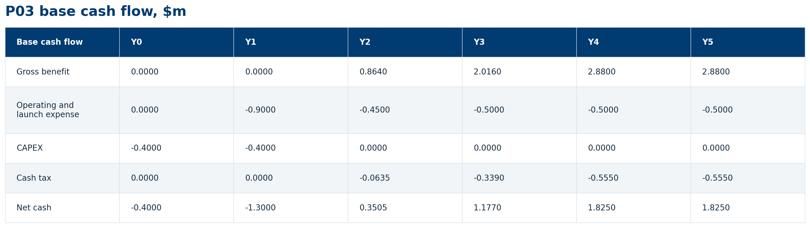

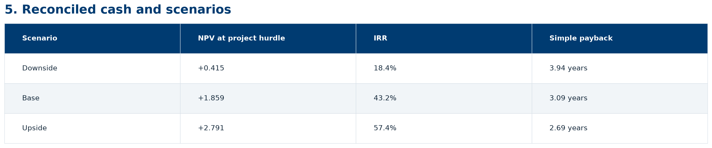

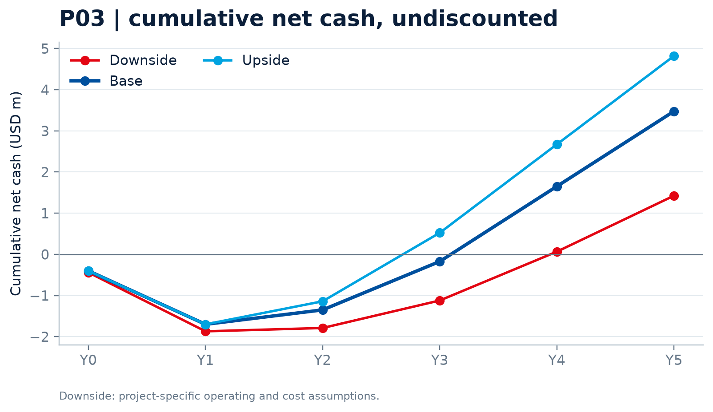

#### 6. Flux opérationnel et plan de preuves

Le responsable forage sélectionne les campagnes éligibles et obtient l'accord de l'opérateur, des partenaires et des contracteurs avant tout transfert de données. Le trio projet combine les données historiques de puits approuvées, les dossiers d'ingénierie et les apports des contracteurs pour faire émerger des recommandations de conseil pour la planification et l'exécution. L'ingénieur de forage et le contracteur évaluent chaque recommandation dans le cadre des procédures HSE et de contrôle de puits existantes ; l'autorité opérationnelle et le droit de rejeter une recommandation restent inchangés.

Avant le pilote, nous établissons des phases de puits comparables et la baseline existante de planification et de temps non productif, en consignant les différences géologiques et opérationnelles. Pour chaque recommandation, la piste de preuve va de l'activité planifiée aux jours de rig réels, puis à la clause contractuelle et à la facture. La Finance ne compte un bénéfice que lorsqu'une période plus courte réduit effectivement un paiement ou crée un autre effet cash documenté, ajusté une fois pour l'intérêt économique du groupe. Si le contrat empêche la captation, si l'outil duplique une capacité existante ou si les cash-flows restants échouent au hurdle de 11 %, le sponsor suspend l'extension et décide de redessiner ou d'arrêter.

#### 7. Sources et validation

- SRC-037 / CLM-077 : opérateur de Mero et participation 2025 ; pas la preuve d'un périmètre opéré à deux rigs.
- SRC-008 / CLM-019 : partenariat Cognite et périmètre de déploiement annoncé ; pas la preuve que les rigs choisis ou l'outil de conseil soient prêts.
- SRC-025 / CLM-068 : exemple de planification de puits de BP ; aucune économie TotalEnergies ne peut en être inférée.
- Hurdle du projet : `work/finance/discount_rate_policy.md`. La question décisive est de savoir si les économies de jours de rig réduisent les paiements selon le contrat réel.

### P12 — Option de licence technologique e-SAF assistée par IA (H3)

#### 1. Décision et hypothèse de modèle économique

**Décision :** financer une expérience par étapes vers une activité de technologie à des tiers, en réutilisant le concept de recherche sur les catalyseurs et son enveloppe de coûts existante. Nous n'approuvons pas d'usine de production ; les recettes commerciales dépendent de gates techniques et de marché.

**Modèle économique :** combiner la découverte assistée par IA de catalyseurs/procédés avec un paquet de procédé licenciable pour des développeurs e-fuel indépendants. L'acheteur est un développeur d'usine tiers ; la contrepartie serait des frais de développement, des redevances de technologie et du support technique, plutôt que seulement une marge sur du carburant produit dans des usines détenues par l'entreprise. Prix, acheteurs adressables, propriété de l'IP et différenciation technique ne sont pas encore établis. Le scénario de base inclut des recettes conditionnées à ces hypothèses et aux gates ci-dessous.

#### 2. Capacité existante et pourquoi l'IA

TotalEnergies dispose déjà du CO2 Techno Hub, de BioHub et de partenariats de recherche sur le SAF ; nous ne recréons pas ces capacités. Infinium décrit un accord de licence technologique à des tiers en Asie du Sud-Est ; cela établit une structure commerciale possible, pas une demande pour un paquet TotalEnergies concurrent. Avant de dépenser, nous cartographions les licences TotalEnergies existantes, l'IP des partenaires et la recherche e-fuel déjà financée. Si le projet se contente d'améliorer un procédé interne de production de carburant ou duplique une offre existante, sa thèse H3 échoue et il est arrêté ou reclassé.

**Pourquoi l'IA :** classer des formulations et expériences candidates à l'aide de modèles conscients de l'incertitude, puis valider par des tests physiques, par comparaison à un plan d'expériences classique avec le même budget de laboratoire. La précision de prédiction seule n'est pas un jalon d'investissement. Nous combinons l'infrastructure de recherche existante, des partenaires de laboratoire spécialisés et une expertise commerciale/IP ; aucun nouveau modèle de fondation ni construction d'usine n'est financé.

**Justification H3 :** la transformation est un modèle de revenu de licence technologique au service de développeurs externes. Le travail de laboratoire est le moyen ; le nouveau modèle de revenu est la raison du H3.

Sources : [innovation et recherche existante de TotalEnergies](https://totalenergies.com/company/strength/innovation-rd) ; [projets Infinium, licence en Asie du Sud-Est](https://infinium.energy/projects), consulté le 10 novembre 2026 ; [note de preuves H3](../../sources/synthesis/2026-11-10_h3_licensing_option.md).

#### 3. Coûts et gates

**Coûts [Hypothèses] :** 0,30 M$ de CAPEX en Y0, 0,30 M$ de CAPEX et 0,40 M$ de charges de lancement en Y1 ; coûts récurrents Y1–Y5 de 0,20 / 0,30 / 0,40 / 0,45 / 0,50 M$. Plafond brut total **2,85 M$** : une enveloppe de faisabilité et de laboratoire, pas un financement pour la certification, une usine de démonstration, des garanties industrielles ou une commercialisation complète. L'accès au laboratoire existant est une condition dure ; l'allocation de lancement de 0,40 M$ couvre le travail commercial/IP et le plan d'expériences, sinon le cas est rechiffré.

**Gates :** avant Y0, OneTech et le juridique établissent la non-duplication, les droits de données et de licence. Avant Y2, au moins deux développeurs tiers qualifiés acceptent de discuter d'une application définie et d'un benchmark. Avant Y3, trois essais expérimentaux indépendants montrent un résultat reproductible contre une cible d'amélioration préenregistrée, une évaluation préliminaire de liberté d'exploitation est terminée et au moins un développeur documente sa volonté d'entrer dans une évaluation payante. Si une condition échoue, les dépenses évitables s'arrêtent ; le cash dépensé et une allocation de clôture de 0,10 M$ demeurent. Aucun passage à l'échelle industrielle ne suit automatiquement un succès de laboratoire.

#### 4. Cash-flows et scénarios

Le scénario de base suppose des recettes brutes liées aux licences de **0,60 M$ en Y3, 1,50 M$ en Y4 et 2,30 M$ en Y5**, conditionnées aux gates techniques, IP et commerciaux ; ce ne sont pas des contrats signés. L'upside applique 115 % à la recette à pleine échelle et accélère la rampe de 15 %, plafonnée à 100 %. Dans le downside, l'expérience s'arrête après Y2, ne reçoit aucun revenu commercial, supporte 110 % des coûts avant arrêt et un coût de clôture de 0,10 M$ en Y3. Le hurdle du projet est de 12 %.

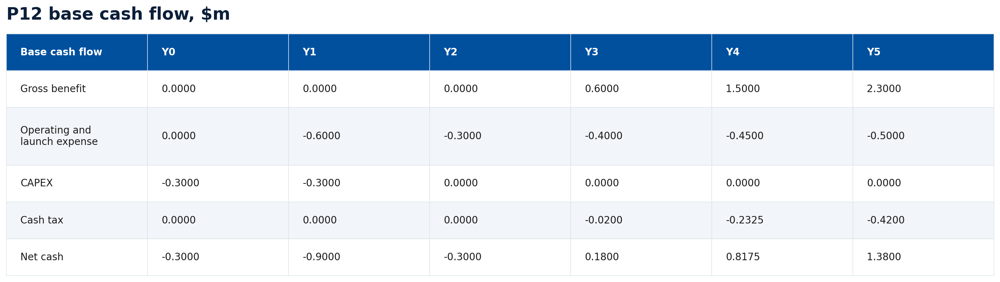

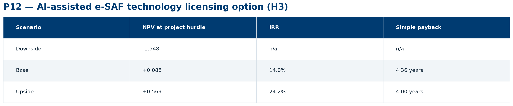

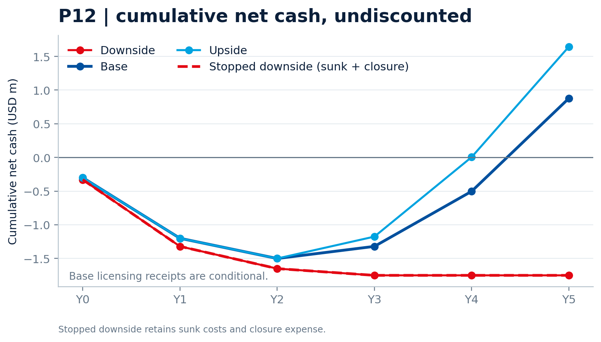

#### 5. Flux opérationnel et plan de preuves

OneTech et le juridique cartographient d'abord la recherche existante, les droits des partenaires et toute offre de licence externe actuelle ; le responsable commercial définit le développeur cible et le problème que le paquet de procédé résoudrait. Dans la capacité de laboratoire existante, les chercheurs comparent la sélection d'expériences assistée par IA au plan d'expériences classique selon un protocole préenregistré et avec les mêmes ressources expérimentales. Les responsables scientifiques fixent le seuil d'amélioration technique avant les tests. Un résultat de recherche ne prouve pas à lui seul qu'un tiers paiera pour la technologie.

Le responsable commercial teste une application et un benchmark définis avec au moins deux développeurs qualifiés avant Y2, et cherche la volonté documentée d'au moins l'un d'eux d'entrer dans une évaluation payante avant Y3. Prix, périmètre du support, droits des partenaires et coût du passage au-delà du laboratoire sont établis avant tout engagement commercial.

### P13 — Demande retail en France et démarques contrôlées (H1)

#### 1. Décision et situation existante

**Proposition [Hypothèse] :** piloter la prévision de la demande et l'aide au réapprovisionnement avec des étiquettes électroniques de rayon et des démarques dynamiques contrôlées dans 100 grandes stations-service françaises exploitées en propre. Un pilote réussi peut justifier une extension approuvée séparément.

**Calibration [Observation locale] :** notre initié, s'appuyant sur son expérience du réseau retail français, suggère un **investissement indicatif de 1 M€ pour 100 grandes stations exploitées en propre en France, étiquettes électroniques comprises** (CLM-078, CLM-079). Cela éclaire nos hypothèses ; ce n'est pas la preuve d'un projet réel, d'un budget d'entreprise ou d'un résultat réalisé.

Avant l'investissement, nous cartographions les capacités et initiatives financées existantes du retail afin que seuls les coûts et bénéfices incrémentaux comptent. L'empreinte retail mondiale de TotalEnergies n'est pas utilisée comme dénominateur du pilote (SRC-002 p. 13). La baseline conserve le réapprovisionnement, la tarification, le personnel et les systèmes existants.

#### 2. Problème, alternatives et horizon

**Problème [Hypothèse] :** la volatilité au niveau de chaque station crée des pertes évitables de produits périssables, des ruptures et des livraisons urgentes ; un ordonnancement et une tarification statiques peuvent ne pas capter le trafic local et la saisonnalité. Les pertes réelles et la performance de baseline sur les 100 stations sont inconnues.

| Alternative | Approche | Justification de la décision |
| --- | --- | --- |
| Processus existant | Les commandes, promotions et ajustements locaux actuels continuent | Contrefactuel. Mesurer ses résultats réels ; ne pas supposer qu'il est inefficace. |
| Prévision seule | Améliorer les commandes et la visibilité des stocks ; pas de nouvelles étiquettes | Moins de dépense matérielle peut la rendre préférable. Comparer coûts et bénéfices du pilote avant de choisir. |
| Prévision + étiquettes | Prévoir la demande et appliquer des démarques approuvées via des étiquettes électroniques | Cas de base de travail. Chaque gain étiquette/démarque doit être incrémental par rapport à la prévision. |
| Règles manuelles | Améliorer les seuils min/max et les règles de péremption sans ML | Benchmark sur les mêmes stations ; l'IA ne se justifie que si elle ajoute une valeur nette mesurable. |

**H1 [Jugement] :** améliore un flux retail existant pour des clients existants à l'aide de méthodes établies. Prévisions et prix restent soumis au contrôle humain et aux règles de tarification.

#### 3. Périmètre, dépendances et mise en œuvre

- **Périmètre :** 100 stations françaises exploitées en propre sélectionnées. Propriété du stock, autorité sur les prix, couverture POS et mix de catégories sont vérifiés avant financement.
- **Dépendances dures :** autorisation d'utiliser l'historique de ventes et de stocks par station/SKU ; une interface POS et étiquettes éligible ; un processus de mise à jour des prix en rayon ; revue de protection des données et commerciale. Les systèmes de prix existants et les coûts d'étiquettes préfinancés font partie de la baseline.
- **Dépendances souples :** flux météo et trafic. Le pilote démarre sans eux s'ils ne sont pas disponibles ; il n'attend pas une plateforme de données groupe.
- **Livraison [Hypothèse] :** un trio projet retail (data engineer de la branche, data scientist du TDF, expert opérations magasin) travaille avec les gérants de station et la Finance ; le matériel d'étiquettes est acheté, intégré aux systèmes existants, et la couche de prévision est construite ou configurée.
- **Calendrier [Hypothèse] :** décision et mise en place en Y0 ; déploiement du pilote et validation de la baseline en Y1 ; extension aux 100 stations éligibles en Y2 après un gate réussi ; exploitation et mesure en Y3–Y5.

#### 4. Investissement et coûts d'exploitation

Montants en **M€**, nominaux ; hypothèses de dossier, pas un devis d'entreprise.

| Poste de coût | Y0 | Y1 | Total ponctuel | Traitement supposé |
| --- | ---: | ---: | ---: | --- |
| Étiquettes électroniques, connectivité et logiciel éligible | 0,400 | 0,400 | 0,800 | Capex, amorti sur cinq ans à partir de Y1. |
| Intégration, installation et formation initiale | 0 | 0,200 | 0,200 | Charge d'exploitation ponctuelle en Y1. |
| **Investissement ponctuel total** | **0,400** | **0,600** | **1,000** | Étiquettes incluses. |

Les coûts récurrents de cloud, données, support et accompagnement des stations sont de 0,060 M€ en Y1, 0,100 M€ en Y2 et 0,120 M€/an en Y3–Y5, distincts du 1 M€. Aucune extension au-delà des 100 stations n'est incluse.

#### 5. Leviers de bénéfice et dossier financier

Toutes les données sont des hypothèses pour 100 stations éligibles. Le bénéfice annuel central est de **0,635 M€** : 0,245 M€ de réduction du gaspillage + 0,250 M€ de récupération incrémentale sur démarques + 0,140 M€ de récupération des ruptures. Les économies de livraisons urgentes sont exclues tant que des factures n'établissent pas un cash évitable.

- Gaspillage : 100 × 350 000 € de ventes périssables × 70 % de coût d'inventaire × 4 % de gaspillage de base × 25 % de réduction = 245 000 €/an.
- Démarques : 100 × 1 000 articles à risque × 2,50 € de récupération incrémentale nette = 250 000 €/an, sur des articles hors du pool de gaspillage, nette de cannibalisation, remises et manutention supplémentaire.
- Ruptures : 100 × 50 000 € de ventes manquées × 8 % de récupération × 35 % de contribution = 140 000 €/an, mesurée comme contribution incrémentale de catégorie.

Le downside suppose 90 % des bénéfices à pleine échelle, 105 % de l'investissement et des coûts d'exploitation, et une rampe plus lente de 40 % / 70 % / 90 % / 100 % / 100 %. L'upside suppose 115 % des bénéfices à pleine échelle et accélère la rampe de base de 15 %, plafonnée à 100 %, aux coûts de base. Les valeurs sont en millions d'euros ; le portefeuille convertit à 1,1165 $/€. Le hurdle du projet est de 9 %.

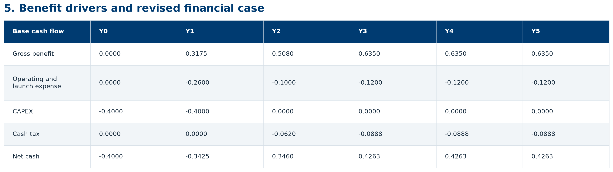

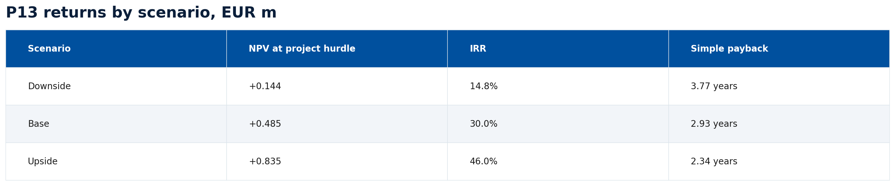

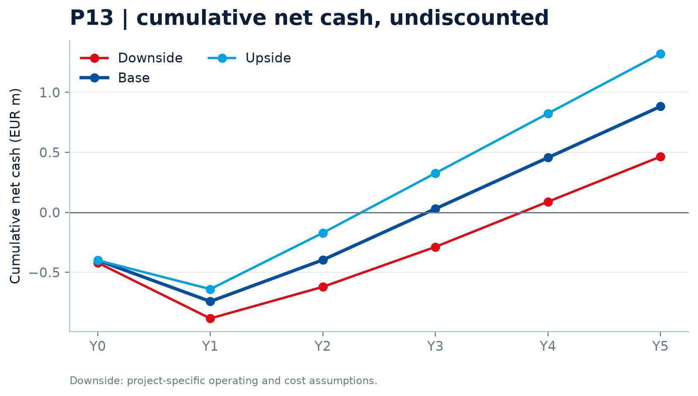

**Sensibilité à l'attribution :** sans le flux de démarques de 0,250 M€, le bénéfice annuel tombe à 0,385 M€, sous le niveau d'équilibre d'environ 0,446 M€ à 9 %. Le cas exige donc la preuve d'une valeur incrémentale des démarques ou une conception moins coûteuse de prévision seule.

**Règle de libération :** le sponsor retail et la Finance préenregistrent le protocole de magasins appariés, les cohortes de gaspillage de baseline, la marge et les factures de livraison payées avant la libération de Y0. Avant l'extension matérielle de Y2, la NPV prospective à 9 % doit être positive en utilisant la marge incrémentale mesurée et les coûts évitables restants. Le déploiement matériel s'arrête si les étiquettes ne font pas mieux que la prévision seule après leurs coûts incrémentaux. Les gérants de station conservent l'autorité sur les prix.

#### 6. Flux opérationnel et plan de preuves

Nous commençons par un sous-ensemble représentatif et instrumenté de stations éligibles. Les opérations retail confirment la propriété du stock, l'autorité sur les prix, les interfaces POS et étiquettes, puis conviennent d'un protocole de magasins appariés avec la Finance avant l'achat du matériel à grande échelle. Les gérants de station reçoivent des commandes et démarques recommandées dans leur flux existant et conservent l'autorité d'approbation. L'équipe forme le personnel aux exceptions, contrôles de prix et à un repli manuel, et enregistre la charge de travail supplémentaire et le coût de remplacement.

Nous comparons la pratique actuelle, la commande à règles, la prévision sans étiquettes et la prévision avec étiquettes lorsque la conception du pilote le permet. Des cohortes SKU/jour distinctes pour la réduction du gaspillage et la récupération sur démarques sont définies avant les tests ; la récupération des ruptures est mesurée nette de la substitution. La Finance vérifie les effets mesurés et les coûts restants avant toute nouvelle libération de matériel. Si l'incrément des étiquettes ne justifie pas son coût, nous gardons la prévision seule ; si le cas prospectif échoue au hurdle de 9 %, l'extension est suspendue ou arrêtée.

**Sources et limites :** la calibration locale CLM-074/078/079 n'établit ni une baseline groupe ni une économie réalisée.

### Gates de libération au niveau projet

Au mois 12, le sponsor et la Finance appliquent ces tests avant de libérer l'extension. La NPV prospective n'utilise que les cash-flows restants et le hurdle du projet. Pour les pilotes tournés vers les utilisateurs (P01, P03, P04, P08, P13), le gate exige aussi au moins **60 % des décisions éligibles enregistrées via l'outil**. Lorsqu'un pilote démarre plus tard, les mêmes preuves sont exigées avant sa première extension. Un échec critique de sécurité, de sûreté ou juridique déclenche une pause immédiate.

| Initiative / responsable | Preuves et seuil au mois 12 | Si le seuil n'est pas atteint |
| --- | --- | --- |
| P01 — Sponsor raffinage | Pilote sûr, baseline documentée et NPV prospective supérieure à zéro à 9,5 %. | Pause de l'extension aux sites ; redesign ou arrêt. |
| P02 — Sponsor amont | Production vendue éligible et baseline d'événements confirmées ; NPV prospective supérieure à zéro à 10 %. | Pause du déploiement ; redesign ou arrêt. |
| P03 — Sponsor forage | Capacité contractuelle d'éviter des paiements de rig confirmée ; NPV prospective supérieure à zéro à 11 %. | Pause de l'extension ; redesign ou arrêt. |
| P04 — Sponsor renouvelables | Production commercialisable et droit économique mesurés contre baseline ; NPV prospective supérieure à zéro à 10 %. | Pause de l'extension aux actifs ; redesign ou arrêt. |
| P05 — IT corporate / achats | Droits de résiliation et cohorte de licences redondantes éligibles vérifiés ; NPV prospective supérieure à zéro à 9 %. | Pause des suppressions ; redesign ou arrêt. |
| P08 — Sponsor métier clients | Un test contrôlé démontre une rétention nette incrémentale positive ; NPV prospective supérieure à zéro à 9,5 %. | Pause de l'extension ; redesign ou arrêt. |
| P09 — Sponsor opérations GNL | Droits sur les paiements de carburant et baseline de factures vérifiés ; NPV prospective supérieure à zéro à 10 %. | Pause du déploiement ; redesign ou arrêt. |
| P12 — OneTech / responsable commercial | IP et accès au laboratoire validés et deux discussions avec des développeurs qualifiés engagées avant Y2. | Arrêt de l'extension commerciale évitable ou redesign de l'option. |
| P13 — Sponsor retail | Essai en magasins appariés et baseline établis ; NPV prospective supérieure à zéro à 9 % et économie incrémentale des étiquettes positive. | Pause de l'extension matérielle ; préférer la prévision seule ou arrêter. |
| E01 — Finance / Digital Line | Propriétaires nommés, inventaire des modèles et registre de baselines couvrant tous les pilotes lancés. | Pause de la libération de tout pilote dépourvu des contrôles requis. |

Au mois 24, les sponsors des branches et la Finance n'approuvent de financement supplémentaire que si le cas restant a une NPV prospective positive à son hurdle de projet et que ses conditions opérationnelles et de contrôle demeurent satisfaites ; P12 exige à la place des preuves techniques, IP et d'évaluation payante avant toute poursuite commerciale. Au mois 36, le comité de pilotage revoit chaque cas selon le même principe. Si une condition n'est pas remplie, le responsable suspend les nouveaux engagements et décide de redessiner ou d'arrêter ; les obligations contractuelles existantes et les coûts de clôture demeurent.

## 5. Mise en œuvre et adoption

**Les 90 premiers jours.** Nommer les sponsors de branches et les chefs de projet ; staffer chaque trio projet et réserver son temps ; vérifier les solutions, contrats, actifs éligibles et accès aux données existants pour chaque cas. La Finance convient avec le métier d'une baseline mesurée et de la formule de valeur incrémentale. Sélectionner les sites pilotes et accomplir la consultation des salariés, les exigences de sécurité et de protection des données. Enregistrer l'intervalle actuel entre revues d'avancement et le délai entre approbation et première mise en service, comme référence du nouveau modèle de livraison.

**Pilote et apprentissage.** Les trios travaillent avec le personnel de première ligne sur site ou dans leur flux quotidien, en cycles courts avec des revues utilisateurs fréquentes. Chaque pilote compare le processus assisté par IA à la pratique actuelle et, lorsque c'est pertinent, à une alternative plus simple à règles. Managers et utilisateurs sont formés à la décision qu'ils doivent prendre, pas seulement à l'outil. Un processus d'exceptions et d'escalade est maintenu. L'usage réel, la qualité des décisions, la performance opérationnelle et les résultats économiques sont mesurés séparément.

**Passer à l'échelle ou arrêter.** Le sponsor métier et la Finance examinent les preuves au gate convenu. Des sites supplémentaires ne sont libérés que si les données, l'adoption par les utilisateurs, la sécurité et l'économie prospective soutiennent l'extension. Si les résultats déçoivent, le périmètre est redessiné ou les dépenses évitables s'arrêtent. Les composants réutilisables et les enseignements retournent au hub afin que les équipes suivantes ne refassent pas le même travail d'intégration.

**Revue exécutive.** Un tableau de bord mensuel d'une page montre, pour chaque initiative, les dépenses engagées et prévues, le délai de livraison, les utilisateurs actifs, les métriques opérationnelles de baseline et observées, le bénéfice vérifié par la Finance, les risques et la prochaine décision de financement. Aucune économie de main-d'œuvre n'est comptée du simple fait qu'on gagne du temps ; toute réaffectation ou réduction de coûts externes doit être observable et convenue avec le métier.

### Responsabilités et jalons

| Moment | Responsable | Décision et preuves |
| --- | --- | --- |
| 90 premiers jours | Sponsors des branches, chefs de projet, responsable du Digital Factory et Finance | Staffer les quatre trios phares et réserver leur capacité ; documenter outils existants, baselines, droits de données, coût de remplacement et budgets de pilote. Ne libérer chaque engagement Y0 qu'après vérification de la sécurité, de la cyber et de la responsabilité métier (Gate 0). |
| Au mois 6 | Chefs de projet | Au moins 40 % des utilisateurs éligibles actifs le mois précédent dans les pilotes tournés vers les utilisateurs ; sinon convenir d'une remédiation ou d'un arrêt sous 30 jours. |
| Au mois 12 | Responsables des sites/métiers, avec la Finance | Revoir l'adoption (au moins 60 % des décisions éligibles enregistrées), les résultats incrémentaux mesurés et les dépenses par rapport à la baseline convenue (Gate 1). Pour P12, OneTech et le juridique confirment les droits et la non-duplication ; le responsable commercial obtient deux discussions avec des développeurs qualifiés avant Y2. Mettre en pause immédiatement un pilote dangereux ou non conforme. |
| Au mois 24 | Sponsors des branches et Finance | P01, P03 et P13 ne poursuivent que si leurs cash-flows restants franchissent leurs hurdles de projet et que les conditions de site ou de contrat sont remplies (Gate 2). P12 ne poursuit que sur ses gates techniques, IP et d'évaluation payante ; sinon les dépenses évitables s'arrêtent et les coûts de clôture demeurent. |
| Au mois 36 | Comité de pilotage du portefeuille | Revoir les dépenses cumulées, le cash réalisé, l'adoption et la prochaine décision de déploiement de chaque cas ; passer à l'échelle, redessiner ou arrêter selon les preuves et l'économie restante. |

Chaque chef de projet enregistre les utilisateurs éligibles, formés et actifs, avec une cible et une date de revue convenues avant le lancement. Les responsables de sites planifient la formation et la couverture du personnel, recueillent le retour des opérateurs et maintiennent un repli manuel ; le sponsor de la branche porte l'adoption et la Finance confirme le cash réalisé plutôt que le seul usage de l'outil.

### Risques de changement, alerte précoce et responsabilités

**Capacité et rétention des spécialistes.** *Responsables : CHRO et responsable du Digital Factory.* Suivre chaque mois postes vacants, détachements non pourvus et points de défaillance uniques. Enregistrer un suppléant nommé et un plan de passation pour chaque membre du trio avant le début des pilotes ; former en croisé et replanifier les déploiements si la capacité n'est pas disponible. Les managers hiérarchiques conservent l'autorité de staffing et approuvent chaque détachement.

**Adoption par les managers et la première ligne.** *Responsables : sponsors des branches et responsables de sites.* Suivre le temps d'expert protégé, la participation aux revues de pilote, l'usage actif et le retour des opérateurs. Lorsqu'une équipe ne peut libérer son expert, le sponsor de la branche organise un remplacement dans l'allocation ou revient avec un périmètre et un budget révisés. Aucun déploiement ne supplante les procédures de sécurité ni l'autorité opérationnelle humaine.

**Friction du double rattachement.** *Responsables : chefs de projet et managers hiérarchiques.* Convenir conjointement des objectifs de chaque membre du trio avant le lancement : objectifs projet avec le chef de projet, standards professionnels avec le manager hiérarchique. Les conflits de priorités sont escaladés au sponsor de la branche sous une semaine.

**Gouvernance et confiance des salariés.** *Responsables : General Counsel, DPO, HSE et relations sociales.* Avant la libération du pilote, évaluer les droits de données, la sécurité, la confidentialité, la sûreté opérationnelle et la consultation requise des représentants du personnel. Une autorisation manquante ou un incident dangereux suspend immédiatement le déploiement concerné ; le propriétaire du contrôle concerné détermine la remédiation et approuve le redémarrage.

**Annulation ou escalade prématurée.** *Responsables : CFO et sponsor du portefeuille.* Revoir chaque trimestre le creux d'investissement avec les dépenses, l'adoption et les indicateurs opérationnels avancés. Suivre les gates convenus plutôt que d'annuler à cause d'un cash-flow initial négatif ; arrêter ou redessiner lorsque l'économie prospective, la sécurité ou les conditions contractuelles échouent.

### Parties prenantes et communication

**Sponsors :** le CEO, le CFO et les dirigeants des branches fixent le mandat et résolvent les conflits de capacité ou de financement. Le sponsor du portefeuille envoie un tableau de bord mensuel d'une page montrant dépenses, jalons, risques et prochaine décision ; les incidents importants sont escaladés immédiatement.

**Traducteurs :** les chefs de projet et managers des branches traduisent chaque initiative en calendriers, rôles et mesures de performance. Ils revoient la capacité du trio et l'adoption toutes les deux semaines, résolvent les frictions et protègent le temps d'expert.

**Adoptants :** opérateurs de sites, spécialistes de maintenance, équipes de forage, personnel retail et autres utilisateurs de pilotes façonnent le flux de travail via l'expert métier et testent les recommandations. Le trio mène de courtes sessions hebdomadaires à double sens pendant un pilote, consigne les préoccupations et publie les décisions à l'équipe. Les utilisateurs conservent leurs droits de décision opérationnelle et un repli manuel.

**Gardiens :** HSE, cyber, juridique, DPO, achats et représentants du personnel sont engagés pendant le cadrage, et la consultation requise est terminée avant le déploiement. Ils reçoivent le flux de travail prévu, les données, les garde-fous, l'effet sur le travail et la voie d'escalade ; le résultat et le responsable sont enregistrés.

### Compétences, mesure et règles d'arrêt

**Trois niveaux de formation.** (1) Pour le personnel concerné : culture pratique de l'IA, usage acceptable des données, incertitude et escalade. (2) Pour les membres des trios, praticiens et managers : conception de flux, validation, supervision humaine et interprétation de la performance. (3) Pour les dirigeants : hypothèses de scénarios, risque de portefeuille, adoption et décisions de gate. Le CHRO et les sponsors des branches fixent les audiences, les mesures d'achèvement et le remplacement avant le lancement, dans les enveloppes projet.

**Escalier d'adoption.** Mois 0–6 : usage (utilisateurs éligibles, formés et actifs). Mois 6–12 : comportement (décisions enregistrées via l'outil, temps de cycle, retour des utilisateurs). À partir du mois 12 : valeur (cash incrémental vérifié par la Finance contre la baseline). Pour les projets sans flux utilisateur, des jalons techniques et commerciaux remplacent les métriques utilisateurs.

**Discipline de libération.** Les pilotes tournés vers les utilisateurs avec moins de **40 % d'utilisateurs éligibles actifs** le mois précédant la revue du mois 6 suspendent l'extension et conviennent d'une remédiation ou d'un arrêt sous 30 jours. Au mois 12, la poursuite exige au moins **60 % des décisions éligibles enregistrées** via l'outil, en plus du gate du projet. Les échecs de sécurité, juridiques et contractuels déclenchent une pause immédiate. Aux mois 12, 24 et 36, le comité de pilotage décide de passer à l'échelle, redessiner ou arrêter chaque initiative ; aucun jalon ne garantit de financement supplémentaire.

## 6. Conditions de la décision finale d'investissement

Avant l'approbation finale, nous confirmons : (1) la disponibilité des ressources et les coûts complets, y compris les détachements de trios, le remplacement dans les branches et les contrôles partagés ; (2) les actifs éligibles, les contrats et la valeur incrémentale par rapport aux outils existants ; (3) la différenciation technique, les droits, la demande et les coûts réalistes de commercialisation de P12 ; et (4) l'accord des branches sur le calendrier de cofinancement et sur le double rattachement. Le programme avance là où l'économie mesurée et l'adoption le justifient ; la possibilité d'arrêter des cas individuels fait partie de la conception.

## Références et base de calcul

Baseline de l'entreprise : [Document d'enregistrement universel 2025](../../sources/primary/totalenergies_universal-registration-document-2025_2026_en.pdf) ; [TotalEnergies sur l'IA et Michel Lutz](https://www2.totalenergies.com/news/news/energytalks-ai-energy-hype-vs-real-impact) ; [TotalEnergies sur les opérations renouvelables O3C](https://totalenergies.com/news/news/roads-carbon-neutral-season-4-episode-1-o3c-renewables-control-tower). Les identifiants de références (CLM-, SRC-) renvoient au [registre des sources](../../sources/register.md). Preuves de maturité : [évaluation de maturité](../../work/options/readiness_bottleneck.md). Les chiffres proviennent du [modèle financier de travail](../../work/finance/portfolio_model_working.xlsx), avec les composantes annuelles de cash vérifiées par le [script de réconciliation](../../work/finance/reconcile_selected.py). Les fiches projet sont maintenues dans `work/projects/`.
