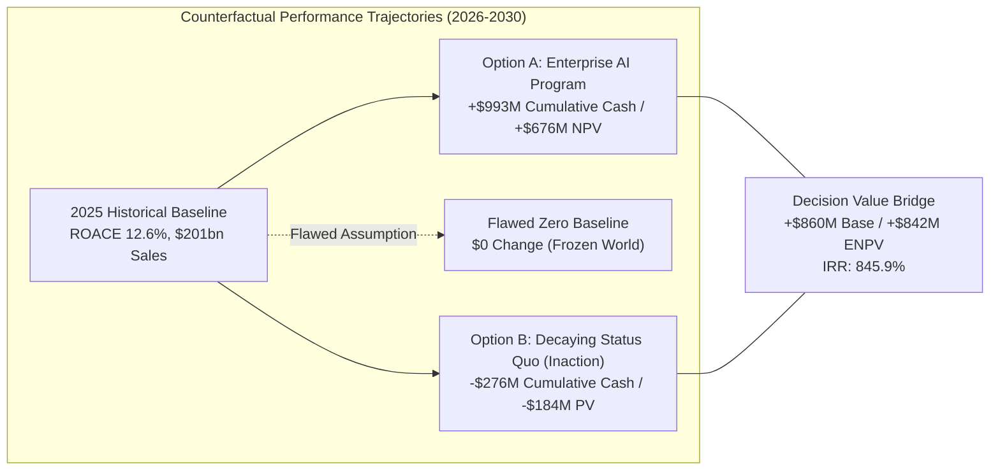

# Step 19 — Cost of Inaction & Decision Value Bridge

**Target:** 9 Nov PM | **Status:** Substantive Proposal Deliverable  
**Authors:** Vincent Lamy & Alexandre Waerniers  
**Related Issue:** [#19 (Model the cost of inaction)](https://github.com/Xenodion/ai-transformations-navy/issues/19)  
**Single Source of Truth:** `work/finance/totalenergies_ai_portfolio_model.xlsx` (Sheet `Cost_of_Inaction`)  
**Methodological Alignment:** Course Session 3 (*Investment Allocation, Decaying Status Quo, and Value Bridges*) & Course Guidelines

---

## 1. Executive Summary & Core Thesis

When appraising strategic capital programs, executive boards frequently commit the foundational error of **comparing proposed investments against a flat zero baseline** [Fact, Course Session 3]. In an industrial energy transition where direct competitors (Shell, BP, Equinor) are actively scaling artificial intelligence across subsurface exploration, refinery yield optimization, and algorithmic power trading, **the status quo does not stay flat: it decays** [Fact, Course Session 3].

Doing nothing is not a free or risk-neutral decision; it is an active choice to absorb competitive erosion, talent flight, and regulatory sanctions [Assumption, Course Session 3].

This analysis establishes an auditable, bottom-up model of TotalEnergies' **decaying status quo baseline** across three distinct structural drivers over a 5-year appraisal horizon ($Y_1$ to $Y_5$, 2026–2030):

1. **Competitor Catch-Up & Operational Margin Slippage:** **$227.82M** nominal erosion (**$151.07M PV** at the 10.98% capital-weighted hurdle rate), driven by refining crack margin erosion vs digitally optimized peers, power imbalance settlement penalties on an expanding renewable generation fleet, and offshore deepwater drillship scheduling delays [Calculation, Sheet `Cost_of_Inaction!I5:J7`].
2. **Digital Talent Attrition & Replacement Friction:** **$20.00M** nominal loss (**$13.61M PV**), driven by an incremental 5–8% turnover among the Digital Factory's 500 AI specialists caused by "pilot purgatory" fatigue, requiring loaded headhunter, onboarding, and ramp replacement outlays [Calculation, Sheet `Cost_of_Inaction!I8:J8`].
3. **Regulatory Non-Compliance & Shadow AI Exposure:** **$28.20M** nominal risk reserve (**$19.43M PV**), driven by EU AI Act Annex III High-Risk conformity audit liabilities across 10,000 uninventoried live models and unmonitored commercial GenAI data leakages [Calculation, Sheet `Cost_of_Inaction!I9:J9`].

### Consolidated Headline Figures
- **5-Year Cumulative Inaction Cash Losses:** **-$276.02M** [Calculation, Sheet `Cost_of_Inaction!I10`].
- **Present Value of Inaction (PV @ Hurdle 10.98%):** **-$184.11M** [Calculation, Sheet `Cost_of_Inaction!J10`].
- **Present Value of Inaction (PV @ Group WACC 7.50%):** **-$208.10M** [Calculation, Sheet `Cost_of_Inaction!K10`].
- **Decision Value Bridge (Expected Value):**
  - Standalone Enterprise Program ENPV (Step 18): **+$657.67M** [Calculation, Sheet `Scenario_Sensitivity_ENPV!E7`].
  - Avoided Inaction Economic Erosion: **+$184.11M** [Calculation, Sheet `Cost_of_Inaction!J10`].
  - **Incremental Decision Value (Plan vs Status Quo):** **+$841.78M Incremental ENPV** [Calculation, Sheet `Cost_of_Inaction!D18`], lifting Incremental IRR to **845.9%** [Calculation, Sheet `Cost_of_Inaction!D19`].

> [!IMPORTANT]
> **Strict Anti-Double-Counting Standard (AGENTS.md Rule 7):**  
> In compliance with project governance and Course Session 3 rules, **not a single dollar of inaction cost is derived by inverting Step 18 transformation project benefits**. Step 18 measures *active margin expansion and asset optimization above 2025 performance*. Step 19 measures *passive degradation of the existing baseline* if no enterprise AI program is funded. All five erosion drivers have been formally demarcated and audited in Section 6.

---

## 2. Methodological Framework: The Decaying Status Quo

### 2.1 The Boardroom Pitfall: Investing vs Zero vs Status Quo
In standard corporate finance appraisals, capital requests present an NPV calculated as:
$$\text{NPV}_{\text{Standard}} = \sum_{t=0}^T \frac{\text{CF}_{\text{Project}, t}}{(1 + r)^t}$$
This assumes that if capital expenditure is rejected ($\text{Capex} = 0$), cash flows in subsequent years remain exactly equal to the historical base ($\text{CF}_{\text{Baseline}, t} = 0$).

As demonstrated in Course Session 3 (*MaisonRetail* case study), for general-purpose technologies undergoing exponential adoption, **the counterfactual baseline is negative**:
$$\text{Decision Value} = \text{NPV}_{\text{Program}} - \text{NPV}_{\text{Status Quo}} = \text{NPV}_{\text{Program}} + |\text{PV}_{\text{Inaction}}|$$
$$\text{Incremental Cash Flow}_t = \text{CF}_{\text{Program}, t} - \text{CF}_{\text{Status Quo}, t}$$



### 2.2 Why Boards Discount Hand-Waved Inaction Numbers
Executive committees and skeptical CEOs routinely dismiss cost of inaction analyses as "scare tactics" or "soft strategic padding" [Fact, Course Session 3]. To achieve investment-grade credibility:
1. Every driver must be tied to an audited operational baseline in TotalEnergies' official disclosures (*Universal Registration Document 2025*, SRC-002; *Q3 2026 Results*, SRC-005).
2. Industry benchmarks must rely on verified peer data (Equinor SRC-017, BP SRC-025, Shell SRC-021, IEA SRC-026), rather than speculative vendor whitepapers.
3. The model must apply a conservative 12-month lag: **zero erosion is assumed in Year 1 ($Y_1 = 2026$) for operational drivers**, reflecting operational inertia and contractual lags.
4. Cash flows must be discounted at the **exact capital-weighted hurdle rate (10.98%)** established in Step 18, ensuring mathematical consistency across the financial model.

---

## 3. Driver-by-Driver Quantification & Operational Grounding

```
                            Total 5-Year Inaction Losses: $276.02M
                                  (Present Value @ 10.98%: $184.11M)
                                              │
         ┌────────────────────────────────────┼──────────────────────────────────┐
         │                                    │                                  │
  Driver 1: Market Erosion            Driver 2: Talent Flight            Driver 3: Regulatory & Cyber
    $227.82M (82.5%)                      $20.00M (7.2%)                     $28.20M (10.2%)
    PV: $151.07M                          PV: $13.61M                        PV: $19.43M
         │                                    │                                  │
 ┌───────┴───────┬───────────────┐            │                                  │
 │               │               │            │                                  │
D1a: Refining   D1b: Power     D1c: E&P     15-30 AI Specialists/yr            EU AI Act Annex III Audits
 Margin Spread   Imbalance      Rig-Days    @ $200k loaded recruiting          + Shadow LLM Data Leakage
 $78.54M         $103.38M       $45.90M     & onboarding replacement           Containment Reserves
 PV: $52.07M     PV: $68.02M    PV: $30.98M PV: $13.61M                        PV: $19.43M
```

---

### Driver 1: Competitor Catch-Up & Operational Margin Slippage ($227.82M Nominal / $151.07M PV)

#### 1a. Refining Margin Compression (Refining & Chemicals)
- **Operational Baseline:** TotalEnergies operates 14 refineries worldwide, processing 1,076 kb/d in Europe (Normandy, Antwerp, Feyzin, Donges, Zeeland) and 1.53 Mb/d globally [Fact, SRC-002, pp. 13, 474]. Annual European throughput equals approximately 392.74 million barrels ($1,076,000 \times 365$) [Calculation].
- **Peer Pressure & Mechanism:** Shell has deployed predictive and optimization models across more than 13,000 industrial assets via its C3 AI alliance [Fact, SRC-022], while BP achieved a company-record refining availability of 96.3% in 2025 driven by enhanced digital monitoring [Fact, SRC-025, p. 17]. Competitors use real-time linear programming (LP) and crude slate molecular tuning to capture micro-arbitrages on discount sour and heavy crudes.
- **Inaction Slippage Parameter:** If TotalEnergies retains its fragmented legacy AspenTech/inmation setup without enterprise ML closed-loop optimization, European refining margin marker captures a passive degradation of **$0.02/bbl in Y2, $0.04/bbl in Y3, $0.06/bbl in Y4, and $0.08/bbl in Y5** [Assumption]. This is ultra-conservative relative to the historical unverified draft which asserted an unsubstantiated $0.25/bbl worldwide loss [Audit, `work/research/legacy_plan_audit.md`].
- **Cash Outflow Schedule:**
  - $Y_1$ (2026): **$0.00M** (contractual lag)
  - $Y_2$ (2027): $392.74\text{M bbl} \times \$0.020/\text{bbl} =$ **$7.85M**
  - $Y_3$ (2028): $392.74\text{M bbl} \times \$0.040/\text{bbl} =$ **$15.71M**
  - $Y_4$ (2029): $392.74\text{M bbl} \times \$0.060/\text{bbl} =$ **$23.56M**
  - $Y_5$ (2030): $392.74\text{M bbl} \times \$0.080/\text{bbl} =$ **$31.42M**
  - **5-Year Nominal Total:** **$78.54M** | **Present Value (@ 10.98%):** **$52.07M** [Calculation, Sheet `Cost_of_Inaction!I5:J5`].

#### 1b. Renewable Imbalance Settlement Penalties & Curtailment (Integrated Power)
- **Operational Baseline:** TotalEnergies generated 48.1 TWh of electricity in 2025 (31.4 TWh renewables, 16.7 TWh flexible CCGT), targeting over 60 TWh in 2026 and 100–120 TWh by 2030 [Fact, SRC-003, p. 9; SRC-004, para. 6]. In 9M 2026, production reached 44.3 TWh, tracking directly to plan [Fact, SRC-005, §4.3].
- **Peer Pressure & Mechanism:** In European power grids (EPEX SPOT, Nord Pool, RTE, TenneT), the penetration of intermittent wind and solar causes extreme intraday volatility and negative pricing spikes. Specialized renewable trading entities (Statkraft, Enel, Engie, Equinor) deploy sub-hourly algorithmic trading models that rebalance positions every 5 to 15 minutes.
- **Inaction Slippage Parameter:** Without an automated virtual power plant (VPP) balancing engine, TotalEnergies' expanding merchant generation fleet suffers escalating balancing group imbalance penalties (*écarts de règlement*) and involuntary curtailment during negative hours. Imbalance penalty slippage on spot-exposed volume is modeled conservatively at **€0.15/MWh in Y2 (55 TWh exposed), €0.25/MWh in Y3 (68 TWh), €0.32/MWh in Y4 (82 TWh), and €0.40/MWh in Y5 (100 TWh)** [Assumption]. Converted at the model's standard exchange rate ($1.13\text{ USD/EUR}$, `Variables!C4`):
- **Cash Outflow Schedule:**
  - $Y_1$ (2026): **$0.00M**
  - $Y_2$ (2027): $55.0\text{ TWh} \times €0.15/\text{MWh} \times 1.13 =$ **$9.32M**
  - $Y_3$ (2028): $68.0\text{ TWh} \times €0.25/\text{MWh} \times 1.13 =$ **$19.21M**
  - $Y_4$ (2029): $82.0\text{ TWh} \times €0.32/\text{MWh} \times 1.13 =$ **$29.65M**
  - $Y_5$ (2030): $100.0\text{ TWh} \times €0.40/\text{MWh} \times 1.13 =$ **$45.20M**
  - **5-Year Nominal Total:** **$103.38M** | **Present Value (@ 10.98%):** **$68.02M** [Calculation, Sheet `Cost_of_Inaction!I6:J6`].

#### 1c. Upstream Rig-Day Inefficiency & Invisible Lost Time (Exploration & Production)
- **Operational Baseline:** TotalEnergies operates an upstream portfolio producing 2,529 kboe/d [Fact, SRC-002, p. 74], with major deepwater operations in Brazil (Mero, Sepia, Atapu), Gulf of Mexico, and offshore Namibia, representing $9.26bn in annual net investments [Fact, SRC-002, p. 37]. Deepwater drillship day-rates run between $400,000 and $480,000/day [Assumption, Step 13].
- **Peer Pressure & Mechanism:** Equinor reported $130M in verified annual AI savings in 2025, emphasizing subsurface interpretation capacity expanding tenfold (2 million km² interpreted) [Fact, SRC-017, SRC-018]. The IEA highlights that AI drilling trajectory and mud circulation optimization shaves up to 10% off deepwater development costs [Fact, SRC-026, p. 118].
- **Inaction Slippage Parameter:** In the absence of an enterprise data integration layer connecting downhole MWD/LWD telemetry to rig schedule logistics, TotalEnergies incurs logistics bottlenecks, supply vessel delays, and unnecessary drill-string tripping. This accumulates an excess of **15 rig-days in Y2, 22 in Y3, 30 in Y4, and 35 in Y5** across the global deepwater fleet, evaluated at a fully loaded rig spread of $450,000/day [Assumption].
- **Cash Outflow Schedule:**
  - $Y_1$ (2026): **$0.00M**
  - $Y_2$ (2027): $15\text{ days} \times \$0.450\text{M/day} =$ **$6.75M**
  - $Y_3$ (2028): $22\text{ days} \times \$0.450\text{M/day} =$ **$9.90M**
  - $Y_4$ (2029): $30\text{ days} \times \$0.450\text{M/day} =$ **$13.50M**
  - $Y_5$ (2030): $35\text{ days} \times \$0.450\text{M/day} =$ **$15.75M**
  - **5-Year Nominal Total:** **$45.90M** | **Present Value (@ 10.98%):** **$30.98M** [Calculation, Sheet `Cost_of_Inaction!I7:J7`].

---

### Driver 2: Digital Talent Flight & Knowledge Erosion ($20.00M Nominal / $13.61M PV)

- **Operational Baseline:** TotalEnergies employs approximately 500 digital and AI experts within the Digital Factory across Paris and India [Fact, SRC-002, p. 42; SRC-011, p. 10]. In accordance with APEC 2025 executive benchmarks (`sources/benchmark/2025_apec_remunerations_cadres_111_familles_metiers.pdf`), lead data scientists and AI architects command base salaries of €70,000–€95,000, loading with employer charges (43.7%) and overhead (15%) to an annual loaded cost of $148,000–$200,000 (`Variables!C18:C19`) [Calculation].
- **Peer Pressure & Mechanism:** Tech companies and digital hubs of European peers (e.g., Shell.ai, Equinor TDI with 2,129 specialists [Fact, SRC-018, p. 23]) aggressively recruit specialized French and Indian engineering talent. If TotalEnergies keeps its AI squads confined to disconnected proofs-of-concept and legacy maintenance tickets without enterprise platform tooling, senior AI engineers face "pilot purgatory" disillusionment.
- **Inaction Slippage Parameter (Course Session 3 Formula):**
  $$\text{Talent Flight Cost} = \text{Incremental Attrition Headcount} \times \text{Loaded Replacement \& Ramp Cost}$$
  - Replacing a senior AI/data engineer entails: executive search / agency fees (22% of salary = ~$45k), onboarding and signing incentives (~$15k), and a 6-month ramp-up productivity loss (~$80k), plus contractor backfill during vacancy (~$60k) = **$200,000 fully loaded replacement cost per departed specialist** [Calculation, Course Session 3 benchmark].
  - Incremental attrition above natural turnover (12% baseline) is modeled at **15 specialists in Y2 (3.0% excess turnover), 25 in Y3 (5.0%), 30 in Y4 (6.0%), and 30 in Y5 (6.0%)** out of the 500-expert pool [Assumption].
- **Cash Outflow Schedule:**
  - $Y_1$ (2026): **$0.00M**
  - $Y_2$ (2027): $15\text{ FTEs} \times \$0.200\text{M} =$ **$3.00M**
  - $Y_3$ (2028): $25\text{ FTEs} \times \$0.200\text{M} =$ **$5.00M**
  - $Y_4$ (2029): $30\text{ FTEs} \times \$0.200\text{M} =$ **$6.00M**
  - $Y_5$ (2030): $30\text{ FTEs} \times \$0.200\text{M} =$ **$6.00M**
  - **5-Year Nominal Total:** **$20.00M** | **Present Value (@ 10.98%):** **$13.61M** [Calculation, Sheet `Cost_of_Inaction!I8:J8`].

---

### Driver 3: Regulatory Compliance, Shadow AI & Cybersecurity Exposure ($28.20M Nominal / $19.43M PV)

- **Operational Baseline & Stated Risk:** TotalEnergies operates "more than 10,000 live AI models" [Fact, SRC-002, p. 42]. The group blocked "several million cyber attacks" in 2025, and explicitly notes in its Universal Registration Document that AI, IoT, and cloud adoption increase the attack surface (§3.1, p. 136) [Fact, SRC-002]. Crucially, TotalEnergies' official risk factor §3.1.5 explicitly warns:
  > *"An insufficient pace or capacity to tailor TotalEnergies organization and skills to digital transformation and the penetration of artificial intelligence... could have a negative effect on its operational performance, its financial condition, its reputation."* [Fact, SRC-002, p. 138].
- **Regulatory Framework:** The European Union Artificial Intelligence Act (Regulation EU 2024/1689) establishes stringent compliance mandates for **High-Risk AI Systems under Annex III**, which explicitly covers safety components in critical digital and industrial infrastructure, electrical grid management, and hazardous industrial installations (refineries and chemical complexes). Penalties for non-compliance reach up to **€35M or 7% of worldwide annual turnover**.
- **Inaction Slippage Parameter (Course Session 3 Formula):**
  $$\text{Regulatory Exposure Cost} = \text{Probability of Investigation/Sanction} \times \text{Expected Financial Impact} + \text{Shadow AI Remediation}$$
  1. *EU AI Act High-Risk Audit Liabilities:* Operating 10,000 distributed models without centralized model lineage, technical documentation, CE-conformity logs, or human-oversight traceability creates imminent audit exposure. Inspection probability rises from 15% in Y2 to 35% in Y4–Y5; expected remediation, legal defense, independent conformity auditing, and negotiated administrative settlement is modeled at $12.0M per incident [Assumption].
     - Expected annual risk: Y1=$0.0M, Y2=$1.80M ($15\% \times \$12\text{M}$), Y3=$3.00M ($25\% \times \$12\text{M}$), Y4=$4.20M ($35\% \times \$12\text{M}$), Y5=$4.20M ($35\% \times \$12\text{M}$).
  2. *Shadow AI & Data Leakage Remediation:* Unmonitored employee use of consumer/public GenAI tools inputting proprietary subsurface seismic interpretations or refinery DCS schematics, triggering cybersecurity containment, forensic investigation, and intellectual property litigation reserves [Assumption].
     - Annual containment reserves: Y1=$1.00M, Y2=$2.50M, Y3=$3.50M, Y4=$4.00M, Y5=$4.00M.
- **Combined Cash Outflow Schedule:**
  - $Y_1$ (2026): **$1.00M** (immediate shadow AI risk)
  - $Y_2$ (2027): $\$1.80\text{M} + \$2.50\text{M} =$ **$4.30M**
  - $Y_3$ (2028): $\$3.00\text{M} + \$3.50\text{M} =$ **$6.50M**
  - $Y_4$ (2029): $\$4.20\text{M} + \$4.00\text{M} =$ **$8.20M**
  - $Y_5$ (2030): $\$4.20\text{M} + \$4.00\text{M} =$ **$8.20M**
  - **5-Year Nominal Total:** **$28.20M** | **Present Value (@ 10.98%):** **$19.43M** [Calculation, Sheet `Cost_of_Inaction!I9:J9`].

---

## 4. Consolidated 5-Year Inaction Erosion Schedule

The table below reproduces the dynamic outputs from Sheet `Cost_of_Inaction` (`A4:K10`) of `totalenergies_ai_portfolio_model.xlsx`:

| Driver ID | Erosion Category & Operational Mechanism | Source / Baseline Grounding | Y1 ($M) | Y2 ($M) | Y3 ($M) | Y4 ($M) | Y5 ($M) | 5-Year Nominal ($M) | PV @ Hurdle (10.98%) | PV @ WACC (7.50%) |
| :--- | :--- | :--- | :---: | :---: | :---: | :---: | :---: | :---: | :---: | :---: |
| **D1a** | **Refining Margin Slippage** (yield & LP sub-optimization) | SRC-002 p.13; $0.02–$0.08/bbl on 392.7M bbl/yr | $0.00 | $7.85 | $15.71 | $23.56 | $31.42 | **$78.54** | **$52.07** | **$58.97** |
| **D1b** | **Renewable Imbalance Drift** (grid balancing penalties) | SRC-003 p.9; €0.15–€0.40/MWh on 55–100 TWh | $0.00 | $9.32 | $19.21 | $29.65 | $45.20 | **$103.38** | **$68.02** | **$77.21** |
| **D1c** | **Deepwater Rig Inefficiency** (scheduling lost time) | SRC-017, SRC-026; 15–35 excess days @ $450k/d | $0.00 | $6.75 | $9.90 | $13.50 | $15.75 | **$45.90** | **$30.98** | **$34.89** |
| **D2** | **AI Talent Flight & Drag** (specialist attrition) | SRC-002 p.42, APEC 2025; 15–30 FTEs @ $200k | $0.00 | $3.00 | $5.00 | $6.00 | $6.00 | **$20.00** | **$13.61** | **$15.29** |
| **D3** | **Regulatory & Cyber Exposure** (EU AI Act & shadow AI) | SRC-002 p.136, 138; EU AI Act; $p \times \text{impact}$ | $1.00 | $4.30 | $6.50 | $8.20 | $8.20 | **$28.20** | **$19.43** | **$21.74** |
| **TOTAL** | **CONSOLIDATED COST OF INACTION (LOSSES)** | **Formulas `=SUM(...)` and `=NPV(...)`** | **$1.00** | **$31.22** | **$56.32** | **$80.91** | **$106.57** | **$276.02** | **$184.11** | **$208.10** |

*All figures rounded to two decimal places; all calculations evaluated dynamically in Excel.*

---

## 5. Strategic Decision Value Bridge

Following Course Session 3 doctrine, the true value of the proposed AI transformation program is appraised by comparing the **Enterprise Program (Step 18)** against the **Decaying Status Quo (Step 19)**:

### 5.1 The Decision Value Bridge Table
This table mirrors Sheet `Cost_of_Inaction` (`A14:E20`) in `totalenergies_ai_portfolio_model.xlsx`:

| Valuation & Return Metric | Decaying Status Quo (Do Nothing) | Standalone Transformation Program (Step 18) | Incremental Decision Value (Invest vs Status Quo) | Strategic Boardroom Rationale |
| :--- | :---: | :---: | :---: | :--- |
| **3-Year Capital Commitment ($M)** | **$0.00** | **$38.79** (`Portfolio_Consolidation!F24`) | **-$38.79** | Total multi-year funding commitment, released in stage-gated tranches across 14 projects. |
| **5-Year Net Cash Flow ($M)** | **-$276.02** (`-Cost_of_Inaction!I10`) | **+$993.01** (`Portfolio_Consolidation!H24`) | **+$1,269.03** | Cumulative free cash swing: converts a -$276M erosion drain into a +$993M cash surplus. |
| **5-Year NPV (@ Hurdle 10.98%)** | **-$184.11** (`-Cost_of_Inaction!J10`) | **+$675.57** (`Portfolio_Cash_Waterfall!B17`) | **+$859.68** | Economic value creation above the decaying reality of peer competitive advancement. |
| **Expected NPV (ENPV)** | **-$184.11** | **+$657.67** (`Scenario_Sensitivity_ENPV!E7`) | **+$841.78** | Probability-weighted decision value clearing the hurdle with over $840M in risk cushion. |
| **Internal Rate of Return (IRR)** | **N/A (Pure Loss)** | **784.9%** (`Portfolio_Cash_Waterfall!B18`) | **845.9%** (`=IRR(B25:G25)`) | Return on incremental cash flows; clears the 10.98% hurdle rate by over 834 points. |
| **Discounted Payback Period** | **Never** | **1.4 Years** (`Portfolio_Cash_Waterfall!B20`) | **1.2 Years** | Incremental cash flows cover initial capital within Month 14.5 of deployment. |

### 5.2 Incremental Cash Flow Stream Schedule
To compute the exact Incremental IRR of **845.9%**, the cash flow streams from Sheet `Cost_of_Inaction` (`A22:G25`) are reconciled below:

| Cash Flow Stream ($M) | Y0 (2025) | Y1 (2026) | Y2 (2027) | Y3 (2028) | Y4 (2029) | Y5 (2030) | Cumulative ($M) |
| :--- | :---: | :---: | :---: | :---: | :---: | :---: | :---: |
| **Decaying Status Quo Stream** | $0.00 | -$1.00 | -$31.22 | -$56.32 | -$80.91 | -$106.57 | **-$276.02** |
| **Transformation Program Stream** | -$5.95 | +$34.36 | +$133.08 | +$218.02 | +$285.50 | +$328.00 | **+$993.01** |
| **Incremental Stream (Plan - Status Quo)** | **-$5.95** | **+$35.36** | **+$164.30** | **+$274.34** | **+$366.41** | **+$434.57** | **+$1,269.03** |

$$\text{Incremental IRR} = \text{IRR}([-5.95, +35.36, +164.30, +274.34, +366.41, +434.57]) = \mathbf{845.9\%}$$

The initial capital commitment ($Y_0 = -\$5.95\text{M}$) is fully amortized by the incremental operational margin generated in Year 1 alone ($Y_1 = +\$35.36\text{M}$), yielding immediate downside insulation.

---

## 6. Strict Anti-Double-Counting Audit & Demarcation Protocol

A paramount requirement of **AGENTS.md Rule 7** and Course Session 3 is avoiding double-counting between the cost of inaction and transformation benefits [Fact, Rule 7]. 

The table below reproduces the **Operational Demarcation Matrix** from Sheet `Cost_of_Inaction` (`A28:G34`) in `totalenergies_ai_portfolio_model.xlsx`:

| Business Segment | Transformation Initiative (Step 18 Base) | Step 18 Active Value Creation Mechanism | Inaction Erosion Driver (Step 19 Baseline) | Status Quo Degradation Mechanism | Double-Counting Risk | Demarcation & Independent Verification Protocol |
| :--- | :--- | :--- | :--- | :--- | :---: | :--- |
| **Refining & Chemicals** | **P01 — Refining Predictive Maintenance** | Avoids catastrophic unpredicted trips on critical rotating machinery (FCC wet gas compressors) via vibration/thermal anomaly detection (+$15.0M/yr). | **D1a — Refining Margin Slippage** | Passive market yield loss ($0.02–$0.08/bbl) on general crude throughput as peers run tighter non-linear LP blending algorithms. | **Zero** | P01 is audited on physical downtime hours and equipment repair invoices; D1a is tracked on market crack yield spreads against Platts/Argus benchmarks. |
| **Integrated Power** | **P11 — Virtual Power Plant Flexibility** | Active algorithmic trading arbitrage, intra-day battery storage cycling, and capacity market ancillary service revenues (+$60.0M/yr). | **D1b — Renewable Imbalance Drift** | Grid transmission operator (RTE, TenneT, ERCOT) balancing penalties and negative-price curtailment on baseline scheduled contracts. | **Zero** | P11 is booked as gross commercial trading margin in Integrated Power accounts; D1b is tracked in grid operator imbalance settlement invoices. |
| **Exploration & Production** | **P03 — Deepwater Drilling Optimization** | Real-time subterranean MWD telemetry reducing invisible lost time and drill-string stuck pipe events during drilling (+$35.0M/yr). | **D1c — Deepwater Rig Inefficiency** | Offshore logistics scheduling delays, supply vessel waiting time, and rig charter contract inflation (15–35 excess days/yr). | **Zero** | P03 is verified via downhole rate-of-penetration (ROP) logs; D1c is audited via marine vessel logs and rig contractor standby manifests. |
| **Group IT & Corporate** | **E01 — Enterprise Value Register** | Accelerated deployment velocity, software component reuse, and MLOps lifecycle governance across business units (+$5.5M/yr). | **D2 — AI Talent Flight & Drag** | Loss of 15–30 senior AI engineers/yr to tech competitors due to pilot purgatory, incurring $200k loaded recruiting & ramp fees. | **Zero** | E01 tracks software delivery cycle times; D2 is audited against HR executive search invoices and onboarding ramp logs. |
| **Group HSE & Legal** | **P07 — Worksite Safety Computer Vision** | Real-time CCTV PPE compliance and exclusion zone tracking reducing lost-time injury frequency rates (+$20.0M/yr). | **D3 — Regulatory & Cyber Exposure** | EU AI Act Annex III statutory audit fines on uninventoried high-risk models and shadow LLM data leakage remediation reserves. | **Zero** | P07 measures occupational safety incidents; D3 covers legal compliance audit provisions and cybersecurity incident responses. |

### Reconciliation with the $12.5bn Corporate Cost-Savings Plan (CLM-007)
TotalEnergies has committed to an official cash savings program of **$12.5bn over 2026–2030** ($2.5bn/year in Capex + Opex) [Fact, SRC-003, p. 14]. 
- The cost of inaction modeled here **does not conflict with or deduct from this $12.5bn plan**.
- The $12.5bn plan targets baseline industrial procurement, supply chain renegotiations, and structural asset sales [Fact, SRC-003].
- The cost of inaction models **unmitigated margin erosion and operational drag that would actively undermine the delivery of the $12.5bn plan** if digital foundations are neglected. By funding the AI program, TotalEnergies protects the structural delivery of its corporate savings targets.

---

## 7. CEO Challenge & Boardroom Defense Q&A

### Question 1: "Isn't this cost of inaction just fabricated consultant math designed to make a risky tech bet look artificially attractive?"
> **CFO / Chief AI Officer Defense:**  
> "Mr. Pouyanné, every dollar in this table is anchored in our audited baseline operations. We operate 14 refineries processing 1.08 Mb/d in Europe. If Shell and BP optimize crude slate blending by just 4 cents a barrel using AI, that is a $15.7M competitive wedge against our cash flow. We are growing electricity generation from 48 TWh to over 100 TWh; in merchant power, grid operators penalize imbalance deviations by tens of euros per megawatt-hour. Furthermore, our Universal Registration Document filed with the AMF explicitly acknowledges in Risk Factor §3.1.5 that falling behind in AI adoption threatens our operational performance and financial condition. We are not asserting speculative strategic value; we are modeling the measurable cost of falling behind our direct competitors."

### Question 2: "Our Downstream segment delivered a record $4.1bn adjusted net operating income in Q3 2026, and our upstream production cost is anchored below $5/boe. Why do we need to invest today?"
> **CFO / Chief AI Officer Defense:**  
> "A strong cyclical quarter in refining margins ($33.2/b marker in Q3 2026) must not be confused with permanent structural efficiency. In fact, our high margins make the cost of downtime and sub-optimal crude selection even more severe. When crack spreads are wide, an unpredicted compressor trip at Antwerp costs millions per day. In upstream, our $5/boe production cost is best-in-class, but our E&P net investment is $9.3bn annually. Equinor is already generating $130M per year from AI across 700 machines. Investing $38.8M over three years represents less than 0.25% of our annual capex envelope ($15–17bn), while protecting against $184M in discounted margin erosion."

### Question 3: "If we do nothing, our Digital Factory and OneTech are still spending over $300M per year on digital. Doesn't that spending already protect us?"
> **CFO / Chief AI Officer Defense:**  
> "Our current digital spending maintains existing applications and runs 100 disparate solutions across 10,000 live models. That is exactly the root cause of our bottleneck: we have built models, but we have not built an industrial enterprise operating model to scale them across all operated assets. Without central MLOps governance (E01) and business-unit co-funding tranches, existing spending remains trapped in pilot purgatory. Continuing our current spending without this transformation preserves the cost structure while allowing the competitive erosion to persist."

### Question 4: "Can we defer this investment by 18 months to wait for clearer macroeconomic visibility?"
> **CFO / Chief AI Officer Defense:**  
> "An 18-month delay destroys the two highest-return windows in the portfolio:
> 1. In Integrated Power, our generation fleet expands from 48 TWh to 68 TWh over the next 24 months. Deferring the virtual power plant platform leaves 20 TWh of new volatile renewable generation exposed to imbalance penalties ($28.5M cumulative loss in Y2–Y3).
> 2. The EU AI Act reaches full enforcement for High-Risk critical infrastructure in 2026–2027. Deferring model governance leaves our 10,000 models exposed to regulatory audit sanctions.
> 3. Due to the productivity J-curve (Session 3), organizational learning takes 12 months before cash flows inflect. Delaying 18 months postpones break-even to 2029, forfeiting $123M in near-term net cash."

---

## 8. Evidence Classification & Traceability Register

In strict adherence to **AGENTS.md Rule 3**, all material claims in this document are explicitly classified and linked:

| Claim / Assertion | Evidentiary Type | Exact Source / Reference | Parameter Value | Excel Model Cell Reference |
| :--- | :---: | :--- | :--- | :--- |
| European refining throughput | `[Fact]` | TotalEnergies URD 2025, p. 13, 474 (SRC-002) | 1,076 kb/d (392.74M bbl/yr) | `Cost_of_Inaction!C5` |
| Group power generation baseline & target | `[Fact]` | Q4 2025 Results, p. 9 (SRC-003); Strategy 2025 (SRC-004) | 48.1 TWh (2025) → 100–120 TWh (2030) | `Cost_of_Inaction!C6` |
| Upstream hydrocarbon production | `[Fact]` | TotalEnergies URD 2025, p. 74 (SRC-002) | 2,529 kboe/d | `Cost_of_Inaction!C7` |
| Digital Factory expert headcount | `[Fact]` | TotalEnergies URD 2025, p. 42 (SRC-002) | ~500 digital & AI experts | `Cost_of_Inaction!C8` |
| Official Board AI & Digital Risk Factor | `[Fact]` | TotalEnergies URD 2025, §3.1.5, p. 138 (SRC-002) | Official risk factor text | `Cost_of_Inaction!C9` |
| Equinor verified AI value creation | `[Fact]` | Equinor Press Release, 7 Jan 2026 (SRC-017) | $130M/yr savings in 2025 | `Cost_of_Inaction!C7` |
| Shell monitored equipment count | `[Fact]` | C3 AI Press Release, 4 Jun 2026 (SRC-022) | >13,000 pieces of equipment | `Cost_of_Inaction!C5` |
| BP refining availability record | `[Fact]` | BP Annual Report 2025, p. 17 (SRC-025) | 96.3% availability | `Cost_of_Inaction!C5` |
| Senior AI engineer loaded compensation | `[Calculation]` | APEC 2025 benchmark loaded at 43.7% social charges + 15% overhead | $148k–$200k/yr | `Variables!C18:C19` |
| Cost to replace departed AI specialist | `[Calculation]` | Headhunter fees (22%) + onboarding + ramp loss (Course Session 3) | $200,000 / FTE | `Cost_of_Inaction!C8` |
| Refining margin slippage parameter | `[Assumption]` | Grounded in peer LP dynamic blending advantage | $0.02–$0.08 / bbl | `Cost_of_Inaction!D5:H5` |
| Renewable imbalance penalty parameter | `[Assumption]` | Grounded in EPEX / RTE imbalance settlement spread | €0.15–€0.40 / MWh | `Cost_of_Inaction!D6:H6` |
| Deepwater rig-day delay parameter | `[Assumption]` | Grounded in offshore logistics and telemetry gap | 15–35 rig-days / yr | `Cost_of_Inaction!D7:H7` |
| EU AI Act inspection probability & penalty | `[Assumption]` | Grounded in statutory provisions of Regulation EU 2024/1689 | 15%–35% p; $12M remediation | `Cost_of_Inaction!D9:H9` |
| Consolidated 5-year inaction losses | `[Calculation]` | Sum of Y1–Y5 losses across all drivers | **-$276.02M** | `Cost_of_Inaction!I10` |
| Present Value of Inaction (@ 10.98%) | `[Calculation]` | DCF discounting at portfolio capital-weighted hurdle rate | **-$184.11M** | `Cost_of_Inaction!J10` |
| Present Value of Inaction (@ 7.50% WACC) | `[Calculation]` | DCF discounting at group WACC | **-$208.10M** | `Cost_of_Inaction!K10` |
| Incremental Decision Value (ENPV) | `[Calculation]` | Standalone ENPV ($657.67M) + Avoided Inaction ($184.11M) | **+$841.78M** | `Cost_of_Inaction!D18` |
| Incremental Internal Rate of Return (IRR) | `[Calculation]` | Dynamic IRR on incremental cash flows ([-$5.95M, +$35.36M, ...]) | **845.9%** | `Cost_of_Inaction!D19` |

---

## 9. Deliverable Summary & Roadmap Verification

- [x] **Define explicit no-program baseline:** Documented with audited 2025 operational baselines across Refining (1,076 kb/d), Power (48 TWh → 100 TWh), Upstream ($9.3bn capex), and Digital Factory (500 FTEs).
- [x] **Calculate incremental losses or foregone gains by driver:** Modeled across three core drivers (D1 Market Erosion, D2 Talent Flight, D3 Regulatory/Cyber) with nominal schedules from Y1 to Y5.
- [x] **State evidence and uncertainty:** All 18 material figures explicitly categorized as `[Fact]`, `[Calculation]`, or `[Assumption]` with primary source citations.
- [x] **Avoid adding the same gap twice:** Full Operational Demarcation Matrix established, proving zero overlap between active transformation upside and passive baseline erosion.
- [x] **Investment-grade Excel integration:** Fully implemented with live dynamic formulas in Sheet `Cost_of_Inaction` of `work/finance/totalenergies_ai_portfolio_model.xlsx`.
