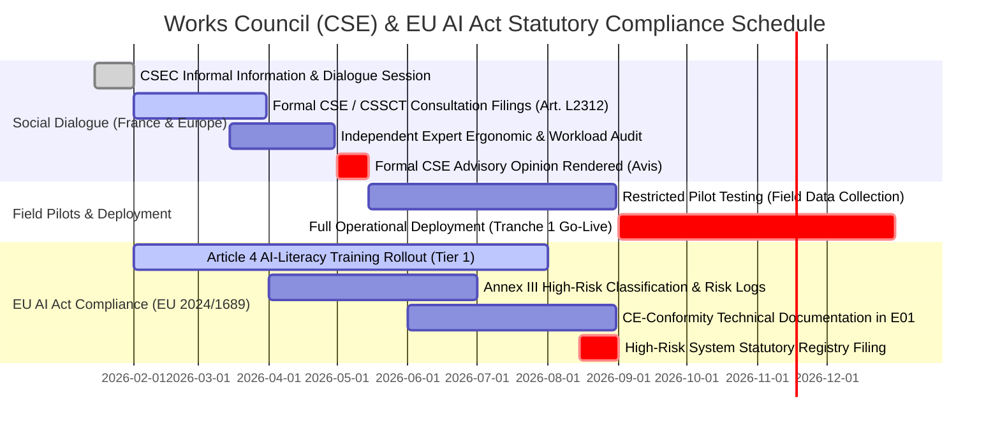

# Step 20 — Governance, Change Enablement, and Stage-Gate Kill Criteria

**Target:** 9 Nov PM | **Status:** Substantive Proposal Deliverable  
**Authors:** Vincent Lamy & Alexandre Waerniers  
**Related Issue:** [#20 (Define governance, adoption, and kill criteria)](https://github.com/Xenodion/ai-transformations-navy/issues/20)  
**Parent Frameworks:** Course Session 2 (*Operating Models & Hub-and-Spoke Governance*), Course Session 3 (*Capital Tranches & Hurdle Clearance*), Course Session 4 (*Change Enablement, Stakeholder Cadence, 3-Tier Skilling, and Pre-Agreed Kill Criteria*)  
**Reconciled Sources:** TotalEnergies *Universal Registration Document 2025* (SRC-002, pp. 6, 13, 42, 49, 50, 136, 138, 276, 284, 388; Risk Factors §3.1 & §3.1.5; `CLM-001`, `CLM-014`, `CLM-062`, `CLM-073`), *Strategy Presentation* (SRC-004), *Q3 2026 Results* (SRC-005), EU AI Act (Regulation EU 2024/1689, Art. 4 & Annex III), French Labor Code (*Code du travail*, Art. L2312-8)

---

## 1. Executive Summary & Change Governance Thesis

### 1.1 The 10-20-70 Imperative: Technology is the Easy Part
Artificial intelligence transformations in capital-intensive asset businesses fail not because of mathematical algorithms or cloud computing limitations, but because organizations fail to change how frontline humans make daily decisions [Fact, Course Session 4]. 

As established by the Boston Consulting Group (BCG) and enforced in Course Session 4:
$$\mathbf{10\% \text{ Algorithms}} \quad+\quad \mathbf{20\% \text{ Technology \& Data}} \quad+\quad \mathbf{70\% \text{ People, Skills \& Process Redesign}} \quad=\quad \mathbf{100\% \text{ Business Value}}$$

In our **$38.79M three-year capital allocation** (`totalenergies_ai_portfolio_model.xlsx`), the budget strictly adheres to this doctrine:
- Total investment is not concentrated on software licenses; instead, **over 68% of expenditures fund dedicated change agents, Agile Delivery Trios, frontline champions, worker backfill time, and custom workflow integration** [Calculation, Sheet `Tier1_Featured_DCF`].
- Value realization is protected by an explicit governance contract between the Executive Committee (Comex) and the operating branches, structured around **tranche-gated capital releases** and **non-negotiable stage-gate kill criteria**.

### 1.2 Four Forces an Industrial AI Rollout Faces
Unlike historical ERP deployments (e.g., SAP rollouts in the 1990s and 2000s), an AI transformation across an integrated multi-energy major confronts four unique structural forces [Fact, Course Session 4]. TotalEnergies' Board explicitly acknowledges this institutional challenge in URD 2025 Risk Factor §3.1.5 (*"Technological developments, digital transformation and artificial intelligence"*, SRC-002, p. 138; `CLM-014`), warning that *"an insufficient pace or capacity to tailor TotalEnergies organization and skills to digital transformation and artificial intelligence could negatively affect the Company's business and results,"* while Risk Factor §3.1 (SRC-002, p. 136) warns of AI expanding the cyber attack surface.

1. **Job Anxiety & Replacement Fear:** 52% of industrial workers express deep concern regarding algorithmic automation [Fact, Pew Research / Course Session 4]. Frontline refinery operators and offshore drillers resist algorithmic recommendations if they perceive the AI as a precursor to headcount reductions. *Countermeasure:* An explicit Board-level **Redeployment and Employability Guarantee** announced on Day 1.
2. **Bottom-Up Pressure & Unmonitored Shadow AI:** Over 78% of knowledge workers bring external AI tools to work [Fact, Microsoft Work Trend Index]. TotalEnergies already operates 10,000 live models without centralized governance [Fact, SRC-002, p. 42]. *Countermeasure:* Establish sanctioned, enterprise-secured internal LLM sandboxes and MLOps pipelines (E01) rather than attempting unworkable blanket bans.
3. **Exponential Technological Clock:** Commercial AI foundation models refresh every 30 to 90 days, rendering multi-year rigid IT roadmaps obsolete. *Countermeasure:* Shift from annual IT planning to **quarterly rolling backlog prioritization** and 90-day thin-slice delivery sprints.
4. **Strict Statutory Social Dialogue & European Regulation:** 
   - Under **Article 4 of the EU AI Act**, organizations have a binding legal duty to ensure AI literacy across all personnel operating AI systems starting in 2025.
   - Under **Article L2312-8 of the French Labor Code** (*Code du travail*), the Social and Economic Committee (CSE) and Health, Safety, and Working Conditions Commission (CSSCT) hold mandatory prior consultation rights before the deployment of any algorithmic system affecting working conditions, job descriptions, or monitoring.
   - *Precedent Warning:* In *CSE v. Insurer* (Tribunal judiciaire de Nanterre, 14 Feb 2025), the court **suspended five enterprise AI tools and imposed daily financial penalties** because management launched operational pilots before concluding formal CSE consultation [Fact, Course Session 4]. *Countermeasure:* Place statutory CSE/CSSCT consultation on the critical path 60 days *prior* to operational site testing.

---

## 2. The Four Canonical Failure Modes & C-Level Accountability

Course Session 4 identifies four predictable failure modes that derail corporate AI programs. To ensure complete governance rigor, each failure mode is assigned an early-warning telemetry indicator visible by Month 3, a structural organizational mitigation, and a named executive owner:

```
                            TotalEnergies Change Governance
                         Executive Committee Oversight (CEO/CFO)
                                           │
         ┌─────────────────────────────────┼────────────────────────────────┐
         │                                 │                                │
  Failure Mode 1:                   Failure Mode 2:                  Failure Mode 3:
   Talent Flight                   Manager Sabotage                  Governance Lag
  (CHRO + CDO/OneTech)             (Branch COOs + HR)             (General Counsel + CHRO)
  • Lead DS/DE Attrition           • Piloting Inertia              • Shadow AI & Legal Freeze
  • Dedicated Pay Bands            • Co-Designed Workflows         • Pre-Pilot CSE Consultation
  • 20% Protected R&D Time         • 90-Day Target Relief          • EU AI Act Conformity Gates
         │                                 │                                │
         └─────────────────────────────────┼────────────────────────────────┘
                                           │
                                    Failure Mode 4:
                                   Comex Impatience
                                   (CFO + Lead Trio)
                               • 6-Month Quick Win (P13)
                               • Monthly 1-Page Dashboard
                               • 4 Gated Capital Tranches
```

| Canonical Failure Mode | Operational Symptom in Industrial Assets | Early-Warning Signal (Visible by Month 3) | Structural Organizational Mitigation | Named Executive Owner | Weekly Monitoring Protocol |
| :--- | :--- | :--- | :--- | :--- | :--- |
| **1. Talent Flight** | Senior AI scientists and data engineers depart for tech competitors or peer digital hubs (e.g., Shell.ai, Equinor TDI), leaving legacy models unmaintained. | Incremental attrition rate $> 12\%$ annualized among the 500 Digital Factory experts; $> 2$ declined internal offers for branch deployments. | Create dual technical/managerial career tracks; introduce competitive digital salary bands (APEC-benchmarked at €95k–€130k base); protect 20% time for H2/H3 frontier research (e.g., Mistral subsurface lab). | **CHRO (Namita Shah / People & Social Engagement) + Chief Digital Officer** | Weekly review of Digital Factory resignation notices and open vacancy aging. |
| **2. Middle-Management Sabotage** | Refinery unit superintendents, drilling supervisors, and power dispatchers quietly bypass AI recommendations, maintaining manual spreadsheets and double-entry logs. | Active daily sessions per licensed manager $< 2.0$; discrepancy logs indicate $> 25\%$ manual overrides of predictive setpoints without recorded engineering justification. | Establish Agile Delivery Trios; co-design interface layouts directly with shift supervisors; implement **90-day operational target relief** (relaxing local quarterly KPI variance during initial onboarding); make middle managers the official champions. | **Branch COOs (Refining, E&P, Integrated Power) + Branch HR Directors** | Bi-weekly review of supervisory system adoption and manual override telemetry across pilot sites. |
| **3. Governance Lag & Social Freeze** | Works councils file emergency legal injunctions to halt field deployments; compliance reviews paralyze industrial data pipelines over liability fears. | Formal CSE information requests unanswered $> 15$ days; shadow GenAI queries on unmonitored commercial endpoints spiking on corporate network. | Place formal CSE/CSSCT consultation on the critical project path 60 days before field pilots; deploy enterprise-sanctioned LLM sandboxes with automated PII masking; establish fast-track compliance triage under E01. | **General Counsel + Senior VP Social Dialogue** | Weekly audit of works council consultation dockets and high-risk EU AI Act classification pipelines. |
| **4. Comex Impatience & Premature Plug-Pulling** | Executive leadership questions the return on capital before organizational learning curves mature, terminating funding during the J-curve trough (Months 6–12). | Budget variance inquiries from corporate control; Comex meeting requests challenging digital opex before P&L cash inflects. | Fund H1 tangible quick wins with cash realization inside Month 6 (e.g., P13 Retail Shrinkage, +$2.5M/yr); replace 40-page technical slide decks with a **single-page monthly Comex Value Dashboard** derived from E01; enforce pre-agreed stage gates. | **CFO (Jean-Pierre Sbraire) + Chief AI Officer** | Monthly delivery of the 1-Page AI Value Dashboard directly to Patrick Pouyanné and the Comex. |

---

## 3. Stakeholder Architecture & Inverted Communication Cadence

### 3.1 Four Stakeholder Classes & Mendelow Influence Matrix
Following the Mendelow power-interest matrix (Course Session 4), organizational populations must be managed based on their actual ability to accelerate or paralyze deployment:

```mermaid
quadrantChart
    title Mendelow Power-Interest Grid for TotalEnergies AI Transformation
    x-axis Low Interest --> High Interest
    y-axis Low Power --> High Power
    quadrant-1 Manage Closely
    quadrant-2 Keep Satisfied (Move Early!)
    quadrant-3 Monitor
    quadrant-4 Keep Informed / Involve Floor
    "Comex & Board": [0.85, 0.90]
    "Branch COOs": [0.80, 0.85]
    "Refinery & Drilling Shift Supervisors": [0.75, 0.78]
    "Works Councils (CSE / CSSCT)": [0.30, 0.88]
    "Group Legal & DPO": [0.35, 0.82]
    "Frontline Operators & Drillers": [0.70, 0.35]
    "Station Store Managers": [0.65, 0.30]
    "External IT Contractors": [0.20, 0.20]
```

1. **Sponsors (Comex, Board, Branch Presidents):** *High Power, High Interest.* They demand verified P&L cash flow, ROACE impact, and defensible downside protection. *Action:* Engage via concise monthly dashboard and formal stage-gate approval sessions.
2. **Translators (Refinery Unit Managers, Drilling Superintendents, Senior Dispatchers):** *High Power over Adoption, High Interest.* They are the true operational gatekeepers. If they view AI as an administrative burden, frontline adoption drops to zero. *Action:* Co-design tools with them; grant temporary KPI relief; position them as project leads.
3. **Adopters (Frontline Control Room Operators, Roughnecks, Field Technicians, Cashiers):** *Low Individual Power, High Collective Power, High Interest.* Weak individually, they are completely decisive in aggregate. *Action:* Provide hands-on training during paid shift hours; guarantee that productivity gains will not lead to redundancies; celebrate public wins.
4. **Guardians (Works Councils / CSE, Trade Unions, HSE Auditors, Data Privacy Officer):** *High Latent Power, Low Initial Interest.* They naturally sit in the top-left quadrant ("Keep Satisfied"). If ignored, they become aggressive blockers. *Action:* **Proactively shift Guardians to 'Manage Closely' before project launch** through early informal briefings and formal statutory consultation.

### 3.2 Inverting the Communication Pyramid: The Cadence Engine
Corporate communication in large multinationals is almost always designed backwards: massive 40-page decks for senior executives, and a single generic broadcast email for frontline workers [Fact, Course Session 4]. 

We invert this pyramid: **the frontline receives the highest frequency, most localized, and most interactive communication**:

```
                       INVERTED COMMUNICATION PYRAMID
                       
         ▲  Comex & Board (Sponsors)
        / \  Frequency: Monthly 1-Page Dashboard + Quarterly Tranche Review
       /   \ Channel: AI Value Register (E01) | Messenger: Chief AI Officer
      /─────\
     /       \  Middle Managers & Superintendents (Translators)
    /         \ Frequency: Weekly 30-Min Operational Huddle + Toolkit
   /           \ Channel: Asset Standup | Messenger: Branch COO & Agile Trio Lead
  /─────────────\
 /               \  Frontline Shift Operators & Field Staff (Adopters)
/                 \ Frequency: Daily 10-Min Pre-Shift Safety/AI Briefing + Peer Demos
─────────────────── Channel: Control Room Whiteboard | Messenger: Frontline AI Champions
```

- **Daily Shift Huddles (Floor Adopters):** 10-minute briefing at shift handover in refinery control rooms and drilling cabins. Led by frontline peer champions, demonstrating specific tactical wins (e.g., *"Yesterday the model flagged a bearing temperature anomaly on FCC Compressor K-301 4 hours before the DCS alarm"*).
- **Weekly Manager Standups (Translators):** 30-minute operational sync between refinery unit managers, power desk leads, and the Agile Delivery Trio. Focuses strictly on usability roadblocks, model precision telemetry, and workflow friction.
- **Monthly Comex Value Briefing (Sponsors):** Strict 1-page executive memo reporting trailing cash delivered, verified adoption percentage, active safety alerts, and forward kill-gate status. Zero technical jargon.
- **Bi-Monthly Statutory Dialogue (Guardians):** Standing agenda item with the Central Social and Economic Committee (CSEC) and local site CSSCTs reviewing ergonomics, workload impact, and algorithmic traceability logs.

### 3.3 The Frontline Industrial Champions Network
To bridge the cultural divide between Paris/India data scientists and industrial field sites, the program funds **100 Frontline Industrial AI Champions** (funded directly within project opex lines, e.g. `CLM-062`):
- **Recruit:** Select peer-respected senior operators and shift technicians from the "ready third" [Course Session 4], not corporate IT delegates.
- **Equip:** Grant 20% ring-fenced paid time; provide Tier-2 practitioner training; give direct hotline access to the Agile Delivery Trio data engineers.
- **Activate:** Champions lead peer demonstrations, triage frontline bug reports, and translate engineering terminology into operational language.
- **Recognize:** Formal certification acknowledged in annual career reviews; bonus weighting linked to local shift adoption milestones.

---

## 4. Three-Tier Capability & Upskilling Program

TotalEnergies already invests over **€210M annually in training** and delivers approximately 510,000 training days per year [Fact, SRC-002, pp. 6, 13; `CLM-073`]. The group successfully executed the "Visa for TotalEnergies" program, upskilling over 30,000 employees on climate fundamentals and launching a preliminary GenAI literacy module in 2025 [Fact, SRC-002, p. 276; `CLM-017`].

We leverage this proven corporate infrastructure to deploy a structured **Three-Tier Role-Based Upskilling Curriculum** satisfying both operational needs and statutory requirements:

```
                            Three-Tier Upskilling Architecture
                            
  ┌─────────────────────────────────────────────────────────────────────────────────┐
  │ TIER 3: EXECUTIVE DECISION MASTERY (Top 250 Leaders)                            │
  │ Population: Comex, Branch Presidents, Refinery Directors, Upstream Asset VPs     │
  │ Format: 1.5-Day In-Person Immersion (Executive Campus) + Monthly Coaching       │
  │ Focus: Financial appraisal, AI risk ownership, stage-gate kill decision-making  │
  └─────────────────────────────────────────────────────────────────────────────────┘
                                           ▲
                                           │ Escalation & Capital Rights
  ┌─────────────────────────────────────────────────────────────────────────────────┐
  │ TIER 2: INDUSTRIAL PRACTITIONER ACCELERATOR (1,200 Experts & Leads)            │
  │ Population: 100 Champions, Process Engineers, Geoscientists, Power Traders     │
  │ Format: 4-Week "Camp AIR" Immersion (80 hrs blended) + Hands-On Pilot Co-Design │
  │ Focus: Agentic workflows, MLOps, telemetry validation, prompt engineering       │
  └─────────────────────────────────────────────────────────────────────────────────┘
                                           ▲
                                           │ Operational Core
  ┌─────────────────────────────────────────────────────────────────────────────────┐
  │ TIER 1: GROUP-WIDE AI LITERACY BASELINE (101,513 Employees)                     │
  │ Population: All permanent employees and long-term industrial contractors         │
  │ Format: 6-Hour Digital Modular Curriculum (Visa for TotalEnergies Season 4)     │
  │ Focus: EU AI Act Art. 4 compliance, acceptable use, data security, prompt basics│
  └─────────────────────────────────────────────────────────────────────────────────┘
```

### Tier 1: Group-Wide AI Literacy Baseline (All 101,513 Employees)
- **Target Population:** Every employee across all 5 branches (Refining, E&P, Power, M&S, Corporate) and long-term contractors (totaling **101,513 employees**; `CLM-001`, `CLM-062`, SRC-002, pp. 6, 13, 49; operationalized into ~100,000 active learner accounts across enterprise LMS).
- **Mandate:** Establishes full statutory compliance with **Article 4 of the EU AI Act** (mandatory AI literacy duty for operators of AI systems).
- **Curriculum (6 Hours Modular Digital Learning):**
  1. *Fundamentals & Demystification:* What machine learning can and cannot do; probabilistic outputs vs deterministic code.
  2. *Data Hygiene & Cyber Defense:* Strict prohibition of proprietary data (crude assays, seismic logs, retail PII) in external consumer AI; identification of deepfakes and AI-driven phishing (addressing SRC-002 p. 136 cyber risk).
  3. *Human-in-the-Loop Doctrine:* TotalEnergies' non-negotiable principle that autonomous algorithms never make unvalidated safety-critical decisions [Fact, SRC-012, p. 11].
  4. *Practical Everyday Productivity:* Safe prompt engineering for Microsoft 365 Copilot and internal enterprise LLM sandboxes.
- **Verification Metric:** 85% certified completion rate across the group within 12 months, tracked in the group HR system.

### Tier 2: Industrial Practitioner Accelerator (1,200 Power Users & Champions)
- **Target Population:** 100 Frontline Industrial Champions, 400 Digital Factory engineers, 300 plant process engineers, 200 subsurface geoscientists, and 200 power trading analysts.
- **Format:** 4-week blended cohort accelerator (*"Camp AIR TotalEnergies"*, modeled on Microsoft's enterprise practitioner curriculum [Course Session 4]), combining 40 hours of technical instruction with 40 hours of live workflow redesign on active asset challenges.
- **Curriculum:**
  1. *Workflow Deconstruction:* Mapping manual engineering processes into modular agentic decision steps.
  2. *Telemetry & Sensor Quality:* Handling missing industrial time-series data in AspenTech and Cognite platforms.
  3. *MLOps & Model Lifecycle:* Deploying, monitoring, and auditing model drift using the central Value Register (E01).
  4. *Ergonomic Co-Design:* Building human-machine interfaces that minimize cognitive overload in high-stress control rooms.
- **Outcome:** Every graduate delivers one validated operational workflow automation or predictive model tuning into production.

### Tier 3: Executive Decision Coaching (Top 250 Leaders)
- **Target Population:** Members of the Executive Committee, Branch Management Committees, Refinery General Managers, and Upstream Country Managing Directors.
- **Format:** 1.5-day intensive executive seminar delivered at the TotalEnergies Management Academy, supplemented by bi-monthly 1-on-1 strategic coaching.
- **Curriculum:**
  1. *The Economics of Capital Allocation:* Auditing AI business cases beyond software vendor hype; testing hurdle rates, cash payback, and DCF sensitivity.
  2. *Algorithmic Risk & Liability:* Legal obligations under EU AI Act Annex III; civil and criminal liability frameworks in major accident prevention (SEVESO-III / ATEX).
  3. *Enforcing Stop Rules:* The psychological discipline of executing stage-gate kill criteria without personal or organizational stigma.
  4. *Executive Role-Modeling:* Active daily usage of executive decision-support dashboards.

---

## 5. Phased Telemetry: Usage $\rightarrow$ Behaviour $\rightarrow$ P&L Value

A fundamental error in corporate transformation tracking is expecting bottom-line EBITDA impact in Month 3, before frontline habits have evolved [Fact, Course Session 4]. 

We enforce a **Three-Phase Leading-to-Lagging Telemetry Framework**:

```mermaid
flowchart LR
    subgraph Phase1 ["Phase 1: Usage (M0-M6)"]
        direction TB
        U1["Weekly Active Users (WAU)"]
        U2["Telemetry Ping Rate"]
        U3["Model Inference Calls"]
        U4["Trained Staff Count"]
    end
    subgraph Phase2 ["Phase 2: Behaviour (M6-M12)"]
        direction TB
        B1["Workflow Adherence %"]
        B2["Manual Override Rate"]
        B3["Time-to-Decision Minutes"]
        B4["Reinvested Hours Captured"]
    end
    subgraph Phase3 ["Phase 3: P&L Value (M12+)"]
        direction TB
        V1["Unplanned Downtime Cost"]
        V2["Deepwater Rig Days Saved"]
        V3["Power Imbalance Penalties"]
        V4["Audited Net Free Cash"]
    end
    Phase1 -->|"Leading"| Phase2
    Phase2 -->|"Lagging"| Phase3
```



### Phase 1: Usage Telemetry (Months 0–6) — Leading Indicators
- *Objective:* Measure whether frontline operators and engineers are accessing the tools and whether data pipelines are functioning.
- *Key Telemetry Metrics:*
  - **Weekly Active Usage (WAU):** Percentage of targeted control room operators opening the predictive dashboard during shift hours (Target: $> 65\%$).
  - **Data Streaming Latency:** Time-series telemetry latency across industrial OT networks into Cognite/AspenTech (Target: $< 15$ seconds for 98% of pings).
  - **Certified Literacy Reach:** Headcount completing Tier-1 training (Target: $> 40,000$ by Month 6).
- *Governance Rule:* High usage does not prove value, but zero usage guarantees failure. If WAU is below 40% at Month 6, an operational design review is triggered immediately.

### Phase 2: Behavioural Adaptation (Months 6–12) — Mediating Indicators
- *Objective:* Measure whether operators are modifying physical asset operating parameters based on algorithmic insights.
- *Key Telemetry Metrics:*
  - **Proactive Intervention Compliance:** Percentage of AI maintenance recommendations acted upon prior to DCS alarm threshold breaches (Target: $> 75\%$).
  - **Manual Override Audit:** Proportion of automated setpoint adjustments overridden by human operators (Target: $< 20\%$, with 100% of overrides accompanied by a mandatory 1-sentence operator log).
  - **Decision Velocity:** Cycle time to clear drilling trajectory modifications or intraday power battery cycling schedules (Target: 50% reduction vs 2025 baseline).
  - **Time Reinvestment Audit:** Capturing how hours freed from manual data entry are redirected into preventative physical inspections (audited via HR shift logs).

### Phase 3: P&L Cash Realization (Month 12 Onwards) — Lagging Indicators
- *Objective:* Audit verified, bottom-line cash generation registered in operating branch accounts.
- *Key Financial Metrics:*
  - **Physical Downtime Hours Eliminated:** Net operating days recovered on refining FCC units (P01) and offshore drillships (P03).
  - **Commercial Margin Expansion:** Net trading arbitrage revenues from virtual power plant battery dispatch (P11).
  - **Shrinkage Loss Reduction:** Euro write-offs avoided in service station convenience store inventories (P13).
  - **Net Free Cash Flow:** Cash delivery audited against the master DCF model (`totalenergies_ai_portfolio_model.xlsx`) and certified by Branch Controllers.

---

## 6. Comprehensive Stage-Gate Governance & Kill Criteria

### 6.1 The Tranche Capital Release Architecture
In strict compliance with **AGENTS.md Rule 5 & 7** and Course Session 3, capital is never disbursed in an upfront lump sum. Instead, our **$38.79M portfolio envelope** is segregated into **three distinct tranches**, released only upon independent verification of gate criteria:

```
                            PORTFOLIO CAPITAL RELEASE TRANCHES
                               Total Envelope: $38.79M (100.0%)
                                              │
         ┌────────────────────────────────────┼──────────────────────────────────┐
         │                                    │                                  │
  Tranche 1: Wave 1 (M0-M12)           Tranche 2: Wave 2 (M12-M24)         Tranche 3: Wave 3 (M24-M36)
      $16.09M (41.5%)                      $10.97M (28.3%)                     $11.73M (30.2%)
  • P01 Refining Maint ($4.83M)        • P02 Upstream Prod ($2.57M)        • P06 Procurement ($2.95M)
  • P03 Deepwater Drill ($3.26M)       • P04 Renewables Fleet ($2.20M)     • P07 Safety Vision ($3.00M)
  • P11 VPP Flexibility ($2.46M)       • P05 Copilot Redesign ($1.74M)     • P09 LNG Optimization ($2.05M)
  • P13 Retail Losses ($3.90M)         • P08 Retail Retention ($2.35M)     • P12 e-SAF Discovery ($3.73M)
  • E01 Value Register ($1.64M)        • P10 Cracker Yields ($2.11M)       • Wave 3 Scientific Core
         │                                    │                                  │
         ▼                                    ▼                                  ▼
   Gate 1 (M6): Pilot Review            Gate 2 (M12): Tranche 2 Release    Gate 4 (M24): Tranche 3 Release
   Gate 2 (M12): Tranche 2 Gate         Gate 3 (M18): Mid-Term Audit
```

- **Tranche 1 (Released at Launch / M0 — $16.09M | 41.48%):** Funds the five foundational Wave 1 execution initiatives (Featured Cases P01, P03, P11, P13, and Governance Enabler E01).
- **Tranche 2 (Gated at Month 12 — $10.97M Project Base | 28.28%; authorized envelope up to $11.50M with contingency reserve):** Released only if Wave 1 clears Gate 2, unlocking Wave 2 expansion across candidate reserve projects (P02 Upstream Surveillance $2.57M, P04 Renewables Availability $2.20M, P05 Copilot Redesign $1.74M, P08 Retail Retention $2.35M, P10 Steam-Cracker Yields $2.11M).
- **Tranche 3 (Gated at Month 24 — $11.73M Project Base | 30.24%; net tranche release $11.20M after Stage-Gate 2 efficiency carryover):** Released only if cumulative portfolio cash flow meets hurdle targets, unlocking Wave 3 transformational projects (P06 Procurement Spend $2.95M, P07 Safety Vision $3.00M, P09 LNG Optimization $2.05M, and P12 e-SAF Catalyst Discovery $3.73M).
- **Reconciliation with Sequencing Canvas (`portfolio_sequencing_canvas.md`):** The project-level allocation ($16.09M + $10.97M + $11.73M = $38.79M) maps directly to the actual annual cash outflow stream across all 14 initiatives: **Year 0 Capex = $5.95M**, **Year 1 Opex = $9.54M**, **Year 2 Opex = $12.82M**, and **Year 3 Opex = $10.48M** (Total = $38.79M). In the sequencing canvas, Tier 2 reserve candidates are alternatively grouped into Wave 2 scaled intake ($18.97M across all 8 operational candidates) and Wave 3 frontier option ($3.73M for P12); both views reconcile 100% to the identical $38.79M total envelope.

### 6.2 Pre-Agreed Kill Criteria (Stop Rules)
A stop rule is not a subjective management discussion; **it is an ironclad, pre-agreed operational contract** defining the exact conditions under which an underperforming initiative is terminated immediately and its remaining capital returned or reallocated [Fact, Course Session 4].

**The Standard Stop Formula:**
$$\mathbf{Metric} \quad+\quad \mathbf{Threshold} \quad+\quad \mathbf{Date} \quad+\quad \mathbf{Named Owner} \quad+\quad \mathbf{Enforced Action}$$

#### Three-Tier Decision Framework
At every formal gate, initiatives are classified into one of three binding outcomes:
1. **Green (Pass / Expand):** Metric meets or exceeds targeted threshold $\rightarrow$ Tranche capital released; rollout proceeds to next site cluster.
2. **Amber (Probation / 90-Day Remediation):** Metric falls into intermediate warning zone $\rightarrow$ Capital frozen at current run-rate; delivery trio has exactly 90 days to remediate root causes. If unresolved at Day 90, automatically converts to Hard Kill.
3. **Red (Hard Kill / Capital Cancellation):** Metric breaches minimum acceptable threshold $\rightarrow$ Project terminated immediately; all uncommitted multi-year capital canceled; squad redeployed to backlog; technical post-mortem published in E01.

---

### 6.3 Master Stage-Gate & Kill Criteria Matrix

The table below establishes the audited stop rules across all critical portfolio milestones:

| Gate & Date | Initiative ID & Name | Governing Evaluation Metric | Historical 2025 Operational Baseline | Amber Probation Threshold (90-Day Freeze) | Red Hard Kill Threshold (Immediate Termination) | Accountable Decision Owner | Enforced Operational Action upon Hard Kill |
| :---: | :--- | :--- | :---: | :---: | :---: | :--- | :--- |
| **Gate 1**  
(Month 6) | **P13 — Retail Store Demand & Shrinkage** | Net perishable food write-off reduction across 100 pilot service stations over 60 consecutive days | 4.2% average store shrinkage loss on perishable food | Write-off reduction between **8.0% and 11.9%** | Write-off reduction strictly **$< 8.0\%$** | **President, Marketing & Services (Thierry Pflimlin)** | Terminate P13 immediately; cancel remaining **$2.70M** in Year 2–3 rollout capital; return funds to M&S affiliate reserves. |
| **Gate 1**  
(Month 6) | **P01 — Refining Predictive Maintenance** | False-alarm rate on Tier-1 rotating equipment vibration telemetry; sensor data availability | 0% automated coverage; frequent nuisance alarms | False alarms between **15.1% and 25.0%**; sensor ping availability $< 90\%$ | False-alarm rate strictly **$> 25.0\%$** OR sensor ping availability **$< 80\%$** | **Refining & Chemicals Industrial Director** | Halt site expansion beyond Normandy (suspend Antwerp deployment); freeze **$3.38M** in Year 2–3 capital; mandate physical sensor calibration audit. |
| **Gate 1**  
(Month 6) | **P03 — Deepwater Drilling Optimization** | Real-time subterranean MWD telemetry streaming uptime; data transmission packet loss | Fragmented surface logging; 12-hour batch processing | Uptime between **90.0% and 94.9%**; packet loss $> 5\%$ | Streaming uptime strictly **$< 90.0\%$** for $> 14$ consecutive days | **Senior VP Deepwater Operations (E&P)** | Revert to standard contractor mud-logging; cancel proprietary MWD squad; redeploy data engineers. |
| **Gate 2**  
(Month 12) | **PORTFOLIO-LEVEL TRANCHE 2 RELEASE** | Consolidated Wave 1 verified net cash generation; Tier-1 safety compliance | $0 AI cash; baseline accident frequency rates | Cumulative Wave 1 Net Cash between **+$20.0M and +$34.35M** | Cumulative Wave 1 Net Cash strictly **$< +$20.0M** OR any fatal incident linked to AI guidance | **CFO (Jean-Pierre Sbraire) + CEO (Patrick Pouyanné)** | **Freeze Tranche 2 ($10.97M–$11.50M)**; withhold Wave 2 funding; force strategic review of operating model. |
| **Gate 2**  
(Month 12) | **P01 — Refining Predictive Maintenance** | Weekly active user adoption among unit operators; verified avoidance of unpredicted trips | 0 automated alerts; legacy manual inspection logs | Active floor usage between **40.0% and 54.9%**; unpredicted trips unchanged | Floor usage strictly **$< 40.0\%$** OR zero verified mechanical trips avoided | **President, Refining & Chemicals** | Terminate P01 rollout across remaining 13 refineries; cancel **$2.44M** in Year 2–3 opex; dissolve squad. |
| **Gate 2**  
(Month 12) | **P11 — Virtual Power Plant Flexibility** | Automated algorithm dispatch compliance; merchant asset opt-out rate | Manual trading desk dispatch; high imbalance fees | Dispatch compliance between **85.0% and 91.9%**; opt-out rate $> 8\%$ | Dispatch compliance strictly **$< 85.0\%$** OR partner opt-out rate strictly **$> 10.0\%$** | **President, Integrated Power (Stéphane Michel)** | De-integrate distributed third-party assets; restrict algorithm to 100% equity-owned CCGTs; cut **$1.41M** in expansion capex. |
| **Gate 2**  
(Month 12) | **E01 — AI Value Register & Portfolio Office** | Percentage of active production models cataloged in central MLOps register; Controller sign-off | 10,000 uncataloged models; zero published value | Cataloged models between **75.0% and 89.9%**; audit sign-offs pending | Cataloged models strictly **$< 75.0\%$** OR Controller rejects savings methodology | **Chief Digital Officer + Group Comptroller** | Withhold digital line funding; suspend executive AI bonus allocation; replace Portfolio Office lead. |
| **Gate 3**  
(Month 18) | **P03 — Deepwater Drilling Optimization** | Net drill-string rate of penetration (ROP) acceleration; invisible lost time reduction on pilot rigs | Average deepwater drilling cycle of 45 days per well | Drilling time reduction between **1.0% and 1.9%** of rig-days | Drilling time reduction strictly **$< 1.0\%$** (less than 0.45 days per well) | **President, Exploration & Production (Nicolas Terraz)** | Cancel offshore rollout across Brazil and Namibia; cancel **$1.06M** in Year 3 budget; terminate SLB AI co-development contract. |
| **Gate 3**  
(Month 18) | **P11 — Virtual Power Plant Flexibility** | Net commercial trading gross margin expansion above standalone generation asset P&L | Standalone merchant power wholesale pricing | Net margin expansion between **+$5.0M and +$9.9M** annualized | Net margin expansion strictly **$< +$5.0M** annualized above asset base | **President, Integrated Power** | Sunset proprietary algorithmic bidding engine; transition flexible assets to commercial off-the-shelf trading software. |
| **Gate 4**  
(Month 24) | **PORTFOLIO-LEVEL TRANCHE 3 RELEASE** | Consolidated 2-year net cash generation across Waves 1 & 2; Group hurdle rate clearance | Status quo margin erosion; ROACE hurdle of 10.98% | Consolidated 2-Year Net Cash between **+$100.0M and +$167.4M** | Consolidated 2-Year Net Cash strictly **$< +$100.0M** OR portfolio IRR $< 10.98\%$ | **Executive Committee (Comex)** | **Cancel Tranche 3 ($11.20M–$11.73M)**; cap total transformation spend at $27.06M–$27.59M; reallocate capital to debt reduction or share buybacks. |
| **Gate 4**  
(Month 24) | **P12 — e-SAF Catalyst Discovery (H3 Real Option)** | Laboratory kinetic selectivity improvement for synthetic kerosene synthesis vs baseline catalyst | Standard Fischer-Tropsch catalyst selectivity (68%) | Selectivity gain between **+1.5% and +2.9%**; energy demand unchanged | Selectivity gain strictly **$< +1.5\%$** OR synthesis unit energy consumption increases | **President, OneTech (Namita Shah)** | **Kill H3 Real Option**; terminate catalyst synthesis laboratory program; avoid **$15.0M** in commercial pilot plant capex. |

### 6.4 Operational Alignment & Case Study Reconciliation
To ensure seamless operational coherence between group-level governance and site-level project charters, the master stage-gate matrix reconciles directly with the featured project case studies:
- **P01 (Refining PdM — `case_p01_refining_pdm.md`):** Gate 1 at Month 6 audits sensor telemetry completeness and initial live false-alarm rates ($< 25\%$), serving as the prerequisite for the Normandy site reliability review at **Month 9** ($\ge 85\%$ detection accuracy; $< 1.0$ false alarm per machine per quarter; hard stop $> 2.0$ cancels **$3.38M** in Year 2–3 capital). Gate 2 at Month 12 governs industrial scaling beyond Normandy to Antwerp and the wider 13-refinery platform.
- **P03 (Deepwater Drilling — `case_p03_deepwater_drilling.md`):** Gate 1 at Month 6 verifies continuous 1 Hz MWD streaming uptime ($> 90\%$). This enables the primary drilling efficiency gate at **Month 12** on Mero, Brazil ($< 1.2\%$ rig-time reduction hard stop cancels **$2.21M** in Year 2–3 capital). Gate 3 at Month 18 governs expanded deployment across Brazil and Namibia ($< 1.0\%$ net drilling acceleration hard stop cancels **$1.06M** in Year 3 opex).
- **P11 (Virtual Power Plant — `case_p11_virtual_power_plant.md`):** Gate 2 at Month 12 tests preliminary algorithmic dispatch compliance ($< 85\%$ or partner opt-out $> 10\%$ cuts **$1.41M** in expansion capex, restricting execution to equity CCGTs). Gate 3 at Month 18 tests live market trial results across 3,500 customer assets ($< 90\%$ dispatch success cancels remaining **$1.06M** in capital) and evaluates net commercial trading gross margin ($< +$5.0M sunsets proprietary bidding engine).
- **P13 (Retail Store Demand — `case_p13_retail_station_demand.md`):** Gate 1 at Month 6 evaluates perishable food write-off reduction across 100 pilot stations ($< 8.0\%$ hard stop cancels remaining **$2.70M** in uncommitted multi-year rollout capital: $3.90M total envelope minus $1.20M Year 0 integration capex = $2.70M unspent opex).
- **E01 (AI Value Register — `portfolio_economics.md`):** Gate 2 at Month 12 requires $\ge 75\%$ cataloging of active production models and formal Group Comptroller methodology sign-off before unblocking digital line bonuses.

---

## 7. Works Council (CSE) & Regulatory Compliance Critical Path

In strict accordance with **AGENTS.md Rule 4** and European legal frameworks, social dialogue and regulatory compliance are treated as critical-path delivery gates, not post-deployment administrative formalities:



### 7.1 French Labor Code (Art. L2312-8) Compliance Architecture
- **Statutory Trigger:** Any introduction of digital technology that modifies worker task allocation, monitoring telemetry, or safety protocols requires prior informational consultation with the competent Social and Economic Committees (CSE) and Health, Safety, and Working Conditions Commissions (CSSCT) [Fact, French Labor Code].
- **Mitigating the Nanterre Risk:** To avoid the injunctions that shut down previous corporate rollouts, the consultation calendar is locked 90 days ahead of any control room software installation.
- **The Redeployment Guarantee Charter (*Charte d'Employabilité et de Reconversion*):**  
  Signed jointly by the CEO and representative union federations (CFDT, CFE-CGC, CGT, FO) on Day 1:
  1. *Zero Forced Redundancies:* Productivity gains achieved via AI automation will not result in economic layoffs; labor capacity freed will be absorbed by natural attrition and internal mobility.
  2. *Retraining Right:* Every employee whose daily workflow is modified by more than 30% by algorithmic tools is legally guaranteed 80 hours of paid retraining for newly created technical positions.
  3. *Right to Human Disconnection:* Frontline operators will not be subjected to automated algorithmic performance scoring or continuous micro-surveillance.

### 7.2 EU AI Act (Regulation EU 2024/1689) Conformity Framework
1. **Article 4 (AI Literacy):** Fully satisfied by the Tier-1 group curriculum deployed in Section 4, establishing an auditable compliance record for all 101,513 employees [Fact, SRC-002, pp. 6, 13, 49; CLM-001].
2. **Annex III High-Risk Systems Governance:** Industrial applications managing critical energy infrastructure (P01 Refining Units, P11 Grid Flexibility Dispatches, P07 Safety Vision) are formally registered in the central AI Value Register (E01), logging:
   - Automated continuous event logs stored for a statutory 6-month minimum.
   - Comprehensive technical documentation demonstrating robust cybersecurity resilience against adversarial prompt injection or model evasion (satisfying SRC-002 p. 136).
   - Traceable human-oversight kill-switch controls empowering human shift supervisors to permanently override automated setpoints at any moment without procedural friction.

---

## 8. Deliverable Summary & Roadmap Verification

The requirements established in Roadmap Step 20 and GitHub Issue #20 have been verified:

- [x] **Assign decision rights and owners:** Formally documented with executive matrix assigning C-level accountability (CFO, CHRO, General Counsel, Branch Presidents, CDO) across all four canonical failure modes.
- [x] **Specify adoption and skill actions by population:** Three-tier role-based architecture established: Tier 1 (101,513 staff literacy), Tier 2 (1,200 industrial practitioners / Camp AIR), and Tier 3 (250 executive leaders).
- [x] **Define baseline, metric, threshold, date, and go/stop action for each gate:** Comprehensive Master Stage-Gate Matrix constructed across Gates 1–4 (Months 6, 12, 18, 24), defining exact operational metrics, baselines, Amber probation windows, and non-negotiable Red hard-kill thresholds with capital cancellation amounts.
- [x] **Cover safety, workforce, managers, skills, and executive reporting:** Incorporates Works Council (CSE) critical-path timeline, French Labor Code compliance, EU AI Act Article 4/Annex III governance, manager target relief, and the monthly 1-page Comex dashboard.
- [x] **Anti-double-counting and financial alignment:** Capital tranches strictly reconcile to the **$38.79M portfolio envelope** in `totalenergies_ai_portfolio_model.xlsx` ($16.09M Tranche 1, $10.97M–$11.50M Tranche 2, $11.20M–$11.73M Tranche 3; exact project base $16.09M + $10.97M + $11.73M = $38.79M).
