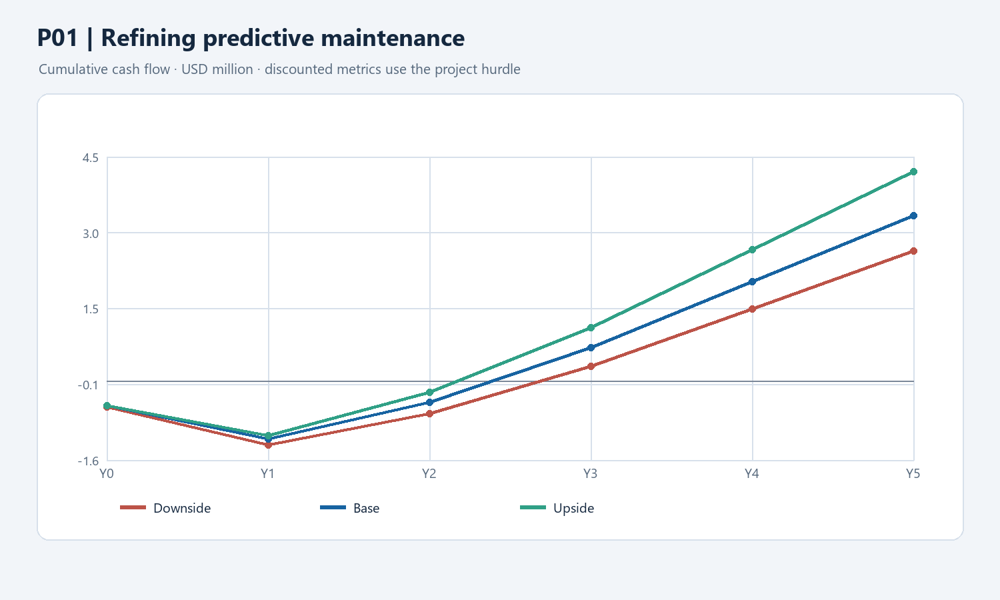

# P01 — Refining predictive maintenance

**Decision at a glance:** deploy a supervised predictive-maintenance pilot on two assumed refining sites, extending existing capabilities. The model assumes **$1.4m** one-time investment, **$2.116m/year** gross benefit at full scale and a **9.5%** hurdle. Its five-year base NPV is **+$2.116m**, with **57.8% IRR** and **2.40-year simple payback**. Quantities and gains are assumptions; continued investment depends on site-level evidence and prospective economics.

**Status:** Rebuilt working case, 10 November 2026. Economic drivers and unit costs are explicit **assumptions**, not reported TotalEnergies results. Validate the site perimeter, counterfactual, actual costs and tax before approval. Calculation: `../finance/industrial_case_models.py`.

## 1. Decision, problem and existing capability

**Proposal:** Pilot predictive maintenance on critical rotating equipment at two eligible refining sites, then extend within those sites only when operations and finance confirm value. Asset and site selection are **assumptions** pending validation. TotalEnergies is already deploying AspenTech's industrial data platform (CLM-018) and has existing maintenance processes; both belong in the counterfactual. This proposal funds an incremental workflow and interventions only where they are not already delivered.

**Problem [Hypothesis]:** Certain unplanned equipment stops lead to lost margin and avoidable emergency repairs. The number of preventable outages, eligible machines and economic contribution of the sites are unknown. A data platform or an anomaly alert alone does not create value: a verified alert must lead to a safe maintenance action that changes the baseline outcome.

## 2. Alternatives, horizon and sourcing

| Option | Decision |
| --- | --- |
| Existing scheduled and condition-based maintenance | Counterfactual. Compare the proposed system against existing monitoring and documented maintenance activity. |
| Improved manual thresholds and reliability review | Benchmark on the same machines; use this simpler approach if it achieves comparable results at lower cost. |
| Vendor APM plus site-owned integration and maintenance workflow | Working proposal: buy/partner for tools, integrate with existing data and build the site workflow. Contracts and current licenses must be checked. |

**H1 [Judgment]:** Optimises existing refining operations using an established class of maintenance tools. Technology maturity does not prove the local gain. No new enterprise-wide data lake is assumed.

## 3. Perimeter and benefit drivers

All parameters below are **assumptions**, not published TotalEnergies site performance. The two sites' actual throughput, ownership share, production constraints and incremental contribution margin must be verified.

| Annual driver at full rollout | Assumption | Calculation / limit |
| --- | ---: | --- |
| Eligible combined refining throughput | 250,000 barrels/day | Two eligible sites combined; a scope assumption, not a factbook site figure. |
| Effective days | 365/year | Applied to the stated daily throughput; confirm whether baseline throughput already includes downtime. |
| Incremental throughput recovery | 0.5% | Improvement over existing maintenance, not all site outages. Avoid applying it to downtime already excluded from the throughput base. |
| Additional output sold | 70% | Capacity and market constraint; verify the actual bottleneck and product demand. |
| Incremental contribution margin | $6/barrel | Working assumption, not TotalEnergies' realised margin; the published ERM is a market marker (CLM-063). |
| Avoided emergency repair cost | $0.200m/year | Additional assumed cash savings; count only invoices not already captured in throughput or existing budgets. |

Full-scale gross benefit = `250,000 × 365 × 0.005 × 0.70 × $6 + $200,000` = **$2.11625m/year [Calculation on assumptions]**. The scope is two assumed sites, not all group throughput. Equinor's reported $120m since 2020 (SRC-017 / CLM-036) is a cumulative contextual benchmark and does not prove this annual amount.

## 4. Costs, schedule and assumptions

Amounts **$m**, nominal. Y0 is a late-2026 decision point and Y1–Y5 the following annual periods. These allocations and dates are project assumptions, not vendor quotations. Total one-time investment: **$1.4m**, comprising $1.0m capitalised hardware/software ($0.5m in Y0 and $0.5m in Y1) and $0.4m implementation/training expensed in Y1. Verify sensor reuse, software capitalization, site costs and existing contracts. Recurring operating and support costs are $0.20m, $0.35m, $0.40m, $0.40m, $0.40m in Y1–Y5.

Pilot benefit ramp is 20%, 60%, 85%, 100%, 100%. Tax illustration assumes a 25% rate, five-year straight-line depreciation on the assumed $1.0m of capital assets from Y1, and no immediate tax credit on annual losses. Actual taxes, depreciation, internal staff and backfill are unverified. No terminal value, external benefit or expansion beyond the assumed perimeter is included.

## 5. Annual cash flow and J-curve

**Base [Calculation on assumptions]**, $m. Gross benefits are pre-tax incremental contribution and repair savings; net cash includes the assumed operating expense, investment and cash tax.

| $m | Y0 | Y1 | Y2 | Y3 | Y4 | Y5 |
| --- | ---: | ---: | ---: | ---: | ---: | ---: |
| Incremental gross benefit | 0 | 0.4233 | 1.2698 | 1.7988 | 2.1163 | 2.1163 |
| Recurring OPEX | 0 | -0.2000 | -0.3500 | -0.4000 | -0.4000 | -0.4000 |
| One-time implementation expense | 0 | -0.4000 | 0 | 0 | 0 | 0 |
| CAPEX | -0.5000 | -0.5000 | 0 | 0 | 0 | 0 |
| Cash tax | 0 | 0 | -0.1799 | -0.2997 | -0.3791 | -0.3791 |
| **Net cash** | **-0.5000** | **-0.6768** | **0.7398** | **1.0991** | **1.3372** | **1.3372** |
| **Cumulative cash** | **-0.5000** | **-1.1768** | **-0.4369** | **0.6622** | **1.9994** | **3.3365** |

At the P01 **9.5% project hurdle** (`../finance/discount_rate_policy.md`): NPV **+$2.116m**, IRR **57.8%**, simple payback **2.40 years**, discounted payback **2.60 years**. The annual interpolation is not a measured monthly result. No figure is a validated TotalEnergies forecast.

## 6. Scenarios and investment decision

The downside assumes 90% of the base benefit and 105% of initial and recurring costs. P13 also uses slower 35% / 60% / 80% / 100% / 100% adoption; other cases retain their base ramp. Upside assumes 115% benefits and base costs; P13 uses 65% / 90% / 100% / 100% / 100% adoption. These are illustrative assumptions, not observed probabilities. A separate severe stress uses 65% benefits and 120% costs. Actual stop costs, delays, contract terms and attribution must be validated before approval.

| Scenario | NPV at project hurdle | IRR | Simple payback (years) |
| --- | ---: | ---: | ---: |
| Downside | $+1.573m | 45.0% | 2.70 |
| Base | $+2.116m | 57.8% | 2.40 |
| Upside | $+2.764m | 70.7% | 2.18 |

## 7. Gates, adoption and risk

1. **Before pilot:** site reliability owner, finance and IT establish existing solutions, eligible equipment and production baseline, data rights and the $1.4m spend split. Agree the alert metric, false-alarm tolerance and comparable maintenance baseline before live testing.
2. **Pilot review:** reliability engineers validate actionable alerts, safe intervention and actual production/repair economics; finance checks whether incremental throughput was sold. Pause on safety issues; retrain or stop on missed pre-agreed performance thresholds.
3. **Expansion:** sponsor releases further spend only if the **future** incremental case clears the hurdle and the site adoption and security conditions are satisfied. A stop leaves sunk and non-cancellable costs in the programme.

**Illustrative financial threshold [Calculation]:** with the base costs, tax and ramp unchanged and all benefits scaled together, total five-year NPV at 9.5% reaches zero at approximately **$1.080m/year at full scale** (51.0% of the modelled $2.116m). This is a full-project sensitivity, not a prospective continuation rule: at the gate, exclude sunk costs and recalculate the remaining cash commitments and attainable benefits. Agree operational reliability and safety thresholds with the site before launch.

The reliability team retains intervention authority; operators and maintenance staff participate in design and receive funded training. Cybersecurity, safety, data completeness and actual licensing scope are gating conditions, not afterthoughts.

## 8. Sources and validation required

- TotalEnergies 2025 URD: refining throughput CLM-052 and existing data initiatives CLM-018; no claim that the assumed two sites have 250 kb/d.
- Market ERM is contextual only, CLM-063; the $6/b incremental contribution assumption is not a source-backed TotalEnergies actual.
- Equinor SRC-017 / CLM-036: $120m cumulative predictive-maintenance value since 2020, including partners; not an annual peer amount or a transferable per-machine return.
- Discount rate: `../finance/discount_rate_policy.md`. Recompute independently in the replacement spreadsheet and validate site baseline, budgets, tax, rates and scenarios before presentation.
