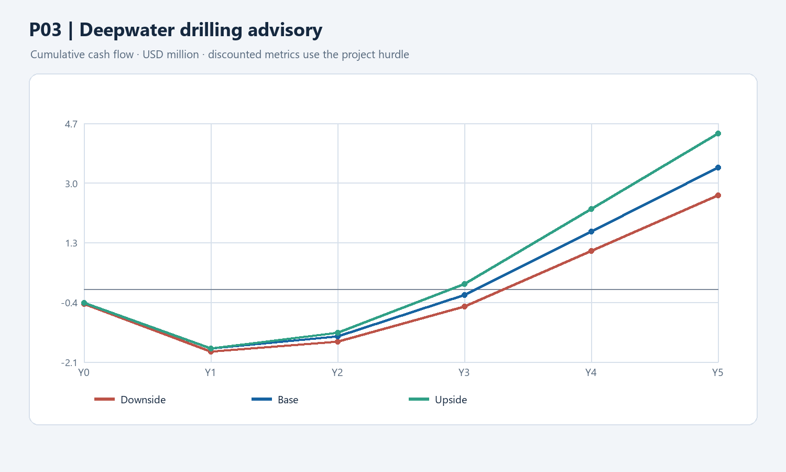

# P03 — Deepwater drilling and well-planning advisory

**Decision at a glance:** test human-supervised drilling advisory on two eligible operated rigs or campaigns. The model assumes **$1.4m** one-time investment, **$2.880m/year** gross benefit at full scale and an **11%** hurdle. Its five-year base NPV is **+$1.859m**, with **43.2% IRR** and **3.09-year simple payback**. Day savings must reduce actual cash payments; site selection, contracts and operator rights are decision gates.

**Status:** Rebuilt working case, 10 November 2026. The two-rig scope, economic inputs, payment mechanism, costs, tax and ramp are assumptions, not TotalEnergies' observed results. Contracts, eligible assets and incremental benefit require validation. Calculation: `../finance/industrial_case_models.py`.

## 1. Proposal and starting point

**Proposal:** Test a human-supervised planning and drilling advisory workflow across **two eligible operated deepwater rigs or campaigns**. Identify actual operated assets and obtain agreement from the operator, drilling contractor and relevant partners before committing to a pilot. Existing Cognite deployments and drilling practices remain in the counterfactual (CLM-019); count only incremental capability and cash.

**Fact:** Mero is operated by Petrobras; TotalEnergies' reported interest was 19.3% in the 2025 announcement (SRC-037, CLM-077). The previous claim that Mero is operated by TotalEnergies was incorrect. This case therefore does not assume the ability to deploy unilaterally at Mero, nor apply the 19.3% figure mechanically to a different contract.

**Problem [Hypothesis]:** Better use of well and drilling data may reduce non-productive time. A faster operation does not automatically save cash: the contract must permit an earlier rig release, reduce variable charges or create another documented financial benefit. BP's published well-planning example is context, not proof of a TotalEnergies gap or saving (CLM-068).

## 2. Alternatives, horizon and delivery

| Option | Assessment |
| --- | --- |
| Existing drilling workflow | Counterfactual, including existing engineering and contracted tools. |
| Improved manual or rules-based planning | Benchmark using the same wells, staff and contractor terms. |
| Commercial drilling tools alone | Consider existing contract features and compare total costs, data rights and actual incremental gains. |
| Blended advisory workflow | Working proposal: integrate existing data and proven software with company drilling expertise, with no autonomous steering. |

**H2 [Judgment, provisional]:** A cross-functional redesign of the well-planning and operational workflow is proposed. Horizon placement must reflect the selected workflow and adoption cycle, not a desire to rebalance the portfolio. HSE and drilling experts retain operational authority.

## 3. Scope and incremental benefit formula

**Annual assumptions at full scale:** two eligible operated rigs/campaigns; six avoidable rig-days per rig per year; $0.400m/day fully avoidable gross spread cost; 60% cash realization after fixed-contract restrictions, partner terms and other leakage. These are **not verified company figures**. The 60% factor is a single combined assumption; do not also apply an unverified ownership discount to the same amount.

`2 rigs × 6 days/rig/year × $0.400m/day × 60% = $2.880m/year` gross incremental cash **[Calculation on assumptions]**. Verify invoices, full rate composition, actual rig release rights, partner allocation and whether the company already planned the saving. Any time saving without reduced cash payment is reported as capacity or schedule value, not this cash benefit. Avoid overlap with procurement P06 and the existing savings plan.

## 4. Costs, data and timing

Amounts **$m**, nominal; calendar and procurement terms are assumptions. The one-time investment is **$1.4m**: $0.8m assumed capitalised integration/software ($0.4m Y0 + $0.4m Y1) and $0.6m of one-time integration, commissioning and training expense in Y1. Confirm the accounting treatment and reuse of existing platforms. Recurring software, data engineering, contractor support and run cost are assumed at $0.30m, $0.45m, $0.50m, $0.50m, $0.50m in Y1–Y5.

Assumed benefit ramp: 0%, 30%, 70%, 100%, 100% in Y1–Y5. This assumes a pilot, followed by conditional release, not autonomous operation. The model assumes a 25% cash-tax rate, straight-line depreciation of $0.8m over five years from Y1 and no immediate credit for annual losses; actual jurisdiction, ownership and tax terms must be confirmed. No terminal value or country premium is assumed separately.

**Hard dependencies:** rights to selected drilling data, contractor integration, operator consent, safely bounded advisory workflow and finance access to invoices. Cognite on operated assets is an existing foundation, not a promise that a specific rig is connected on a chosen date. Well engineering lead and contractor representatives own validation.

## 5. Annual cash flow and J-curve

**Base [Calculation on assumptions]**, $m; Y0 late 2026 and Y1–Y5 subsequent annual periods.

| $m | Y0 | Y1 | Y2 | Y3 | Y4 | Y5 |
| --- | ---: | ---: | ---: | ---: | ---: | ---: |
| Incremental gross benefit | 0 | 0 | 0.8640 | 2.0160 | 2.8800 | 2.8800 |
| Recurring OPEX | 0 | -0.3000 | -0.4500 | -0.5000 | -0.5000 | -0.5000 |
| One-time implementation | 0 | -0.6000 | 0 | 0 | 0 | 0 |
| CAPEX | -0.4000 | -0.4000 | 0 | 0 | 0 | 0 |
| Cash tax | 0 | 0 | -0.0635 | -0.3390 | -0.5550 | -0.5550 |
| **Net cash** | **-0.4000** | **-1.3000** | **0.3505** | **1.1770** | **1.8250** | **1.8250** |
| **Cumulative net cash** | **-0.4000** | **-1.7000** | **-1.3495** | **-0.1725** | **1.6525** | **3.4775** |

At the fixed P03 **11% hurdle**: NPV **+$1.859m**, IRR **43.2%**, simple payback **3.09 years**, discounted payback **3.35 years**, with annual interpolation and no terminal value. These are not actual results or a commitment to a specific rig programme.

## 6. Scenarios and controls

The downside assumes 90% of the base benefit and 105% of initial and recurring costs. P13 also uses slower 35% / 60% / 80% / 100% / 100% adoption; other cases retain their base ramp. Upside assumes 115% benefits and base costs; P13 uses 65% / 90% / 100% / 100% / 100% adoption. These are illustrative assumptions, not observed probabilities. A separate severe stress uses 65% benefits and 120% costs. Actual stop costs, delays, contract terms and attribution must be validated before approval.

| Scenario | NPV at project hurdle | IRR | Simple payback (years) |
| --- | ---: | ---: | ---: |
| Downside | $+1.302m | 33.8% | 3.32 |
| Base | $+1.859m | 43.2% | 3.09 |
| Upside | $+2.510m | 52.2% | 2.89 |

**Illustrative financial threshold [Calculation]:** at base costs and timing, approximately **$1.660m/year at full scale** (57.6% of $2.880m) is needed for a zero five-year NPV at 11%. Before proceeding, the drilling lead and finance must verify that day reductions release cash under the actual contract; a schedule improvement alone does not qualify. At the continuation gate, test the remaining cash flows excluding sunk costs, and stop if the prospective NPV is negative or operator/safety permissions fail. The sensitivity is not a guaranteed operational threshold.

**Sequenced decisions:** In Y0, the upstream sponsor confirms two eligible campaigns, data rights and operator/contractor access before approving the assumed $0.4m capital outlay. In Y1, the drilling lead tests advisory recommendations under human control and finance verifies the rig-release or variable-cost mechanism before the assumed $0.4m capital and $0.6m implementation expenditure. At the Y2 review, compare measured cash capture with the agreed baseline and release further activity only if the **remaining** incremental business case clears 11%. If the pilot fails, stop avoidable spending and retain sunk and non-cancellable commitments. These gates do not change the annual cash schedule above; cancellation costs require contract validation.

## 7. Sources, limitations and challenge

- SRC-037 / CLM-077: Mero operator and 2025 participation; not evidence of operated two-rig scope.
- SRC-008 / CLM-019: Cognite partnership, announced deployment scope; not proof that the selected rigs or advisory tool are ready.
- SRC-025 / CLM-068: BP's well-planning example; no TotalEnergies savings or cash entitlement can be inferred.
- Project hurdle: `../finance/discount_rate_policy.md`. Recompute in the replacement workbook and verify scope, actual contracts, tax, prices, timeline and scenarios. The main CEO question is whether rig-day savings reduce payments under the actual contract.
