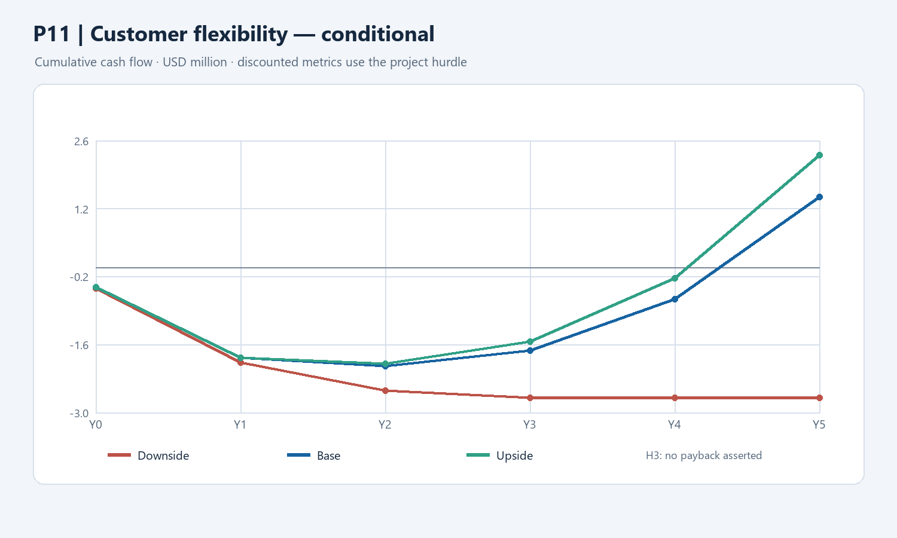

# P11 — Customer-side flexibility option

**Decision at a glance:** test a customer-flexibility service using existing market capabilities and a staged learning investment. The conditional commercial case assumes **$1.5m** one-time investment, **$3.75m/year** retained contribution at 250 MW and an **11%** hurdle. If its assumptions hold, five-year NPV is **+$0.328m** and IRR **16.1%**. This H3 case uses learning gates; no payback or unmodelled post-Y5 value is claimed.

**Status:** Rebuilt conditional case, 10 November 2026. The opportunity is an option to test, not an established new market, a guaranteed revenue stream or a funded rollout. The capacity, margin, costs and customer behavior below are scenario assumptions, not TotalEnergies figures. Active scenarios: `../finance/portfolio_model_14_revised.xlsx`.

## 1. Proposal and existing capability

**Proposal [Hypothesis]:** Test a customer-side flexibility service that enrolls eligible commercial loads, batteries or EV charging and offers dispatchable flexibility through existing market capabilities. This is a staged learning investment. First determine which countries, assets, customer segments and services are genuinely incremental to TotalEnergies' current portfolio.

**Existing capability [Fact]:** Quadra Energy's 2023 acquisition announcement describes a 9 GW virtual power plant aggregating renewable production (SRC-036, CLM-076); Integrated Power also has trading and forecasting capability (CLM-027). These facts do not establish whether the specific customer-side service proposed here already exists. A product and contract inventory is a precondition: do not propose a duplicate service or recreate an existing trading platform.

## 2. Alternatives, classification and design

| Option | Assessment |
| --- | --- |
| Use current Quadra and existing flexibility offers | Counterfactual; determine what they already cover in the chosen country and asset class. |
| Partner with an existing aggregator | Compare customer economics, acquisition costs, market access and sharing of margins. |
| Extend existing platforms with customer-side assets | Working option: partner/buy asset connectivity, use existing trading and build only the missing integration and customer workflow. |

**H3 [Provisional judgment]:** Customer-owned assets could create a different service and revenue-sharing relationship. If the selected offer is only an extension of an existing TotalEnergies business model, H2 may be more appropriate. Classification is not proven by project duration or a label.

The programme tests enrollment, asset availability, cyber controls and dispatch performance; human oversight and network-security rules apply. Before customer activation, obtain explicit consent, control rights, data access, market eligibility and approved contractual terms. The existing portfolio is the baseline.

## 3. Conditional commercial illustration

**Assumptions, not facts:** Eligible enrolled/dispatchable capacity is 0, 25, 75, 150 and 250 MW in Y1–Y5; all MW are assumed to meet contractual availability conditions. Annual retained contribution is **$15,000 per MW** after customer payments but **before project operating costs and tax**. This cannot automatically be treated as a market price or extrapolated across products, geographies or assets. It requires contracts, settlement data, customer economics and proof that revenues do not overlap with existing activities.

At 250 MW, `250 MW × $15,000/MW/year = $3.75m/year` **[Calculation on assumptions]**. The small pilot's trial economics must be measured separately; the assumption that 250 MW can be acquired and kept available within five years is especially uncertain.

## 4. Cost, tax and staged timeline

Amounts are **$m nominal**. A hypothetical initial project investment of **$1.5m** includes $0.8m eligible software/integration capital ($0.4m Y0 and $0.4m Y1) and $0.7m initial implementation/contracting expense in Y1. Spending classification is an accounting assumption, not an approved budget or vendor quote. Recurring acquisition, platform, cyber and market operations cost is assumed at $0.35m, $0.55m, $0.75m, $0.90m and $1.00m in Y1–Y5. Procurement, credit/collateral needs, customer recruitment, service levels and non-cancellable commitments require validation.

Tax illustration uses 25% of positive operating surplus after straight-line depreciation of the $0.8m over five years from Y1; no immediate credit for losses. Jurisdictional taxes, working capital and contract accounting are unknown. Costs in a funded pilot are counted in the programme regardless of whether future commercial receipts materialise.

**Indicative sequence:** Y0–Y1 map existing offers and customers, contract a limited pilot and prepare controls; Y2 learn from a 25 MW trial; Y3–Y5 consider additional releases only if customer, dispatch and financial thresholds are met. Each MW and date is an assumption to test, not an approved rollout.

## 5. Conditional annual cash-flow illustration

**Conditional portfolio base, not committed revenue.** $m; Y0 late 2026 and Y1–Y5 subsequent annual model periods. The flows below assume every gate succeeds and the hypothetical capacity and margin materialise.

| $m | Y0 | Y1 | Y2 | Y3 | Y4 | Y5 |
| --- | ---: | ---: | ---: | ---: | ---: | ---: |
| Retained contribution before project OPEX | 0 | 0 | 0.3750 | 1.1250 | 2.2500 | 3.7500 |
| Recurring OPEX | 0 | -0.3500 | -0.5500 | -0.7500 | -0.9000 | -1.0000 |
| One-time implementation | 0 | -0.7000 | 0 | 0 | 0 | 0 |
| CAPEX | -0.4000 | -0.4000 | 0 | 0 | 0 | 0 |
| Cash tax | 0 | 0 | 0 | -0.05375 | -0.2975 | -0.6475 |
| **Net cash** | **-0.4000** | **-1.4500** | **-0.1750** | **0.32125** | **1.0525** | **2.1025** |
| **Cumulative cash** | **-0.4000** | **-1.8500** | **-2.0250** | **-1.70375** | **-0.65125** | **1.45125** |

Under these conditional assumptions, NPV at the **11% P11 illustrative hurdle** is **+$0.328m** and IRR **16.1%**. They describe one successful commercial scenario, not verified option value or the value of the initial learning tranche. No H3 payback is claimed. The programme base must retain approved pilot spending even if commercial receipts are excluded.

## 6. Scenarios and learning gates

The base is conditional on the commercial capacity and retained margin described above. The downside stops after Y2, retains all Y0–Y2 spending, assumes 5% higher costs and includes an additional **$0.15m exit cost in Y3**; all later avoidable operating costs and commercial income stop. The exit allowance and cancellation terms require validation. Upside assumes benefits 15% higher than the conditional base, with base costs. No outcome is guaranteed.

| Scenario | NPV at project hurdle | IRR | Simple payback (years) |
| --- | ---: | ---: | ---: |
| Downside | $-2.370m | n/a | n/a |
| Base | $+0.328m | 16.1% | n/a |
| Upside | $+0.883m | 24.0% | n/a |

For H3, IRR is shown only for the conditional illustration and no payback is claimed. The separate severe stress assumes no P11 commercial receipts and continued spending, providing a materially harsher case than the staged downside. The base portfolio includes P11 conditional income; it is not a company forecast.

| Gate | Owner | Continue only after |
| --- | --- | --- |
| Existing capability | Power owner and Quadra | Document product, geography and contract incrementality; stop duplication. |
| Controlled trial | Venture owner, customers, operator and security | Demonstrate consent, eligibility, dispatch, customer acquisition cost, settlements and cybersecurity. |
| Commercial release | Sponsor and finance | Validate prospective margin and next-stage cash flows against the 11% hurdle and approve incremental exposure. |
| Stop | Sponsor and finance | Recognise sunk costs and contracted exit fees; cancel only costs that are avoidable. |

Capacity, commercial margin, hurdle clearance and exit costs are assumptions requiring evidence; do not advance automatically.

**Illustrative financial threshold [Calculation]:** keeping the base costs, timing and proportional capacity ramp unchanged, the full five-year illustration reaches zero NPV at 11% at roughly **$3.418m retained annual contribution at full scale**, equivalent to about **228 MW** at $15,000/MW/year. This is not evidence that either MW or margin is achievable. At each actual gate, recalculate the remaining prospective economics excluding sunk costs; validate non-cancellable commitments and compare against the partner alternative.

## 7. Sources and limits

- SRC-036 / CLM-076: 2023 Quadra VPP announcement; scope was renewable generation aggregation, not proof that the proposed customer offer does or does not exist.
- CLM-027: existing Integrated Power forecasting and trading capabilities.
- `../finance/discount_rate_policy.md`: P11 11% assumed project hurdle; conditional H3 metrics are not guaranteed.
- `../finance/industrial_case_models.py`: illustrative calculations. Primary market rates, customer economics, implementation quotes, actual taxes and existing contract coverage remain to be verified. No H3 payback is asserted.
