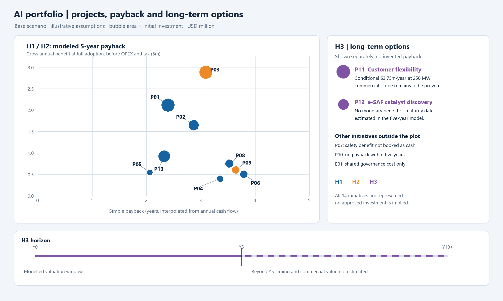
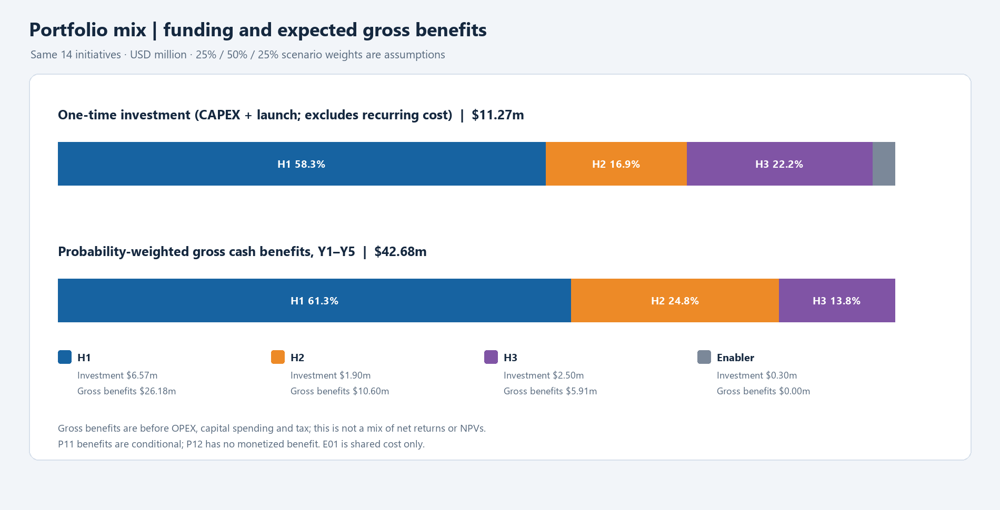
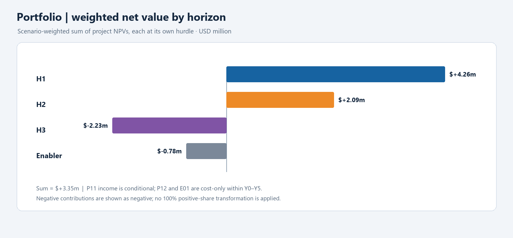
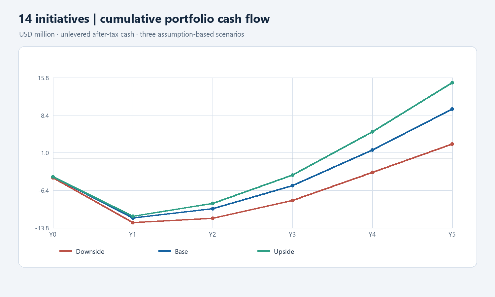

# Portfolio visuals: method and reconciliation

**Scope:** P01–P13 plus E01, the four focus cases and nine simplified project estimates. The financial assumptions are fixed in `../finance/portfolio_model_14_revised.xlsx`; visual generation does not change the workbook. All amounts are nominal USD million except the P13 individual J-curve, which is in EUR. Exchange rate is the workbook's editable 1.1165 USD/EUR assumption. Quantities, effects and scenario weights are business-case assumptions, not TotalEnergies actuals.

## Bubble map and H3 timeline

For H1/H2, the **x-axis** is simple payback interpolated from the base annual net cash schedule, the **y-axis** is gross annual benefit at full adoption before recurring OPEX and tax, and **bubble area** is proportional to one-time CAPEX plus launch expense. It is not proportional to radius. P07's safety benefit is not booked as hard cash and P10 has no payback within the modelled five years. E01 is a cost-only enabler. Their absence from the payback coordinates does not remove their costs from the portfolio.

P11 and P12 are displayed as purple option bubbles in a **qualitative H3 panel**, with areas on the same investment scale; their horizontal panel positions are not payback dates. P11's $3.75m/year is the assumed conditional contribution at 250 MW before project OPEX and tax. P12 has no monetised benefit. The timeline deliberately continues beyond Y5: neither a commercial maturity date nor post-Y5 value is estimated. It is incorrect to infer that H3 investments end after five years or to give P12 an invented payback.

## Mix: different economic measures, separate charts

The first bar allocates **$11.2665m initial investment** (Y0/Y1 capital expenditure and Y1 launch expense, excluding later recurring OPEX) to H1 **58.3%**, H2 **16.9%**, H3 **22.2%** and shared E01 **2.7%**. Shares use unrounded amounts and total 100% before display rounding. These are modelled allocations, not approved spending.

The second bar uses **scenario-weighted gross benefits over Y1–Y5**, before capital spending, OPEX and tax: H1 **$26.176m / 61.3%**, H2 **$10.601m / 24.8%**, H3 **$5.906m / 13.8%**, E01 **$0**. The total is **$42.683m**, using the model's explicit 25% / 50% / 25% downside/base/upside weights. P11's benefit is conditional, P12 is unmonetised and H3's possible post-Y5 benefits are excluded. These are gross benefit shares, not ROI, net cash, NPV, a guaranteed return mix or a 10/20/70 target. The separate severe stress is not included in the weighting.

The separate net-value chart weights each scenario's **project NPVs at their respective hurdles** and then sums by horizon: H1 **+$4.257m**, H2 **+$2.094m**, H3 **−$2.226m**, E01 **−$0.780m**. Total **+$3.345m** agrees with the weighted project-NPV sum in the workbook. H3's negative five-year contribution includes the cost-only P12 option and the staged downside; it does not value possible post-Y5 outcomes. Negative values are preserved rather than transformed into positive percentages. The risk of double counting between scenario weights and hurdle premiums requires review before interpreting this as a formal economic expected NPV.

## Cash-flow curves and reproducibility

The portfolio and four focus-case J-curves show cumulative **undiscounted** net cash for Y0–Y5; taxes, operating costs and capital expenditure are included in the underlying flows. The H3 conditional success case is not a guaranteed revenue path. The [four detailed cases](case_rebuild_decisions.md) link their own images and list yearly flows, hurdles and continuation criteria.

To refresh the PNGs, recalculate and save the workbook, then run `python work/projects/generate_portfolio_visuals.py` in an environment with Pillow and openpyxl. The generator reads cached workbook values, writes no spreadsheet data, verifies project coverage, probability weights and the weighted NPV bridge, and saves the data used in `assets/visuals_data.json`. A workbook edited without recalculating its formulas must not be used to regenerate charts. Review the visual output after refresh.
