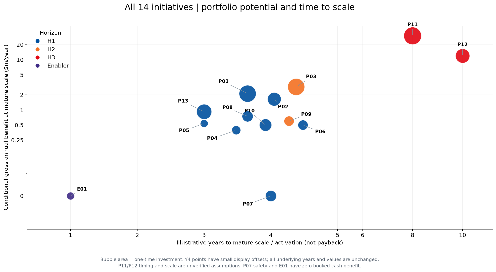
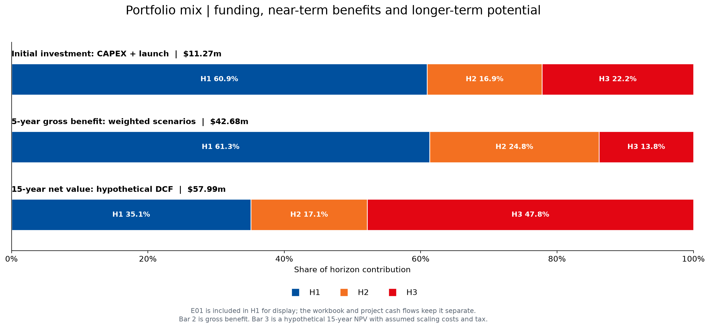
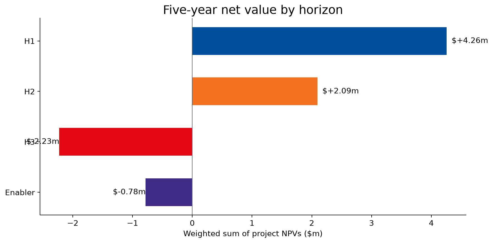
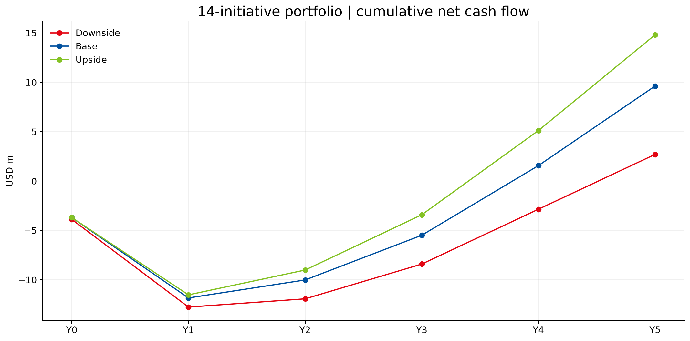

# Portfolio charts — method and assumptions

The [portfolio notebook](portfolio_charts.ipynb) generates all current figures with Matplotlib. It reads the cached, recalculated `../finance/portfolio_model_14_revised.xlsx` and never changes it. The four focus cases, 14-initiative five-year cash flows, hurdles and scenario weights remain unchanged. The chart palette reuses the colour values from the former project SVG. The course's 10/20/70 illustration is an approximate external reference, not an observed split for this portfolio.

## One bubble chart, 14 initiatives

All 14 initiatives use the same axes: **x** is indicative time to mature operating scale or activation, **not payback**; **y** is conditional gross annual benefit at that scale, before project OPEX and tax. Bubble **area** represents initial CAPEX plus launch expense, and colour represents horizon. H1/H2 scale timing comes from the five-year model's adoption ramps; E01 is shown at Y1 with zero booked benefit. P07 is shown with zero cash benefit because its safety benefit is not booked as hard cash. Identical coordinates can overlap.

P11 and P12 appear on the same chart using separate, unverified long-term scenario assumptions: P11 reaches an assumed 2,000 MW at Y8 with retained contribution of $15,000/MW/year before project OPEX; P12 reaches an assumed $12m/year gross contribution in Y10. Neither amount, timing nor commercial outcome is a validated TotalEnergies forecast. P11's Y0–Y5 financial case remains the separate 250 MW illustration; P12 has no monetised benefit in that model. No H3 payback is inferred.

## Three different mixes

1. **Initial investment:** $11.2665m allocated to H1 58.3%, H2 16.9%, H3 22.2% and E01 2.7%; CAPEX plus launch, excluding recurring OPEX.
2. **Five-year gross benefit:** $42.683m weighted using the workbook's subjective 25% / 50% / 25% downside/base/upside assumptions: H1 61.3%, H2 24.8%, H3 13.8%. This is before costs and tax, not NPV.
3. **Illustrative 15-year net value:** **+$57.987m**, consisting of H1 **+$21.721m**, H2 **+$9.903m**, H3 **+$27.727m** and E01 **−$1.364m**. On the bar, the positive contributions alone sum to 100%: H1 **36.6%**, H2 **16.7%** and H3 **46.7%**; E01's negative value is shown separately. This is a separate hypothetical scenario, not the approved five-year NPV.

The third bar adds **Y6–Y15 net cash discounted at each project's own hurdle** to the workbook's weighted Y0–Y5 project NPVs. Its H3 scenario assumes P11 has 60% conditional post-Y5 continuation, $4m expansion CAPEX in Y7 and $5m/year total OPEX at scale; P12 has 30% continuation, $6m expansion CAPEX in Y8 and $4m/year OPEX at scale. Post-Y5 tax is an assumed 25% on positive operating profit; depreciation of the new capital, tax-loss carryforwards, working capital and terminal value are omitted. Expansion costs are incurred only on the assumed continuation path. H1/H2 and E01 repeat base Y5 net cash for ten years with no benefit decay or replacement investment. The H3 amounts, timing, probabilities and costs are speculative, editable notebook inputs, not sourced facts. H3 leads under these assumptions, which do not establish that it will actually do so or justify the course's illustrative 70% ratio. The initial weighted scenarios and subsequent continuation probabilities may overlap with risk already reflected in hurdle premiums, so do not treat the result as decision-grade without a risk and evidence review.

For net value, the separate chart keeps negative contributions and uses the **sum of five-year project NPVs at their own hurdle rates**, weighted by the workbook scenarios: H1 +$4.257m, H2 +$2.094m, H3 −$2.226m and E01 −$0.780m, totalling +$3.345m. H3's negative five-year result does not value possible post-Y5 benefits. The risk of charging the same uncertainty both in the scenarios and the hurdle premiums needs review before treating this as a formal economic expected NPV.

## Curves and regeneration

The [four detailed case cards](case_rebuild_decisions.md) link their own scenario J-curves. These and the portfolio curve display five-year cumulative **undiscounted net cash**, including modelled costs and tax. The 15-year illustration does not alter them.

Install dependencies with `pip install -r work/projects/requirements-notebook.txt`, recalculate and save the workbook, then run all cells of `portfolio_charts.ipynb`. Matplotlib produces PNG and editable SVG versions; `assets/notebook_chart_data.json` records inputs and annual schedules, and `assets/notebook_longterm_cashflows.csv` presents the Y6–Y15 net cash bridge and 15-year NPV by project for review in Excel. The notebook only reads cached spreadsheet values: re-save the workbook after recalculation before refreshing. The separate long-term calculations are currently in the notebook and CSV, not Excel formulas. Review all unverified long-term assumptions before using the third bar in the report, memo or slides.
